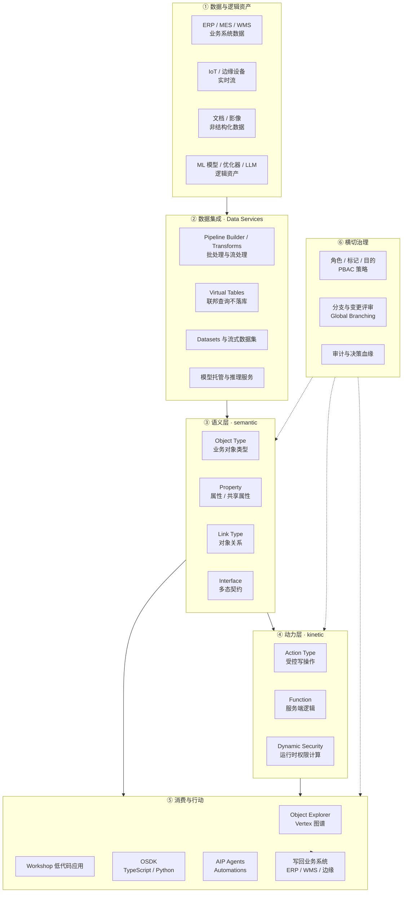
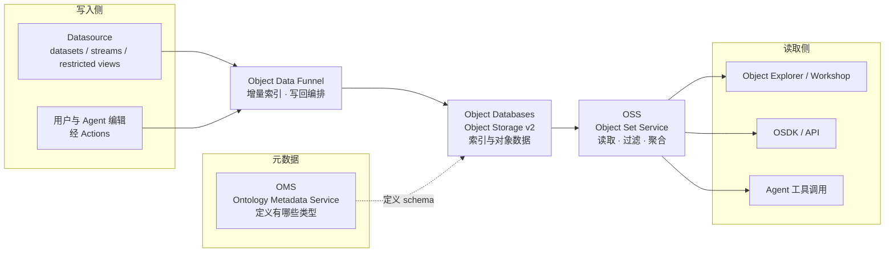
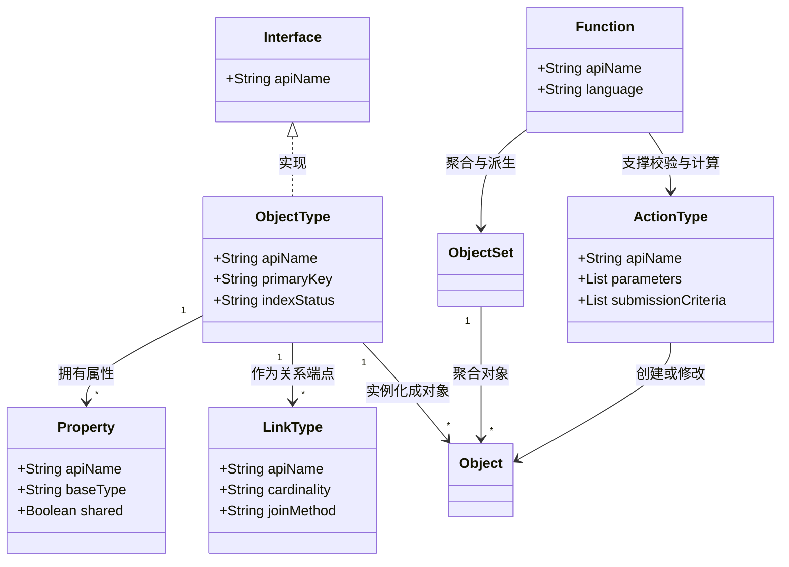
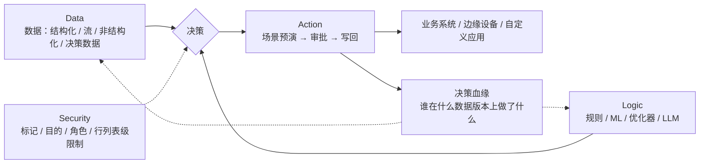

---
tags:
  - Palantir
  - Ontology
  - Foundry
created: 2026-11-07
updated: 2026-11-07
source:
  - https://www.palantir.com/docs/foundry/ontology/overview/
  - https://www.palantir.com/docs/foundry/object-backend/overview/
  - https://www.palantir.com/docs/foundry/architecture-center/overview/
  - https://www.palantir.com/docs/foundry/ontology-manager/overview/
status: 初稿
---

# Palantir Ontology 架构图与界面截图

> [!summary] 一句话
> Ontology 是 Palantir 的**决策层**，而不是又一个数据目录：下面接数据与模型，中间是名词（对象 / 属性 / 关系）加动词（动作 / 函数），上面接应用、Agent 和业务系统，安全治理贯穿每一层。

这篇是「看图版」：先用三张图把架构讲清楚，再用官方文档里的界面截图说明这些概念在软件里长什么样。概念细节看 [[Palantir Ontology 核心概念]]，资源建模看 [[Ontology 资源模型]]。

---

## 一、分层总架构

| 层 | 回答的问题 | 关键组件 | 在软件里的位置 |
|---|---|---|---|
| ① 数据与逻辑 | 事实从哪里来 | 连接器、流、外部模型 | Data Connection、Pipeline Builder |
| ② 数据集成 | 怎么变成可信数据 | 数据集、虚拟表、流水线 | Pipeline Builder、Datasets |
| ③ 语义层 | 世界由什么构成 | Object / Property / Link / Interface | Ontology Manager |
| ④ 动力层 | 世界如何被改变 | Action / Function / 动态安全 | Ontology Manager 的类型页 |
| ⑤ 消费层 | 人怎么用、Agent 怎么调 | Object Explorer、Workshop、OSDK、AIP | 各应用 + API |
| ⑥ 治理层 | 谁能看、谁能改、改了什么 | 角色、标记、分支、血缘 | Control Panel、Ontology Manager |

> [!note] 和教科书本体的区别
> 传统本体（OWL/RDF）只回答「是什么」；Palantir 的 Ontology 把**动作**和**权限**也做成一等资源，所以它能承载「决策」，而不只是「描述」。这就是官方那句 *data、logic、action、security* 四要素合一的由来。

---

## 二、后端：Ontology 是跑在哪些服务上的

Ontology 本身不是数据库，而是**一组微服务**。官方把职责拆成三块：数据源与 schema 管理、对象查询聚合、写入编排。

五个关键服务：

- **OMS（Ontology Metadata Service）**：定义「存在哪些本体实体」——对象类型、链接类型、动作类型的元数据，是所有其他服务的 schema 源头。
- **Object Data Funnel**：写入口。从数据集、受限视图、流式数据源以及用户编辑读数据，做**增量索引**写进对象数据库，并保持与上游数据同步。
- **Object Databases**：对象数据的实际存储与索引层。v1 是 Phonograph，v2 是新一代规范存储，两者职责被刻意分开——索引与查询解耦，才能横向扩容。
- **OSS（Object Set Service）**：读出口。给应用和外部系统提供搜索、过滤、聚合、加载对象的能力，对象集（object set）就是这里的核心概念。
- **Actions**：编辑事务层。把用户编辑结构化地落到对象数据库，同时负责权限、条件、以及历史 action log。

> [!important] 几个硬指标
> - 单个对象类型最多 **2000 个属性**；单个对象类型索引可到**数百亿对象**量级。
> - 一次 Action 最多编辑 **1 万条对象**（更高需 Palantir 支持开白）。
> - Search Around 默认上限 **10 万对象**。
> - Object Storage v1（Phonograph）**计划弃用**，官方给的截止时间是 2026-06-30，之后只剩 v2。
> - 整个 AIP + Foundry 由 **300+ 微服务**组成，跑在 Apollo 管理的零信任底座上。

---

## 三、对象模型：一张图看清类型之间的关系

三条建模经验（官方 best practices 的转述）：

1. **对象类型跟着业务语言走，不跟着表走**。一个对象类型应该对应业务人员嘴里会说的名词（航班、工单、设备），不是一张宽表。
2. **关系优先用外键，复杂关系用 object-backed link**。见 [[关系建模：Link、关系对象与 Object-backed Link]]。
3. **接口用于跨类型统一动作**。当「审批」「告警升级」这类动作要同时作用于多个对象类型时，用 Interface 收口，避免为每个类型复制一份 Action。

---

## 四、决策四要素与闭环

官方反复强调 Ontology 不是数据目录，而是**决策的载体**。每个决策拆成四块：

四个要素的落地方式：

- **Data**：不只是接入 ERP/MES，还包括用户和 Agent 在决策过程中产生的「决策数据」（选项、依据、结果），并自动记录 end-to-end decision lineage。
- **Logic**：业务规则、ML 模型、优化器、LLM 都用统一的「logic binding」接进来，对人和 Agent 暴露成同一套工具。
- **Action**：动作先落 **scenario**（沙箱化的本体子集）预演，再按 submission criteria 校验、按权限审批、最后批量写回不同系统（API / 连接器 / 平面文件）。
- **Security**：策略在**每次交互时运行时计算**，融合底层数据集的行列级限制、用户组属性（含 SSO 带来的）、以及跨流水线传播的安全标记。Agent 的工具调用同样受这套策略约束。

> [!warning] 这一点最容易被低估
> 「AI 能做什么」在 Palantir 里不是靠提示词约束，而是靠**动作本身的权限边界**。Agent 默认只能把动作**暂存待审**，能不能闭环由人来逐步放权——这是它敢让 Agent 写生产系统的原因。

---

## 五、界面截图巡览

以下截图来自 Palantir 官方公开文档（非客户环境），展示的是 Ontology 相关软件的真实界面形态。

### 5.1 Ontology Manager：本体资产的「管理台」

![[附件/Palantir-Ontology/palantir-ontology-manager-overview.png]]

*图 1-1 Ontology Manager 首页：左侧是本体资源目录，右侧是对象类型卡片*

值得注意的细节：

- 左侧统计直接告诉你这套本体的体量：Object types **3,312**、Shared properties **344**、Link types **4,555**、Action types **7,665**、Functions **5,423**。这就是「企业级本体」和「画几张 ER 图」的差距。
- 每个对象类型卡片上标了**实例数和依赖数**（如 `9 dependents`），一眼能看出改这个类型会波及多少下游。
- 卡片右下角带业务域色块（CRM / Marketing / Operations / Equipment），说明本体是**按业务域分组治理**的。

![[附件/Palantir-Ontology/palantir-ontology-manager-discover.png]]

*图 1-2 Discover 视图：对象类型按「最近查看 / 收藏 / 常用类型组」组织*

本体规模一大，找资源就成了主要工作。Discover 视图把「最近看过」「收藏」「类型组」三块前置，右上角还有一键跳到 List / Graph 视图的入口。

### 5.2 对象类型：语义层的编辑界面

![[附件/Palantir-Ontology/palantir-object-type-view.png]]

*图 2-1 对象类型详情页：以 Aircraft 为例*

这一页把「一个对象类型到底是什么」摊开了：

- 顶部是**主键**与实例数（`4,464 objects`），右侧是状态机式的元数据：Status、Visibility、Index status、Edits 是否启用。
- 中间是**属性列表**，`Tail Number` 被标记为 `Primary key`，`Display Name` 被标记为 `Title`——即「给人看的标题」和「给系统用的主键」是分开的。
- 右侧是**引用了本类型的 Action**（`Edit aircraft details`），说明类型与动作是双向可查的。
- 左侧页签暴露了完整的资源维度：Properties、Security、Datasources、Capabilities、Object views、Interfaces、Automations、Usage。

![[附件/Palantir-Ontology/palantir-property-editor.png]]

*图 2-2 属性编辑器：属性不只是名字和类型*

属性上可以挂**值格式、条件格式、渲染提示（render hints）、必填约束、仅可编辑（edit-only）**等元数据。这正是它比「数据库列」多出来的部分：属性自带展示语义与校验语义。

### 5.3 链接类型：三种建立关系的方式

![[附件/Palantir-Ontology/palantir-link-type-view.png]]

*图 2-3 链接类型详情页：Aircraft 与 Airline 的 many-to-one 关系*

界面上最值得注意的是 **Join method** 三选一：

| Join method | 含义 | 适用场景 |
|---|---|---|
| **Foreign key** | 用两端对象上的属性做等值连接 | 关系在数据里本来就存在（最常见） |
| **Dataset** | 通过一张中间数据集定义关系 | 关系需要 ETL 计算出来 |
| **Object type** | 关系本身也是一种对象（object-backed link） | 关系要带属性、要被权限和动作管理 |

底部就是外键的映射：`Carrier Code` → `Code（Primary key）`，并且显示成可视化连线而不是一行 SQL。

![[附件/Palantir-Ontology/palantir-create-link-type.png]]

*图 2-4 新建链接类型：先选关系类型，再选两端资源*

### 5.4 动作类型与函数：动力层

![[附件/Palantir-Ontology/palantir-action-type-view.png]]

*图 3-1 动作类型详情页：`Escalate Patient Care`*

这是整组截图里信息量最大的一张：

- **Input**：`Patient`（对象参数）、`Care Recommendation`（关联对象）、`Escalation Reason`（文本参数）——动作的参数是**混着对象和标量的**。
- **Rules**：`Modify [O1Y1] Patient` 上挂着 `Requires AI Review`，`Create [O1Y1] Alert` 列出可设置的具体字段（`Severity, Updated At, Alert ID, Resolution Status, Acknowledged`）。AI 写操作要过人工复核，就是在这里配的。
- 左侧页签：Rules、Parameters、User Interface、Capabilities、**Security & Submission Criteria**、Automations、History、**Observability**。
- 底部 **Dependents**：这个动作被哪个 Automation、哪个 Workshop 应用引用，一目了然。

![[附件/Palantir-Ontology/palantir-function-type-view.png]]

*图 3-2 函数详情页：服务端逻辑也是本体资源*

函数和动作分开管理，是因为它们的**权限模型不同**：函数是可复用的计算（读多写少），动作是受控的写操作（带提交条件、审批、审计）。函数可以被动作调用，也可以被应用直接调用。

### 5.5 消费端：Object Explorer 与 Vertex

![[附件/Palantir-Ontology/palantir-object-explorer-home.png]]

*图 4-1 Object Explorer 首页：以对象类型组为导航维度*

注意左侧的**对象类型组**：`AIT`、`Card Fraud Intelligence`、`Census: Entity Resolution`、`Claim 360`、`Cyber Threat Intelligence`、`FDA`…… 这些都是 Palantir 官方的示例本体域。业务人员进系统不是先看表，而是先选「我在哪个业务域里找东西」。

![[附件/Palantir-Ontology/palantir-object-type-group-graph.png]]

*图 4-2 对象类型组图谱：Aviation 示例的类型网络*

这张图把「本体」直观化了：节点是对象类型（Airline、Flight、Airport、Aircraft、Route、Delay、Flight Alert…），边是链接类型并标注基数（`1`、`*`）。它本质上是 **ER 图 + 基数 + 业务命名**，但可以交互下钻到真实对象。

![[附件/Palantir-Ontology/palantir-vertex-system-graph.jpg]]

*图 4-3 Vertex 图谱探索：从类型网络下钻到具体对象与关系*

Object Explorer 看「一张表/一组对象」，Vertex 看「关系网络」——供应链追溯、欺诈团伙识别这类问题，看的就是这张图。

### 5.6 建模过程：从数据到对象

![[附件/Palantir-Ontology/palantir-create-object-type-datasource.png]]

*图 5-1 新建对象类型第一步：选择数据源*

![[附件/Palantir-Ontology/palantir-create-object-type-properties.png]]

*图 5-2 新建对象类型：把数据列映射成属性*

这两张图说明了 Ontology 与数据资产的绑定关系：**对象类型必须有 backing datasource**，属性是数据列加语义元数据（主键、标题、显示格式）的投影。这也是为什么「本体不能脱离数据独立存在」——它是长在数据集之上的。

![[附件/Palantir-Ontology/palantir-aviation-ontology.png]]

*图 5-3 官方文档里的本体概念示意：航空域的对象、属性与关系*

---

## 六、从截图能读出的几个设计取舍

1. **类型是一等公民，应用是二等公民**。Ontology Manager 里每个类型都显示 dependents（被多少下游引用），改类型有分支和评审流程；应用只是类型的消费者。这决定了它能做「平台」而不是「一堆看板」。
2. **写操作被单独抽出来做资源**。Action type 有自己的参数、提交条件、权限、UI 配置、可观测性页签。绝大多数数据平台把「写」当成 API 的一个方法，Palantir 把它变成了可治理的资产。
3. **语义元数据比数据本身更重**。属性上能挂格式、约束、渲染提示、别名；对象类型带标题属性和主键属性；这些都不是数据库 schema 的范畴，而是「给人和 Agent 读」的范畴。
4. **导航维度是业务域，不是库表**。Object Explorer 首页按 object type group 组织，Onyx 这类客户案例里也是按供应链/仓储/生产分域——用户不需要知道底层是哪张表。
5. **AI 的权限边界落在动作上**。`Requires AI Review` 这种配置直接长在 Action 上，意味着「Agent 能做什么」是可审计、可逐条放权的，而不是靠提示词祈祷。
6. **规模是公开的工程约束**。2000 属性上限、万级批量编辑、十万级 Search Around、数百亿对象索引——这些数字反向解释了为什么后端要拆成 OMS / Funnel / OSS / Actions 这么多服务。

---

## 七、和站内笔记的对应关系

- 概念与定位：[[Palantir Ontology 核心概念]]、[[Palantir Ontology 资料索引]]
- 类型与关系建模：[[Ontology 资源模型]]、[[关系建模：Link、关系对象与 Object-backed Link]]
- 动作与函数：[[Actions、Functions 与写回机制]]
- 权限与治理：[[安全治理与权限]]、[[OpenFGA 与 PBAC 权限模型对比]]
- 应用与 SDK：[[OSDK 与应用开发]]
- 全景与清单：[[Palantir Ontology 能力全景]]、[[Ontology 能力核对清单]]
- 流处理：[[Palantir 实时数据分析与点位流处理]]

---

## 参考资料

- [Ontology building — Overview](https://www.palantir.com/docs/foundry/ontology/overview/)
- [Ontology — Core concepts](https://www.palantir.com/docs/foundry/ontology/core-concepts/)
- [Why create an Ontology?](https://www.palantir.com/docs/foundry/ontology/why-ontology/)
- [Ontology architecture（后端服务）](https://www.palantir.com/docs/foundry/object-backend/overview/)
- [Architecture center — Overview](https://www.palantir.com/docs/foundry/architecture-center/overview/)
- [Ontology Manager — Overview](https://www.palantir.com/docs/foundry/ontology-manager/overview/)
- [Object Explorer — Getting started](https://www.palantir.com/docs/foundry/object-explorer/getting-started/)
- [Link types — Overview](https://www.palantir.com/docs/foundry/object-link-types/link-types-overview)

> [!info] 图片说明
> 所有截图均来自 palantir.com 公开文档，版权归 Palantir Technologies 所有，此处仅作学习与研究引用；截图中的 `[Example Data]` 为官方示例数据，非真实客户数据。
