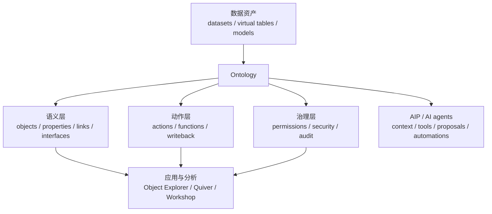

---
tags:
  - Palantir
  - Ontology
  - Foundry
  - AIP
created: 2026-06-05
updated: 2026-06-05
status: 整理中
source: Palantir 官方文档
---

# Palantir Ontology 资料索引

> [!summary]
> Palantir 的 Ontology 不是单纯的「本体论」或「知识图谱」，而是 Foundry/AIP 里的组织级操作层：把数据、模型、业务对象、关系、动作、函数、权限和应用开发连接到一起，让人和 AI 都能围绕真实业务对象做决策、执行动作和沉淀反馈。

## 快速入口

- [[Ontology/01-核心概念/Palantir Ontology 核心概念|01 Palantir Ontology 核心概念]]
- [[Ontology/02-资源模型/Ontology 资源模型|02 Ontology 资源模型]]
- [[Ontology/03-动作与函数/Actions、Functions 与写回机制|03 Actions、Functions 与写回机制]]
- [[Ontology/04-安全治理/安全治理与权限|04 安全治理与权限]]
- [[Ontology/05-应用开发/OSDK 与应用开发|05 OSDK 与应用开发]]
- [[Ontology/07-能力全景/Palantir Ontology 能力全景|07 Palantir Ontology 能力全景]]
- [[Ontology/07-能力全景/Ontology 能力核对清单|07 附：Ontology 能力核对清单]]
- [[基于 Hermes 的多用户 Ontology 分析系统评估]]
- [[Ontology 多用户 Agent 分析平台替代方案选型]]
- [[Palantir 实时数据分析与点位流处理]]
- [[点位流处理自研与第三方软件选型]]
- [[Ontology/90-阅读路线/Palantir Ontology 阅读路线|90 Palantir Ontology 阅读路线]]

## 目录结构

- `00-总览/`：资料入口、概念地图、官方链接。
- `01-核心概念/`：Ontology 的定位、定义、与 Foundry/AIP/Apollo 的关系。
- `02-资源模型/`：Object type、Link type、Interface、Shared property 等资源。
- `03-动作与函数/`：Actions、Functions、写回、Action log。
- `04-安全治理/`：Ontology 权限、对象权限、动态安全、AI agent 权限边界。
- `05-应用开发/`：OSDK、自定义应用、AIP 结合方式。
- `06-实时流处理/`：Streams、Streaming pipelines、Automate 与工业点位事件归并。
- `07-能力全景/`：按能力域拆解 Ontology 的全部能力，附可打分的核对清单。
- `90-阅读路线/`：学习路径、待补主题、后续整理计划。

## 一张图理解

## 核心判断

- Ontology 是 Palantir 平台的核心抽象，把底层数据资产映射为企业里的真实对象和业务关系。
- 它不只描述「有什么」，也描述「能做什么」：Actions 和 Functions 负责把决策变成可审计、受权限控制的变更。
- AIP 把 LLM、agent、自动化能力接到 Ontology 上，使 AI 可以在业务上下文、权限和审计框架内工作。
- OSDK 让开发者把 Foundry/Ontology 当作后端，从外部应用读取、查询和写回业务对象。
- 安全治理不是外挂，而是 Ontology 设计的一部分：资源权限、对象/链接权限、动态安全和审计共同决定谁能看、谁能改、怎么改。
- 能力远不止「对象 + 关系 + 动作」：从类型系统、索引查询、函数计算，到应用框架、AI 工具层、SDK 与变更治理，共十个能力域，逐项拆解见 [[Ontology/07-能力全景/Palantir Ontology 能力全景|07 Palantir Ontology 能力全景]]。

## 官方资料

- [Ontology building overview](https://www.palantir.com/docs/foundry/ontology/overview/)
- [Platform overview: The Ontology](https://www.palantir.com/docs/foundry/platform-overview/overview/)
- [Architecture center: AIP, Foundry, and Apollo](https://www.palantir.com/docs/foundry/architecture-center/platforms)
- [Ontologies overview](https://www.palantir.com/docs/foundry/ontologies/ontologies-overview)
- [Object types overview](https://www.palantir.com/docs/foundry/object-link-types/object-types-overview)
- [Link types overview](https://www.palantir.com/docs/foundry/object-link-types/link-types-overview)
- [Action types overview](https://www.palantir.com/docs/foundry/action-types/overview)
- [Functions overview](https://www.palantir.com/docs/foundry/functions/overview)
- [Object permissioning overview](https://www.palantir.com/docs/foundry/object-permissioning/overview)
- [Ontology SDK overview](https://www.palantir.com/docs/foundry/ontology-sdk/overview)
- [Streams](https://www.palantir.com/docs/foundry/data-integration/streams/)
- [Streaming resource guide](https://www.palantir.com/docs/foundry/data-integration/streaming-guide/)
- [Types of pipelines](https://www.palantir.com/docs/foundry/building-pipelines/pipeline-types/)
