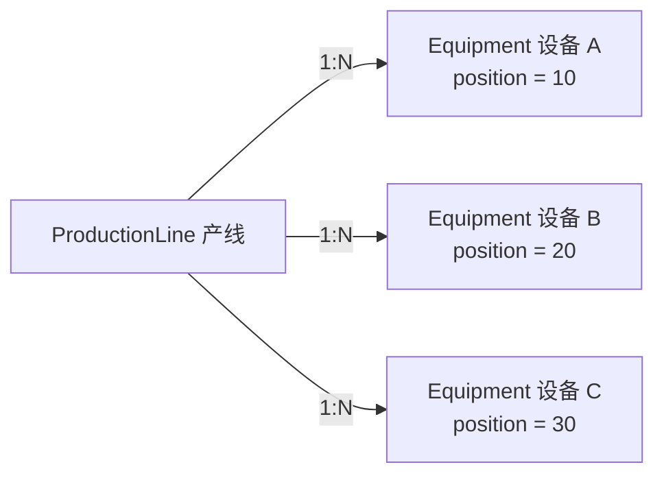
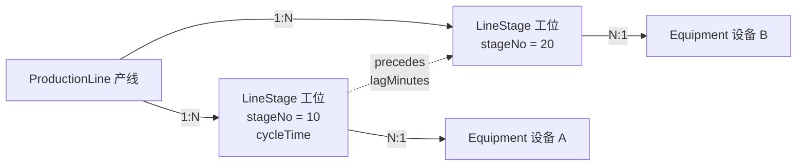
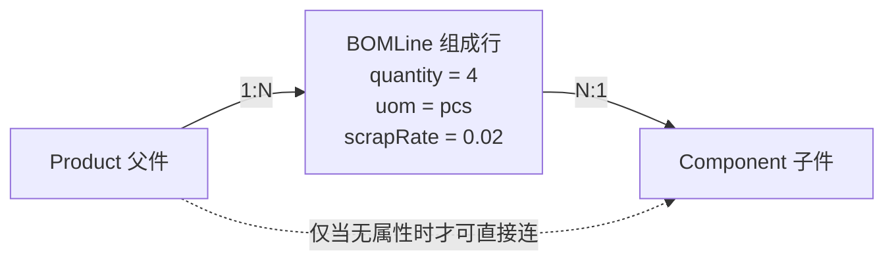

---
tags:
  - Palantir
  - Ontology
  - 数据建模
  - 关系建模
created: 2026-10-23
updated: 2026-10-23
status: 初稿
source:
  - https://www.palantir.com/docs/foundry/object-link-types/link-types-overview
  - https://www.palantir.com/docs/foundry/object-link-types/create-link-type
  - https://www.palantir.com/docs/foundry/object-link-types/link-type-metadata
  - https://www.palantir.com/docs/foundry/ontology/ontology-best-practices
---

# 关系建模：Link、关系对象与 Object-backed Link

> [!summary] 一句话
> Link 描述「谁和谁有关系」，本身只有元数据、不承载业务属性，也没有顺序；一旦关系本身有数据（数量、工序号、生效期、角色），就要把关系「提升为对象」。Palantir 现在有三种 link 背书方式，其中 object-backed link type 可以让你沿 link 直接看到关系对象的属性。

## 先纠正一个说法

「Link 没有属性」这句话容易被理解成「这种关系没法建模」。更准确的说法是：

- 普通 link 只有**元数据**（两侧显示名、API 名、基数），没有可写的业务属性。
- 关系上的数据必须落在**对象**上，而不是 link 上。
- 落法有三种：属性放端点对象、建关系对象、用 object-backed link type 让关系对象背书 link。

所以产线设备顺序、产品组成部件这类需求不仅能表达，而且是 Palantir 建模里的标准模式，只是图会比你直觉中的「一条边」多一个节点。

## Link 的三种背书方式

| 方式 | 数据源 | 能否带业务属性 | 典型基数 | 适用 |
|---|---|---|---|---|
| 外键背书（foreign key） | 某一端的对象属性值 = 另一端主键 | 不能，属性在对象上 | 1:1、N:1 | 订单→客户、设备→产线 |
| 关联表背书（join table） | 一张只含两端主键的关联数据集 | 不能，关联表里的其他列不暴露为 link 属性 | M:N | 标签、简单多对多 |
| 对象背书（object-backed） | 一个对象类型 + 两条指向它的 N:1 link | 能，属性就是背书对象的属性 | M:N（逻辑上） | BOM 行、工位、任职、合同 |

> [!note] 官方口径
> Link types 文档明确：多对多基数的 link type 由数据源背书；创建 link type 的文档里进一步提供 **Object-backed links**，说明它「为 link 存储提供对象类型的一等支持，允许在 link 上附加额外元数据，并支持 restricted views」。官方例子是 `Aircraft ↔ Flight` 由 `Flight Manifest` 对象背书，Manifest 上的 `Pilot`、`First Mate` 就是 link 的附加信息。

## 为什么默认不给 link 加属性

四个原因，都是平台设计的必然结果，不是偷懒：

1. **link 没有独立身份。** 它由两端主键或关联表推导出来，身份就是「这一对对象」。没有身份，就没有地方挂生命周期（创建、失效、删除）。
2. **link 的 schema 是双向的。** 一个 link type 有两侧，两侧都能遍历。而「工序号」「数量」这类属性只在某个方向上有意义，硬挂在双向 schema 上语义会拧。
3. **属性需要一整套对象级能力。** 写回要走 Action、权限要能按行过滤、变更有 edit history、还要能被别的对象引用。这些能力在 Palantir 里都是对象级的，link 级等于要再造一套边存储、边权限、边审计。
4. **平台的答案是「具体化」（reify），不是「给边加列」。** 把关系建成对象后，它自动获得动作、权限、审计、派生属性、接口、评论、对象视图——不需要为边单独造一套。

> [!tip] 一句话判断
> 问自己：这个字段是「某个对象的属性」，还是「两个对象在一起才成立的属性」？后者就必须有承载它的对象。

## 什么时候 Link 就够了

- 关系上没有任何数据；
- 关系上的数据只依赖一端，且这一端在关系中唯一。

典型例子：

- `Order → Customer`：订单只属于一个客户，订单金额在 Order 上，link 不需要属性。
- `Equipment → ProductionLine`：设备只属于一条产线，设备在产线上的位置可以放在 Equipment 的 `position` 属性上。
- `Employee → Department`：一个员工只属于一个部门，工位、职级放 Employee。

这类场景加关系对象只会让图变复杂，收益为零。

## 什么时候必须用关系对象

满足任意两条，基本就该建关系对象：

- 数据依赖**两端组合**（同一部件装在不同产品上用量不同）；
- **多对多**，且关系需要独立维护；
- 关系有**生效期/失效期**，需要时间版本；
- 关系需要独立的**审批、状态、负责人**；
- 关系需要被**其他对象引用**（例如质量记录引用某条 BOM 行）；
- 需要**排序**，而顺序会随业务调整（link 本身无序，顺序只能来自属性）；
- 关系两侧需要**不同的权限**（谁能看某条供应关系）。

## 案例 A：产线设备的先后顺序

顺序有两种含义，建模方式不同：

- **物理布局顺序**：设备在产线上的位置（工位 10、20、30）。
- **工艺依赖顺序**：工序 A 完成后才能做 B，可能是 DAG，边上还带节拍、传输时间。

### 方案 1：属性放在设备上（最简单）

适用：设备只属于一条产线，位置固定，不需要保留历史。

- `Equipment` 增加 `position` 或 `stationNo`。
- 查询时按 `position` 排序即可。
- 代价：设备换线、产线重排、同一设备出现在多条产线时就不够用了。

### 方案 2：工位对象（推荐，最通用）

适用：设备会在多条产线复用、顺序会调整、每个工位还有自己的节拍和工艺参数。

- 新对象 `LineStage`：`lineId`、`stageNo`、`equipmentId`、`cycleTime`、`effectiveFrom/To`。
- 两条 link：`LineStage → ProductionLine`、`LineStage → Equipment`。
- 遍历变成「产线 → 工位 → 设备」两跳，但换来：设备可复用、顺序可调、工位可带数据、可按时间版本保留历史。
- 如果先后关系是 DAG（一个工位有多个前驱/后继），再加关系对象 `StageDependency`：`fromStage`、`toStage`、`lagMinutes`、`transportTime`，而不是在 `LineStage` 上放一个 `nextStage`。

### 方案 3：object-backed link（图分析体验最好）

把 `LineStage` 作为 `ProductionLine ↔ Equipment` 这个 link type 的背书对象。这样在 Object Explorer / Vertex / Workshop 里，从产线直接点到设备，就能看到这条关系上的工位号、节拍。

- 前提：先建两侧对象类型、背书对象类型，再建两条 N:1 link，最后把 link type 的 join 方式改成 object type。
- 官方说明：object-backed link types 目前可在 Object Explorer、Vertex、Workshop 中查看；Vertex 里 link 的标题会显示背书对象的标题；支持 restricted views；已有 link 可以转换过去。

### 怎么选

| 场景 | 选择 |
|---|---|
| 设备只属于一条线，位置稳定 | 方案 1：属性放设备 |
| 设备复用、顺序常调、工位有数据 | 方案 2：LineStage 关系对象 |
| 已在做图分析，希望沿 link 看关系属性 | 方案 3：object-backed link |
| 先后是复杂 DAG，边上还有节拍/传输时间 | `StageDependency` 关系对象 |

## 案例 B：产品组成 / BOM

BOM 是「关系带数据」的教科书案例：一个部件装在不同父件上，用量、单位、损耗率、替代组都可能不同。

`BOMLine` 的典型字段：

| 字段 | 说明 |
|---|---|
| parentPart | 父件（指向 Product） |
| childPart | 子件（指向 Component） |
| quantity | 用量，依赖父子组合 |
| uom | 计量单位 |
| scrapRate | 损耗率 |
| position | 装配顺序/位号 |
| effectiveFrom / effectiveTo | 生效期，支持工程变更 |
| alternateGroup | 替代料分组 |
| version | BOM 版本 |

几个必须处理的点：

- **唯一性**：`parentPart + childPart + version + effectiveFrom` 建复合主键，避免同一父件下重复行。
- **递归展开**：多级 BOM 要递归遍历。Palantir 的派生属性最多三跳，深层展开和用量 rollup 要用函数（TypeScript / Python）实现，不要硬堆 link。
- **Where-used**：同一套 `BOMLine`，从 `childPart` 反向遍历即可，不需要另建模型。
- **替代料**：`alternateGroup` 只是标记，真正的替代关系建议再建 `Substitution` 关系对象，带优先级和条件。
- **权限**：如果不同产品线之间要隔离 BOM，权限要落在 `BOMLine` 上，而不是 link 上。

## Object-backed link 的用法与边界

创建顺序（官方要求）：

1. 建两侧对象类型（如 `Aircraft`、`Flight`）。
2. 建背书对象类型（如 `FlightManifest`），把关系属性放这里。
3. 建两条从背书对象到两侧的 N:1 link（`FlightManifest → Aircraft`、`FlightManifest → Flight`）。
4. 创建 link type 时 join 方式选 **Object type**，指定背书对象和两条 link。
5. 已有 link 也可以在 Configuration 里改成 object-backed。

适用与边界：

- 适合「希望沿 link 直接看到关系属性」的场景，尤其是 Vertex 图分析和对象详情页。
- 背书对象是普通对象，权限、动作、审计、对象视图照常生效，这是它比「给边加列」更稳的地方。
- 官方明确目前可在 Object Explorer、Vertex、Workshop 查看；其他应用的支持度要以文档为准。
- 一个数据源只能背一个 link type（重复使用会报 `DatasetAndBranchAlreadyRegistered`）。

## 建模检查清单

- [ ] 关系上的每个候选字段，问一遍「它依赖一端还是两端」？
- [ ] 多对多是否真的需要独立属性？不需要就用关联表 link。
- [ ] 关系对象的主键是否包含版本/时间，能否唯一确定一条关系？
- [ ] 基数约束怎么保证：关系对象是否恰好连一个父、一个子？
- [ ] 顺序、优先级是否放在属性上（link 无序）？
- [ ] 递归/汇总是否走函数，而不是超过三跳的派生属性？
- [ ] 关系对象是否需要自己的 Object View 和 Action（改数量、审批变更）？
- [ ] 权限落在关系对象上，行级过滤是否覆盖？
- [ ] 命名是否表达业务：`BOMLine`、`LineStage`、`Membership`、`Assignment`，而不是 `Link1`。

## 对自研的启示

如果自研用的是属性图数据库（Neo4j 等），物理上可以直接给边加属性，看起来省事，但会踩两个坑：

1. **治理不一致**：边属性没有对象级权限、动作和审计，导出和 Agent 输出会绕过控制。
2. **演进困难**：边一旦需要被别的实体引用（质量记录、变更单），就得再做一次「边升对象」的迁移。

更稳的做法是：**逻辑上一律把关系对象当一等公民**，物理存储可以是边表（性能好），但在 API、权限、审计层统一暴露为对象。Palantir 的 object-backed link 本质上就是这个思路的产品化实现。

## 参考资料

- [Link types overview](https://www.palantir.com/docs/foundry/object-link-types/link-types-overview)
- [Create a link type（含 object-backed links）](https://www.palantir.com/docs/foundry/object-link-types/create-link-type)
- [Link type metadata](https://www.palantir.com/docs/foundry/object-link-types/link-type-metadata)
- [Ontology design: Best practices](https://www.palantir.com/docs/foundry/ontology/ontology-best-practices)

## 关联笔记

- [[Ontology/02-资源模型/Ontology 资源模型|Ontology 资源模型]]
- [[Ontology/07-能力全景/Palantir Ontology 能力全景|Palantir Ontology 能力全景]]
