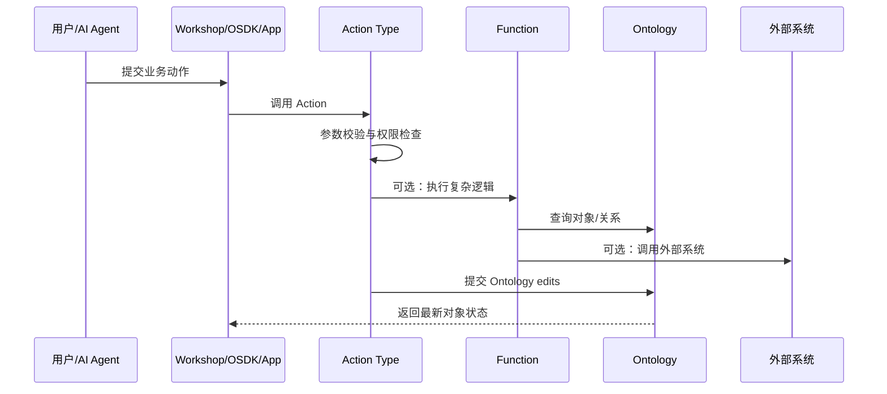

---
tags:
  - Palantir
  - Ontology
  - Foundry
  - Actions
  - Functions
created: 2026-06-05
updated: 2026-06-05
source:
  - https://www.palantir.com/docs/foundry/action-types/overview
  - https://www.palantir.com/docs/foundry/functions/overview
  - https://www.palantir.com/docs/foundry/platform-overview
status: 初稿
---

# Actions、Functions 与写回机制

## 为什么需要 Actions

如果 Ontology 只描述对象和关系，它仍然只是一个更业务化的数据模型。Palantir 真正强调的是：Ontology 还要描述组织能执行的动作。

Action type 定义用户、应用或 AI agent 可以执行的一组受控变更。

例子：

- `Assign Employee`
- `Close Alert`
- `Approve Order`
- `Update Maintenance Status`
- `Create Work Order`
- `Escalate Incident`

> [!summary]
> Object type 是企业里的「名词」，Action type 是企业里的「动词」。

## Action type 包含什么

一个 Action type 通常包括：

- 参数：用户或系统提交动作时需要提供的信息。
- 规则：如何创建、修改、删除对象或链接。
- 校验：什么情况下允许提交。
- 权限：哪些人或服务可以执行。
- 副作用：通知、webhook、触发 schedule build 等。
- 日志：记录动作提交和决策上下文。

Action 的关键价值是把「编辑数据」提升为「执行业务意图」。用户不需要关心改哪张表、哪个字段，而是执行一个业务动作。

## Rules

Action type 的规则分两类：

- Ontology rules：创建、修改、删除对象和链接。
- Other rules：触发通知、webhook、schedule build 等副作用。

注意点：

- 多个规则会被编译为对象编辑。
- 同一个 action 内规则顺序会影响最终对象编辑。
- 创建对象、修改对象、删除对象存在不支持的组合，需要按官方限制设计。
- 对一对多、一对一关系，通常通过修改对象上的 foreign key 属性处理。
- 对多对多关系，可以创建对象的同时创建 link。

## Function 的角色

Functions 是服务端执行的业务逻辑，可以在 dashboards、applications、Workshop、Quiver、Slate、Pipeline Builder 等场景中使用。

常见用途：

- 返回 object set，供应用展示。
- 计算派生指标、聚合值或自定义度量。
- 在 Workshop 中做 function-backed columns。
- 通过 function-backed action 执行复杂 Ontology edits。
- 查询外部系统并 enrich Ontology objects。
- 使用 TypeScript 或 Python 写复杂逻辑。

> [!note]
> 简单动作可以用 Action rules 配置；复杂动作通常交给 Function-backed Actions。

## 写回机制

Palantir 的写回不是绕开治理直接写数据库，而是通过 Ontology 的 Action 和 Function 机制进行受控变更。

典型路径：

## Action log

Action log 把 action submissions 建模为 object types，用于分析、展示和审计。

它适合：

- 追踪谁在什么时候做了什么决策。
- 把决策上下文沉淀为对象。
- 将一次动作与被编辑的多个对象关联起来。
- 用于后续监控、分析、复盘和模型反馈。

## 和 AI agent 的关系

在 AIP 语境下，AI agent 不应该直接随意改数据，而应通过受控工具调用执行动作：

- 查询 Ontology 获取上下文。
- 调用 Function 做推理、计算或建议。
- 生成 action proposal。
- 经人类确认或规则校验后提交 Action。
- 将结果写回 Ontology，进入审计和反馈闭环。

这也是 Palantir 强调 human + AI teaming 的原因：Ontology 给 AI 提供业务上下文，Actions 给 AI 提供可控执行边界。

## 参考资料

- [Action types overview](https://www.palantir.com/docs/foundry/action-types/overview)
- [Action type rules](https://www.palantir.com/docs/foundry/action-types/rules)
- [Action log](https://www.palantir.com/docs/foundry/action-types/action-log)
- [Functions overview](https://www.palantir.com/docs/foundry/functions/overview)
- [Platform overview: Actions](https://www.palantir.com/docs/foundry/platform-overview)
