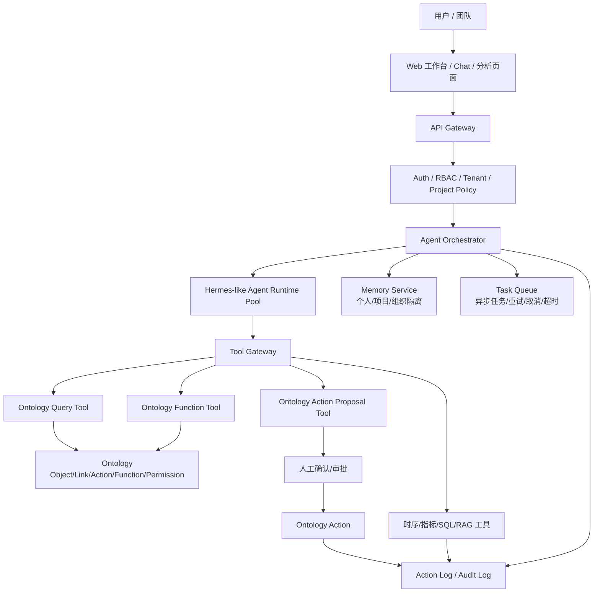

---
tags:
  - Palantir
  - Ontology
  - Agent
  - Hermes
  - 多租户
  - 架构评估
created: 2026-06-30
updated: 2026-07-01
status: 初稿
source:
  - "[[大模型/09-Agent/Hermes]]"
  - "[[大模型/09-Agent/OpenClaw]]"
  - "[[大模型/09-Agent/个人常驻智能体对比]]"
  - "[[Ontology/01-核心概念/Palantir Ontology 核心概念]]"
  - "[[Ontology/02-资源模型/Ontology 资源模型]]"
  - "[[Ontology/03-动作与函数/Actions、Functions 与写回机制]]"
  - "[[Ontology/04-安全治理/安全治理与权限]]"
  - "[[Ontology/05-应用开发/OSDK 与应用开发]]"
  - https://openclaw.ai/
  - https://www.techradar.com/pro/security/microsoft-says-openclaw-is-unsuited-to-run-on-standard-personal-or-enterprise-workstation-so-should-you-be-worried
  - https://www.techradar.com/pro/security/multiple-malicious-openclaw-skills-found-online-including-two-macos-infostealers
aliases:
  - Hermes 多用户 Ontology 分析系统
---

# 基于 Hermes 的多用户 Ontology 分析系统评估

> [!summary] 结论
> 可以借鉴 [[Hermes]] 这类个人常驻智能体的任务执行、记忆、技能沉淀和 `profile` 状态隔离思路。`profile` 可以作为“一个用户一个独立 Hermes 实例目录”的工程落点，但它只隔离 Hermes 自身状态，不等于完整多租户安全边界。真正可靠的方案仍然是：由我们自己的平台负责登录身份、用户到 profile 的绑定、多租户权限、工具网关、审计和 Ontology 访问控制，Hermes 只作为 Agent Runtime 或执行内核。

## 一、问题定义

目标不是做一个普通聊天机器人，而是做一个多人使用的 Ontology 分析系统：

- 多用户登录
- 多租户 / 多项目隔离
- 基于 Ontology 对象、关系、动作和函数做分析
- Agent 能解释业务对象，能调用分析工具
- 必要时能生成 Action Proposal
- 关键动作需要权限、确认和审计

如果系统面向企业或工业场景，风险边界比个人助理大很多。

## 二、Hermes 能不能直接做多用户隔离

短答案：**可以用 profile 做状态隔离，但不建议只靠 Hermes profile 直接承载完整多用户系统。**

原因是 [[Hermes]] / [[OpenClaw]] 这类系统默认更像个人智能体：

- 个人上下文
- 个人记忆
- 个人技能
- 个人工具账号
- 单用户长期运行状态

如果 Hermes 的 `profile` 语义是一个独立实例目录，那么它可以隔离一部分状态：

- `config.yaml`：模型、工具、gateway 等配置
- `.env`：API key、bot token 等密钥
- `SOUL.md`：agent 人格和系统说明
- `memories/`：长期记忆
- `state.db`：会话数据库
- `sessions/`：会话相关文件
- `skills/`：技能
- `cron/`：定时任务
- `logs/`：日志

这种模式下，“一个用户一个 profile”比所有用户共享同一个 `state.db` 和 `memories/` 更合理。用户 A 的会话、记忆、密钥和配置不会天然混进用户 B 的本地状态里。

但这仍然不等于企业级多用户隔离。多用户系统还需要这些边界：

- 用户隔离
- 租户隔离
- 项目隔离
- 工具权限隔离
- 会话隔离
- 记忆隔离
- 任务队列隔离
- 审计隔离

> [!warning] 关键判断
> 多用户隔离不是给表加一个 `user_id`，也不是创建多个 `profile` 就结束。只要 Agent 能调用工具、写文件、访问对象、记忆用户偏好，就必须从运行时、工具网关、存储、调度和审计全链路隔离。

### 登录用户到 profile 的绑定

如果用 Hermes profile 做用户级状态隔离，Dashboard / API 层需要补一层强制绑定逻辑：

```text
登录用户身份
  -> 查 user_profile_mapping
  -> 得到 hermes_profile_name
  -> 所有 Chat / Sessions / Memory / Config 请求都固定使用该 profile
```

映射关系可以类似：

```text
ontology_user_id -> hermes_profile_name
alice_ontology_id -> u_8f3a12c9
bob_ontology_id   -> u_92b7aa10
```

关键约束：

- 普通用户不能通过 URL 参数、请求体字段或 profile switcher 切换到别人的 profile。
- 管理员可以保留全局 profile 管理能力，但必须有审计。
- 所有工具调用仍要带 `tenant_id / project_id / user_id / role / request_id`。
- 如果统一 gateway 接收外部消息，需要按外部 `user_id` 路由到对应 profile。

## 三、profile 模式的性能影响

`profile` 数量本身通常不是主要瓶颈。一个空闲 profile 基本只是目录和文件，占用磁盘，不消耗持续 CPU。真正影响性能的是活跃用户数、常驻进程数和工具/LLM 调用量。

主要风险点：

- 每个 profile 都启动独立 gateway：进程数、内存、连接数会线性增长，几十个还可控，上百个需要认真规划。
- 大量用户同时聊天：瓶颈主要在 LLM 请求、工具调用、上下文加载、压缩和长会话检索。
- 每个 profile 一个 `state.db`：这反而减少了所有用户挤在同一个 SQLite 文件里的锁竞争；但 dashboard 如果频繁扫描所有 profile 的 sessions/config，会带来磁盘 I/O 和页面加载压力。
- skills/plugins 复制到每个 profile：磁盘占用和活跃 profile 的工具 schema 加载成本会增长。
- 定时任务和 bot token：如果每个用户都有独立 cron、Telegram/Discord/Slack bot token 或外部 webhook，连接管理会成为实际瓶颈。

推荐判断：

- 少量内部用户：一个用户一个 profile，必要时一个 profile 一个 gateway，可以先做。
- 几十到上百用户：不要默认每个用户常驻一个 gateway，优先做统一入口 + 用户到 profile 路由。
- Web dashboard 多用户：请求进来后按登录身份定位 profile，按需启动或复用会话，不要为所有用户常驻进程。
- 高并发产品化：增加任务队列、worker pool、并发限流、profile 元数据缓存、session 分页和 LLM 调用配额。
- 强隔离企业场景：profile 之外还需要容器、独立系统用户或沙箱。

> [!summary] 性能结论
> profile 多但大多空闲，问题不大；同时在线用户多，瓶颈在 worker、LLM、工具调用和上下文管理；每个 profile 都跑常驻 gateway，资源压力会接近线性增长。

## 四、state.db 是否应该迁到 MySQL

现阶段不建议直接把每个 profile 的 `state.db` 改成 MySQL。

更合理的分层是：

```text
中心业务库 MySQL / Postgres:
  users
  user_profile_mapping
  profile_status
  quota / billing / audit
  dashboard permissions

Hermes profile 本地状态:
  profiles/u_xxx/state.db
  profiles/u_xxx/memories/
  profiles/u_xxx/config.yaml
  profiles/u_xxx/.env
```

理由：

- `state.db` 属于 Hermes 本地会话状态，通常会牵涉 sessions、messages、全文搜索、压缩链、分支、归档、删除、统计和 migration。
- 如果每个用户一个 profile，SQLite 锁竞争已经被拆散，不会所有用户共用一个数据库文件。
- 从 SQLite 迁 MySQL 不是换连接字符串，FTS5、SQL 方言、事务语义、索引、migration 和测试都要重做。
- MySQL 能解决中心用户、权限、配额、审计问题，但不一定能解决 Hermes profile 的核心状态隔离问题。

只有下面条件成立时，才值得设计可插拔 SessionDB 后端并考虑迁移：

- 多台机器需要同时读写同一个用户/profile 的会话。
- profile 不再固定在单机本地磁盘。
- 需要跨所有用户做统一全文搜索、审计、报表和留存治理。
- 单个用户/profile 下并发写入很高，SQLite 成为明确瓶颈。
- 要做真正云端多租户服务，而不是内网或单机多用户 Hermes。

如果确实要迁，优先评估 Postgres，而不是 MySQL。原因是 Postgres 在 JSON、全文搜索、并发控制、索引表达能力和复杂查询上更接近替代 SQLite + FTS5 的职责。

> [!summary] 数据库结论
> 当前更应该新增中心业务库，而不是急着迁移 `state.db`。中心库管用户、profile 映射、权限、配额和审计；Hermes profile 继续保留自己的本地状态库。等确认瓶颈来自 `state.db` 本身，再设计数据库后端抽象。

## 五、如果基于 Hermes 改，需要多大变动

### 变动量级

如果 Hermes 当前是个人常驻智能体架构，改成多用户 Ontology 分析系统，属于 **中到大型改造**。

不能算二次开发小改，更接近“保留 Agent 能力，重建企业级控制面”。

### 必改模块

| 模块 | 个人版 Hermes 常见形态 | 多用户系统需要改成 |
|---|---|---|
| 用户模型 | 单用户配置 | `tenant / org / project / user / role` |
| 会话 | 单用户聊天上下文 | 多用户 session，带用户和项目上下文 |
| 记忆 | 全局或个人记忆 | 个人记忆、项目记忆、组织记忆分层隔离 |
| 工具 | 用户本地工具或全局技能 | Tool Gateway + per-user tool policy |
| 权限 | 靠用户配置和运行环境 | RBAC / ABAC / object-level permission |
| 任务 | 单 Agent 任务循环 | 多用户任务队列、取消、重试、超时 |
| 写回 | Agent 直接执行 | Action Proposal -> 确认 -> Ontology Action |
| 审计 | 本地日志 | 全链路 audit log / action log |
| 安全 | 本机或容器边界 | 租户隔离、沙箱、凭据托管、技能审计 |
| 部署 | 单实例 / 单人运行 | 多实例 runtime pool + scheduler |

## 六、推荐架构



## 七、Ontology 在这里的角色

Ontology 不只是数据源，而是 Agent 的业务操作边界。

对应关系：

| Ontology 能力 | Agent 系统用途 |
|---|---|
| Object type | 让 Agent 理解业务对象，例如设备、产线、告警、工单、客户 |
| Link type | 让 Agent 沿业务关系推理，例如设备属于产线，告警关联工单 |
| Object set | 作为分析范围和权限过滤后的对象集合 |
| Function | 作为受控计算和分析工具 |
| Action | 作为写回和业务动作入口 |
| Permission | 限制 Agent 能看什么、能调什么、能改什么 |
| Action log | 保存 Agent 建议、用户确认和写回结果 |

> [!summary] 推荐原则
> Agent 可以生成分析、调用 Function、提出 Action Proposal，但不要直接绕过 Ontology 权限和 Action 写业务数据。

## 八、分析流程示例

用户问题：

> 分析 1 号产线最近 24 小时停机原因，并给出优先处理建议。

执行流程：

1. 识别用户、租户、项目和权限。
2. 查询用户可访问的 `产线`、`设备`、`告警`、`停机记录`、`工单`。
3. 沿 Ontology link 找到相关点位、设备、告警和维修记录。
4. 调用 Function 计算停机分布、Top N 原因、持续时间、影响范围。
5. 生成分析结论和证据链。
6. 生成处理建议，例如创建工单、升级告警、通知负责人。
7. 对写回动作生成 Action Proposal。
8. 用户确认后提交 Ontology Action。
9. 写入 Action Log 和审计日志。

## 九、关键安全边界

### 1. Agent 不直接拿数据库账号

Agent 只能通过 Tool Gateway 调用受控工具。

### 2. 工具调用必须带用户上下文

每次调用都携带：

- `tenant_id`
- `project_id`
- `user_id`
- `role`
- `allowed_object_types`
- `allowed_actions`
- `request_id`

### 3. 写回必须 proposal-first

所有写动作先生成 proposal：

- 动作类型
- 目标对象
- 参数
- 理由
- 影响范围
- 风险说明

再由用户或规则确认。

### 4. 记忆分层

建议分为：

- 个人偏好记忆
- 项目上下文记忆
- 组织知识记忆
- 临时会话记忆

禁止把用户 A 的分析上下文自动泄漏给用户 B。

## 十、改造难度评估

### 如果直接改 Hermes

难度：高。

主要工作：

- 重构用户和租户模型
- 重构 memory
- 重构 skills / tools 权限
- 增加任务调度和隔离
- 增加审计
- 增加工具沙箱
- 增加 Ontology 访问控制适配

适合前提：

- Hermes 代码结构清晰
- 技能系统容易改
- 运行时容易拆成无状态控制面和有状态执行面
- 团队愿意长期维护 fork

### 如果只借鉴 Hermes 思路

难度：中。

做法：

- 自己实现多用户控制面
- Agent Runtime 可以参考 Hermes
- 工具协议可以自己定义
- 编排层用 [[LangGraph]] / [[OpenAI Agents SDK]] / [[AutoGen]]
- Ontology 作为核心工具和权限边界

这是更稳的路线。

## 十一、可选底座对比

| 方案 | 是否适合作为多用户 Ontology 分析底座 | 判断 |
|---|---|---|
| Hermes | 不建议直接作为完整多用户底座 | 可以参考运行时、记忆、技能和 profile 状态隔离思路 |
| [[OpenClaw]] | 不建议直接进入企业多用户环境 | 安全边界压力大，更适合个人或隔离环境 |
| [[Agent Zero]] | 可作为隔离执行环境参考 | 更偏本地/容器执行，不负责 Ontology 治理 |
| [[LangGraph]] | 适合作为编排层 | 状态、流程和 human-in-the-loop 更适合企业分析 |
| [[OpenAI Agents SDK]] | 适合作为 Agent SDK | handoff、tool、guardrails、tracing 思路可借鉴 |
| [[AutoGen]] | 适合多 Agent 实验和角色协作 | 工程治理仍需自建 |
| [[Letta]] | 适合作为记忆层参考 | 长期记忆和 stateful agent 值得参考 |
| [[Relevance AI]] | 可参考企业 AI workforce 形态 | 如果自研，则借鉴其 RBAC、audit、evals 思路 |

## 十二、推荐方案

### 推荐路线

> [!summary]
> 不要只做“多用户 Hermes”。要做“基于 Ontology 的多用户 Agent 分析平台”。Hermes profile 可以承担用户级本地状态隔离，平台控制面负责登录、授权、profile 映射、审计、配额和工具边界。

建议技术拆分：

- 编排层：[[LangGraph]] 或 [[OpenAI Agents SDK]]
- 多 Agent 协作：可参考 [[AutoGen]]
- 记忆层：参考 [[Letta]]
- 个人智能体运行时：参考 [[Hermes]] / [[OpenClaw]]
- 用户状态隔离：Hermes profile，一用户一 profile
- 中心业务库：用户、profile 映射、权限、配额、审计，不直接替换 `state.db`
- 业务语义层：Ontology
- 工具协议层：MCP / 自定义 Tool Gateway
- 写回层：Ontology Action / Function

### 第一阶段 MVP

只做只读分析：

- 多用户登录
- 用户到 Hermes profile 的强制绑定
- 项目权限
- Ontology object 查询
- Function 聚合分析
- Agent 生成解释和证据链
- 不做自动写回

### 第二阶段

增加 Action Proposal：

- Agent 生成建议动作
- 用户确认
- 调用 Action
- 写入审计

### 第三阶段

增加自动化：

- 低风险动作自动执行
- 高风险动作审批
- 定时分析任务
- 失败样本和反馈闭环

## 十三、最终判断

可以基于 Hermes 的思想和 profile 机制做，但不要把“多个 profile”误认为完整企业多用户系统。

真正的核心是：

- Ontology 负责业务对象和权限
- 中心业务库负责用户、profile 映射、权限、配额和审计索引
- Agent Runtime 负责思考和任务执行
- Hermes profile 负责单个用户的本地会话、记忆、配置和技能状态
- Tool Gateway 负责把两者安全连接
- Action Proposal 负责控制写回风险
- Audit Log 负责可追溯

如果目标是长期产品化，应该优先设计多用户控制面、profile 路由和 Ontology 工具边界，再决定 Agent Runtime 使用 Hermes、LangGraph、OpenAI Agents SDK 还是自研。`state.db` 先保留在 profile 内，除非后续确认跨机器、统一搜索或高并发写入成为真实瓶颈。
