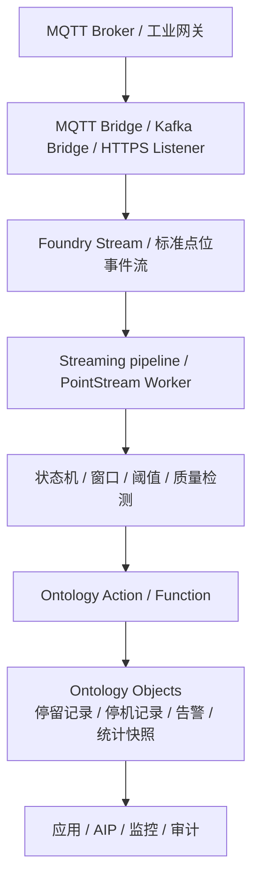

---
tags:
  - Palantir
  - Ontology
  - Foundry
  - Streaming
  - MQTT
  - 工业互联网
created: 2026-06-05
updated: 2026-06-05
source:
  - https://www.palantir.com/docs/foundry/data-integration/streams/
  - https://www.palantir.com/docs/foundry/data-integration/streaming-guide/
  - https://www.palantir.com/docs/foundry/building-pipelines/pipeline-types/
  - https://www.palantir.com/docs/foundry/data-connection/listeners-event-processing
  - https://www.palantir.com/docs/foundry/available-connectors/kafka/
  - https://www.palantir.com/docs/foundry/building-pipelines/streaming-keys
status: 初稿
---

# Palantir 实时数据分析与点位流处理

## 结论

Palantir 支持实时或准实时数据分析场景。Foundry 官方提供 Streams、Streaming syncs、Streaming pipelines、Automate event processing、Kafka 等流式接入和处理能力。

但对于 MQTT 点位事件归并这类场景，需要区分三层能力：

1. **实时接入**：把 MQTT/Kafka/HTTPS/工业数据流接入 Foundry Stream。
2. **流式处理**：解析、清洗、状态机、窗口聚合、阈值判断、幂等处理。
3. **Ontology 写回**：把派生结果通过 Action / Function / object edits 变成可治理的业务对象。

> [!summary]
> Palantir 能支撑这类场景，但不是简单依靠 Ontology 对象定义完成。RFID 首末次归并、状态切换成段、阈值持续告警等能力，本质上应落在流处理或自动化层，再通过 Ontology Actions/Functions 写回业务对象。

## 官方能力对应关系

| 你的需求 | Palantir 对应能力 | 备注 |
|---|---|---|
| MQTT 点位持续接入 | Foundry Streams / Stream proxy / Kafka connector / HTTPS listener | 官方文档列出 Kafka、Kinesis、SQS、Aveva PI 等；MQTT 通常需要桥接到 Kafka/HTTPS/自定义接入。 |
| 低延迟读取最新数据 | Stream hot buffer | Streams 同时有低延迟 hot buffer 和归档后的 dataset view。 |
| 点位解析和标准化 | Streaming transform / Pipeline Builder | Kafka connector 不解析 message value，需要下游 transform 解析 JSON。 |
| 持续处理新数据 | Streaming pipeline | 适合低延迟要求高、吞吐变化大的场景。 |
| 每条事件触发动作 | Automate stream processing | 适合低吞吐、无状态、几秒延迟、at-least-once 可接受的场景。 |
| RFID 会话归并 | Stateful streaming pipeline | 需要 key、状态、checkpoint、幂等，不能只靠无状态 Automate。 |
| 阈值持续告警 | Streaming pipeline 或轻量状态 worker | 需要窗口和状态，复杂度高于单事件触发。 |
| 派生对象写入 | Action / Function / Ontology edits | 输出应进入 Ontology 审计和权限体系。 |
| 运行监控 | Stream metrics / Stream monitoring / job graph | Foundry 有 stream monitoring；复杂业务规则还需要业务级失败样本。 |

## Streams 能力

Foundry Stream 类似 dataset，但面向低延迟数据流。它有两层存储：

- Hot buffer：低延迟读取，供实时处理使用。
- Cold storage：每隔几分钟归档为标准 Foundry dataset，供普通 Foundry 应用使用。

关键特性：

- 流数据是结构化、表格化的。
- 支持 schema 管理、权限管理、版本管理等 Foundry dataset 的治理能力。
- 支持分区以提升吞吐。
- 处理一致性支持 `AT_LEAST_ONCE` 和 `EXACTLY_ONCE`。
- 通过 checkpoint 支持故障恢复和状态恢复。

## Streaming pipeline 的定位

官方对 streaming pipeline 的定位比较克制：当端到端延迟要求低于一分钟时，它可能是合适选择；但复杂度和成本都高，运行方式更像一个长期在线的微服务，而不是普通批处理任务。

适合：

- 低延迟要求明确。
- 输入量持续且较高。
- 需要持续处理新消息。
- 能接受专门维护状态、checkpoint、监控和故障恢复。

不适合：

- 只是分钟级刷新。
- 吞吐低且业务逻辑无状态。
- 可以通过 incremental pipeline 满足。
- 团队暂时没有能力维护长期在线流任务。

> [!warning]
> Palantir 官方文档也提示，能用 incremental pipeline 满足的场景不应轻易上 streaming pipeline。流处理的复杂度、可用性要求和计算成本都更高。

## Automate 处理 stream event

Foundry HTTPS listeners 写入 stream 后，可以使用 Automate 直接处理 inbound event。

官方给出的适用条件：

- event stream 不是高吞吐。
- 处理逻辑是无状态的。
- 几秒级延迟可以接受。
- at-least-once processing 可以接受。

这适合：

- 单条事件创建对象。
- 单条事件触发 Function。
- 单条事件触发通知或外部系统调用。

不适合：

- RFID 首末次归并。
- 停机开始/结束状态机。
- 持续 5 分钟超过阈值才告警。
- 需要复杂窗口、乱序、去重、会话状态的场景。

## 对 MQTT 点位场景的判断

你的 `PointStreamRule` 方案和 Palantir 的思路是兼容的，但对应实现层次应这样理解：

其中：

- `mqtt_bridge` 类似 Palantir streaming ingestion 前的一层接入适配。
- `point_event` 类似进入 Foundry Stream 的标准化事件。
- `PointStreamRule` 类似你们自研的轻量 streaming rules runtime。
- `output.action_ref` 对应 Palantir 的 Action / Function 写回思想。

> [!note]
> 官方资料中能看到 Streams、Streaming pipelines、Automate、Actions、Functions 等能力，但没有看到一个名为 `PointStreamRule` 的现成 Ontology 资源。这个更像是在你们平台中借鉴 Palantir 架构思想后设计的产品化资源。

## RFID 会话归并如何映射

### 方案一：低吞吐无状态

如果只是每条 RFID 事件直接生成一条对象记录：

- 用 Automate 处理 stream event。
- 调用 Action 或 Function 写入 Ontology object。
- 幂等键放在对象主键或 Action 参数中。

不适合首末次归并。

### 方案二：RFID 首末次归并

推荐使用有状态流处理：

- key：`reader_id + point_name + rfid` 或 `reader_id + point_name`
- state：当前 active session
- trigger：value change、empty、timeout
- debounce：过滤抖动
- checkpoint：恢复当前会话状态
- idempotency key：避免重放重复写入
- output：通过 Action / Function 生成 `RFID停留记录`

这和你 TODO 中的 `session` 规则非常接近。

### 方案三：阈值持续告警

推荐使用窗口或状态规则：

- key：`device_id + point_name`
- window：滚动窗口或会话窗口
- condition：连续超过阈值 T 秒
- output：生成或更新告警对象
- close：恢复正常后关闭告警

如果要求很低，也可以用 lightweight worker + Redis；如果要求高吞吐和可恢复性，应使用正式 streaming pipeline 的状态和 checkpoint。

## 设计上应保留的 Palantir 原则

- 接入层只做接入、解析、标准化和监控，不承载业务规则。
- 流处理层负责状态机、窗口、阈值、质量检测。
- Ontology 层负责业务对象、关系、动作、权限和审计。
- 写回通过 Action / Function，不绕过治理直接写业务表。
- 关键输出必须有 `rule_id`、`rule_version`、`source_event_id`、`idempotency_key`。
- 对 AI agent 暴露的是受控 Action/Function，而不是原始写库能力。

## 和你的 TODO 的差异

你的方案比 Palantir 官方公开文档更贴近工业 MQTT 产品化配置，尤其是：

- `PointStreamRule` 作为 Schema 驱动资源。
- RFID / 状态点 / 告警点 / 计数点的规则模板。
- Redis 轻量状态存储。
- 管理台规则发布、回滚、失败样本。
- 与现有 generated CRUD / Action Executor 强绑定。

这些更像是在 Palantir 架构思想上做的行业产品化实现，而不是 Palantir 文档里现成的单一功能。

## 推荐结论

> [!summary]
> Palantir 支持实时数据分析和流处理能力；你的 MQTT 点位事件归并场景在 Palantir 架构中是成立的。对应落点不是单纯 Ontology schema，而是 `stream ingestion -> streaming/stateful processing -> Action/Function writeback -> Ontology objects`。

对你当前平台的建议：

1. 保留 `mqtt_bridge` 的轻量职责。
2. 增加标准 `point_event` 流。
3. 新增 `PointStreamRule` 作为产品化规则资源。
4. 第一阶段优先实现 RFID session 和状态点 session。
5. 输出必须走 Action / generated CRUD。
6. Redis 可以作为第一阶段轻量状态存储，但规则状态、失败样本、幂等和重放语义要提前设计。
7. 如果后续吞吐、乱序、恢复和窗口需求明显提升，再升级到 Kafka/Flink 类流处理内核。

## 参考资料

- [Streams](https://www.palantir.com/docs/foundry/data-integration/streams/)
- [Streaming resource guide](https://www.palantir.com/docs/foundry/data-integration/streaming-guide/)
- [Types of pipelines](https://www.palantir.com/docs/foundry/building-pipelines/pipeline-types/)
- [Event processing with HTTPS listeners](https://www.palantir.com/docs/foundry/data-connection/listeners-event-processing)
- [Kafka connector](https://www.palantir.com/docs/foundry/available-connectors/kafka/)
- [Streaming keys](https://www.palantir.com/docs/foundry/building-pipelines/streaming-keys)
- [Streaming compute usage](https://www.palantir.com/docs/foundry/building-pipelines/streaming-compute-usage)
- [Stream monitoring](https://www.palantir.com/docs/foundry/data-integration/stream-monitoring/)
