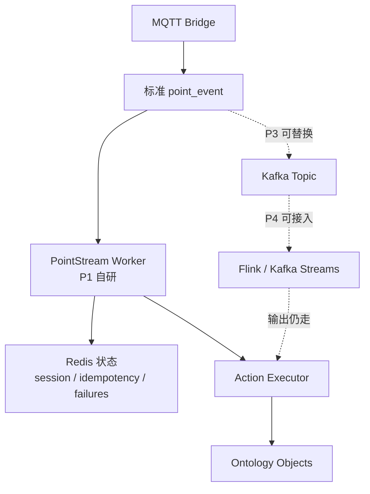

---
tags:
  - Ontology
  - MQTT
  - Streaming
  - Flink
  - Kafka
  - Redis
  - 技术选型
created: 2026-06-05
updated: 2026-06-05
status: 初稿
source:
  - https://nightlies.apache.org/flink/flink-docs-release-1.20/docs/concepts/stateful-stream-processing/
  - https://kafka.apache.org/33/streams/core-concepts/
  - https://redis.io/docs/latest/develop/data-types/streams/
---

# 点位流处理自研与第三方软件选型

## 结论

针对当前 MQTT 点位事件归并能力，第一阶段没有必要直接引入 Flink 这类完整流处理平台。更务实的路线是：

1. **自研 PointStreamRule 规则层**：因为规则语义、Action 写回、Ontology Schema、管理台配置和审计链路都是你们平台自己的产品能力。
2. **用 Redis 做轻量状态与幂等**：适合 P1 的 RFID 会话、状态切换、超时关闭、失败样本和运行指标。
3. **暂不引入 Flink/Kafka Streams 作为第一阶段核心依赖**：除非吞吐、乱序、窗口、重放和故障恢复要求已经明确超过轻量 worker 能力。
4. **预留事件流抽象**：后续可以把输入从内存/Redis Stream 切换到 Kafka，把处理 runtime 切换到 Flink 或 Kafka Streams。

> [!summary]
> 要自研的是「业务规则引擎和 Ontology 写回语义」，不建议自研的是「通用大规模流处理内核」。P1 可以自研轻量 worker；P3/P4 如果复杂度上升，再引入 Kafka/Flink。

## 为什么不能完全靠第三方

第三方流处理软件解决的是通用计算问题：

- 消息消费
- 分区
- 状态
- checkpoint
- 窗口
- 乱序
- 故障恢复
- 横向扩展

但你的核心需求不是单纯流计算，而是产品语义：

- `PointStreamRule` Schema 如何描述业务规则。
- 管理台如何配置、发布、回滚规则。
- selector 如何匹配产品、设备、点位、版本。
- 输出如何映射到 Action / generated CRUD。
- 派生对象如何携带 `rule_id/rule_version/source_event_id/idempotency_key`。
- 失败样本如何与 MQTT 接收监控和 Ontology 审计打通。
- 规则如何避免硬编码 RFID、工单、人员、物料等业务词。

这些能力即使用 Flink 或 Kafka Streams 也要自己做。因此不能指望引入第三方后业务层就消失。

## 为什么也不建议从零自研完整流处理引擎

完整流处理引擎很难。真正复杂的部分包括：

- 分区有序处理。
- event time 与 processing time。
- watermark 和迟到数据。
- exactly-once / at-least-once 语义。
- checkpoint 与状态恢复。
- 大状态存储和状态迁移。
- backpressure。
- rebalance。
- 横向扩展。
- 作业升级和 savepoint。

Apache Flink 官方定位就是面向有状态流处理，支持 checkpoint 恢复和 exactly-once 状态一致性。Kafka Streams 官方也提供 state stores、聚合、join、容错和 exactly-once processing semantics。说明这些能力是通用流处理框架的核心价值，不应轻易重造。

## 当前场景的复杂度判断

### 适合自研轻量 worker 的情况

- 点位量不大，单机或少量 worker 可以处理。
- 主要规则是 RFID session、状态切换、简单阈值。
- 对延迟要求是秒级，不是毫秒级严格实时。
- 可接受业务级幂等，而不是底层端到端 exactly-once。
- 失败后可以基于幂等键重放或补偿。
- 规则状态主要是小对象，例如 active session、last value、seen count。
- 目前更需要管理台配置、审计、Action 写回，而不是极致吞吐。

### 应考虑第三方流处理的情况

- 点位规模达到每秒数万到数十万事件。
- 需要跨设备、跨点位 join。
- 需要复杂窗口、watermark、迟到数据修正。
- 需要严格故障恢复，worker 重启后不能丢状态。
- 需要水平扩展和分区再均衡。
- 需要历史事件大规模重放。
- 需要多个下游系统订阅同一标准事件流。
- Redis 状态已经成为可靠性或容量瓶颈。

## 选型对比

| 方案 | 适合场景 | 优点 | 缺点 | 当前建议 |
|---|---|---|---|---|
| 自研 worker + Redis | P1/P2，轻量规则、RFID 会话、状态切换 | 实现快，贴合 Ontology/Action，运维简单 | 流处理语义有限，扩展和恢复能力弱 | 推荐先做 |
| Redis Streams + consumer group | 轻量事件队列，多 worker 消费 | 引入成本低，支持消费组和 pending 处理 | 分区、有序、窗口、checkpoint 能力弱 | 可作为过渡 |
| Kafka + 自研 worker | 标准事件流，多下游订阅，后续可接 Flink | 解耦接入和处理，利于扩展 | 增加 Kafka 运维成本 | P2/P3 评估 |
| Kafka Streams | 已有 Kafka，Java 生态，状态聚合 | state store、容错、exactly-once 语义较完整 | 规则产品化仍要自研，Go 技术栈不完全贴合 | 中期可选 |
| Flink | 高吞吐、复杂窗口、乱序、状态恢复 | 流处理能力最完整 | 运维和开发复杂度高 | 后期再上 |
| Timescale/Influx + 定时任务 | 准实时统计、历史补算 | 简单、利于回放 | 不适合秒级事件状态机 | 辅助，不做主链路 |

## 推荐分阶段路线

### P1：自研轻量闭环

实现：

- 标准 `point_event`。
- `PointStreamRule` 规则资源。
- `session` 规则。
- `change_event` 的最小能力。
- Redis 保存 active session、last value、idempotency key、failure samples。
- 输出统一走 Action / generated CRUD。

此阶段不要引入 Flink。

### P2：增强可运维性

实现：

- 规则发布/回滚。
- dry-run。
- 失败样本。
- 活跃会话查看。
- 幂等查询。
- 基于时间范围的局部 replay。
- MQTT 接收监控与规则消费状态关联。

如果需要多 worker 消费，可评估 Redis Streams 或内部持久化事件表。

### P3：引入标准事件总线

如果标准点位事件开始被多个下游消费，可以引入 Kafka：

- MQTT Bridge 写入 Kafka topic。
- PointStream Worker 消费 Kafka。
- 时序写入、质量检测、告警、统计各自成为独立 consumer。

这一步的重点是解耦，而不是马上上复杂流计算。

### P4：引入 Flink/Kafka Streams

当窗口、乱序、重放、状态恢复和吞吐成为主要矛盾时，再把部分规则 runtime 迁移到 Flink 或 Kafka Streams。

保留不变：

- `PointStreamRule` 仍是产品规则定义。
- Action / Function 仍是写回出口。
- 管理台仍管理规则版本和审计。

变化的是：

- 规则执行引擎从轻量 worker 切换成 Flink/Kafka Streams adapter。

## 架构建议

## 具体建议

### 当前不要做的事

- 不要为了 RFID 第一版直接引入 Flink。
- 不要在 MQTT Bridge 里硬编码 RFID 业务逻辑。
- 不要把 Redis 当永久事实源。
- 不要绕过 Action 直接写业务表。
- 不要承诺底层 exactly-once；先提供业务级幂等。

### 当前应该做的事

- 把 `point_event` 设计稳定。
- 把 `PointStreamRule` 做成独立资源。
- 把规则运行时和规则定义解耦。
- 为每条输出强制生成幂等键。
- 保留事件重放入口。
- 把 worker 的输入源抽象成 interface，未来可从 Redis/Kafka/数据库读取。
- 把状态存储抽象成 interface，未来可从 Redis 切换到 Flink state 或 RocksDB。

## 判断标准

可以用下面几个指标决定是否升级到第三方流处理：

| 指标 | 继续自研轻量 worker | 考虑 Kafka/Flink |
|---|---|---|
| 吞吐 | < 5k events/s | > 10k events/s 且持续增长 |
| 延迟 | 秒级可接受 | 亚秒级且吞吐高 |
| 状态规模 | 万级 active sessions | 百万级 active sessions |
| 规则复杂度 | session/change/简单 threshold | join/复杂窗口/乱序修正 |
| 故障恢复 | 可重放补偿 | 必须自动恢复且低丢失 |
| 下游数量 | 1-2 个 | 多个系统订阅同一事件流 |
| 团队运维 | 不想维护复杂集群 | 已具备 Kafka/Flink 运维能力 |

## 最终建议

> [!summary]
> 先自研，不要先上大组件。但自研范围要克制：只做点位规则产品层、轻量状态机、Action 写回和管理台，不要把自己拖进通用流处理引擎的坑里。

推荐当前路线：

1. P1：Go Worker + Redis，完成 RFID session 最小闭环。
2. P2：补管理台、规则版本、失败样本、replay。
3. P3：如果多下游和吞吐上来，引入 Kafka 作为标准点位事件总线。
4. P4：如果复杂窗口、乱序和大状态成为主要问题，再引入 Flink 或 Kafka Streams。

## 参考资料

- [Apache Flink: Stateful Stream Processing](https://nightlies.apache.org/flink/flink-docs-release-1.20/docs/concepts/stateful-stream-processing/)
- [Apache Kafka Streams: Core Concepts](https://kafka.apache.org/33/streams/core-concepts/)
- [Apache Kafka Streams: Architecture](https://kafka.apache.org/24/streams/architecture/)
- [Redis Streams](https://redis.io/docs/latest/develop/data-types/streams/)
