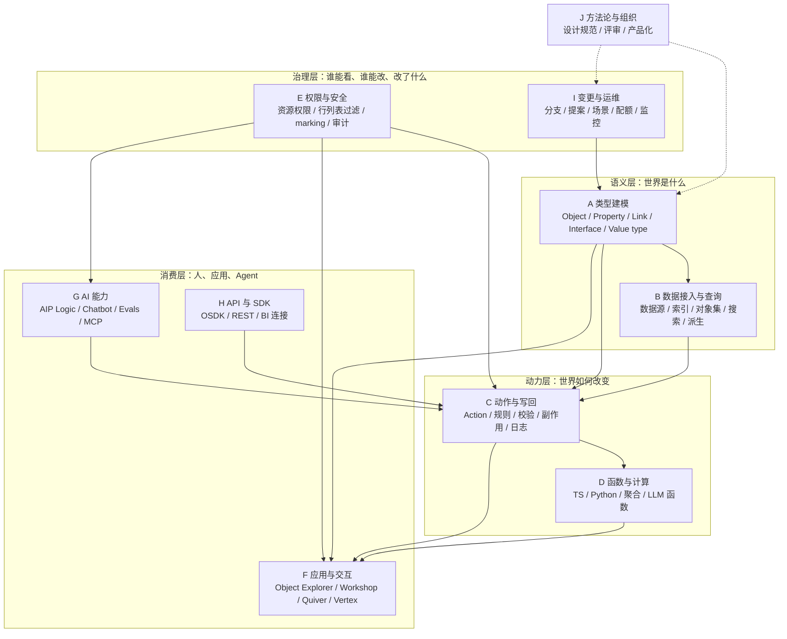

---
tags:
  - Palantir
  - Ontology
  - Foundry
  - AIP
  - 能力地图
  - 架构
created: 2026-10-23
updated: 2026-10-23
status: 初稿
source:
  - https://www.palantir.com/docs/foundry/ontology/overview
  - https://www.palantir.com/docs/foundry/ontology/core-concepts
  - https://www.palantir.com/docs/foundry/object-link-types/object-types-overview
  - https://www.palantir.com/docs/foundry/object-link-types/link-types-overview
  - https://www.palantir.com/docs/foundry/action-types/overview
  - https://www.palantir.com/docs/foundry/functions/overview
  - https://www.palantir.com/docs/foundry/interfaces/interface-overview
  - https://www.palantir.com/docs/foundry/object-permissioning/overview
  - https://www.palantir.com/docs/foundry/ontology-sdk/overview
  - https://www.palantir.com/docs/foundry/ontologies/branching-ontology
  - https://www.palantir.com/docs/foundry/ontology/overview-ontology-scenario
  - https://www.palantir.com/docs/foundry/ontology-mcp/overview
---

# Palantir Ontology 能力全景

> [!summary] 一句话
> Palantir Ontology 的能力不是「对象 + 关系 + 动作」三个词，而是围绕这三件事长出来的十层能力：类型系统、数据接入与索引、查询与搜索、动作与写回、函数计算、权限治理、应用框架、AI 工具层、API/SDK、变更与运维。**真正难抄的是各层共用同一套类型系统和同一套权限模型。**

## 为什么单独写这一篇

现有笔记是按「概念 → 资源 → 动作 → 权限 → 应用」的阅读顺序组织的，适合建立理解，但不适合逐项对照。

这一篇换一种组织方式：**按能力域拆，逐项列出 Palantir 到底提供了什么、每项的边界在哪、分析自研方案时该问什么**。可以配合 [[Ontology/07-能力全景/Ontology 能力核对清单|能力核对清单]] 做差距分析。

阅读建议：

- 第一遍只看「能力总表」和每节开头的一句话定位。
- 第二遍挑你关心的域，看表格第三列（分析要点）。
- 做选型时，直接用 [[Ontology/07-能力全景/Ontology 能力核对清单|能力核对清单]] 逐行打分。

## 能力骨架

| 层 | 能力域 | 一句话定位 |
|---|---|---|
| 语义层 | A 类型建模 | 定义企业里有哪些「名词」，以及名词的形状、约束和复用方式 |
| 语义层 | B 数据接入与查询 | 把真实数据接进来、索引成对象，并提供对象集查询与搜索 |
| 动力层 | C 动作与写回 | 把「改数据」升级成「执行业务动作」，带校验、副作用和审计 |
| 动力层 | D 函数与计算 | 用代码表达任意复杂度的业务逻辑，并被动作和应用复用 |
| 治理层 | E 权限与安全 | 资源层与数据层双层授权，强制控制与酌情控制分离 |
| 治理层 | I 变更与运维 | 分支、提案、场景沙箱、容量配额、运行监控 |
| 消费层 | F 应用与交互 | 官方提供的分析、运营、图分析、自动化应用 |
| 消费层 | G AI 能力 | LLM 函数、Agent、评测、语义搜索、MCP 工具化 |
| 消费层 | H API 与 SDK | 把 Ontology 当后端，给外部应用和开发者用 |
| 组织层 | J 方法论与组织 | 建模规范、反模式、评审机制、Marketplace 产品化 |

## 能力总表

| 域 | 能力项 | 数量 | 关键词 |
|---|---|---|---|
| A 类型建模 | A1–A9 | 9 | Object type、Property、Struct、Value type、Link、Interface、Shared property、元数据、设计规范 |
| B 数据与查询 | B1–B7 | 7 | Backing datasource、OSv2 索引、Object Set Service、搜索、流、派生属性、富类型 |
| C 动作与写回 | C1–C10 | 10 | 参数、规则、提交条件、函数动作、副作用、写授权、一致性、Action log、撤销、内联编辑 |
| D 函数与计算 | D1–D7 | 7 | TS v1/v2、Python、查询/聚合/编辑函数、外部调用、LLM、工程化、性能 |
| E 权限与安全 | E1–E11 | 11 | 双层权限、项目授权、行列表过滤、marking/CBAC、传播边界、动态安全、审计、共享、变更治理 |
| F 应用与交互 | F1–F9 | 9 | Object Explorer、Object Views、Workshop、自定义前端、分析套件、图/地图/流程、规则与自动化、工作流治理、Marketplace |
| G AI 能力 | G1–G8 | 8 | AIP Logic、Chatbot Studio、Analyst、Evals、Threads/Assist、语义搜索、MCP、模型治理 |
| H API 与 SDK | H1–H7 | 7 | OSDK、WebSocket、REST/Platform SDK、BI 连接、外部系统、Developer Console、计算扩展 |
| I 变更与运维 | I1–I6 | 6 | Ontology Manager、Global Branching、Scenarios、迁移、容量、可观测 |
| J 方法论与组织 | J1–J5 | 5 | 定位叙事、设计规范、协作评审、产品化、采用路径 |

---

## A. 类型建模能力

> 这一域是 Ontology 的「名词系统」。Palantir 的深度不在 object / link 这两个概念，而在围绕它们的元数据、类型系统与复用机制。

| 编号 | 能力 | Palantir 具体提供了什么 | 分析 / 自研关注点 |
|---|---|---|---|
| A1 | 对象类型 Object type | 实体或事件的 schema：主键、标题属性（决定对象在 UI 中怎么显示）、显示名与复数、描述、API 名、状态、类型类（type class）、渲染提示（render hint）；可用对象类型组（object type group）分组 | 主键策略（业务键 vs 代理键）、标题可读性、状态生命周期、分组是否同时服务导航与权限 |
| A2 | 属性 Property | 基础类型覆盖字符串、布尔、整数、浮点/小数、日期与时间戳、geohash/地理形状、数组、struct、附件、媒体引用、时序、密文等；必填（required）与 mandatory control；仅编辑属性（edit-only）；值格式化（value formatting）；条件格式化（conditional formatting）；属性级元数据 | 金额精度、时区、地理、附件这些业务语义能否在类型层表达；格式化是下推到模型还是留给前端 |
| A3 | 结构体 Struct | 嵌套结构类型，可自动映射字段、指定主字段，适合地址、金额+币种这类复合值 | 嵌套建模与拆表的取舍；嵌套后查询与权限的粒度 |
| A4 | 值类型 Value type | 带业务语义的类型（如邮箱、币种、度量单位），支持约束（constraint）、版本、权限 | 校验放在类型层还是动作层；值类型升级如何兼容旧数据 |
| A5 | 关系类型 Link type | 双向关系，两侧各有显示名和 API 名，可独立遍历；支持 1:1、1:N、N:M 与自关联；同一对对象类型之间可以定义多条语义不同的关系；跨 ontology 不支持，跨组织要用 shared ontology；支持外键、关联表、对象背书三种方式 | 关系命名要表达业务含义；多跳查询性能；普通 link 只有元数据、不承载业务属性，也没有顺序；带数据的关系用「关系对象」或 object-backed link type，详见 [[Ontology/02-资源模型/关系建模：Link、关系对象与 Object-backed Link\|关系建模]] |
| A6 | 接口 Interface | 抽象类型，描述形状与能力：接口属性、link 约束、action 约束、元数据；可继承、可多继承；对象类型可实现多个接口；支持「接口上的动作」和「接口上的 link」 | 能否用多态替代大量重复对象类型；接口在平台各应用中的支持度并不一致，要按使用场景确认 |
| A7 | 共享属性 Shared property | 跨对象类型复用同一属性定义与元数据，集中管理，保证口径一致 | status、owner、时间戳这类通用属性的统一治理；改共享属性时的影响面 |
| A8 | 元数据与组织 | 类型类、渲染提示、状态、对象类型组、Marketplace 打包 ontology types | 资源规模上去后的可发现性；元数据能否驱动前端自动渲染 |
| A9 | 设计方法论 | 官方给出 best practices、structural guidance、anti-patterns、design validation 四份设计文档 | 有没有建模评审机制；反模式清单能不能变成自研的 lint 规则 |

> [!warning] 容易忽略
> 普通 link 只有元数据，没有业务属性，也没有顺序。现实里的「任职关系」有开始时间、职级，「供应关系」有份额、价格，「产线工位」有工序号、节拍——这些都要把关系提升为对象，再用 link 连过去。Palantir 也提供 object-backed link type，让关系对象直接背书 link，从而能在图里沿 link 看到关系属性。具体做法与选型见 [[Ontology/02-资源模型/关系建模：Link、关系对象与 Object-backed Link|关系建模：Link、关系对象与 Object-backed Link]]。

## B. 数据接入与查询能力

> 语义层定义了「世界是什么」，这一域解决「对象的数据从哪来、怎么被查到」。

| 编号 | 能力 | Palantir 具体提供了什么 | 分析 / 自研关注点 |
|---|---|---|---|
| B1 | 数据源绑定 | 对象类型可以绑定数据集（批）、virtual tables（联邦查询外部库）、streams（流）、restricted views（行列受限视图）、media sets；也可以不绑数据源，对象只通过动作创建 | 多源异构、批 vs 流、联邦查询的代价；「无源对象」对自研的含义 |
| B2 | 对象存储与索引 | Object Storage V2（OSv2）作为对象索引存储，支持增量索引；有索引延迟、同步状态、索引算力等概念；仍存在 OSv1 遗留限制 | 写入到可查的延迟 SLA；索引成本；索引与底层数据集不一致时的处理 |
| B3 | 对象集服务 OSS | Object Set Service 提供过滤、排序、分页、聚合、计数、沿 link 取相关对象等能力，并有明确的服务端限制与配额 | 大对象集的分页与聚合性能；哪些计算必须下推到服务端 |
| B4 | 搜索 | 关键词/前缀/结构化过滤语法；文本搜索；语义搜索（向量检索）作为独立工作流 | 中文分词与召回；权限过滤后的搜索结果一致性 |
| B5 | 实时与流 | 流作为对象数据源、streaming functions、增量更新；Automate 持续检查条件并触发效果 | 事件时间 vs 处理时间；实时链路幂等；迟到数据 |
| B6 | 派生与聚合 | property reducers 沿 link 做聚合；derived properties 在运行时按 link 计算，最多三跳，支持 count、average、sum、min、max、近似/精确基数、collect list/set，并有 collection limit（默认 10，最大 100） | 派生 vs 物化的取舍；多跳性能；派生属性不能引用另一个派生属性 |
| B7 | 富数据类型 | 附件、媒体引用、时序属性、地理形状、struct；动作可上传媒体与附件 | 大文件的存储与权限；时序数据与对象的关联方式 |

> [!note] 理解要点
> Palantir 的 object 不是「数据库视图」。OSv2 是独立的索引存储，动作写回会落到 writeback dataset，索引与数据集之间存在一致性窗口。自研时如果直接把对象映射成视图，会先丢掉写回，再丢掉实时。

## C. 动作与写回能力

> 这一域是 Ontology 的「动词系统」。核心不是 CRUD，而是把一个业务决策封装成一次原子、可校验、有副作用、可审计的事务。

| 编号 | 能力 | Palantir 具体提供了什么 | 分析 / 自研关注点 |
|---|---|---|---|
| C1 | 动作类型 Action type | 定义一次事务：修改一个或多个对象的属性、创建/删除对象和 link，并附带副作用；同一套动作逻辑在所有应用里复用，保证编辑一致 | 事务边界；跨对象一致性；动作粒度（细粒度 vs 场景化） |
| C2 | 参数 | 参数类型、默认值、下拉结果过滤、应用级覆盖（override）、表单分区（section）、性能注意事项 | 参数下拉是否会泄露未授权对象（官方有专门的 dropdown security 文档） |
| C3 | 规则 Rules | create object、modify object、create-or-modify、delete object；create link、delete link；接口版规则；function rule（存在时不能配置其他规则）；属性值可来自参数、对象参数的属性、静态值、当前用户/当前时间 | 规则顺序与组合限制；外键关系靠改属性、多对多靠 link 规则；复杂逻辑何时切到函数动作 |
| C4 | 提交条件 | submission criteria 在提交前做校验，可区分「在场景中执行」与「对主 Ontology 执行」；支持用户可见的错误信息 | 校验放动作还是函数；错误信息对业务用户是否可读 |
| C5 | 函数型动作 | function-backed action 承载任意复杂逻辑；支持批量执行（batched execution）；TS v2 / Python 支持 staged writes | 复杂业务逻辑的归属；批量执行的性能与失败处理 |
| C6 | 副作用 | 通知、webhook、触发 schedule build | 副作用失败是否回滚主事务；重试与幂等 |
| C7 | 权限与写授权 | 动作单独授权；read/write authorizations 区分读授权与写授权；下拉安全 | 写权限与对象权限的组合；最小权限 |
| C8 | 一致性与隔离 | 动作提交后对所有应用可见；官方单独说明一致性/隔离语义 | 并发冲突；长事务；提交期间的数据可见性 |
| C9 | 审计与运维 | Action log 把提交建模成对象类型；edit history；监控规则与 action metrics；支持撤销/回退（revert）；分支上的动作类型 | 审计字段够不够复盘；撤销的边界（能否撤销级联影响） |
| C10 | 交互细节 | 内联编辑（inline edits）、上传媒体/附件、scale 与属性数量限制 | 批量操作上限；移动端/轻量编辑的体验 |

> [!tip] 设计要点
> 判断一个动作该不该建模成 Action type，看三条：是否需要跨多个对象原子提交、是否需要业务校验、是否需要留下「谁在什么上下文下做了什么决定」。三条里中两条，就别用通用编辑权限。

## D. 函数与计算能力

> 动作负责「一次受控变更」，函数负责「可复用的业务逻辑」。两者结合，才让 Ontology 从数据模型变成可执行系统。

| 编号 | 能力 | Palantir 具体提供了什么 | 分析 / 自研关注点 |
|---|---|---|---|
| D1 | 运行时 | 服务端隔离执行；TypeScript v1 / v2、Python；函数版本化、发布、部署 | 冷启动、超时、资源上限；多语言运行时的一致性 |
| D2 | 函数类型 | 查询函数、聚合函数、Ontology 编辑函数、functions on objects（装饰器风格）、functions on models、流式函数、函数接口（function interface） | 函数类型和调用场景是否匹配；聚合能否下推 |
| D3 | 与 Ontology 交互 | 读对象属性、遍历 link、查询与聚合 object set、提交 edits、生成唯一 ID、读写附件与媒体 | N+1 查询；批量读；函数内权限如何继承调用者 |
| D4 | 外部集成 | 函数内调用外部 API、使用 platform SDK、webhook；查询函数可通过 API gateway 对外暴露 | 外部系统故障与超时；密钥与出网管理 |
| D5 | LLM 能力 | 函数内调用语言模型；AIP Logic 函数可被当普通函数调用；staged writes 支持在场景里暂存写入 | 提示词版本与评测；token 成本 |
| D6 | 工程化 | 本地开发 + 本地 OSDK、TypeScript v1 单测、函数监控与指标、函数权限、版本范围依赖、别名（alias） | CI/CD；版本升级的影响面；谁能发布函数 |
| D7 | 性能 | 官方优化指南、聚合下推、缓存策略 | 大对象集计算；跨函数调用的开销 |

## E. 权限与安全能力

> Ontology 的权限不是外挂，而是类型系统的一部分。它最值得学的地方是「强制控制」和「酌情控制」分开，并且明确告诉你哪些控制会随数据传播、哪些不会。

| 编号 | 能力 | Palantir 具体提供了什么 | 分析 / 自研关注点 |
|---|---|---|---|
| E1 | 双层权限 | 资源层：object type、link type、action type、interface、shared property、type group 的定义权；数据层：具体对象、属性值、link 的读写权 | 定义权与数据权分离；两层的授权入口是否统一 |
| E2 | 资源授权模型 | Ontology roles 授权到 ontology 级或单个资源级；正在迁移到 project-based permissions；支持资源保护（protected resources） | 角色爆炸；项目制迁移路径；保护资源与分支的关系 |
| E3 | 行/列过滤 | restricted views、object security policies、property security policies 在读取时过滤行和列 | 过滤能否下推到索引；与缓存、聚合、导出的关系 |
| E4 | 强制控制 | markings、Classification-based Access Control（CBAC）、organizations；这些控制随数据派生沿血缘传播 | 分级分类体系；跨组织隔离 |
| E5 | 传播边界 | 行/列过滤只约束「谁能读到什么」，不随导出或下游输出传播；要保护下游必须叠加 marking 或 CBAC | 导出、API 响应、Agent 输出、报表下载都是泄漏面 |
| E6 | 动态安全 | 依据对象属性、用户与对象的关系、执行上下文动态判断权限 | 规则可解释性；性能；与静态角色的优先级 |
| E7 | 动作/函数/值类型权限 | 动作可单独授权；读写授权分离；值类型有独立权限；下拉参数有安全注意事项 | 最小权限；写操作的双人复核 |
| E8 | API/SDK 双闸 | OSDK token 只覆盖应用被授予的资源子集，同时受用户自身权限约束；官方明确这是 read-time enforcement | Agent 越权；token 生命周期；应用与用户权限的交集语义 |
| E9 | 审计与溯源 | 安全审计日志、action log、edit history、数据血缘（provenance/lineage） | 「谁在何时改了什么、为什么」能否一条链路查清 |
| E10 | 多组织共享 | shared ontology 挂在 shared space 下，继承该 space 的组织 marking 与角色授权 | 跨组织协作的边界；共享资源的可见性 |
| E11 | 变更治理 | 分支保护、proposal 评审、变更审阅与恢复、导出/导入、清理 | 谁能改模型；改模型要不要走代码评审 |

> [!warning] 最常见的安全误判
> 以为「对象级权限配好了就安全了」。官方文档明确：restricted views、object security policies、property security policies 只做读取时过滤，**不会**延伸到 OSDK 响应体、导出文件或应用下游。真要防泄漏，必须叠加 marking 或 CBAC。

## F. 应用与交互能力

> 官方应用是 Ontology 能力的「参考实现」。看这些应用，比看概念文档更容易判断一个能力到底做到什么程度。

| 编号 | 能力 | Palantir 具体提供了什么 | 分析 / 自研关注点 |
|---|---|---|---|
| F1 | Object Explorer | 对象搜索、SQL 分析、图表探索、沿 link 透视、对象集比较、保存探索与列表、批量执行动作、可生成 URL | 分析入口的统一性；保存的探索能否变成应用 |
| F2 | Object Views | 标准视图、完整视图、面板视图；配置版本管理；分支；对象评论 | 「对象 360」的配置化程度；评论是否也算协作数据 |
| F3 | Workshop | 面向对象的 no-code 应用构建器，用对象、link、动作、函数拼交互式 Web/移动应用；支持 function-backed columns、自定义 widget | 运营类应用的交付速度；no-code 的边界在哪 |
| F4 | 自定义前端 | OSDK React 应用、Pilot（自然语言生成应用）、custom widgets、Slate（低代码拖拽）、Code Workspaces（Streamlit/Dash/Shiny） | 交付形态选择；自定义代码如何继承治理 |
| F5 | 分析套件 | Quiver（对象分析、时序分析、点选式 ML、仪表盘）、Contour（表格探索）、Notepad、Fusion（表格 + 对象）、Code Workbook | 分析结果能否写回；分析工具与对象模型的耦合度 |
| F6 | 图/地图/流程 | Vertex（图探索、事件与时序、场景）、Map（地理图层、标注、动作）、Machinery（流程挖掘） | 关系分析是否是一等公民；图规模上限 |
| F7 | 规则与自动化 | Foundry Rules（规则对象模型、部署、时序规则）、Automate（条件持续检查 + 自动执行效果，可与 AIP Logic 联动做「提议—人工确认—应用」） | 自动化的审批与回滚；规则与动作的边界 |
| F8 | 工作流治理 | Workflow Lineage（应用与其底层对象、动作、函数、模型的溯源）、Carbon（面向特定人群的工作台）、Solution Designer、Use Cases | 资产可维护性；改一个对象类型会影响哪些应用 |
| F9 | Marketplace | 把 ontology types、action types、functions、Object Views、应用打包成产品分发 | 复用与分发；跨环境安装 |

## G. AI 能力

> AIP 的价值不在「能聊天」，而在把 LLM 放进 Ontology 的类型、权限和审计框架里：它能读什么、能做什么、做完留下什么记录。

| 编号 | 能力 | Palantir 具体提供了什么 | 分析 / 自研关注点 |
|---|---|---|---|
| G1 | AIP Logic | no-code 的 LLM 函数开发环境：block 编排、提示词工程、读写 Ontology、测试与部署 | 提示词与工具边界；函数化后如何被动作复用 |
| G2 | AIP Chatbot Studio | 原 AIP Agent Studio；创建能使用企业数据与工具的对话式 agent，可编辑 Ontology 数据、编排流程 | 多轮任务状态；工具选择策略；人工确认点 |
| G3 | AIP Analyst | 面向分析场景的 agent 能力 | 分析结论的可信度与可复现性 |
| G4 | AIP Evals | 评测套件、测试用例与评估标准、中间参数评测、Ontology edits 评测、实验对比、指标面板 | 回归测试；模型升级后的效果验证 |
| G5 | AIP Threads / AIP Assist | Threads 支持拖入文档与选择已有 chatbot 做临时分析；Assist 是平台内的上下文感知助手 | 使用门槛；与正式应用的边界 |
| G6 | 语义搜索与文档处理 | embedding、chunking、PDF 处理、ontology augmented generation；可用平台模型或自定义模型 | 中文语料效果；召回评估；与对象权限的结合 |
| G7 | MCP 工具化 | **Ontology MCP（OMCP）**：把应用的对象类型、动作、查询函数暴露为 MCP 工具，供外部 agent 读对象、执行动作、查询数据，并受应用限制约束；**Palantir MCP**：面向构建者，提供 70+ 工具修改 Ontology 结构，但不能写数据 | 外部 agent 接入方式；工具粒度；「能写数据」和「能改结构」必须分开授权 |
| G8 | 模型接入与治理 | 模型目录与可选 LLM、自带模型（BYOM）、自托管模型、代理/联邦层、模型容量管理与限流、用 marking 控制 LLM 数据访问、AIP 功能开关 | 模型准入；数据出境；成本与配额 |

> [!important] OMCP 与 Palantir MCP 的分工
> 这是两个容易混淆的能力：OMCP 面向 **ontology 消费者**（外部 agent 安全地读写生产对象数据），Palantir MCP 面向 **ontology 构建者**（IDE/agent 修改对象类型等结构，不能写数据）。自研如果要做 agent 接入，这两条通道应该分开设计，权限模型也完全不同。

## H. API 与 SDK 能力

> 这一域决定 Ontology 能不能「被当成后端」。Palantir 的做法是从 Ontology 子集生成类型安全的 SDK，而不是暴露一张大而全的 API。

| 编号 | 能力 | Palantir 具体提供了什么 | 分析 / 自研关注点 |
|---|---|---|---|
| H1 | OSDK 基础 | 支持 npm（TypeScript）、pip/Conda（Python）、Maven（Java）、OpenAPI（其他语言）；只包含应用被授权的 Ontology 子集；类型和函数从元数据生成 | 类型安全边界；SDK 版本与 Ontology 演进的兼容 |
| H2 | OSDK 进阶 | TypeScript OSDK 可订阅 Ontology 变更（WebSocket）；TypeScript 单测；SuperRepo / Ontology-as-code（对象、link、action 与函数、前端同仓，SDK 本地生成） | 前端实时；Ontology 定义要不要进代码仓库 |
| H3 | REST 与 Platform SDK | 直接用 REST API 查询对象、执行动作、调用函数；函数可用 platform SDK 调平台能力；查询函数可经 API gateway 暴露 | 非 OSDK 语言的接入；API 版本策略 |
| H4 | 分析工具连接 | Power BI、Tableau 连接器；ODBC/JDBC；Python/R SDK；Excel/Report Builder 引导式集成 | BI 接入；语义层能否被 BI 工具直接消费 |
| H5 | 外部系统双向集成 | virtual tables 读外部库、webhook 推事件、函数内调外部 API、streams 接实时数据 | 双向同步的一致性；外部系统故障隔离 |
| H6 | Developer Console | 应用注册、资源范围选择、OAuth 公有/机密客户端、应用托管 | 应用生命周期；密钥轮换 |
| H7 | 计算扩展 | compute modules（容器化应用访问 Ontology 对象）、functions deployed | 自定义运行时；资源隔离 |

## I. 变更与运维能力

> 这一域最容易被低估：Ontology 是会持续演进的 schema + 数据 + 逻辑集合，没有变更治理，规模一大就会失控。

| 编号 | 能力 | Palantir 具体提供了什么 | 分析 / 自研关注点 |
|---|---|---|---|
| I1 | Ontology Manager | 建模主界面：Discover 首页、对象类型视图、属性编辑器、link 视图、动作视图、函数视图；查看用量；保存变更、审阅与恢复历史；导出/编辑/导入；清理 | 建模体验；变更历史能否回滚到任意点 |
| I2 | Global Branching | 在分支上隔离开发 Ontology 资源：创建分支、rebase、冲突解决、资源保护（对象/动作/link/接口/共享属性）、proposal 评审与合并；只能从 main 拉分支 | 多人协作；schema 变更的代码评审；保护资源强制走分支 |
| I3 | Scenarios | what-if 沙箱：在 Ontology 数据之上叠加动作产生的编辑，不影响主数据；默认 31 天 TTL；每 10 分钟自动 rebase；用 merge action 合并；可按「场景内 / 主 Ontology」区分动作的提交条件；函数（AIP Logic 需开 staged writes）可在场景上运行 | 模拟推演；Agent 试跑；场景不是数据版本工具 |
| I4 | 迁移 | ontology migration、legacy branches 迁移路径 | 演进与拆分；跨环境迁移 |
| I5 | 容量与配额 | Ontology volume、索引算力（indexing compute）、查询算力（query compute）、Object Set Service 限制 | 成本模型；配额与限流 |
| I6 | 可观测 | 动作/函数监控规则与近实时用量、workflow lineage、平台可观测性、发布说明 | 运行质量；异常定位 |

> [!note] Scenarios 和 Branching 不是一回事
> Branching 是**构建者**用来开发测试工作流的隔离环境；Scenario 是**使用者（人和 agent）**用来做 what-if 的沙箱。前者改结构，后者改数据。可以把这一点当作自研时区分「开发环境」和「推演环境」的参考。

## J. 方法论与组织能力

| 编号 | 能力 | Palantir 具体提供了什么 | 分析 / 自研关注点 |
|---|---|---|---|
| J1 | 定位叙事 | 把 Ontology 定位为组织的 operational layer、digital twin、决策层，而不是数据目录 | 内部叙事决定资源投入和验收标准 |
| J2 | 设计规范 | best practices、structural guidance、anti-patterns、design validation 四份文档 | 能否转成建模规范 + lint 规则 |
| J3 | 协作评审 | 分支保护、proposal、评审与合并流程 | 建模是否像写代码一样评审 |
| J4 | 产品化 | Marketplace 打包与分发、shared ontology 跨组织复用 | 复用单元是对象类型还是整套应用 |
| J5 | 采用路径 | 官方学习门户课程、speedrun 教程 | 团队上手成本 |

---

## 横向对照：成熟度与自研难度

> 下表的「成熟度」按官方文档口径粗略分级；标 Beta 的能力官方会明确写出，其余按文档完备度估计。「自研难度」是按通用工程经验给的相对判断，不是 Palantir 官方结论。

| 能力域 | 稳定成熟 | 进阶 / 实验性 | 自研难度 | 建议 |
|---|---|---|---|---|
| A 类型建模 | Object/Property/Link/Shared property | Struct、Value type、Interface（各应用支持度不一） | 中 | 必须自建，但要先定「类型系统的最小闭环」 |
| B 数据与查询 | 数据源绑定、OSS、搜索 | OSv2 细节、派生属性（Beta）、语义搜索 | 高 | 对象存储/索引是硬骨头，可先借力现有引擎 |
| C 动作与写回 | Action、规则、参数、校验、副作用、Action log | 函数动作批量执行、staged writes、分支动作 | 高 | 必须自建，否则只剩只读图谱 |
| D 函数与计算 | TS/Python 函数、查询/聚合/编辑 | function interface、流式函数、函数内 LLM | 中高 | 先做「函数运行时 + 权限继承」 |
| E 权限与安全 | 双层权限、行列表过滤、marking/CBAC | 动态安全、跨组织共享 | 高 | 必须自建，且要早于应用层 |
| F 应用与交互 | Object Explorer、Workshop、Quiver | Pilot、custom widgets、Scenarios 相关视图 | 中 | 不必全抄，选 2–3 个高频形态 |
| G AI 能力 | AIP Logic、Evals、语义搜索 | Chatbot Studio、OMCP、Palantir MCP | 中 | 重点是「工具边界 + 评测 + 审计」 |
| H API 与 SDK | OSDK、REST | WebSocket 订阅、Ontology-as-code | 中 | 从 Ontology 子集生成 SDK，而不是手写 API |
| I 变更与运维 | Ontology Manager、分支 | Scenarios（Beta）、迁移工具 | 中高 | 变更治理容易被拖到最后，建议前置 |
| J 方法论 | 设计文档、评审流程 | Marketplace 产品化 | 低 | 先写自己的反模式清单 |

## 做详细分析时的问题清单

按域给一组可以直接拿去讨论的问题，比逐条抄功能更有用。

**语义层**

1. 我们的「对象」由谁定义、按什么粒度定义？主键用业务键还是代理键？
2. 哪些概念其实是「关系对象」（带属性的关系），现在被误建成了 link？
3. 需要多态吗？如果需要，是 Interface 还是靠命名约定？
4. 金额、单位、时区、地理、附件这些语义，在类型层怎么表达？

**数据与查询**

5. 对象数据从哪来：批、流、联邦，还是只由动作创建？
6. 写入到可查的延迟要求是多少？能接受最终一致吗？
7. 大对象集的过滤、聚合、排序由谁做？服务端还是客户端？
8. 派生属性用运行时计算还是物化？多跳几层还能接受？

**动作与写回**

9. 哪些变更必须原子提交？跨几个对象？
10. 校验规则放动作、函数还是数据库约束？
11. 副作用失败要不要回滚主事务？
12. Action log 要记录哪些上下文，才能支撑复盘和追责？

**函数与计算**

13. 业务逻辑的归属：动作规则、函数、还是外部服务？
14. 函数如何继承调用者权限？会不会越权读？
15. 函数版本升级如何不影响已上线的应用？

**权限与治理**

16. 资源定义权和数据读写权是否分开授权？
17. 行/列过滤会不会随导出、API、Agent 输出泄漏？兜底是什么？
18. Agent 的 token scope 与用户权限是什么关系（交集还是并集）？
19. 改模型要不要走分支和评审？谁能合并？

**AI 与接口**

20. Agent 能读哪些对象、能执行哪些动作？边界写在哪一层？
21. 外部 agent 接入用 MCP 还是 SDK？「能写数据」和「能改结构」是否分开？
22. 有没有评测集？模型或提示词变更后怎么回归？

**变更与运维**

23. Schema 变更如何灰度？如何回滚？
24. 需要 what-if 沙箱吗？沙箱里的编辑如何合并回主数据？
25. 容量与成本按什么维度计量（对象数、索引、查询）？

## 三个最容易被忽略的能力

> [!important] 如果只记三件事
> 1. **Action log 是一等公民**：动作提交被建模成对象类型，意味着「决策」本身可以被查询、分析和复盘，而不只是写进日志文件。
> 2. **派生属性 + property reducers**：语义层自带跨 link 计算能力，很多「指标」不需要另建指标平台。
> 3. **变更治理（分支 + 提案 + 资源保护）**：Ontology 是活的 schema，没有这一层，规模一大就会出现「没人敢改对象类型」。

## 和现有笔记的关系

- **A 类型建模**：[[Ontology/02-资源模型/Ontology 资源模型|Ontology 资源模型]]、[[Ontology/01-核心概念/Palantir Ontology 核心概念|Palantir Ontology 核心概念]]
- **B 数据与查询**：[[Ontology/06-实时流处理/Palantir 实时数据分析与点位流处理|Palantir 实时数据分析与点位流处理]]、[[Ontology/06-实时流处理/点位流处理自研与第三方软件选型|点位流处理自研与第三方软件选型]]
- **C 动作与写回 / D 函数与计算**：[[Ontology/03-动作与函数/Actions、Functions 与写回机制|Actions、Functions 与写回机制]]
- **E 权限与安全**：[[Ontology/04-安全治理/安全治理与权限|安全治理与权限]]、[[Ontology/04-安全治理/OpenFGA 与 PBAC 权限模型对比|OpenFGA 与 PBAC 权限模型对比]]
- **F/H 应用与接口**：[[Ontology/05-应用开发/OSDK 与应用开发|OSDK 与应用开发]]
- **自研取舍**：[[Ontology/05-应用开发/基于 Hermes 的多用户 Ontology 分析系统评估|基于 Hermes 的多用户 Ontology 分析系统评估]]、[[Ontology/05-应用开发/Ontology 多用户 Agent 分析平台替代方案选型|Ontology 多用户 Agent 分析平台替代方案选型]]

## 参考资料

官方文档（Ontology building 分区）：

- [Ontology overview](https://www.palantir.com/docs/foundry/ontology/overview)
- [Core concepts](https://www.palantir.com/docs/foundry/ontology/core-concepts)
- [Ontologies overview](https://www.palantir.com/docs/foundry/ontologies/ontologies-overview)
- [Object types overview](https://www.palantir.com/docs/foundry/object-link-types/object-types-overview)
- [Link types overview](https://www.palantir.com/docs/foundry/object-link-types/link-types-overview)
- [Properties overview](https://www.palantir.com/docs/foundry/object-link-types/properties-overview)
- [Value types overview](https://www.palantir.com/docs/foundry/object-link-types/value-types-overview)
- [Interfaces overview](https://www.palantir.com/docs/foundry/interfaces/interface-overview)
- [Action types overview](https://www.palantir.com/docs/foundry/action-types/overview)
- [Action rules](https://www.palantir.com/docs/foundry/action-types/rules)
- [Functions overview](https://www.palantir.com/docs/foundry/functions/overview)
- [Derived properties](https://www.palantir.com/docs/foundry/object-link-types/derived-properties)
- [Semantic search](https://www.palantir.com/docs/foundry/ontology/overview-semantic-search)
- [Branching the ontology](https://www.palantir.com/docs/foundry/ontologies/branching-ontology)
- [Ontology scenarios](https://www.palantir.com/docs/foundry/ontology/overview-ontology-scenario)
- [Ontology Manager](https://www.palantir.com/docs/foundry/ontology-manager/overview)

权限、应用与 AI：

- [Object permissioning](https://www.palantir.com/docs/foundry/object-permissioning/overview)
- [Security and governance](https://www.palantir.com/docs/foundry/security/overview)
- [Ontology SDK](https://www.palantir.com/docs/foundry/ontology-sdk/overview)
- [Ontology MCP](https://www.palantir.com/docs/foundry/ontology-mcp/overview)
- [AIP features](https://www.palantir.com/docs/foundry/aip/aip-features)
- [Use case development](https://www.palantir.com/docs/foundry/app-building/overview)
- [Analytics](https://www.palantir.com/docs/foundry/analytics/overview)

## 后续可以继续拆的专题

- [ ] Palantir 类型系统 vs 传统主数据管理（MDM）模型
- [ ] OSv2 对象存储与索引的工程实现推测
- [ ] Action log / edit history 的数据模型设计
- [ ] 用 OpenFGA + PBAC 复刻 E 域的最小可行方案
- [ ] OMCP 与自研 agent 工具网关的对照
- [ ] Scenarios 的沙箱实现方式（写时复制？编辑叠加？）
