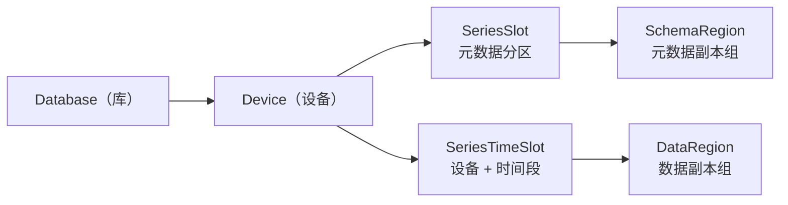

---
tags:
  - 技术/数据库
  - 技术/物联网
  - 时序数据库
  - IoTDB
created: 2026-11-27
updated: 2026-11-27
source: Apache IoTDB 官方文档（分布式/集群维护）+ 2.0.12 Release Notes
status: 已验证
type: 技术笔记
---

# IoTDB 集群架构与访问方案

> [!summary] 一句话结论
> IoTDB 是**原生分布式**时序数据库：**ConfigNode** 管控制面（分区表、节点状态，Raft 高可用），**DataNode** 管数据面（SchemaRegion / DataRegion，多副本），单机只是集群特例。客户端**只连 DataNode**（多地址直连或四层负载均衡 VIP），ConfigNode 和节点间复制流量**不能经过负载均衡**。

## 1. 版本与定位

- 当前主线 **2.0.x**（2026-11 最新 2.0.12）；
- 1.0 起分布式 GA；1.3 引入表模型（关系型 SQL），与树模型并存；2.0 增加 AINode、可观测性增强、一键启停、C 驱动等；
- 适用：工业 IoT、MES 采集、车联网、能源等**高写入、时序查询**场景。

## 2. 集群角色

| 角色 | 职责 | 高可用 |
| --- | --- | --- |
| **ConfigNode（CNode）** | 控制面：节点状态、分区表（元数据分区 + 数据分区）、负载均衡、Region 迁移调度 | 多个 ConfigNode 组成 **Raft 高可用组**，全量备份；**过半数存活**集群才可服务 |
| **DataNode（DNode）** | 数据面：管理 SchemaRegion（元数据分片）与 DataRegion（数据分片），执行读写/查询 | 每个 Region 多副本，Leader/Follower |
| **AINode**（2.0，可选） | 集群内做时序分析、预测、ML 推理 | 按需部署，不参与核心读写 |

要点：

- 每个 Node 是**独立进程**，可一机多进程或一机一进程；
- 客户端**只能通过 DataNode 读写**，ConfigNode 不直接服务客户端；
- 生产建议 **3 ConfigNode + 3 DataNode**（3C3D），副本数 3。


*图 1：IoTDB 集群架构（Fireworks Tech Graph 生成的矢量 SVG）——客户端只连 DataNode；ConfigNode 独立控制面，Raft 高可用；副本同步与心跳走内网直连。*

## 3. 数据分区模型

这是理解 IoTDB 集群的核心：



| 概念 | 含义 |
| --- | --- |
| **SeriesSlot** | 元数据分区单位，按设备划分 |
| **SchemaRegion** | 多个 SeriesSlot 的集合，多副本、互为备份 |
| **SeriesTimeSlot** | 数据分区单位：同一设备 + 一段时间 |
| **DataRegion** | 多个数据分区的集合，多副本 |
| **Region** | 分布式存储/迁移/负载均衡的基本单元 |

分区表由 ConfigNode 维护，DataNode 缓存分区信息；副本分布在不同 DataNode，形成 Leader/Follower。

## 4. 共识与副本

DataNode 的 Region 副本之间支持两种共识协议（配置项 `schema_region_consensus_protocol_class` / `data_region_consensus_protocol_class`）：

| 协议 | 特点 | 适用 |
| --- | --- | --- |
| **IoTConsensus** | IoTDB 自研，异步/半同步复制，**写入性能好、延迟低** | 高吞吐写入，可接受最终一致 |
| **Ratis** | 基于 Raft 的**强一致**复制，多数派确认 | 对一致性要求高的场景 |

ConfigNode 之间固定用 Raft 保证控制面强一致。

## 5. 读写路径

**写入**：

```text
Client → DataNode（Region Leader）
  → 写 WAL
  → 写 MemTable → 刷成 TsFile
  → 副本同步（IoTConsensus / Ratis）到 Follower
```

**查询**：

```text
Client → 任意 DataNode（协调者）
  → SQL 解析、生成分布式执行计划
  → 分区裁剪，下发相关 DataNode 并行执行
  → 谓词/时间下推、聚合下推
  → 协调节点汇聚结果返回
```

客户端（Java/Python/C++/JDBC/REST）缓存分区信息，节点故障时自动切换。

## 6. 存储引擎

- **TsFile**：列式时序文件，按时间分区落盘；
- **WAL**：写入先落预写日志，保证崩溃恢复；
- **Compaction**：后台合并小文件、去重、提升查询效率；
- **TTL**：按时间自动过期删除；
- **冷热分层**：热数据 SSD，冷数据可下沉对象存储（2.0 / 企业能力）。

## 7. 高可用与扩缩容

| 故障 | 影响 | 恢复 |
| --- | --- | --- |
| 1 个 ConfigNode 挂 | 剩余节点重新选主，集群正常 | 自动 |
| ConfigNode 不过半 | 集群不可用（控制面失效） | 必须恢复多数派 |
| 1 个 DataNode 挂 | 其 Region Leader 切到其他副本 | 自动 |
| 副本数=1 的 DataNode 挂 | 该分片不可用 | 恢复节点/副本 |

扩容与再平衡：

- 新增 DataNode **秒级加入**，无需停机迁移，自动分担写入；
- Region 迁移：`migrate region 1 from 2 to 3`（1.3.3+ 推荐，支持 IoTConsensus/Ratis）；
- 迁移占带宽/磁盘，建议低峰执行；
- 2.0 提供 `start-all/stop-all` 一键启停脚本。

## 8. 部署形态与端口

| 形态 | 场景 |
| --- | --- |
| 单机 Standalone | 开发、小规模、单点可接受 |
| **3C3D 集群** | 生产最小高可用：3 ConfigNode + 3 DataNode |
| Docker / K8s（Helm） | 云原生部署 |
| 二进制 + 一键脚本 | 物理机/虚拟机部署 |

| 端口（默认） | 用途 | 是否对外 |
| --- | --- | --- |
| **6667** | DataNode Thrift RPC（JDBC/原生客户端） | 只对客户端网段 |
| **18080** | DataNode REST | 可按需 |
| 10710 / 22277 等 | ConfigNode RPC / 共识 | **仅 VPC 内** |
| 内部同步端口 | DataNode ↔ DataNode 副本复制 | **仅 VPC 内** |

> 具体端口以官方「端口说明」为准；原则是**只暴露客户端需要的 DataNode 端口**。

配置要点：

- DataNode 只配**种子** ConfigNode（`dn_target_config_node_list` 填一个），启动后自动同步完整拓扑；
- ConfigNode 个数建议奇数（3/5），副本数 = 当前加入的 ConfigNode 数；
- WAL 与数据盘分离、SSD、万兆网络；
- 每节点 JVM 堆 + 直接内存按数据量规划。

## 9. 客户端访问：用哪个 IP

| 方式 | 入口 | 优点 | 缺点 |
| --- | --- | --- | --- |
| **A. 多地址直连（推荐默认）** | `jdbc:iotdb://dn1:6667,dn2:6667,dn3:6667/` | 无单点、自动故障切换、延迟最低 | 客户端要配全部节点；扩缩容要更新配置/DNS |
| **B. 云负载均衡 VIP** | 一个 VIP → DataNode 组 | 客户端只配一个地址；扩缩容透明 | LB 是新增单点（需多 AZ）；要调超时/会话保持 |
| **C. K8s Service** | ClusterIP/NodePort/LoadBalancer | 与 K8s 集成好、StatefulSet 稳定 DNS | 需处理外部 TCP 监听 |

IoTDB 官方 JDBC/原生客户端支持**多节点列表 + 自动 failover**（2.0 的 C 驱动也补了多节点切换），所以 A 是标准做法；B 是“想要单一入口”时的可选优化。

```text
jdbc:iotdb://192.0.2.2.11:6667,192.0.2.2.12:6667,192.0.2.2.13:6667/?useSSL=false
```

## 10. 前面能加云负载均衡吗

能，但只加在「客户端 → DataNode」这一层，并满足以下条件：

| 项 | 要求 |
| --- | --- |
| 监听类型 | **四层 TCP**（JDBC/原生走 Thrift 二进制，不能七层 HTTP） |
| 健康检查 | TCP 检查 `6667`，最好叠加业务级检查 |
| 会话保持 | 建议开启（源 IP 粘性），减少长连接漂移 |
| 空闲超时 | 调大（如 3600s），IoTDB 是长连接、查询可能流式返回 |
| 后端 | **只挂 DataNode**，绝不挂 ConfigNode |
| 多可用区 | LB 自身跨 AZ，否则成为新单点 |
| 带宽 | 大查询结果经过 LB，注意带宽/连接数上限 |

> [!warning] 绝对不能加 LB 的流量
> - ConfigNode ↔ ConfigNode（Raft 选主/日志复制）
> - DataNode ↔ DataNode（Region 副本同步 / IoTConsensus / Ratis）
> - ConfigNode ↔ DataNode（心跳、分区表同步）
>
> 这些是集群内部共识与复制流量，必须走节点间**内网直连**；经过 LB/NAT 会破坏连接语义、增加延迟，严重时导致选主异常、副本落后。

云 LB 典型配置（以阿里云 CLB/NLB 为例）：

| 配置项 | 值 |
| --- | --- |
| 监听协议 | TCP |
| 监听端口 | 6667 |
| 后端服务器 | DataNode 的 6667（跨可用区） |
| 健康检查 | TCP:6667，间隔 5s，不健康阈值 2 |
| 会话保持 | 开启（源 IP） |
| 空闲超时 | 3600s |
| 安全组 | 仅放行客户端网段到 LB；DataNode 只放行 LB 与集群内网 |

REST 访问（`18080`）可以放在七层 LB/Ingress 后面，但与 6667 **分开监听**。

## 11. 扩缩容时访问层怎么处理

| 方式 | 加 DataNode 后 |
| --- | --- |
| A 多地址 | 更新客户端连接串（或 DNS 多 A/服务发现） |
| B LB | 后端池加节点即可，客户端无感；健康检查自动摘除旧节点 |
| K8s | StatefulSet 扩副本，Service/Endpoint 自动更新 |

## 12. 什么情况下不该上集群

- 数据量 < 单机容量、可用性要求一般 → 单机足够，集群只增加运维复杂度；
- 写入 QPS 不高但查询复杂 → 优先优化建模/时间分区/索引，而非加节点；
- 集群最小生产规模就是 3C3D，机器成本要提前算。

## 13. 常见坑

1. **把 ConfigNode 暴露到公网/LB** —— 安全风险且无意义；
2. **在 DataNode 之间加 LB** —— 破坏副本同步，禁止；
3. **LB 超时太短** —— 长查询被切断；
4. **DataNode 只填一个 ConfigNode 且该节点先挂** —— 启动顺序要规划；
5. **副本数 1 却按高可用部署** —— 单节点故障即数据不可用；
6. **大查询走 LB** —— 报表类查询建议直连指定 DataNode。

## 14. 参考资料

- [IoTDB 分布式设计（cwiki）](https://cwiki.apache.org/confluence/pages/viewpage.action?pageId=199537343)
- [集群维护 / Region 迁移](https://iotdb.incubator.apache.org/zh/UserGuide/latest/User-Manual/Load-Balance_apache.html)
- [Apache IoTDB 2.0.12 Release Notes](https://github.com/apache/iotdb/blob/master/RELEASE_NOTES.md)
- [集群基本概念（Cluster-Concept）](https://apache.googlesource.com/iotdb-docs/+/dfa4358065197a9ee1be7674994fc21523adff88/src/zh/UserGuide/V1.3.x/stage/Cluster/Cluster-Concept.md)
