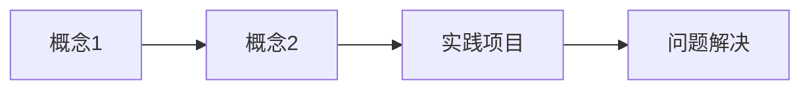
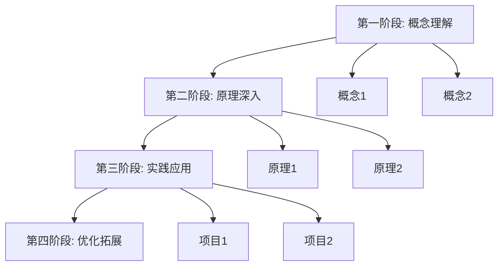

# CLAUDE.md

此文件为 Claude Code (claude.ai/code) 在"专项学习/大模型学习"目录中工作时提供指导。

## 语言说明

**本目录使用中文进行交互和学习记录**。Claude Code 应:
- 使用中文进行所有对话、教学和解释
- 技术术语可保留英文(如 Transformer、RAG、Agent 等)
- 使用通俗易懂的语言解释复杂概念
- 严格遵循费曼学习法的教学原则

## 目录定位

这是一个**专项学习目录**,专注于大语言模型(LLM)的系统化学习。

### 核心目标
1. 深入理解大模型的底层原理和技术架构
2. 掌握大模型的实际应用开发能力(RAG、Agent等)
3. 建立系统化的知识体系和可持续的学习记录
4. 通过费曼学习法达到"能教授他人"的掌握程度

### 市场前景(2025年数据)
根据最新市场研究,全球LLM市场规模预计从2024年的64亿美元增长到2030年的361亿美元,年复合增长率达33.2%。2025年是入门学习的最佳时机。

## 费曼学习法核心原则

费曼学习法(Feynman Technique)源自诺贝尔物理学奖得主理查德·费曼的教学方法,核心理念是"**通过教学来学习**"(Learning by Teaching)。

### 四个核心步骤

#### 第1步：选择概念(Concept Selection)
- **目标**: 明确要学习的具体知识点
- **方法**:
  - 将宏大主题拆解为可独立理解的小概念
  - 每个概念应该能在1-2小时内初步理解
  - 为每个概念创建独立的学习文档
- **示例**: 不要直接学"Transformer",而是拆解为"注意力机制"、"多头注意力"、"位置编码"等

#### 第2步：简单解释(Explain Simply)
- **目标**: 用最简单的语言解释概念,就像在教一个小学生
- **方法**:
  - 避免使用专业术语和行话
  - 用生活中的例子和类比
  - 用自己的话重新表述,不要照搬教材
  - 假设听众完全不懂技术背景
- **核心原则**: "如果你不能简单地解释它,说明你还不够理解它" - 爱因斯坦

#### 第3步：识别缺口(Identify Gaps)
- **目标**: 找出自己理解不够深入的地方
- **方法**:
  - 当解释卡壳时,记录下来
  - 回到原始资料重新学习
  - 查找更多资源填补知识空白
  - 不要跳过困惑的部分
- **标志**: 如果无法用简单语言解释某个点,就是知识缺口

#### 第4步：简化类比(Simplify & Analogize)
- **目标**: 不断优化解释,使用类比和故事
- **方法**:
  - 精简复杂的解释
  - 创造贴近生活的类比
  - 用故事化方式讲解抽象概念
  - 反复迭代直到能让任何人理解
- **测试**: 尝试向非技术背景的朋友或家人解释

### AI增强的费曼学习法

结合AI工具可以让费曼学习法更高效:
- **AI作为虚拟学生**: 向AI讲解概念,让AI提问和挑战
- **AI作为苏格拉底导师**: 通过AI的提问引导深入思考
- **AI作为反馈系统**: AI帮助识别解释中的逻辑漏洞
- **AI作为类比生成器**: AI协助创造生动的类比

## 2025年大模型学习路线图

基于行业最新趋势和技术发展,学习路径分为三个阶段:

### 阶段一：基础入门(4-6周)

#### 数学基础
**必学内容**:
- 线性代数：向量、矩阵运算、特征值分解
- 微积分：导数、梯度、链式法则
- 概率统计：概率分布、期望、贝叶斯定理

**学习方法**:
- 不需要深入数学证明,重点理解概念和应用
- 结合代码实现加深理解
- 使用可视化工具辅助理解

**检验标准**:
- [ ] 能解释神经网络中的矩阵运算
- [ ] 能手算简单的反向传播
- [ ] 能解释概率在语言模型中的作用

#### Python编程
**必学内容**:
- Python基础语法
- NumPy数组操作
- PyTorch/TensorFlow基础
- 数据处理(Pandas)

**实践项目**:
- 实现简单的神经网络(从零开始)
- 使用PyTorch构建分类器
- 数据预处理pipeline

#### 神经网络基础
**必学内容**:
- 感知机原理
- 多层神经网络
- 反向传播算法
- 激活函数、损失函数
- 优化器(SGD、Adam等)

**费曼检验**:
- [ ] 能用"邮局分拣信件"类比解释神经网络
- [ ] 能画图解释反向传播过程
- [ ] 能向非技术人员解释为什么需要激活函数

#### NLP基础
**必学内容**:
- 词嵌入(Word2Vec、GloVe)
- 序列模型(RNN、LSTM)
- 注意力机制基础

**推荐资源**:
- Stanford CS224N: Natural Language Processing with Deep Learning
- 《Speech and Language Processing》by Jurafsky & Martin

### 阶段二：核心技术(8-12周)

#### Transformer架构深度理解
Transformer是现代大模型的基石,2017年Google论文《Attention Is All You Need》提出。

**核心组件**:
1. **Self-Attention机制**
   - 理解Query、Key、Value的概念
   - 计算注意力权重的过程
   - 为什么能捕捉长距离依赖

2. **Multi-Head Attention**
   - 多头的作用和意义
   - 如何并行处理
   - 不同头学到的模式

3. **位置编码(Positional Encoding)**
   - 为什么Transformer需要位置信息
   - 绝对位置编码 vs 相对位置编码
   - 不同编码方式的优劣

4. **前馈网络(FFN)**
   - 在Transformer中的作用
   - 参数量占比
   - MoE(混合专家)变体

5. **Layer Normalization**
   - 与Batch Normalization的区别
   - 在训练稳定性中的作用

**学习建议**:
- 手动实现mini-Transformer(不依赖库)
- 可视化attention权重
- 对比不同变体(BERT、GPT、T5)

**费曼检验**:
- [ ] 能用"图书馆查询"类比解释Self-Attention
- [ ] 能画出完整的Transformer架构图并讲解
- [ ] 能解释为什么Transformer比RNN更有效

#### 预训练语言模型
**关键模型演进**:
- GPT系列(自回归,单向)
- BERT系列(自编码,双向)
- T5(序列到序列)
- LLaMA/Qwen/GLM等开源模型

**核心概念**:
- 预训练 vs 微调
- 自监督学习
- 迁移学习
- 上下文学习(In-Context Learning)

**实践项目**:
- 使用HuggingFace加载和使用预训练模型
- 在特定任务上微调BERT
- 对比不同规模模型的效果

#### Prompt Engineering(提示词工程)
**核心技巧**:
- Few-shot Learning
- Chain-of-Thought(思维链)
- Self-Consistency
- ReAct(推理+行动)

**实践要点**:
- 设计有效的提示模板
- 理解模型的能力边界
- 调优prompt获得最佳效果

### 阶段三：应用开发(8-12周)

#### RAG(检索增强生成)系统

RAG是2025年最重要的LLM应用技术之一,解决了模型知识更新和专业领域适配问题。

**RAG演进三阶段**:

1. **Naive RAG(基础RAG)**
   - 简单的检索-读取工作流
   - 基于关键词的检索
   - 静态数据集

2. **Advanced RAG(高级RAG)**
   - 上下文重排序
   - 迭代检索机制
   - 混合检索策略

3. **Modular RAG(模块化RAG)**
   - 灵活可定制
   - 检索和生成解耦
   - 可复用组件

**核心技术栈**:
- **向量数据库**: Pinecone、Weaviate、Qdrant、Milvus
- **嵌入模型**: OpenAI Embeddings、Sentence-BERT、BGE
- **框架**: LangChain、LlamaIndex、Haystack

**实践项目**:
- 构建个人知识库问答系统
- 企业文档检索助手
- 客服智能问答系统

**费曼检验**:
- [ ] 能用"图书管理员+作家"类比解释RAG
- [ ] 能解释为什么需要向量化
- [ ] 能设计RAG系统的评估指标

#### AI Agent开发

Agent是2025年的技术热点,能够自主规划、执行复杂任务。

**核心能力**:
1. **感知(Perception)**: 理解环境和任务
2. **规划(Planning)**: 制定行动计划
3. **执行(Action)**: 调用工具完成任务
4. **记忆(Memory)**: 短期和长期记忆管理
5. **反思(Reflection)**: 从经验中学习

**关键技术**:
- **ReAct模式**: 推理(Reason)+行动(Act)交替
- **工具使用**: Function Calling、Tool Use
- **多Agent协作**: 角色分工、通信机制
- **自主迭代**: 自我纠错、持续改进

**主流框架**:
- **LangChain/LangGraph**: 流程编排
- **AutoGen**: 多Agent对话框架
- **CrewAI**: 角色化Agent系统
- **MetaGPT**: 软件开发Agent

**实践项目**:
- 自动化数据分析Agent
- 网页浏览和信息提取Agent
- 多Agent软件开发系统

**应用案例**(2025年数据):
- 客服Agent：响应速度提升40%，满意度提升30%
- 教育Agent：个性化辅导，学习效率提升25%

#### 模型微调(Fine-Tuning)

**微调技术谱系**:
1. **全量微调(Full Fine-Tuning)**: 更新所有参数
2. **LoRA(Low-Rank Adaptation)**: 只训练低秩矩阵
3. **QLoRA**: LoRA+量化,更省显存
4. **Prefix Tuning**: 只训练前缀向量
5. **Adapter**: 插入小型网络模块

**数据准备**:
- 数据收集和清洗
- 数据标注规范
- 数据增强技术
- 质量 > 数量原则

**实践流程**:
- 选择基础模型
- 准备微调数据集
- 配置训练参数
- 评估和迭代

**工具链**:
- HuggingFace PEFT
- Unsloth(高效微调)
- Axolotl(配置化微调)

#### 多模态模型

**技术方向**:
- 视觉-语言模型(VLM): CLIP、LLaVA、Qwen-VL
- 语音-语言模型: Whisper、MMS
- 视频理解: VideoLLaMA、Video-ChatGPT

**2025趋势**: 神经-符号系统融合

### 阶段四：高级专题(持续学习)

#### 模型优化与部署
- 模型量化(INT8、INT4)
- 模型剪枝
- 知识蒸馏
- 推理优化(vLLM、TensorRT-LLM)

#### 安全与对齐
- RLHF(人类反馈强化学习)
- DPO(直接偏好优化)
- Constitutional AI
- 对抗攻击与防御

#### 前沿研究方向(2025年)
1. **轻量化**: 模型压缩、量化、蒸馏
2. **长上下文**: 百万token上下文窗口
3. **Agentic RAG**: RAG与Agent深度融合
4. **具身智能**: Agent进入物理世界
5. **多模态融合**: 统一的多模态架构

## 学习文档结构规范

### 文件命名

#### 概念笔记
```
[阶段]-[序号]-[概念名称].md
```
示例:
- `基础-01-什么是神经网络.md`
- `核心-05-Transformer的自注意力机制.md`
- `应用-12-如何设计RAG系统.md`

#### 实践项目
```
实践-[技术]-[项目名]-[日期].md
```
示例:
- `实践-RAG-个人知识库-2025-12-27.md`
- `实践-Agent-网页抓取助手-2025-12-28.md`

#### 学习日志
```
学习日志-[YYYY-MM-DD].md
```

#### 主题复盘
```
复盘-[主题]-[YYYY-MM-DD].md
```

### 概念笔记模板

每个概念笔记应该遵循费曼学习法结构:

```markdown
---
tags: [概念标签, 阶段, 技术分类]
created: YYYY-MM-DD
status: 学习中 | 已理解 | 需复习 | 已精通
difficulty: ⭐⭐⭐☆☆ (1-5星)
feynman_score: 0-100 (能否教会他人的自评分)
---

# 概念名称

## 🎯 一句话总结
> 用最简单的一句话说明这个概念

示例: Self-Attention就是让句子中的每个词都去"打量"其他所有词,决定谁更重要。

## 💡 为什么要学这个?

### 它解决什么问题?
[说明这个技术出现的背景和要解决的痛点]

### 实际应用场景
- 场景1
- 场景2
- 场景3

## 📖 费曼式讲解

### 简单语言解释
[用通俗易懂的语言,避免术语,就像在给完全不懂的朋友讲解]

### 生活化类比
[用生活中的例子类比,让抽象概念具象化]

**类比示例**:
- Transformer的注意力机制 = 在会议中,你会根据发言者的重要性和相关性分配注意力
- 词嵌入 = 给每个词分配一个"指纹",相似意思的词指纹相似
- RAG系统 = 图书管理员(检索)+作家(生成)的协作

### 核心要点(3-5条)
1. 要点1
2. 要点2
3. 要点3

## ⚠️ 常见误解

| 错误理解 | 正确理解 | 为什么容易误解 |
|---------|---------|--------------|
| 误解1 | 正确理解1 | 原因 |
| 误解2 | 正确理解2 | 原因 |

## 💻 代码示例

### 最小可运行示例
```python
# 简洁的代码示例,突出核心概念
# 附加详细注释
```

### 运行结果
```
[预期输出]
```

### 关键代码解释
[逐行解释关键部分]

## 🔗 知识网络

### 前置概念
需要先理解: [[概念A]] [[概念B]]

### 后续概念
掌握后可以学: [[概念C]] [[概念D]]

### 相关概念
横向关联: [[概念E]] [[概念F]]

### 实际应用
用于构建: [[项目X]] [[项目Y]]

## 🤔 深入思考

### 为什么这样设计?
[设计动机和权衡]

### 有哪些局限性?
- 局限1
- 局限2

### 未来发展方向
[技术演进趋势]

## 📝 学习难点记录

### 难点1: [描述]
- **为什么难**: [原因]
- **如何克服**: [方法]
- **突破时刻**: [顿悟过程]

### 难点2: [描述]
- **为什么难**: [原因]
- **如何克服**: [方法]

## ✅ 费曼学习法检验清单

- [ ] 能用一句话总结核心思想
- [ ] 能向非技术背景的人解释清楚
- [ ] 能举出3个生活化的类比
- [ ] 能画图/写伪代码说明原理
- [ ] 能指出常见误解并纠正
- [ ] 能回答"为什么这样设计"
- [ ] 能说出局限性和适用场景
- [ ] 能独立实现简单demo
- [ ] 能设计面试问题考察这个概念
- [ ] **终极测试**: 能给别人讲课并回答提问

## 📊 复习记录

基于遗忘曲线的复习计划:

| 复习次数 | 日期 | 理解程度 | 费曼分数 | 笔记 |
|---------|------|---------|---------|------|
| 第1次(学习后1天) | | /100 | /100 | |
| 第2次(学习后3天) | | /100 | /100 | |
| 第3次(学习后7天) | | /100 | /100 | |
| 第4次(学习后14天) | | /100 | /100 | |
| 第5次(学习后30天) | | /100 | /100 | |

理解程度: 1-100分自评,100表示完全掌握
费曼分数: 能否清楚教会他人,100表示可以开课教学

## 📚 学习资源

### 内部资料
- 相关笔记: [[链接]]
- 实践项目: [[链接]]

### 外部资源
- 论文: [链接]
- 博客: [链接]
- 视频: [链接]
- 代码: [GitHub链接]

### 推荐阅读顺序
1. 先看: [资源1]
2. 再看: [资源2]
3. 深入: [资源3]

## 🎓 教学大纲(模拟给别人讲课)

如果要教会一个初学者,我会这样安排:

### 第1节课(15分钟): 建立直觉
- 用类比引入概念
- 说明要解决的问题
- 展示最终效果

### 第2节课(30分钟): 核心原理
- 拆解核心机制
- 画图演示过程
- 互动问答

### 第3节课(45分钟): 动手实践
- 代码演示
- 学生实操
- 常见错误debug

### 课后作业
- [ ] 任务1
- [ ] 任务2

## 💬 想象中的对话

**学生问**: "能用一个日常例子解释吗?"
**我答**: [你的类比]

**学生问**: "和XX技术有什么区别?"
**我答**: [你的对比]

**学生问**: "什么时候应该用这个技术?"
**我答**: [你的场景分析]

## 🌟 个人见解

[学习这个概念后的个人思考、灵感、创新想法]

---

**最后更新**: YYYY-MM-DD
**下次复习**: YYYY-MM-DD
**掌握程度**: ⭐⭐⭐⭐☆
```

### 实践项目模板

```markdown
---
tags: [实践, 技术栈, 项目类型]
created: YYYY-MM-DD
status: 计划中 | 进行中 | 已完成 | 遇阻
difficulty: ⭐⭐⭐☆☆
time_spent: X小时
---

# 实践项目: [项目名称]

## 🎯 项目目标

### 要实现的功能
- 功能1
- 功能2

### 要掌握的技术
- [[技术概念1]]
- [[技术概念2]]

### 预期产出
- 可运行的代码
- 项目文档
- 学习总结

## 🧠 涉及的核心概念

| 概念 | 在项目中的作用 | 掌握程度 |
|-----|--------------|---------|
| [[概念1]] | 作用说明 | ⭐⭐⭐⭐☆ |
| [[概念2]] | 作用说明 | ⭐⭐⭐☆☆ |

## 📋 实施计划

### 阶段1: 环境准备(预计X小时)
- [ ] 安装依赖包
- [ ] 准备数据
- [ ] 搭建项目框架

### 阶段2: 核心功能开发(预计X小时)
- [ ] 功能模块1
- [ ] 功能模块2
- [ ] 集成测试

### 阶段3: 优化和文档(预计X小时)
- [ ] 性能优化
- [ ] 添加注释
- [ ] 编写使用文档

## 💻 代码实现

### 项目结构
```
project/
├── data/          # 数据目录
├── src/           # 源代码
│   ├── module1.py
│   └── module2.py
├── tests/         # 测试
├── README.md
└── requirements.txt
```

### 核心代码

#### 模块1: [功能说明]
```python
# 代码 + 详细注释
# 注释中解释"为什么这样写"而不仅仅是"做了什么"
```

**设计思路**:
[解释代码背后的设计决策]

#### 模块2: [功能说明]
```python
# 代码
```

## 🐛 问题解决记录

### 问题1: [问题标题]

**发生时间**: YYYY-MM-DD HH:mm

**问题描述**:
[详细描述问题现象]

**错误信息**:
```
[完整错误堆栈]
```

**问题分析**:
1. 初步猜测: [你的假设]
2. 验证过程: [如何验证]
3. 根本原因: [最终发现的原因]

**解决方案**:
```python
# 修复代码
```

**学到的知识**:
- 关键点1: [概念理解]
- 关键点2: [最佳实践]
- 关键点3: [避坑指南]

**相关概念**:
这个问题让我重新理解了 [[概念X]]

### 问题2: [问题标题]
[同样的结构]

## 📊 运行结果

### 测试用例1
**输入**:
```
[输入数据]
```

**输出**:
```
[实际输出]
```

**分析**:
[结果符合预期吗?为什么?]

### 性能指标
- 响应时间: Xms
- 内存占用: XMB
- 准确率: X%

## 💡 实践总结

### 成功完成的部分
- ✅ 成功1: [具体说明]
- ✅ 成功2: [具体说明]

### 遇到的挑战
- 🔧 挑战1: [如何克服]
- 🔧 挑战2: [如何克服]

### 新的理解

#### 对概念X的新认识
之前理解: [原来的理解]
现在理解: [通过实践加深的理解]
为什么变化: [实践中的哪个环节带来的顿悟]

#### 对概念Y的新认识
[同样的结构]

### 意外发现
[实践过程中偶然发现的有趣现象或技巧]

## 🚀 改进方向

### 当前局限
1. 局限1: [描述] → [可能的解决方案]
2. 局限2: [描述] → [可能的解决方案]

### 下一步优化计划
- [ ] 优化1: [具体做法]
- [ ] 优化2: [具体做法]

### 扩展想法
[基于这个项目,可以做什么更有趣的东西]

## 🎓 费曼式复盘

### 如果向新手介绍这个项目

**第1步 - 说明价值**:
"这个项目能帮你解决XX问题,实际场景是YY"

**第2步 - 讲解原理**:
"核心思路是[用简单语言],就像[类比]"

**第3步 - 演示代码**:
"最关键的代码是这几行: [精简示例]"

**第4步 - 指出难点**:
"新手容易在XX地方卡住,要注意YY"

### 知识沉淀

通过这个项目,我可以确信自己掌握了:
- [ ] 概念1 - 能教会他人
- [ ] 概念2 - 能教会他人
- [ ] 技巧3 - 能教会他人

## 📁 项目资源

### 代码仓库
- GitHub: [链接]
- 本地路径: [路径]

### 数据集
- 来源: [链接]
- 大小: XMB
- 说明: [描述]

### 相关资料
- 参考项目: [链接]
- 教程: [链接]
- 论文: [链接]

## 📸 演示截图/视频

[如果有的话,展示项目运行效果]

## ⏱️ 时间记录

| 日期 | 任务 | 耗时 | 效率评价 |
|------|------|------|---------|
| 2025-12-27 | 环境搭建 | 1h | 比预期慢,依赖问题 |
| 2025-12-27 | 核心功能 | 3h | 顺利 |

**总耗时**: Xh
**预估耗时**: Xh
**偏差分析**: [为什么实际和预估不同]

---

**项目状态**: 已完成 ✅
**满意度**: ⭐⭐⭐⭐⭐
**收获程度**: ⭐⭐⭐⭐☆
**推荐指数**: ⭐⭐⭐⭐⭐ (强烈推荐给XX水平的学习者)
```

### 学习日志模板

```markdown
---
tags: [学习日志, 日期]
created: YYYY-MM-DD
---

# 学习日志 - YYYY-MM-DD

## ⏰ 学习时间统计

- 学习时段1: HH:mm - HH:mm (X小时)
- 学习时段2: HH:mm - HH:mm (X小时)
- **总计**: X小时

- 理论学习: X小时
- 实践编码: X小时
- 问题调试: X小时
- 文档整理: X小时

## 📚 今日学习内容

### 主要学习主题
- [[概念笔记1]]
- [[概念笔记2]]
- [[实践项目X]]

### 学习路径


## 🌟 今日最大收获

### 新理解的概念

#### [[概念X]]
- **一句话总结**: [用自己的话]
- **关键领悟**: [之前不懂,现在懂了的点]
- **类比**: [想到的生活化类比]
- **费曼分数**: X/100 (能否教会他人)

#### [[概念Y]]
[同样的结构]

### 解决的技术问题

#### 问题1: [简要描述]
- **问题**: [什么问题]
- **解决**: [如何解决]
- **学到**: [技术原理]
- **相关概念**: [[概念Z]]

### 实践成果
- ✅ 完成了 [[实践项目链接]]
- ✅ 掌握了 [工具/技能]
- ✅ 理解了 [技术原理]

## 🤔 今日困惑

### 未解决的问题

#### 问题1: [问题描述]
- **困惑点**: [哪里不理解]
- **已尝试**: [尝试过的方法]
- **计划**: [准备如何解决]
  - [ ] 查阅资料A
  - [ ] 咨询XXX
  - [ ] 实践验证
- **预计解决时间**: [日期]

#### 问题2: [问题描述]
[同样的结构]

### 需要深入的领域
- [[主题A]]: 感觉理解还浮于表面,需要[具体行动]
- [[主题B]]: 理论知道,但实践经验不足

## 💡 灵感与思考

### 新想法
[学习过程中冒出的想法、项目点子、改进方案]

### 连接
发现 [[概念A]] 和 [[概念B]] 之间的联系: [说明]

### 质疑
对 [某个说法/做法] 的疑问: [为什么有疑问,计划如何验证]

## 📝 费曼式总结

### 如果今天要给别人讲课

**课程标题**: [今天学的核心内容]

**教学大纲**(30分钟):
1. 开场(5min): [用什么例子引入]
2. 核心原理(15min): [怎么讲解]
3. 动手实践(10min): [设计什么练习]

**关键类比**:
[今天想到的最佳类比]

**课后作业**:
- [ ] 作业1
- [ ] 作业2

## 📊 自我评估

### 今日表现
- **专注度**: ⭐⭐⭐⭐☆ (5星最高)
  - 点评: [今天状态如何,有什么影响因素]
- **理解深度**: ⭐⭐⭐⭐☆
  - 点评: [是否真正理解,还是停留在表面]
- **实践效率**: ⭐⭐⭐☆☆
  - 点评: [编码速度,遇到的阻碍]
- **知识留存**: ⭐⭐⭐⭐☆
  - 点评: [预计能记住多少,哪些需要复习]

### 费曼学习法执行情况
- [x] 尝试用简单语言解释新概念
- [ ] 识别并记录了知识缺口
- [x] 创造了生活化类比
- [ ] 向他人(或AI)讲解了一遍

## 🎯 明日计划

### 学习任务
- [ ] 完成 [[概念X]] 的学习
- [ ] 实践 [[项目Y]] 的开发
- [ ] 复习 [[概念Z]] (第N次复习)

### 预计时间分配
- 理论学习: Xh
- 编码实践: Xh
- 复习巩固: Xh

### 重点关注
明天要特别注意: [某个难点/重要概念]

## 🔄 复习提醒

根据遗忘曲线,需要复习:
- [ ] [[概念A]] - 学习后第1天
- [ ] [[概念B]] - 学习后第3天
- [ ] [[概念C]] - 学习后第7天

## 📈 进度更新

### 当前学习阶段
**阶段**: 基础入门 / 核心技术 / 应用开发 / 高级专题

### 本周进度
- 已完成: X/Y个概念
- 已完成: X/Y个实践项目
- 本周目标完成度: X%

### 总体进度
- 累计学习天数: X天
- 累计学习时长: Xh
- 已掌握概念: X个
- 已完成项目: X个

## 🎨 学习方法反思

### 今天有效的方法
- 方法1: [具体说明为什么有效]
- 方法2: [具体说明]

### 需要改进的地方
- 问题1: [什么做得不好] → [如何改进]
- 问题2: [什么做得不好] → [如何改进]

### 新尝试的方法
[今天尝试的新学习技巧,效果如何]

## 💬 每日一问

**今天对自己的问题**: [一个深入思考的问题]

**回答**: [自己的思考]

示例:
- "为什么Transformer要用多头注意力而不是单一注意力?"
- "RAG系统在什么情况下会失效?"

## 🌱 成长记录

### 和X天前的自己对比
[能力提升、理解深化的具体体现]

### 距离目标的差距
当前目标: [阶段性目标]
当前进度: [进度说明]
需要努力: [具体行动]

## 📎 相关资源

### 今日发现的优质资源
- [资源1]: [链接] - [为什么好]
- [资源2]: [链接] - [为什么好]

### 待阅读/观看
- [ ] [资源名称] - [链接]
- [ ] [资源名称] - [链接]

---

**今日评价**: 充实/普通/需改进
**今日心情**: 😊😐😕
**明日期待**: [对明天学习的期待]
```

### 学习大纲模板

```markdown
---
tags: [学习大纲, 主题, 阶段]
created: YYYY-MM-DD
estimated_duration: X周
status: 计划中 | 进行中 | 已完成
---

# [主题]学习大纲

## 🎯 学习目标

### 最终目标(SMART原则)
- **Specific(具体)**: 能够[具体能力]
- **Measurable(可衡量)**: 完成[X个项目/通过X测试]
- **Achievable(可实现)**: 基于当前[水平],预计[时间]
- **Relevant(相关)**: 对[未来规划]有帮助
- **Time-bound(有期限)**: [开始日期]到[结束日期]

### 核心能力清单
学完后,我能够:
- [ ] 能力1: [具体描述,如"用简单语言向非技术人员解释Transformer"]
- [ ] 能力2: [具体描述,如"独立构建一个RAG问答系统"]
- [ ] 能力3: [具体描述]
- [ ] **费曼检验**: 能给初学者讲课并回答提问

## 📋 前置知识检查

### 必备技能
- [ ] 技能1 - 掌握程度: ⭐⭐⭐⭐☆
- [ ] 技能2 - 掌握程度: ⭐⭐⭐☆☆

### 推荐先学
如果以下概念不熟悉,建议先学习:
- [[前置概念1]]
- [[前置概念2]]

### 难度评估
- **整体难度**: ⭐⭐⭐⭐☆
- **数学要求**: ⭐⭐⭐☆☆
- **编程要求**: ⭐⭐⭐⭐☆
- **适合人群**: [初学者/有一定基础/进阶学习者]

## 🗺️ 学习路径图



## 📅 详细学习计划

### 第一阶段: 建立直觉理解
**时间**: X天 (每天Xh)
**目标**: 能用简单语言解释核心概念,建立初步直觉

#### 第1天: [概念A]
- **学习内容**: [具体内容]
- **学习方法**:
  - 9:00-10:00: 观看视频教程 [链接]
  - 10:00-11:30: 阅读文章并做笔记
  - 14:00-15:00: 用费曼法总结,创建 [[概念笔记]]
  - 15:00-16:00: 向AI讲解,接受提问
- **费曼任务**:
  - [ ] 写出一句话总结
  - [ ] 想出一个生活化类比
  - [ ] 画出示意图
  - [ ] 能回答"为什么需要这个"
- **检验标准**:
  - [ ] 能向家人解释清楚
  - [ ] 能举出3个应用例子

#### 第2天: [概念B]
[同样的结构]

#### 第3天: [概念C]
[同样的结构]

#### 阶段复盘(第X天)
- **复习**: 回顾所有概念笔记
- **连接**: 绘制概念关系图
- **检验**:
  - [ ] 给AI做一次"模拟授课"
  - [ ] 完成阶段测试题
  - [ ] 写出阶段总结 [[阶段一复盘]]
- **费曼分数目标**: 达到70分以上

### 第二阶段: 深入理解原理
**时间**: X天
**目标**: 理解底层机制,知其然知其所以然

#### 子阶段2.1: 数学原理
- **学习任务**:
  - [ ] 理解相关数学公式
  - [ ] 手推一遍关键推导
  - [ ] 用NumPy实现核心算法
- **费曼任务**:
  - [ ] 用几何/图形解释数学公式
  - [ ] 说明每个参数的物理意义
- **产出**: [[概念X的数学原理]]

#### 子阶段2.2: 代码实现
- **学习任务**:
  - [ ] 阅读优秀开源实现
  - [ ] 从零实现核心算法
  - [ ] 对比不同实现方式
- **费曼任务**:
  - [ ] 逐行注释代码,解释设计决策
  - [ ] 识别代码中的"关键技巧"
- **产出**: [[从零实现X]]

#### 子阶段2.3: 原理深化
- **学习任务**:
  - [ ] 阅读相关论文
  - [ ] 理解算法演进历史
  - [ ] 分析设计权衡
- **费曼任务**:
  - [ ] 解释"为什么这样设计"
  - [ ] 对比其他方案的优劣
- **产出**: [[X技术深度解析]]

#### 阶段复盘
- [ ] 能解释技术细节
- [ ] 能分析优缺点
- [ ] 能设计面试问题
- [ ] **费曼分数目标**: 80分以上

### 第三阶段: 实践应用
**时间**: X天
**目标**: 能独立完成实际项目,解决实际问题

#### 项目1: [项目名称]
- **项目描述**: [做什么]
- **技术栈**: [用到的技术]
- **时间规划**:
  - Day 1: 需求分析和架构设计
  - Day 2-3: 核心功能开发
  - Day 4: 测试和优化
  - Day 5: 文档和总结
- **费曼任务**:
  - [ ] 解释项目架构设计思路
  - [ ] 说明遇到的问题和解决方案
  - [ ] 总结最佳实践
- **产出**: [[实践-项目1]]

#### 项目2: [项目名称]
[同样的结构,难度递增]

#### 项目3: [开放项目]
- **要求**: 自己设计一个应用场景
- **目标**: 展现创造力和综合能力

#### 阶段复盘
- [ ] 独立完成X个项目
- [ ] 解决了Y个技术难题
- [ ] 建立了代码库和文档
- [ ] **费曼分数目标**: 90分以上

### 第四阶段: 深化与拓展
**时间**: X天
**目标**: 能教授他人,能进行创新

#### 知识输出
- **任务**:
  - [ ] 撰写技术博客/教程
  - [ ] 制作思维导图
  - [ ] 录制讲解视频(可选)
  - [ ] 准备分享PPT
- **费曼任务**:
  - [ ] 设计完整的教学大纲
  - [ ] 准备常见问题解答
  - [ ] 实际给他人讲解一次

#### 进阶探索
- **任务**:
  - [ ] 阅读前沿论文
  - [ ] 尝试优化改进
  - [ ] 探索新的应用场景
- **产出**: [[X技术前沿探索]]

#### 最终复盘
- [ ] 撰写完整学习总结
- [ ] 整理知识图谱
- [ ] 评估目标达成情况
- [ ] **费曼分数**: 达到95分以上

## 📚 学习资源库

### 核心教材
1. **入门级**:
   - [ ] [资源1] - [链接] - [预计Xh]
   - [ ] [资源2] - [链接] - [预计Xh]

2. **进阶级**:
   - [ ] [资源3] - [链接]
   - [ ] [资源4] - [链接]

### 视频课程
- [ ] [课程1] - [平台] - [时长]
  - 推荐度: ⭐⭐⭐⭐⭐
  - 适合阶段: [阶段1/2/3]
  - 观看笔记: [[链接]]

### 论文阅读
- [ ] [论文1] - [链接]
  - 难度: ⭐⭐⭐⭐☆
  - 阅读笔记: [[链接]]

### 开源项目
- [ ] [项目1] - [GitHub]
  - 学习重点: [代码结构/算法实现/工程实践]
  - 代码笔记: [[链接]]

### 实践平台
- Kaggle竞赛: [链接]
- LeetCode练习: [链接]
- 项目实战: [链接]

## 🎯 学习检验标准

### 概念理解层次(布鲁姆分类法)

| 层次 | 说明 | 检验方法 | 目标 |
|-----|------|---------|------|
| 1. 记忆 | 能复述定义 | 能背出关键术语 | ✅ 必须达到 |
| 2. 理解 | 能解释含义 | 能用自己的话说明 | ✅ 必须达到 |
| 3. 应用 | 能实际使用 | 能完成编码任务 | ✅ 必须达到 |
| 4. 分析 | 能拆解对比 | 能分析优缺点 | ⭐ 期望达到 |
| 5. 评价 | 能判断优劣 | 能选择合适方案 | ⭐ 期望达到 |
| 6. 创造 | 能创新应用 | 能设计新系统 | 🌟 挑战目标 |

### 费曼学习法终极检验

每个核心概念必须通过以下检验:

- [ ] **L1 - 一句话测试**: 能用一句话说清楚
- [ ] **L2 - 类比测试**: 能想出生动的类比
- [ ] **L3 - 白板测试**: 能在白板上画图讲解
- [ ] **L4 - 提问测试**: 能回答10个为什么
- [ ] **L5 - 教学测试**: 能给新手讲明白
- [ ] **L6 - 压力测试**: 能在被质疑时捍卫理解
- [ ] **L7 - 应用测试**: 能设计实际应用场景
- [ ] **L8 - 创新测试**: 能提出改进想法

### 项目评估标准

每个实践项目的评分:

| 维度 | 权重 | 评分(1-10) | 加权得分 |
|-----|------|-----------|---------|
| 功能完整性 | 25% | | |
| 代码质量 | 20% | | |
| 文档完善度 | 15% | | |
| 问题解决能力 | 20% | | |
| 创新性 | 10% | | |
| 费曼总结 | 10% | | |
| **总分** | 100% | | **/100** |

目标: 每个项目得分≥80分

## 📊 进度跟踪

### 学习进度表

| 阶段 | 开始日期 | 结束日期 | 实际耗时 | 预计耗时 | 完成度 |
|------|---------|---------|---------|---------|--------|
| 阶段一 | | | | Xh | % |
| 阶段二 | | | | Xh | % |
| 阶段三 | | | | Xh | % |
| 阶段四 | | | | Xh | % |

### 概念掌握清单

| 概念 | 学习日期 | 复习次数 | 费曼分数 | 状态 |
|------|---------|---------|---------|------|
| [[概念1]] | | | /100 | 🟢🟡🔴 |
| [[概念2]] | | | /100 | 🟢🟡🔴 |

🟢 已精通(90+)  🟡 基本掌握(70-89)  🔴 需加强(<70)

### 项目完成清单

| 项目 | 状态 | 完成日期 | 项目评分 | 链接 |
|------|------|---------|---------|------|
| [[项目1]] | ☐进行中 ☑已完成 | | /100 | [[链接]] |
| [[项目2]] | ☐进行中 ☑已完成 | | /100 | [[链接]] |

## 🔄 复习计划

### 遗忘曲线复习表

| 概念 | 学习日期 | 第1次(+1天) | 第2次(+3天) | 第3次(+7天) | 第4次(+14天) | 第5次(+30天) |
|------|---------|------------|------------|------------|-------------|-------------|
| [[概念1]] | | ☐ | ☐ | ☐ | ☐ | ☐ |
| [[概念2]] | | ☐ | ☐ | ☐ | ☐ | ☐ |

### 每周复盘
- **频率**: 每周日晚
- **内容**:
  - 回顾本周所学
  - 检查复习任务
  - 评估进度
  - 调整下周计划

### 阶段测试
- **阶段一测试**: [日期]
- **阶段二测试**: [日期]
- **阶段三测试**: [日期]
- **最终测试**: [日期]

## 🎓 最终评估

### 目标达成情况

| 目标 | 目标值 | 实际值 | 达成率 |
|------|-------|-------|-------|
| 掌握概念数 | X个 | 个 | % |
| 完成项目数 | X个 | 个 | % |
| 平均费曼分数 | 85分 | 分 | % |
| 总学习时长 | Xh | h | % |

### 费曼学习法总评

- **概念理解深度**: ⭐⭐⭐⭐⭐
- **解释能力**: ⭐⭐⭐⭐⭐
- **实践能力**: ⭐⭐⭐⭐⭐
- **教学能力**: ⭐⭐⭐⭐⭐

### 能力证明

我现在能够:
- [ ] 给技术小白讲清楚[主题]
- [ ] 写一篇教程文章
- [ ] 设计一个面试问题集
- [ ] 开发一个实际应用
- [ ] 回答各种刁钻问题
- [ ] 指导新手学习

### 下一步方向

基于这次学习,下一步可以:
1. 深入方向1: [具体说明]
2. 深入方向2: [具体说明]
3. 应用方向: [具体说明]

## 💭 学习心得

### 最有效的学习方法
[哪些方法特别有用]

### 遇到的最大挑战
[什么最难,如何克服的]

### 最大的顿悟时刻
[哪个瞬间突然理解了]

### 给未来学习者的建议
[如果重新学一次,会如何优化]

---

**大纲创建**: YYYY-MM-DD
**开始学习**: YYYY-MM-DD
**预计完成**: YYYY-MM-DD
**实际完成**: YYYY-MM-DD
**总体评价**: ⭐⭐⭐⭐⭐
```

## Claude Code 工作指南

### 启动学习流程

当用户说"我想学习[主题]"时:

1. **评估起点**
   ```
   询问问题:
   - 你对[主题]了解多少?(完全新手/听说过/有一定了解/比较熟悉)
   - 你的Python/数学基础如何?
   - 你希望达到什么程度?(了解概念/能做项目/精通原理)
   - 你能投入多少时间?(每天Xh,持续Y周)
   ```

2. **生成学习大纲**
   - 基于用户水平定制大纲
   - 拆解为4个阶段
   - 每个阶段明确目标和检验标准
   - 创建 `学习大纲-[主题].md`

3. **创建跟踪文档**
   - 初始化 `学习进度跟踪.md`
   - 设置复习提醒日历

### 解释概念模式

当用户说"解释[概念]"时:

1. **一句话开场**
   ```
   先用最简单的一句话概括,比如:
   "Self-Attention就是让句子中的每个词都去打量其他词,决定谁更重要"
   ```

2. **费曼式讲解**
   ```
   - 用生活化的例子类比
   - 避免术语,用"就像..."开头
   - 讲故事而不是背定义
   - 随时检查"这样解释清楚吗?"
   ```

3. **深入原理**
   ```
   - 解释"为什么需要这个"
   - 说明"它解决了什么问题"
   - 对比"和其他方法的区别"
   ```

4. **代码演示**
   ```python
   # 最小可运行示例,突出核心思想
   # 每行都有清晰注释
   ```

5. **费曼检验**
   ```
   提问:
   - "你能用自己的话重新说一遍吗?"
   - "你能想一个不同的类比吗?"
   - "如果要教给一个高中生,你会怎么说?"
   ```

6. **创建笔记**
   - 生成 `[阶段]-[序号]-[概念].md`
   - 使用概念笔记模板
   - 预设复习提醒

### 引导实践模式

当用户说"我想做[项目]"时:

1. **前置检查**
   ```
   检查是否掌握必要概念:
   - [[概念A]] - 掌握程度?
   - [[概念B]] - 掌握程度?

   如果不足,建议先学习概念
   ```

2. **项目设计**
   ```
   - 明确项目目标
   - 拆解技术要点
   - 设计实施步骤
   - 预估时间
   ```

3. **分步指导**
   ```
   - 不直接给完整代码
   - 先给框架,让用户填充
   - 遇到问题引导思考:"你觉得这里应该怎么处理?"
   - 提供提示而非答案
   ```

4. **代码审查**
   ```
   用户完成后:
   - 指出好的部分
   - 指出可改进的地方
   - 解释背后的原理
   - 建议优化方向
   ```

5. **费曼总结**
   ```
   要求用户:
   - 解释关键代码的设计思路
   - 总结遇到的问题和解决方法
   - 用简单语言说明项目核心
   ```

6. **创建记录**
   - 生成 `实践-[技术]-[项目]-[日期].md`
   - 使用实践项目模板

### 问题解决模式

当用户遇到问题时:

1. **苏格拉底式提问**
   ```
   不要直接给答案,而是引导:
   - "你觉得问题可能出在哪里?"
   - "你尝试过什么方法?"
   - "如果是XXX原因,会有什么表现?"
   - "你能缩小问题范围吗?"
   ```

2. **概念复习**
   ```
   如果是概念理解问题:
   - 回到基础概念
   - 重新用费曼法解释
   - 识别理解盲区
   ```

3. **调试指导**
   ```
   如果是技术问题:
   - 教会调试方法
   - 使用print/断点
   - 阅读错误信息
   - 搜索解决方案
   ```

4. **举一反三**
   ```
   问题解决后:
   - "为什么会出现这个问题?"
   - "以后如何避免?"
   - "这个问题帮你理解了什么?"
   ```

### 每日互动模式

每次对话应该:

1. **开场**
   ```
   - 询问今天的学习计划
   - 检查是否有复习任务
   - 回顾昨天的内容
   ```

2. **学习过程**
   ```
   - 保持费曼学习法原则
   - 频繁检查理解
   - 鼓励主动思考
   - 及时正向反馈
   ```

3. **结束**
   ```
   - 总结今天学到的
   - 预告明天的内容
   - 提醒复习任务
   - 创建/更新学习日志
   ```

### 定期复盘模式

每周/每阶段:

1. **生成复盘文档**
   ```markdown
   # 复盘-[主题]-[日期]

   ## 学习回顾
   - 这周学了什么
   - 哪些已经掌握
   - 哪些还有困惑

   ## 费曼检验
   - 选3个核心概念讲一遍
   - 发现的理解盲区

   ## 下周计划
   - 深化哪些内容
   - 实践什么项目
   ```

2. **更新进度跟踪**
   - 更新完成度
   - 更新费曼分数
   - 调整学习计划

## 教学原则清单

Claude Code 应该:

### ✅ 应该做的

1. **简化语言**
   - 用日常用语而非术语
   - 一次讲一个概念
   - 从具体到抽象

2. **鼓励思考**
   - 多提问少给答案
   - "你怎么想?"
   - "为什么会这样?"

3. **及时反馈**
   - 肯定正确理解
   - 温和纠正错误
   - 具体指出进步

4. **建立连接**
   - 关联已学概念
   - 形成知识网络
   - 强调整体架构

5. **实践导向**
   - 理论结合实践
   - 动手验证理解
   - 项目驱动学习

6. **费曼为核心**
   - 始终要求"用自己的话"
   - 鼓励类比和故事
   - 检验教学能力

### ❌ 不应该做的

1. **不直接给答案**
   - 不要一下子给完整代码
   - 不要代替用户思考
   - 不要跳过推导过程

2. **不使用过多术语**
   - 不要假设用户理解术语
   - 不要用行话显示专业
   - 不要复制教科书式语言

3. **不跳过基础**
   - 不要急于进入高级话题
   - 不要忽视概念理解
   - 不要追求速度牺牲深度

4. **不忽视困惑**
   - 不要假装理解
   - 不要跳过难点
   - 不要敷衍提问

5. **不只讲理论**
   - 不要只讲不练
   - 不要脱离应用
   - 不要忽视实践

## 学习资源参考

### 基础入门

**数学基础**:
- 《线性代数的本质》 - 3Blue1Brown (YouTube,中文字幕)
- 《深度学习的数学》 - 涌井良幸/涌井贞美

**Python编程**:
- 《Python Crash Course》
- 《流畅的Python》

**机器学习基础**:
- Andrew Ng的Machine Learning课程 (Coursera,有中文字幕)
- 《动手学深度学习》- 李沐(有配套视频)

### 核心技术

**Transformer**:
- 原始论文: "Attention Is All You Need" (2017)
- The Illustrated Transformer - Jay Alammar (图解,强烈推荐)
- Harvard NLP的注释版Transformer代码

**预训练模型**:
- HuggingFace Course (免费,实践导向)
- Stanford CS224N: NLP with Deep Learning

**提示工程**:
- OpenAI Prompt Engineering Guide
- Learn Prompting (learningprompting.org)

### 应用开发

**RAG系统**:
- LangChain Documentation
- LlamaIndex Documentation
- [大模型RAG知识库完整指南2025](https://www.betteryeah.com/blog/llm-rag-knowledge-base-complete-guide-2025)

**AI Agent**:
- LangChain Agent文档
- AutoGen官方教程
- [2025年AI Agent综述](https://www.yicaiai.com/news/article/676384614ddd79f11a084e86)

**模型微调**:
- HuggingFace PEFT文档
- Unsloth教程
- [2025大模型学习路线图](https://machinelearningmastery.com/the-roadmap-for-mastering-language-models-in-2025/)

### 进阶学习

**论文阅读**:
- arXiv.org (最新论文)
- Papers with Code (论文+代码)
- Semantic Scholar (学术搜索)

**技术博客**:
- Jay Alammar's Blog (图解系列)
- Lil'Log (OpenAI研究员)
- Sebastian Ruder's Blog

**社区资源**:
- HuggingFace Forums
- r/MachineLearning (Reddit)
- 知乎AI话题

## 更新日志

| 日期 | 更新内容 |
|------|---------|
| 2025-12-27 | 初始版本创建,基于2025年最新行业趋势 |

---

**版本**: v1.0
**最后更新**: 2025-12-27
**适用对象**: 零基础到进阶的大模型学习者
**核心方法**: 费曼学习法

## Sources

- [2025年过半,最新的大模型学习路线 - 知乎](https://zhuanlan.zhihu.com/p/1905376136730478093)
- [The Roadmap for Mastering Language Models in 2025](https://machinelearningmastery.com/the-roadmap-for-mastering-language-models-in-2025/)
- [用AI怎样来迭代优秀的学习法,AI+费曼学习法的妙用](https://blog.csdn.net/shellyAI66/article/details/143146818)
- [费曼学习法 - AI驱动的深度学习助手](https://www.feynmanstudy.org/learn)
- [2025 代理式 RAG (Agentic RAG) 综述 - 知乎](https://zhuanlan.zhihu.com/p/1952076996965307597)
- [大模型RAG知识库完整指南2025](https://www.betteryeah.com/blog/llm-rag-knowledge-base-complete-guide-2025)
- [2025年AI Agent:技术革新下的未来热点探讨](https://www.yicaiai.com/news/article/676384614ddd79f11a084e86)
