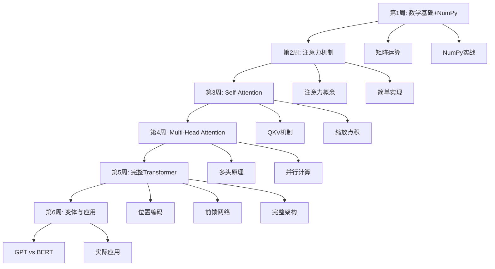

# Transformer架构学习大纲

## 🎯 学习目标

### 最终目标
通过6周的学习（每天1小时），达到**深入理解Transformer原理**的程度：

- **Specific（具体）**: 能够从零用NumPy实现一个简化版Transformer，并解释每行代码的作用
- **Measurable（可衡量）**: 完成3个递进式实践项目，费曼分数达到85+
- **Achievable（可实现）**: 基于您的Python基础和每天1小时投入
- **Relevant（相关）**: Transformer是所有现代大模型（GPT、BERT、LLaMA等）的基础
- **Time-bound（有期限）**: 2025-12-27 开始，预计2026-02-07 完成

### 核心能力清单
学完后，您能够：
- [ ] 用生活化的例子向非技术人员解释Transformer的核心思想
- [ ] 画出完整的Transformer架构图，并讲解每个组件的作用
- [ ] 用NumPy从零实现Self-Attention机制
- [ ] 解释为什么Transformer比RNN/LSTM更有效
- [ ] 分析GPT（单向）和BERT（双向）的架构差异
- [ ] 调试和优化Transformer模型的常见问题
- [ ] **费曼检验**: 能给初学者讲一堂Transformer入门课

## 📋 前置知识现状

### ✅ 已具备
- Python编程（熟练）
- 线性代数基本概念
- 微积分基本概念
- 机器学习基础概念

### 🔧 需要补充（会在学习过程中补充）
- NumPy矩阵运算（第1周集中学习）
- 注意力机制概念（第2周）
- 梯度下降和反向传播（穿插讲解）

### 难度评估
- **整体难度**: ⭐⭐⭐⭐☆（中等偏上）
- **数学要求**: ⭐⭐⭐☆☆（需要矩阵运算，但不需要复杂推导）
- **编程要求**: ⭐⭐⭐⭐☆（需要实现算法，但您Python熟练是优势）
- **适合人群**: 有Python基础，想深入理解原理的学习者

## 🗺️ 学习路径图



## 📅 详细学习计划

---

## 第1周：数学基础与NumPy实战

**目标**: 掌握Transformer所需的数学工具，能够用NumPy进行矩阵运算

### Day 1: 矩阵运算基础（1h）

**学习内容**:
- 向量和矩阵的基本概念
- 矩阵加法、数乘、矩阵乘法
- 转置、逆矩阵（概念了解即可）
- **重点**: 理解矩阵乘法的物理意义

**学习方法**:
- 0:00-0:20: 观看3Blue1Brown《线性代数的本质》第3-4集（矩阵乘法部分）
- 0:20-0:40: 阅读笔记，用几何视角理解矩阵运算
- 0:40-1:00: 手算3个简单的矩阵乘法例子

**费曼任务**:
- [ ] 用"坐标系变换"类比解释矩阵乘法
- [ ] 在纸上画图说明2×2矩阵相乘的过程
- [ ] 写出一段话："矩阵乘法在神经网络中的作用是..."

**产出**: 创建笔记 `基础-01-矩阵运算的直觉理解.md`

---

### Day 2: NumPy矩阵操作（1h）

**学习内容**:
- NumPy数组创建和索引
- 矩阵运算：`np.dot()`, `@`, `np.matmul()`
- 广播机制（Broadcasting）
- 轴操作：`sum()`, `mean()`, `softmax`

**学习方法**:
- 0:00-0:15: 阅读NumPy官方教程（矩阵运算部分）
- 0:15-0:50: 动手实践，在Jupyter Notebook中完成10个练习
- 0:50-1:00: 总结NumPy和纯Python的区别

**实践练习**:
```python
# 练习1: 创建矩阵并相乘
# 练习2: 实现向量点积
# 练习3: 实现矩阵转置
# 练习4: 广播机制实验
# 练习5: 实现简单的Softmax函数
```

**费曼任务**:
- [ ] 解释什么是广播机制，为什么需要它
- [ ] 说明`np.dot()`和`@`的区别
- [ ] 能向他人演示如何用NumPy做矩阵运算

**产出**: `实践-NumPy-矩阵运算练习-2025-12-XX.md`

---

### Day 3: 向量相似度与点积（1h）

**学习内容**:
- 向量的点积（Dot Product）
- 余弦相似度
- **关键**: 点积衡量向量相似度的直觉理解

**学习方法**:
- 0:00-0:20: 理解点积的几何意义（投影×长度）
- 0:20-0:45: 用代码实现余弦相似度计算
- 0:45-1:00: 实验：计算词向量的相似度

**代码实践**:
```python
import numpy as np

# 实现余弦相似度
def cosine_similarity(vec1, vec2):
    # TODO: 实现
    pass

# 实验：找出最相似的词
words = ['king', 'queen', 'man', 'woman']
# 使用预训练词向量测试
```

**费曼任务**:
- [ ] 用"手电筒照射"类比解释点积
- [ ] 说明为什么点积可以衡量相似度
- [ ] 解释在注意力机制中为什么要用点积

**产出**: `基础-02-点积与相似度.md`

---

### Day 4: Softmax函数详解（1h）

**学习内容**:
- Softmax函数的作用和计算
- 为什么需要Softmax（概率归一化）
- 数值稳定性问题

**学习方法**:
- 0:00-0:20: 理解Softmax的数学公式和直觉
- 0:20-0:50: 从零实现Softmax，处理数值溢出
- 0:50-1:00: 可视化Softmax的效果

**代码实践**:
```python
def softmax(x):
    """
    实现数值稳定的Softmax
    输入: x - shape (n,) 或 (batch, n)
    输出: 概率分布，和为1
    """
    # TODO: 实现，注意处理数值稳定性
    pass

# 测试
x = np.array([1.0, 2.0, 3.0])
print(softmax(x))  # 应该和为1
```

**费曼任务**:
- [ ] 用"成绩排名转换为概率"类比Softmax
- [ ] 解释为什么要减去max(x)
- [ ] 说明Softmax在注意力机制中的作用

**产出**: `基础-03-Softmax函数.md`

---

### Day 5: 词嵌入（Word Embeddings）基础（1h）

**学习内容**:
- 什么是词嵌入（Word Embedding）
- 为什么需要把词转换为向量
- 词嵌入的性质（语义相似的词向量接近）

**学习方法**:
- 0:00-0:25: 理解词嵌入的概念和作用
- 0:25-0:50: 使用预训练词向量（如Word2Vec）做实验
- 0:50-1:00: 总结词嵌入的性质

**代码实践**:
```python
# 使用gensim加载预训练词向量
import gensim.downloader as api

# 加载词向量
word_vectors = api.load("glove-wiki-gigaword-50")

# 实验1: 找相似词
word_vectors.most_similar('king')

# 实验2: 词类比 king - man + woman ≈ queen
result = word_vectors.most_similar(
    positive=['king', 'woman'],
    negative=['man']
)
```

**费曼任务**:
- [ ] 用"给词语打标签"类比词嵌入
- [ ] 解释为什么要用向量表示词
- [ ] 说明词嵌入如何捕捉语义关系

**产出**: `基础-04-词嵌入入门.md`

---

### Day 6-7: 第一周复盘与小项目（2h）

**复盘内容**:
- 回顾所有概念笔记
- 检查理解盲区
- 绘制知识图谱

**小项目**: 实现一个简单的文本相似度计算器
```python
"""
项目：基于词向量的句子相似度计算
功能：
1. 输入两个句子
2. 将句子转换为词向量的平均值
3. 计算余弦相似度
4. 输出相似度分数
"""
```

**费曼检验**:
- [ ] 向朋友/家人解释"计算机如何理解文字"
- [ ] 做一个5分钟的演示：从词到向量到相似度
- [ ] 写一篇小总结："这周我学到了..."

**产出**:
- `复盘-第1周-数学基础.md`
- `实践-词向量-句子相似度计算器-2025-12-XX.md`

---

## 第2周：注意力机制（Attention Mechanism）

**目标**: 深入理解注意力机制的核心思想，为Self-Attention打基础

### Day 8: 注意力机制的直觉（1h）

**学习内容**:
- 为什么需要注意力机制
- 注意力机制的核心思想
- Seq2Seq模型的问题

**学习方法**:
- 0:00-0:30: 阅读Jay Alammar的《图解注意力机制》
- 0:30-0:50: 理解"查询-键-值"的比喻
- 0:50-1:00: 用费曼法总结

**类比理解**:
> **图书馆查询比喻**:
> - 你有一个问题（Query）
> - 图书馆有很多书（Keys）
> - 每本书有内容（Values）
> - 注意力机制：找到和你问题最相关的书，读取其内容

**费曼任务**:
- [ ] 用"在派对上找人聊天"类比注意力机制
- [ ] 解释为什么RNN处理长句子会遗忘
- [ ] 画图说明Query、Key、Value的关系

**产出**: `核心-01-注意力机制的直觉.md`

---

### Day 9: 简单注意力计算（1h）

**学习内容**:
- 注意力分数的计算
- 注意力权重的归一化
- 加权求和得到输出

**学习方法**:
- 0:00-0:25: 理解注意力的三步计算流程
- 0:25-0:55: 手动计算一个简单例子
- 0:55-1:00: 总结公式

**手动计算示例**:
```
假设句子: "我 爱 机器学习"
词向量维度: 3

步骤1: 计算相似度（点积）
步骤2: Softmax归一化
步骤3: 加权求和
```

**费曼任务**:
- [ ] 在纸上演示完整计算过程
- [ ] 解释每一步的作用
- [ ] 说明为什么要用Softmax

**产出**: `核心-02-注意力计算步骤.md`

---

### Day 10: 用NumPy实现简单注意力（1h）

**学习内容**:
- 编码实现注意力机制
- 理解矩阵运算的并行计算优势

**代码实践**:
```python
import numpy as np

def simple_attention(query, keys, values):
    """
    简单注意力机制实现

    参数:
        query: shape (d,) - 查询向量
        keys: shape (n, d) - n个键向量
        values: shape (n, d) - n个值向量

    返回:
        output: shape (d,) - 加权求和的输出
        attention_weights: shape (n,) - 注意力权重
    """
    # 步骤1: 计算相似度分数
    scores = np.dot(keys, query)  # (n,)

    # 步骤2: Softmax归一化
    attention_weights = softmax(scores)  # (n,)

    # 步骤3: 加权求和
    output = np.dot(attention_weights, values)  # (d,)

    return output, attention_weights

# 测试
query = np.array([1.0, 0.0, 0.0])
keys = np.array([
    [1.0, 0.0, 0.0],
    [0.0, 1.0, 0.0],
    [0.0, 0.0, 1.0]
])
values = np.array([
    [1.0, 2.0, 3.0],
    [4.0, 5.0, 6.0],
    [7.0, 8.0, 9.0]
])

output, weights = simple_attention(query, keys, values)
print("注意力权重:", weights)
print("输出:", output)
```

**费曼任务**:
- [ ] 逐行解释代码的作用
- [ ] 改变输入，观察输出变化
- [ ] 可视化注意力权重

**产出**: `实践-注意力-简单实现-2025-12-XX.md`

---

### Day 11: 批量处理与矩阵化（1h）

**学习内容**:
- 如何处理多个query（批量计算）
- 矩阵化计算提高效率
- Broadcasting的应用

**代码改进**:
```python
def batched_attention(queries, keys, values):
    """
    批量注意力计算

    参数:
        queries: shape (m, d) - m个查询
        keys: shape (n, d) - n个键
        values: shape (n, d) - n个值

    返回:
        outputs: shape (m, d)
        attention_weights: shape (m, n)
    """
    # 计算所有query与所有key的相似度
    scores = np.dot(queries, keys.T)  # (m, n)

    # 对每个query的分数做Softmax
    attention_weights = softmax(scores, axis=1)  # (m, n)

    # 加权求和
    outputs = np.dot(attention_weights, values)  # (m, d)

    return outputs, attention_weights
```

**费曼任务**:
- [ ] 解释为什么要矩阵化
- [ ] 画出矩阵维度变化图
- [ ] 说明计算复杂度的变化

**产出**: `核心-03-批量注意力计算.md`

---

### Day 12: 注意力可视化（1h）

**学习内容**:
- 可视化注意力权重
- 理解注意力模式
- Heatmap绘制

**代码实践**:
```python
import matplotlib.pyplot as plt
import seaborn as sns

def visualize_attention(attention_weights, input_words, output_words):
    """
    可视化注意力权重矩阵
    """
    plt.figure(figsize=(10, 8))
    sns.heatmap(
        attention_weights,
        xticklabels=input_words,
        yticklabels=output_words,
        cmap='Blues',
        annot=True
    )
    plt.title('Attention Weights')
    plt.xlabel('Input')
    plt.ylabel('Output')
    plt.show()

# 示例：机器翻译的注意力
input_words = ['I', 'love', 'machine', 'learning']
output_words = ['我', '爱', '机器', '学习']
# 假设的注意力权重
attention = np.array([...])
visualize_attention(attention, input_words, output_words)
```

**费曼任务**:
- [ ] 解释热力图中的模式
- [ ] 说明对角线模式的含义
- [ ] 分析注意力失败的情况

**产出**: `实践-注意力-可视化-2025-12-XX.md`

---

### Day 13-14: 第二周复盘（2h）

**复盘内容**:
- 完整实现并测试注意力机制
- 准备一个讲解PPT（可选）
- 向AI讲解一遍，接受提问

**小项目**: 机器翻译的注意力可视化
```
目标：
1. 使用预训练的翻译模型
2. 提取注意力权重
3. 可视化对齐关系
4. 分析注意力模式
```

**费曼检验**:
- [ ] 给初学者讲解注意力机制（15分钟）
- [ ] 回答常见问题："为什么叫注意力？"
- [ ] 演示代码并解释

**产出**: `复盘-第2周-注意力机制.md`

---

## 第3周：Self-Attention（自注意力）

**目标**: 理解Self-Attention的核心创新，实现QKV机制

### Day 15: Self-Attention与普通Attention的区别（1h）

**学习内容**:
- Self-Attention的定义
- 与Encoder-Decoder Attention的区别
- Query、Key、Value都来自同一序列

**学习方法**:
- 0:00-0:30: 理解"自己关注自己"的概念
- 0:30-0:50: 分析例句中的自注意力模式
- 0:50-1:00: 总结关键差异

**示例分析**:
```
句子: "The animal didn't cross the street because it was too tired"

问题: "it" 指代什么？

Self-Attention会让"it"高度关注"animal"，因为：
- Query(it) 与 Key(animal) 相似度高
- 这样Value(animal)会被强加权
- 帮助模型理解"it"的指代
```

**费曼任务**:
- [ ] 用"在镜子里看自己"类比Self-Attention
- [ ] 解释为什么叫"自"注意力
- [ ] 举例说明Self-Attention的应用场景

**产出**: `核心-04-Self-Attention概念.md`

---

### Day 16: Query、Key、Value矩阵（1h）

**学习内容**:
- 为什么需要三个不同的投影矩阵
- W_Q、W_K、W_V的作用
- 线性变换的意义

**学习方法**:
- 0:00-0:25: 理解QKV投影的必要性
- 0:25-0:50: 初始化和测试投影矩阵
- 0:50-1:00: 分析参数量

**关键理解**:
```
输入: X (seq_len, d_model)

通过三个不同的线性变换:
Q = X @ W_Q  # (seq_len, d_k)
K = X @ W_K  # (seq_len, d_k)
V = X @ W_V  # (seq_len, d_v)

为什么需要三个？
- 不同的投影学习不同的表示
- Q: "我在问什么"
- K: "我能回答什么"
- V: "我的实际内容是什么"
```

**费曼任务**:
- [ ] 用"换不同镜头看世界"类比QKV
- [ ] 解释为什么不直接用X
- [ ] 说明三个矩阵的参数是训练得到的

**产出**: `核心-05-QKV投影矩阵.md`

---

### Day 17: 缩放点积注意力（Scaled Dot-Product Attention）（1h）

**学习内容**:
- 为什么要缩放（除以√d_k）
- 完整的Self-Attention公式
- 梯度消失问题

**学习方法**:
- 0:00-0:30: 推导缩放的必要性
- 0:30-0:55: 实现完整公式
- 0:55-1:00: 实验对比缩放前后的差异

**核心公式**:
```
Attention(Q, K, V) = softmax(Q @ K^T / √d_k) @ V
```

**代码实现**:
```python
def scaled_dot_product_attention(Q, K, V, mask=None):
    """
    缩放点积注意力

    参数:
        Q: (batch, seq_len, d_k)
        K: (batch, seq_len, d_k)
        V: (batch, seq_len, d_v)
        mask: (batch, seq_len, seq_len) 可选

    返回:
        output: (batch, seq_len, d_v)
        attention_weights: (batch, seq_len, seq_len)
    """
    d_k = Q.shape[-1]

    # 计算注意力分数
    scores = np.matmul(Q, K.transpose(0, 2, 1))  # (batch, seq_len, seq_len)
    scores = scores / np.sqrt(d_k)  # 缩放

    # 应用mask（可选，用于防止看到未来信息）
    if mask is not None:
        scores = np.where(mask == 0, -1e9, scores)

    # Softmax
    attention_weights = softmax(scores, axis=-1)

    # 加权求和
    output = np.matmul(attention_weights, V)

    return output, attention_weights
```

**费曼任务**:
- [ ] 解释为什么除以√d_k
- [ ] 用数值实验说明不缩放的问题
- [ ] 画出完整的计算流程图

**产出**: `核心-06-缩放点积注意力.md`

---

### Day 18: Mask机制（1h）

**学习内容**:
- Padding Mask（处理不同长度序列）
- Look-ahead Mask（防止看到未来）
- Mask的实现细节

**学习方法**:
- 0:00-0:30: 理解两种Mask的作用
- 0:30-0:55: 实现Mask生成函数
- 0:55-1:00: 测试Mask效果

**代码实践**:
```python
def create_padding_mask(seq):
    """
    创建padding mask
    将padding位置（通常是0）标记出来
    """
    mask = (seq != 0).astype(float)
    return mask[:, np.newaxis, np.newaxis, :]  # (batch, 1, 1, seq_len)

def create_look_ahead_mask(size):
    """
    创建look-ahead mask
    防止在预测位置i时看到位置i之后的信息
    """
    mask = 1 - np.triu(np.ones((size, size)), k=1)
    return mask  # (seq_len, seq_len)

# 测试
look_ahead = create_look_ahead_mask(5)
print(look_ahead)
# [[1. 0. 0. 0. 0.]
#  [1. 1. 0. 0. 0.]
#  [1. 1. 1. 0. 0.]
#  [1. 1. 1. 1. 0.]
#  [1. 1. 1. 1. 1.]]
```

**费曼任务**:
- [ ] 解释为什么需要Mask
- [ ] 画图说明Look-ahead Mask
- [ ] 说明在GPT和BERT中Mask的不同

**产出**: `核心-07-Mask机制.md`

---

### Day 19: 完整Self-Attention实现（1h）

**学习内容**:
- 整合所有组件
- 完整的Self-Attention层
- 测试和调试

**完整实现**:
```python
class SelfAttention:
    def __init__(self, d_model, d_k, d_v):
        """
        参数:
            d_model: 输入向量维度
            d_k: Query和Key的维度
            d_v: Value的维度
        """
        self.d_k = d_k

        # 初始化投影矩阵
        self.W_Q = np.random.randn(d_model, d_k) * 0.01
        self.W_K = np.random.randn(d_model, d_k) * 0.01
        self.W_V = np.random.randn(d_model, d_v) * 0.01

    def forward(self, X, mask=None):
        """
        前向传播

        参数:
            X: (batch, seq_len, d_model)
            mask: 可选mask

        返回:
            output: (batch, seq_len, d_v)
            attention_weights: (batch, seq_len, seq_len)
        """
        # 线性投影
        Q = np.matmul(X, self.W_Q)  # (batch, seq_len, d_k)
        K = np.matmul(X, self.W_K)  # (batch, seq_len, d_k)
        V = np.matmul(X, self.W_V)  # (batch, seq_len, d_v)

        # 缩放点积注意力
        output, attention_weights = scaled_dot_product_attention(
            Q, K, V, mask
        )

        return output, attention_weights

# 测试
d_model, d_k, d_v = 512, 64, 64
batch_size, seq_len = 2, 10

X = np.random.randn(batch_size, seq_len, d_model)
self_attn = SelfAttention(d_model, d_k, d_v)

output, weights = self_attn.forward(X)
print(f"输出shape: {output.shape}")  # (2, 10, 64)
print(f"注意力权重shape: {weights.shape}")  # (2, 10, 10)
```

**费曼任务**:
- [ ] 在白板上画出完整数据流
- [ ] 解释每个矩阵的维度变化
- [ ] 计算参数量和计算复杂度

**产出**: `实践-Self-Attention-完整实现-2025-12-XX.md`

---

### Day 20-21: 第三周复盘（2h）

**复盘项目**: 可视化句子的Self-Attention
```
目标：
1. 输入一个句子（如："The cat sat on the mat"）
2. 通过Self-Attention计算
3. 可视化每个词对其他词的注意力
4. 分析注意力模式
5. 解释为什么某些词被高度关注
```

**费曼检验**:
- [ ] 讲解Self-Attention的完整计算过程
- [ ] 对比与普通Attention的区别
- [ ] 演示代码并解释每一步

**产出**: `复盘-第3周-Self-Attention.md`

---

## 第4周：Multi-Head Attention（多头注意力）

**目标**: 理解多头机制的优势，实现并行计算

### Day 22: 多头注意力的动机（1h）

**学习内容**:
- 为什么需要多个注意力头
- 每个头学习不同的模式
- 多头的优势

**学习方法**:
- 0:00-0:30: 理解多头的概念和作用
- 0:30-0:50: 分析真实模型的多头模式
- 0:50-1:00: 总结设计思路

**核心理解**:
```
单头注意力的局限:
- 只能学习一种关注模式
- 可能错过重要信息

多头注意力的优势:
- Head 1: 关注句法关系（主谓宾）
- Head 2: 关注语义相似性
- Head 3: 关注位置邻近性
- ...
- 综合多个视角，更全面
```

**费曼任务**:
- [ ] 用"多角度拍照"类比多头注意力
- [ ] 解释为什么不用一个大的注意力头
- [ ] 说明头数的选择（通常8或12）

**产出**: `核心-08-多头注意力概念.md`

---

### Day 23: Multi-Head Attention架构（1h）

**学习内容**:
- 多头注意力的计算流程
- 拼接和线性变换
- 参数量分析

**架构图解**:
```
输入 X (seq_len, d_model)
    |
    ├─> Head 1: Q1,K1,V1 -> Attention1 -> (seq_len, d_v)
    ├─> Head 2: Q2,K2,V2 -> Attention2 -> (seq_len, d_v)
    ├─> Head 3: Q3,K3,V3 -> Attention3 -> (seq_len, d_v)
    └─> Head h: Qh,Kh,Vh -> Attentionh -> (seq_len, d_v)
    |
Concat: (seq_len, h * d_v)
    |
Linear: (seq_len, d_model)
    |
输出
```

**关键公式**:
```
MultiHead(Q, K, V) = Concat(head_1, ..., head_h) @ W_O

其中 head_i = Attention(Q @ W_Q_i, K @ W_K_i, V @ W_V_i)
```

**费曼任务**:
- [ ] 画出完整的计算流程图
- [ ] 解释Concat和线性变换的作用
- [ ] 计算总参数量

**产出**: `核心-09-多头注意力架构.md`

---

### Day 24: 实现Multi-Head Attention（1h）

**代码实践**:
```python
class MultiHeadAttention:
    def __init__(self, d_model, num_heads):
        """
        参数:
            d_model: 模型维度（必须能被num_heads整除）
            num_heads: 头的数量
        """
        assert d_model % num_heads == 0

        self.d_model = d_model
        self.num_heads = num_heads
        self.d_k = d_model // num_heads  # 每个头的维度

        # 每个头都有自己的QKV投影
        self.W_Q = np.random.randn(d_model, d_model) * 0.01
        self.W_K = np.random.randn(d_model, d_model) * 0.01
        self.W_V = np.random.randn(d_model, d_model) * 0.01

        # 输出投影
        self.W_O = np.random.randn(d_model, d_model) * 0.01

    def split_heads(self, x):
        """
        将最后一维拆分为(num_heads, d_k)
        输入: (batch, seq_len, d_model)
        输出: (batch, num_heads, seq_len, d_k)
        """
        batch_size, seq_len, _ = x.shape
        x = x.reshape(batch_size, seq_len, self.num_heads, self.d_k)
        return x.transpose(0, 2, 1, 3)

    def forward(self, X, mask=None):
        """
        前向传播
        """
        batch_size, seq_len, _ = X.shape

        # 线性投影
        Q = np.matmul(X, self.W_Q)  # (batch, seq_len, d_model)
        K = np.matmul(X, self.W_K)
        V = np.matmul(X, self.W_V)

        # 拆分为多头
        Q = self.split_heads(Q)  # (batch, num_heads, seq_len, d_k)
        K = self.split_heads(K)
        V = self.split_heads(V)

        # 对每个头应用缩放点积注意力
        d_k = Q.shape[-1]
        scores = np.matmul(Q, K.transpose(0, 1, 3, 2)) / np.sqrt(d_k)

        if mask is not None:
            scores = np.where(mask == 0, -1e9, scores)

        attention_weights = softmax(scores, axis=-1)
        attention_output = np.matmul(attention_weights, V)
        # (batch, num_heads, seq_len, d_k)

        # 合并多头
        attention_output = attention_output.transpose(0, 2, 1, 3)
        # (batch, seq_len, num_heads, d_k)

        attention_output = attention_output.reshape(batch_size, seq_len, self.d_model)
        # (batch, seq_len, d_model)

        # 输出投影
        output = np.matmul(attention_output, self.W_O)

        return output, attention_weights

# 测试
d_model = 512
num_heads = 8
batch_size, seq_len = 2, 10

X = np.random.randn(batch_size, seq_len, d_model)
mha = MultiHeadAttention(d_model, num_heads)

output, weights = mha.forward(X)
print(f"输出shape: {output.shape}")  # (2, 10, 512)
print(f"注意力权重shape: {weights.shape}")  # (2, 8, 10, 10)
```

**费曼任务**:
- [ ] 解释split_heads的作用
- [ ] 说明为什么要transpose
- [ ] 逐步跟踪张量的维度变化

**产出**: `实践-MultiHead-完整实现-2025-12-XX.md`

---

### Day 25: 多头可视化与分析（1h）

**学习内容**:
- 可视化不同头的注意力模式
- 分析每个头学到的模式
- 头的冗余性问题

**代码实践**:
```python
def visualize_multihead_attention(attention_weights, words, num_heads):
    """
    可视化多头注意力
    attention_weights: (num_heads, seq_len, seq_len)
    """
    fig, axes = plt.subplots(2, 4, figsize=(20, 10))
    axes = axes.flatten()

    for i in range(num_heads):
        sns.heatmap(
            attention_weights[i],
            xticklabels=words,
            yticklabels=words,
            ax=axes[i],
            cmap='Blues'
        )
        axes[i].set_title(f'Head {i+1}')

    plt.tight_layout()
    plt.show()

# 测试：使用预训练模型（如BERT）提取真实注意力
```

**分析任务**:
- 识别每个头的专长（句法/语义/位置）
- 找出冗余的头
- 理解头的分工

**费曼任务**:
- [ ] 解释不同头的注意力模式差异
- [ ] 说明如何判断头的作用
- [ ] 讨论头的数量对性能的影响

**产出**: `实践-MultiHead-可视化分析-2025-12-XX.md`

---

### Day 26-27-28: 第四周复盘与项目（3h）

**综合项目**: 从零实现完整的Multi-Head Self-Attention层

**项目要求**:
1. 整合所有代码
2. 添加详细注释
3. 编写测试用例
4. 性能优化
5. 与PyTorch实现对比

**测试清单**:
- [ ] 单元测试：每个函数
- [ ] 集成测试：完整流程
- [ ] 边界测试：不同输入大小
- [ ] 性能测试：速度对比

**费曼检验**:
- [ ] 准备一个15分钟的讲解
- [ ] 制作PPT或笔记
- [ ] 向他人演示并回答问题
- [ ] 写一篇技术博客草稿

**产出**:
- `复盘-第4周-多头注意力.md`
- `实践-完整MultiHeadAttention-2025-12-XX.md`

---

## 第5周：完整Transformer架构

**目标**: 理解Transformer的其他关键组件，构建完整模型

### Day 29: 位置编码（Positional Encoding）（1h）

**学习内容**:
- 为什么需要位置编码
- 绝对位置编码 vs 相对位置编码
- 正弦位置编码的设计

**核心问题**:
Transformer没有RNN的顺序性，如何让模型知道词的位置？

**解决方案**:
在输入嵌入上加上位置编码

**公式**:
```
PE(pos, 2i) = sin(pos / 10000^(2i/d_model))
PE(pos, 2i+1) = cos(pos / 10000^(2i/d_model))

其中：
- pos: 位置（0, 1, 2, ...）
- i: 维度索引（0, 1, 2, ..., d_model/2）
```

**代码实现**:
```python
def positional_encoding(max_len, d_model):
    """
    生成位置编码

    参数:
        max_len: 最大序列长度
        d_model: 模型维度

    返回:
        pe: (max_len, d_model) 位置编码矩阵
    """
    pe = np.zeros((max_len, d_model))
    position = np.arange(0, max_len)[:, np.newaxis]  # (max_len, 1)

    div_term = np.exp(
        np.arange(0, d_model, 2) * -(np.log(10000.0) / d_model)
    )  # (d_model/2,)

    # 奇数位置用sin，偶数位置用cos
    pe[:, 0::2] = np.sin(position * div_term)
    pe[:, 1::2] = np.cos(position * div_term)

    return pe

# 测试和可视化
pe = positional_encoding(100, 512)
plt.figure(figsize=(15, 5))
plt.imshow(pe, cmap='RdBu', aspect='auto')
plt.colorbar()
plt.xlabel('Dimension')
plt.ylabel('Position')
plt.title('Positional Encoding')
plt.show()
```

**费曼任务**:
- [ ] 解释为什么用sin/cos函数
- [ ] 说明位置编码的性质（相对位置）
- [ ] 对比学习式位置编码的优劣

**产出**: `核心-10-位置编码.md`

---

### Day 30: 前馈网络（Feed-Forward Network）（1h）

**学习内容**:
- FFN的结构（两层全连接）
- 激活函数（ReLU/GELU）
- FFN在Transformer中的作用

**架构**:
```
FFN(x) = ReLU(x @ W1 + b1) @ W2 + b2

通常：
- 中间层维度 = 4 * d_model
- 参数量占Transformer的大部分
```

**代码实现**:
```python
class FeedForward:
    def __init__(self, d_model, d_ff):
        """
        参数:
            d_model: 输入/输出维度
            d_ff: 中间层维度（通常是4 * d_model）
        """
        self.W1 = np.random.randn(d_model, d_ff) * 0.01
        self.b1 = np.zeros(d_ff)
        self.W2 = np.random.randn(d_ff, d_model) * 0.01
        self.b2 = np.zeros(d_model)

    def forward(self, x):
        """
        前向传播
        输入: (batch, seq_len, d_model)
        输出: (batch, seq_len, d_model)
        """
        # 第一层
        hidden = np.matmul(x, self.W1) + self.b1
        hidden = np.maximum(0, hidden)  # ReLU

        # 第二层
        output = np.matmul(hidden, self.W2) + self.b2

        return output

# 测试
d_model, d_ff = 512, 2048
ffn = FeedForward(d_model, d_ff)

x = np.random.randn(2, 10, d_model)
output = ffn.forward(x)
print(f"输出shape: {output.shape}")  # (2, 10, 512)
```

**费曼任务**:
- [ ] 解释FFN的作用（非线性变换）
- [ ] 说明为什么中间层要扩大4倍
- [ ] 计算FFN的参数量

**产出**: `核心-11-前馈网络.md`

---

### Day 31: Layer Normalization与残差连接（1h）

**学习内容**:
- Layer Norm的作用
- 与Batch Norm的区别
- 残差连接（Skip Connection）

**Layer Normalization**:
```python
def layer_norm(x, epsilon=1e-6):
    """
    Layer Normalization

    参数:
        x: (batch, seq_len, d_model)
        epsilon: 防止除零

    返回:
        normalized_x: 归一化后的x
    """
    mean = np.mean(x, axis=-1, keepdims=True)
    std = np.std(x, axis=-1, keepdims=True)

    return (x - mean) / (std + epsilon)

class LayerNorm:
    def __init__(self, d_model, epsilon=1e-6):
        self.epsilon = epsilon
        self.gamma = np.ones(d_model)  # 可学习的缩放参数
        self.beta = np.zeros(d_model)  # 可学习的偏移参数

    def forward(self, x):
        mean = np.mean(x, axis=-1, keepdims=True)
        std = np.std(x, axis=-1, keepdims=True)

        normalized = (x - mean) / (std + self.epsilon)
        return self.gamma * normalized + self.beta
```

**残差连接**:
```python
# 标准模式：Add & Norm
def residual_connection(x, sublayer_output):
    """
    残差连接 + Layer Norm
    """
    return layer_norm(x + sublayer_output)

# Transformer Encoder层的完整流程
x_norm = layer_norm(x)
attention_output = multi_head_attention(x_norm)
x = x + attention_output  # 残差连接

x_norm = layer_norm(x)
ffn_output = feed_forward(x_norm)
x = x + ffn_output  # 残差连接
```

**费曼任务**:
- [ ] 解释Layer Norm与Batch Norm的区别
- [ ] 说明残差连接的作用（缓解梯度消失）
- [ ] 画出Add & Norm的流程图

**产出**: `核心-12-LayerNorm和残差连接.md`

---

### Day 32: Encoder层实现（1h）

**学习内容**:
- 组装完整的Encoder层
- 理解数据流

**完整实现**:
```python
class TransformerEncoderLayer:
    def __init__(self, d_model, num_heads, d_ff, dropout=0.1):
        self.mha = MultiHeadAttention(d_model, num_heads)
        self.ffn = FeedForward(d_model, d_ff)
        self.ln1 = LayerNorm(d_model)
        self.ln2 = LayerNorm(d_model)
        self.dropout = dropout

    def forward(self, x, mask=None):
        """
        Encoder层前向传播

        参数:
            x: (batch, seq_len, d_model)
            mask: 可选的padding mask

        返回:
            output: (batch, seq_len, d_model)
        """
        # Multi-Head Attention
        attn_output, _ = self.mha.forward(x, mask)
        x = self.ln1.forward(x + attn_output)  # Add & Norm

        # Feed-Forward
        ffn_output = self.ffn.forward(x)
        x = self.ln2.forward(x + ffn_output)  # Add & Norm

        return x
```

**费曼任务**:
- [ ] 画出完整的Encoder层架构图
- [ ] 解释每个子层的输入输出
- [ ] 说明Pre-LN和Post-LN的区别

**产出**: `实践-Encoder层-实现-2025-12-XX.md`

---

### Day 33: Decoder层与Masked Attention（1h）

**学习内容**:
- Decoder层的三个子层
- Masked Self-Attention
- Encoder-Decoder Attention

**Decoder架构**:
```
1. Masked Multi-Head Self-Attention (看不到未来)
2. Encoder-Decoder Attention (Query来自Decoder，Key和Value来自Encoder)
3. Feed-Forward Network
```

**代码实现**:
```python
class TransformerDecoderLayer:
    def __init__(self, d_model, num_heads, d_ff):
        # 三个注意力/FFN层
        self.masked_mha = MultiHeadAttention(d_model, num_heads)
        self.enc_dec_mha = MultiHeadAttention(d_model, num_heads)
        self.ffn = FeedForward(d_model, d_ff)

        # 三个Layer Norm
        self.ln1 = LayerNorm(d_model)
        self.ln2 = LayerNorm(d_model)
        self.ln3 = LayerNorm(d_model)

    def forward(self, x, encoder_output, look_ahead_mask=None, padding_mask=None):
        """
        Decoder层前向传播

        参数:
            x: Decoder输入 (batch, target_len, d_model)
            encoder_output: Encoder输出 (batch, source_len, d_model)
            look_ahead_mask: 防止看到未来
            padding_mask: Encoder的padding mask
        """
        # 1. Masked Self-Attention
        attn1, _ = self.masked_mha.forward(x, look_ahead_mask)
        x = self.ln1.forward(x + attn1)

        # 2. Encoder-Decoder Attention
        # Query来自Decoder，Key和Value来自Encoder
        attn2, _ = self.enc_dec_mha.forward_cross(
            query=x,
            key=encoder_output,
            value=encoder_output,
            mask=padding_mask
        )
        x = self.ln2.forward(x + attn2)

        # 3. Feed-Forward
        ffn_out = self.ffn.forward(x)
        x = self.ln3.forward(x + ffn_out)

        return x
```

**费曼任务**:
- [ ] 解释Decoder为什么需要三个子层
- [ ] 说明Masked Attention的作用
- [ ] 画出Encoder-Decoder Attention的计算流程

**产出**: `核心-13-Decoder层.md`

---

### Day 34-35: 第五周复盘与完整Transformer（2h）

**最终项目**: 实现完整的Transformer模型

**项目结构**:
```python
class Transformer:
    def __init__(self, vocab_size, d_model, num_heads, num_layers, d_ff, max_len):
        # Embedding层
        self.embedding = Embedding(vocab_size, d_model)
        self.pos_encoding = positional_encoding(max_len, d_model)

        # Encoder和Decoder层
        self.encoder_layers = [
            TransformerEncoderLayer(d_model, num_heads, d_ff)
            for _ in range(num_layers)
        ]
        self.decoder_layers = [
            TransformerDecoderLayer(d_model, num_heads, d_ff)
            for _ in range(num_layers)
        ]

        # 输出层
        self.output_layer = np.random.randn(d_model, vocab_size) * 0.01

    def encode(self, src, src_mask):
        # 嵌入 + 位置编码
        x = self.embedding(src) + self.pos_encoding[:src.shape[1]]

        # 通过所有Encoder层
        for layer in self.encoder_layers:
            x = layer.forward(x, src_mask)

        return x

    def decode(self, tgt, encoder_output, tgt_mask, src_mask):
        # 嵌入 + 位置编码
        x = self.embedding(tgt) + self.pos_encoding[:tgt.shape[1]]

        # 通过所有Decoder层
        for layer in self.decoder_layers:
            x = layer.forward(x, encoder_output, tgt_mask, src_mask)

        return x

    def forward(self, src, tgt, src_mask, tgt_mask):
        encoder_output = self.encode(src, src_mask)
        decoder_output = self.decode(tgt, encoder_output, tgt_mask, src_mask)

        # 输出层
        logits = np.matmul(decoder_output, self.output_layer)

        return logits
```

**测试任务**:
- [ ] 测试完整模型的前向传播
- [ ] 验证所有维度变换正确
- [ ] 计算总参数量
- [ ] 与PyTorch实现对比

**费曼检验**:
- [ ] 画出完整的Transformer架构图
- [ ] 讲解数据如何流经整个模型
- [ ] 解释Encoder和Decoder的交互
- [ ] 总结Transformer的核心创新点

**产出**:
- `复盘-第5周-完整Transformer.md`
- `实践-完整Transformer-实现-2025-12-XX.md`

---

## 第6周：Transformer变体与应用

**目标**: 理解实际应用中的Transformer变体，总结学习成果

### Day 36: GPT架构（Decoder-Only）（1h）

**学习内容**:
- GPT为什么只用Decoder
- 自回归语言模型
- Causal Masking

**核心差异**:
```
标准Transformer: Encoder-Decoder架构（翻译任务）
GPT: 只有Decoder（语言生成任务）

GPT的特点：
- 单向注意力（只看左边）
- 自回归生成（一个词一个词生成）
- 预训练+微调范式
```

**费曼任务**:
- [ ] 解释为什么GPT不需要Encoder
- [ ] 说明GPT的训练目标（预测下一个词）
- [ ] 对比GPT-1/2/3的演进

**产出**: `核心-14-GPT架构分析.md`

---

### Day 37: BERT架构（Encoder-Only）（1h）

**学习内容**:
- BERT为什么只用Encoder
- Masked Language Model
- 双向上下文理解

**核心差异**:
```
GPT: 单向（只看左边），生成式
BERT: 双向（看左右），理解式

BERT的特点：
- Masked LM（随机遮盖15%的词）
- NSP任务（Next Sentence Prediction）
- 适合分类、问答等任务
```

**费曼任务**:
- [ ] 解释BERT的Masked LM训练方式
- [ ] 说明双向上下文的优势
- [ ] 对比BERT和GPT的应用场景

**产出**: `核心-15-BERT架构分析.md`

---

### Day 38: 实际应用：使用HuggingFace Transformers（1h）

**学习内容**:
- HuggingFace库的使用
- 加载预训练模型
- 提取和可视化注意力

**代码实践**:
```python
from transformers import BertTokenizer, BertModel
import torch

# 加载预训练模型
tokenizer = BertTokenizer.from_pretrained('bert-base-uncased')
model = BertModel.from_pretrained('bert-base-uncased', output_attentions=True)

# 输入句子
text = "The cat sat on the mat"
inputs = tokenizer(text, return_tensors='pt')

# 前向传播
outputs = model(**inputs)

# 提取注意力权重
attentions = outputs.attentions  # tuple of (num_layers,)
# 每个元素: (batch, num_heads, seq_len, seq_len)

# 可视化第一层第一个头的注意力
layer_0_head_0 = attentions[0][0, 0].detach().numpy()

import seaborn as sns
import matplotlib.pyplot as plt

tokens = tokenizer.convert_ids_to_tokens(inputs['input_ids'][0])
plt.figure(figsize=(10, 8))
sns.heatmap(layer_0_head_0, xticklabels=tokens, yticklabels=tokens, cmap='Blues')
plt.title('BERT Layer 0, Head 0 Attention')
plt.show()
```

**探索任务**:
- 可视化不同层的注意力模式
- 分析BERT学到的语言知识
- 尝试不同的句子

**费曼任务**:
- [ ] 解释如何使用预训练模型
- [ ] 说明不同层注意力的差异
- [ ] 演示注意力可视化

**产出**: `实践-HuggingFace-注意力可视化-2025-12-XX.md`

---

### Day 39: Transformer的优化技巧（1h）

**学习内容**:
- 训练技巧（Warmup、Learning Rate Schedule）
- 正则化（Dropout、Label Smoothing）
- 推理优化（KV Cache、Beam Search）

**关键技术**:

1. **Warmup + Decay**:
```python
def transformer_lr_schedule(step, d_model, warmup_steps=4000):
    """
    Transformer论文中的学习率调度
    """
    step = max(step, 1)
    lr = d_model ** (-0.5) * min(
        step ** (-0.5),
        step * warmup_steps ** (-1.5)
    )
    return lr
```

2. **KV Cache**:
```
生成时的优化：
- 缓存已计算的Key和Value
- 新token只需计算自己的K/V
- 大幅减少重复计算
```

**费曼任务**:
- [ ] 解释为什么需要Warmup
- [ ] 说明KV Cache的原理
- [ ] 讨论Transformer的计算瓶颈

**产出**: `核心-16-Transformer优化技巧.md`

---

### Day 40-42: 最终项目与总结（3h）

**最终项目**: 选择以下之一

**选项1**: 实现一个简单的机器翻译模型
```
- 使用小规模数据集（如WMT14 EN-DE的子集）
- 训练Transformer模型
- 评估BLEU分数
- 可视化注意力对齐
```

**选项2**: 实现一个文本生成模型（GPT-style）
```
- 训练一个字符级语言模型
- 生成连贯的文本
- 分析生成质量
```

**选项3**: 深度分析预训练模型
```
- 选择BERT或GPT
- 系统分析各层注意力模式
- 探索模型学到的语言知识
- 撰写分析报告
```

**总结任务**:
1. **知识图谱**: 绘制Transformer的完整知识图谱
2. **教学材料**: 准备一套教学材料（PPT/笔记）
3. **技术博客**: 撰写一篇"Transformer完全解析"博客
4. **代码仓库**: 整理所有代码到GitHub

**费曼终极检验**:
- [ ] 给一个完全不懂AI的人讲解Transformer（10分钟）
- [ ] 给有ML基础的人讲解Transformer（30分钟）
- [ ] 准备一个技术分享（45分钟）
- [ ] 回答至少20个常见问题

**产出**:
- `复盘-第6周-Transformer变体.md`
- `总结-Transformer学习之旅.md`
- 最终项目文档

---

## 📚 推荐学习资源

### 必读资料

1. **论文**:
   - ⭐⭐⭐⭐⭐ "Attention Is All You Need" (2017) - 原始论文
   - "BERT: Pre-training of Deep Bidirectional Transformers" (2018)
   - "Improving Language Understanding by Generative Pre-Training" (GPT, 2018)

2. **图解教程**:
   - ⭐⭐⭐⭐⭐ The Illustrated Transformer - Jay Alammar
   - The Annotated Transformer - Harvard NLP
   - Transformer from Scratch - 多个YouTube教程

3. **视频课程**:
   - Stanford CS224N (Lecture on Transformers)
   - DeepLearning.AI的NLP课程
   - 3Blue1Brown的线性代数系列

### 实践资源

1. **代码库**:
   - HuggingFace Transformers (官方实现)
   - Annotated Transformer (哈佛注释版)
   - minGPT (Andrej Karpathy的最小GPT)

2. **交互工具**:
   - BertViz (注意力可视化)
   - Tensor2Tensor (Google的Transformer实现)
   - exBERT (BERT探索工具)

### 进阶阅读

1. **优化与变体**:
   - "Reformer: The Efficient Transformer" (长序列优化)
   - "Linformer: Self-Attention with Linear Complexity"
   - "Perceiver: General Perception with Iterative Attention"

2. **应用**:
   - Vision Transformer (ViT)
   - Audio Transformers
   - Protein Structure Prediction (AlphaFold)

---

## 📊 学习进度跟踪

### 周进度表

| 周次 | 主题 | 开始日期 | 结束日期 | 实际耗时 | 完成度 | 费曼分数 |
|-----|------|---------|---------|---------|--------|---------|
| 第1周 | 数学基础+NumPy | | | /7h | % | /100 |
| 第2周 | 注意力机制 | | | /7h | % | /100 |
| 第3周 | Self-Attention | | | /7h | % | /100 |
| 第4周 | Multi-Head Attention | | | /7h | % | /100 |
| 第5周 | 完整Transformer | | | /7h | % | /100 |
| 第6周 | 变体与应用 | | | /7h | % | /100 |

### 概念掌握清单

| 概念 | 学习日期 | 复习次数 | 费曼分数 | 状态 |
|------|---------|---------|---------|------|
| [[矩阵运算]] | | | /100 | 🔴 |
| [[点积与相似度]] | | | /100 | 🔴 |
| [[Softmax]] | | | /100 | 🔴 |
| [[词嵌入]] | | | /100 | 🔴 |
| [[注意力机制]] | | | /100 | 🔴 |
| [[Self-Attention]] | | | /100 | 🔴 |
| [[QKV机制]] | | | /100 | 🔴 |
| [[缩放点积注意力]] | | | /100 | 🔴 |
| [[Multi-Head Attention]] | | | /100 | 🔴 |
| [[位置编码]] | | | /100 | 🔴 |
| [[前馈网络]] | | | /100 | 🔴 |
| [[Layer Norm]] | | | /100 | 🔴 |
| [[Encoder层]] | | | /100 | 🔴 |
| [[Decoder层]] | | | /100 | 🔴 |
| [[GPT架构]] | | | /100 | 🔴 |
| [[BERT架构]] | | | /100 | 🔴 |

🟢 已精通(90+)  🟡 基本掌握(70-89)  🔴 待学习(<70)

### 实践项目清单

| 项目 | 状态 | 完成日期 | 项目评分 | 链接 |
|------|------|---------|---------|------|
| NumPy矩阵运算练习 | ☐ | | /100 | |
| 简单注意力实现 | ☐ | | /100 | |
| 注意力可视化 | ☐ | | /100 | |
| Self-Attention完整实现 | ☐ | | /100 | |
| Multi-Head Attention | ☐ | | /100 | |
| 完整Transformer | ☐ | | /100 | |
| 最终项目 | ☐ | | /100 | |

---

## 🎯 最终评估标准

### 理解深度检验

- [ ] **L1 - 概念理解**: 能用一句话解释每个核心概念
- [ ] **L2 - 原理掌握**: 能画图说明Transformer的完整架构
- [ ] **L3 - 代码实现**: 能从零实现Self-Attention和Multi-Head Attention
- [ ] **L4 - 深入分析**: 能解释每个设计决策的动机
- [ ] **L5 - 对比能力**: 能对比Transformer与RNN/CNN的优劣
- [ ] **L6 - 应用理解**: 能解释GPT和BERT的架构差异
- [ ] **L7 - 优化知识**: 了解训练和推理的优化技巧
- [ ] **L8 - 教学能力**: 能给他人讲一堂Transformer入门课

### 费曼学习法总评

**终极测试**:
- [ ] 能向非技术人员解释"Transformer如何理解语言"
- [ ] 能向初学者讲解Transformer的核心创新
- [ ] 能向有基础的人深入讲解技术细节
- [ ] 能制作教学材料（PPT、博客、视频）
- [ ] 能回答刁钻的技术问题
- [ ] 能指导新手学习Transformer

**目标费曼分数**: 85分以上

---

## 💡 学习建议

### 每天学习流程（1小时）

**前10分钟**: 复习
- 快速浏览昨天的笔记
- 回忆核心概念
- 检查复习任务

**中间40分钟**: 新内容学习
- 理论学习（15分钟）
- 动手实践（25分钟）
- 重点：边学边写代码

**最后10分钟**: 费曼总结
- 用自己的话总结今天学的
- 写下一个类比
- 提出一个问题

### 学习原则

1. **理解优先于记忆**: 不要死记公式，理解背后的直觉
2. **代码验证理解**: 每个概念都写代码验证
3. **可视化辅助**: 多画图、多可视化
4. **费曼为核心**: 每天练习"能否教会他人"
5. **循序渐进**: 不要跳过基础
6. **主动思考**: 多问为什么

### 遇到困难时

1. **回到基础**: 可能是前置知识不扎实
2. **简化问题**: 从最简单的例子开始
3. **多角度理解**: 阅读不同的资料
4. **动手实验**: 写代码调试
5. **寻求帮助**: 向AI或社区提问

---

## 📝 附录

### 常见问题FAQ

**Q1: Transformer为什么比RNN更有效？**
A: (学习后填写)

**Q2: 为什么需要Multi-Head而不是一个大的单头？**
A: (学习后填写)

**Q3: 位置编码为什么用sin/cos函数？**
A: (学习后填写)

**Q4: GPT和BERT的本质区别是什么？**
A: (学习后填写)

**Q5: Transformer的计算复杂度是多少？**
A: (学习后填写)

### 术语表

| 术语 | 英文 | 简单解释 | 详细笔记链接 |
|-----|------|---------|-------------|
| 注意力机制 | Attention | 依据输入相关性动态加权 | - |
| 自注意力 | Self-Attention | 同一序列不同位置间相互计算注意力 | - |
| 多头注意力 | Multi-Head Attention | 投射到多个子空间并行关注不同特征 | - |
| 位置编码 | Positional Encoding | 为无序的注意力机制注入序列位置信息 | - |
| ... | ... | | |

---

**大纲创建**: 2025-12-27
**开始学习**:
**预计完成**:
**实际完成**:
**总体评价**: ⭐⭐⭐⭐⭐
**最大收获**: (学习完成后填写)
**推荐给他人**: (是/否，为什么)
