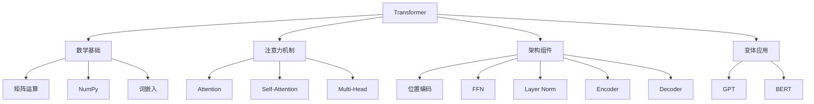

# 大模型学习进度跟踪

## 📊 当前状态

**当前阶段**: 核心技术 - Transformer学习
**开始日期**: 2025-12-27
**当前专注**: Transformer架构深度理解
**学习模式**: 每天1小时，理论+实践+费曼

## 🎯 学习大纲列表

### 进行中
- [ ] [[学习大纲-Transformer架构]] - 进度：0% - 预计完成：2026-02-07

### 计划中
- [ ] RAG系统原理与实践
- [ ] AI Agent开发
- [ ] 模型微调技术
- [ ] Prompt Engineering高级技巧

### 已完成
_暂无_

---

## 📚 概念掌握情况

### 待学习（Transformer相关）

#### 第1周：数学基础
- [ ] 矩阵运算的直觉理解
- [ ] NumPy矩阵操作
- [ ] 点积与相似度
- [ ] Softmax函数
- [ ] 词嵌入基础

#### 第2周：注意力机制
- [ ] 注意力机制的直觉
- [ ] 注意力计算步骤
- [ ] 批量注意力计算

#### 第3周：Self-Attention
- [ ] Self-Attention概念
- [ ] QKV投影矩阵
- [ ] 缩放点积注意力
- [ ] Mask机制

#### 第4周：Multi-Head Attention
- [ ] 多头注意力概念
- [ ] 多头注意力架构
- [ ] 并行计算机制

#### 第5周：完整Transformer
- [ ] 位置编码
- [ ] 前馈网络
- [ ] Layer Normalization
- [ ] 残差连接
- [ ] Encoder层
- [ ] Decoder层

#### 第6周：变体与应用
- [ ] GPT架构（Decoder-Only）
- [ ] BERT架构（Encoder-Only）
- [ ] Transformer优化技巧

### 正在学习
_将在开始学习时更新_

### 基本理解（需要复习巩固）
_暂无_

### 已掌握（可以教授他人）
_暂无_

---

## 💻 实践项目记录

### 计划中
- [ ] NumPy矩阵运算练习
- [ ] 简单注意力机制实现
- [ ] 注意力可视化
- [ ] Self-Attention完整实现
- [ ] Multi-Head Attention实现
- [ ] 完整Transformer实现
- [ ] 最终项目（机器翻译/文本生成/模型分析）

### 进行中
_暂无_

### 已完成
_暂无_

---

## 📈 学习统计

### 时间统计
- **总学习天数**: 0天
- **累计学习时长**: 0小时
- **平均每天**: 1小时（计划）

### 成果统计
- **完成概念数**: 0个
- **完成项目数**: 0个
- **平均费曼分数**: N/A
- **创建笔记数**: 0篇

### 本周目标（第1周：数学基础）
- [ ] 完成Day 1-7的学习
- [ ] 掌握NumPy矩阵运算
- [ ] 理解词嵌入概念
- [ ] 完成句子相似度计算器项目

---

## 🗓️ 复习日程

### 本周需要复习
_暂无_

### 下周需要复习
_暂无_

### 本月需要复习
_暂无_

---

## 🎓 费曼学习法自评

### 当前能力
- **概念理解深度**: ⭐☆☆☆☆ (1/5)
- **解释能力**: ⭐☆☆☆☆ (1/5)
- **实践能力**: ⭐☆☆☆☆ (1/5)
- **教学能力**: ⭐☆☆☆☆ (1/5)

### 目标能力（学习完成后）
- **概念理解深度**: ⭐⭐⭐⭐⭐ (5/5)
- **解释能力**: ⭐⭐⭐⭐⭐ (5/5)
- **实践能力**: ⭐⭐⭐⭐☆ (4/5)
- **教学能力**: ⭐⭐⭐⭐☆ (4/5)

---

## 🗺️ 知识图谱

_将在学习过程中逐步完善_

---

## 📝 学习日志列表

_每天的学习日志链接将在这里列出_

-

---

## 💡 学习心得与反思

### 最有效的学习方法
_在学习过程中记录_

### 遇到的挑战
_在学习过程中记录_

### 改进计划
_在学习过程中记录_

---

## 🎯 下个月目标

完成Transformer架构的深度学习后：
1. 开始RAG系统的学习
2. 实践一个实际的RAG应用
3. 学习AI Agent基础

---

**创建日期**: 2025-12-27
**最后更新**: 2025-12-27
**更新频率**: 每日学习后更新
