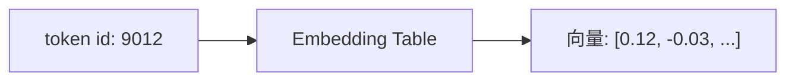
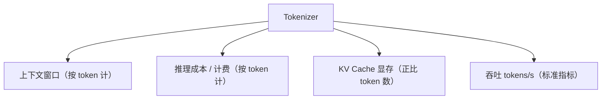

---
tags:
  - 大模型/基础原理
  - 大模型/Token
  - 大模型/Embedding
created: 2026-06-12
updated: 2026-10-02
status: evergreen
aliases:
  - Tokenizer
  - Token Embedding
  - 词嵌入
  - 分词
  - 子词切分
  - BPE
---

# Token、Tokenizer 与 Embedding

> [!summary] 一句话理解
> 大模型不能直接处理文本。它先用 tokenizer 把文本切成 token，再把 token id 查表得到 embedding 向量，Transformer 真正处理的是这些向量序列。
>
> 更重要的定位：**Tokenizer 是模型与文本之间唯一的有损接口**。它决定了模型“看得见什么、看不见什么”，也决定了你为每个字付多少钱。它不是预处理细节，而是模型设计的一部分，并且**一旦训练完成就冻结、不可更换**。

## 1. 为什么需要 Token

神经网络擅长处理数字张量，不擅长直接处理文字。所以文本进入模型前必须先离散化：


```text
大模型会写代码
```

可能被切成：

```text
["大", "模型", "会", "写", "代码"]
```

也可能被切成：

```text
["大模型", "会", "写代码"]
```

具体怎么切，取决于模型使用的 tokenizer 和词表。

> [!note] 关键点
> Token 不一定等于一个字、一个词或一个英文单词。它只是模型词表中的一个基本符号单元。

## 2. 三种粒度：为什么现代模型都选了子词

要让神经网络处理文本，理论上只有三档选择，而每一档单独用都会撞墙：

| 粒度 | 词表大小 | 序列长度 | 致命问题 |
|---|---|---|---|
| 字符级 | 极小（几千） | 极长（×4~8） | 注意力是 O(n²)，长文本直接爆；语义单元被拆碎 |
| 词级 | 爆炸（几十万~百万） | 极短 | 未登录词（OOV）无解；形态变化各占一个 id；罕见词学不好 |
| **子词级** | 3 万~25 万 | 适中 | —— 现代 LLM 的共同选择 |

子词的核心思想：**高频整体保留，低频拆成更小但可复用的片段**。于是 `tokenization` 可能是一个 token，`tokenizerization` 会被拆成 `token` + `izer` + `ization`，词表规模可控，且几乎不会遇到 OOV。

> [!important] 必须记住的权衡三角
> **词表越大 → 压缩率越高（序列越短）→ 但 embedding / 输出层参数与 softmax 计算越贵，且每个 token 分到的训练样本越少。**
>
> 这就是词表大小从 GPT-2 的 5 万涨到 Gemma 的 25.6 万、却没有无限涨下去的原因。

## 3. 子词切分算法

### 3.1 BPE：最主流的算法，原本是压缩算法

BPE（Byte Pair Encoding）原本是 1994 年的数据压缩算法，Sennrich 等人在 2016 年把它搬来做机器翻译的子词切分（[论文](https://aclanthology.org/P16-1162/)）。

**训练过程**：从字符起步，反复合并最高频的相邻对。

```text
初始：把每个词拆成字符 + 词尾标记 </w>
  low     → l o w </w>        (5 次)
  lower   → l o w e r </w>    (2 次)
  newest  → n e w e s t </w>  (6 次)
  widest  → w i d e s t </w>  (3 次)

第 1 轮：统计相邻对，(e,s) 出现 6+3=9 次，最高 → 合并成 es
第 2 轮：(es,t) 出现 9 次 → 合并成 est
第 3 轮：(est,</w>) → 合并成 est</w>
...（继续直到达到目标词表大小或合并次数用尽）
```

**编码过程**：拿训练好的 merge 规则表，对输入**按学习顺序**依次套用。所以 BPE 编码是确定性的、贪心的，不是“选全局最优切分”。

> [!note] 为什么合并顺序重要
> BPE 的合并规则是**有序**的，这个顺序天然编码了训练语料里哪些组合更高频。换一份语料，同一个词可能被切成完全不同的片段。

### 3.2 byte-level BPE：GPT-2 带来的转折

GPT-2 做了个决定性改动：**基础词表不是字符，而是 256 个字节**。因为任何 UTF-8 文本都能表示成字节序列，**OOV 问题被彻底消灭**。

GPT-2 词表 = 256 字节 + 50,000 次合并 + 1 个 `<|endoftext|>` = **50,257**。

代价是：一个汉字在 UTF-8 里是 3 个字节。如果语料里中文不够多、没能把常见汉字合并成单个 token，它就会被拆成 3 个 byte-token。**这是“中文更费 token”的第一个技术根源**——详见第 8 节。

> [!tip] 为什么 GPT tokenizer 里有一堆怪符号
> `Ġ` 其实是空格，`Ċ` 是换行。PreTokenizer 阶段把 256 个字节**映射到可打印字符**，这样才能用文本形式保存词表。看到这些符号不要慌，它们只是字节的替身。

### 3.3 WordPiece：BERT 的路线

WordPiece（Schuster & Nakajima, 2012，最初为日语语音搜索）和 BPE 长得很像，但合并准则不同：

- **BPE**：选**频率最高**的相邻对
- **WordPiece**：选**能最大提升语料似然**的相邻对，实践中近似为 `freq(xy) / (freq(x) × freq(y))`

也就是说 WordPiece **会惩罚本身已经很高频的片段**，倾向于合并“两个片段单独出现不多、但组合起来很常见”的对——更像在寻找有意义的搭配，而不是单纯的高频串。

另外 WordPiece 用 `##` 标记“非词首”子词：`playing` → `play` + `##ing`。BERT 系（含中文 BERT）用的都是它。

### 3.4 Unigram LM 与 SentencePiece：Google 的路线

Kudo 2018 的 Unigram 语言模型走的是**反向路径**（[论文](https://arxiv.org/abs/1804.10959)）：

1. 从**很大的候选词表**开始（所有子串，或用后缀数组挖掘）
2. 用 **EM 算法**估计每个子词的概率，使语料似然最大
3. 计算每个子词若被删掉、总似然会下降多少，**砍掉最不重要的**（例如砍掉 10%~20%）
4. 回到第 2 步，迭代到目标词表大小

编码时用 **Viterbi 算法**求概率最大的切分路径。因为带概率，它天然支持**子词正则化**（训练时按概率随机采样切分，而非总取最优），能显著提升鲁棒性——BPE 侧对应的技巧叫 BPE-Dropout（[论文](https://aclanthology.org/2020.acl-main.170/)）。

**SentencePiece**（[论文](https://arxiv.org/abs/1808.06226)）是这套方法的工程化产物，解决了三个实际问题：

- **语言无关**：不假设空格分词，把空格也当成普通符号 `▁`（U+2581），中日泰一视同仁
- **端到端**：normalization → 训练 → 编码/解码 一体，且 **decode(encode(x)) == x** 严格可逆，这对生成任务非常重要
- **byte_fallback**：遇到词表里没有的字符，退化成 `<0xXX>` 字节 token，同样消灭 OOV

LLaMA-1/2、Mistral、Gemma、T5 都用它；LLaMA-3 转向了 tiktoken 风格的 BPE。

### 3.5 三种算法对比

| | BPE | WordPiece | Unigram |
|---|---|---|---|
| 起点 | 字符/字节 | 字符 | 大候选集 |
| 方向 | 自底向上合并 | 自底向上合并 | 自顶向下剪枝 |
| 合并准则 | 频率 | 似然增益 | EM 后验概率 |
| 编码方式 | 贪心套 merge | 贪心最长匹配 | Viterbi 最优路径 |
| 代表模型 | GPT 全系、LLaMA-3 | BERT 系 | T5、LLaMA-1/2 |

## 4. 主流模型的 Tokenizer 谱系

| 模型 | 算法 | 词表大小 | 备注 |
|---|---|---|---|
| GPT-2 | byte-level BPE | 50,257 | `gpt2` |
| GPT-3.5 / GPT-4 | byte-level BPE | 100,256 | `cl100k_base` |
| GPT-4o / o 系列 | byte-level BPE | 200,019 | `o200k_base`，多语言压缩率大幅改善 |
| BERT | WordPiece | 30,522 | `##` 前缀 |
| LLaMA-1/2 | SentencePiece BPE | 32,000 | 带 byte fallback |
| LLaMA-3 | tiktoken BPE | 128,256 | 压缩率显著提升 |
| Qwen2 / 2.5 / 3 | byte-level BPE | 约 15.2 万 | 中文优化好 |
| Mistral 7B | SentencePiece | 32,000 | |
| Gemma | SentencePiece | 256,000 | 词表极大 |
| DeepSeek-V3 | BPE | 约 13 万 | 从 V2 的 10.24 万扩上来 |

> [!important] 趋势解读
> 词表越做越大，主要动机是**多语言与代码的压缩率**。中国团队做的模型词表普遍 15 万起，就是为了给中文留足名额——这不是审美选择，是成本选择。

## 5. 完整流水线：不只是“切词”

HuggingFace `tokenizers` 把 tokenizer 抽象成五段。理解这个结构，才能理解各种诡异行为：

```text
Normalizer → PreTokenizer → Model → PostProcessor → Decoder
```

1. **Normalizer**：NFKC 归一化、大小写、连续空格处理等
2. **PreTokenizer**：按空格/标点粗切，或按字节切（GPT 系的字节映射在这里）
3. **Model**：BPE / WordPiece / Unigram 真正干活的地方
4. **PostProcessor**：加 `<BOS>` / `<EOS>` / `[SEP]`，套 chat template
5. **Decoder**：id → 文本，处理 `▁` 和 `##` 的还原

> [!warning] decode 不保证等于原文
> Normalizer 可能把全角转半角、多个空格合成一个。所以 `decode(encode(x))` 与 `x` 在**语义上**等价，但**字节上不一定**相等。做逐字符回显、代码补全之类的任务时要特别注意这一点。

**Chat template 也在这一层**。Qwen 的 `<|im_start|>user\n...<|im_end|>`、Llama-2 的 `[INST]...[/INST]`、Gemma 的 `<start_of_turn>` 都是**特殊 token，不是普通文本**。模型训练时见过它们，推理时就必须精确复现——这也是为什么“自己拼 prompt”经常不如官方 chat template。

## 6. Token ID、词表与 Embedding

模型维护一张词表，每个 token 对应一个整数 id：

| Token | Token ID |
|------|----------|
| 大 | 1001 |
| 模型 | 2387 |
| 代码 | 9012 |
| `<eos>` | 2 |

这些数字本身没有语义，只是查表索引。真正携带语义的是后面的 embedding 向量。



如果词表大小是 150000、隐藏维度是 4096，那么 embedding 矩阵大致是：

```text
150000 x 4096
```

这个向量不是人工定义的，而是在训练过程中学出来的。

### 词表大小要吃多少参数

输入 embedding 是 `V × d`；若输出层不共享权重（untied，Qwen 就是 untied），则是 `2 × V × d`。

以 V = 152k、d = 4096 为例：

```text
2 × 152000 × 4096 ≈ 12.5 亿参数
```

**光词表和输出头就占 1.2B 参数**。这就是“小模型不配大词表”的原因。

## 7. 上下文窗口、成本与 Token 预算

模型处理的是 token 序列，所以上下文长度按 **token 数**计算。一个 32K context 的模型，意思是它最多处理约 32768 个 token，而不是 32768 个汉字或英文单词。



Tokenizer 会影响：

- **成本**：同样文本切成更多 token，推理更贵
- **速度**：token 越多，生成和处理越慢
- **多语言效果**：中文、英文、代码的切分效率差异巨大
- **长上下文容量**：同样窗口下，token 越省，能塞进的信息越多
- **特殊格式能力**：代码、数学公式、JSON、Markdown 的切分质量直接影响模型学习效率
- **训练效率**：缩放律按 token 计数（如 Chinchilla 的“20 tokens/参数”）

> [!warning] 使用注意
> 估算上下文长度时，不能简单按字符数计算。长代码、表格、JSON、日志的 token 密度远高于自然语言。

## 8. 中文为什么“费 Token”：把字节账算开

这一节专门澄清一个常见误解。结论先说：**“中文更费 token”不是中文的属性，而是特定词表的属性。**

### 8.1 字节账：问题从来不是“每个字一个”

token 的价格本质是**每 token 能装多少字节**。同一句话，三种情形：

| 情形 | 1 个 token 覆盖 | 字节数 | bytes/token |
|---|---|---|---|
| 英文（词级合并） | 1 个词（约 4.7 字符 + 1 空格） | ≈ 5.7 | **≈ 4.4** |
| 中文（每字一个 token） | 1 个汉字 | 3 | **3.0** |
| 中文（常见双字词合并） | 1 个双字词 | 6 | **6.0** |

所以：

- **“每字一个 token”确实比英文略亏**，约 30%，但这是温和差距，绝不是灾难
- **一旦能把常见双字词合成一个 token，中文反而比英文省约 35%**
- 最优解不是“每字一个”，而是 **“常用字单列 + 高频词合并”**；“每字一个”只是可用的下界

> [!important] 中文的语义单位是“词”，不是“字”
> 而且中文没有空格，**词边界本身就是统计问题**，分词器必须自己找。经典歧义句“研究生命起源”可以是「研究 / 生命 / 起源」，也可以是「研究生 / 命 / 起源」。BPE 在这里的作用，就是用频率统计替你把分词这件事一次性学下来。

如果坚持每字一个 token，就等于**主动放弃**把“人工智能”“区块链”“注意力机制”这类高频词压缩成一个符号的机会——而这恰恰是子词方案最大的红利。

### 8.2 “中文更费”的抱怨从哪来：三个原因叠加

**① 连“每字一个”都没做到（最主要）**

byte-level BPE 的基础词表是 256 个字节，一个汉字是 3 个字节。如果训练语料里中文不够、没把某个汉字合并成单 token，**这个字就会被拆成 2~3 个 byte-token**。

于是实际情况是 **1 个汉字 = 1~3 个 token**。这才是真正的“费”——不是“每字一个”太贵，而是**连“每字一个”都没保住**。

**② 词表名额是零和的，中文被摊薄**

一个 10 万词表要同时装：英文词、代码片段、标点组合、几十种语言、特殊 token。BPE 按**频率**分配合并名额——如果训练语料 90% 是英文，中文词根本排不上号。

这是**语料配比问题，不是语言属性问题**。证据很直接：Qwen 把词表做到 15.2 万、DeepSeek 约 13 万之后，中文常见文本的压缩率就能反超英文。同一个汉字，在不同词表里价格可以差 3 倍。

**③ 跨语言比较的口径本身就错了**

大家习惯拿“同一篇文章的 token 数”直接比。但中文用更少的字符表达同样的意思——**中文一个汉字的信息量约等于英文一个单词**。所以：

- 英文：1 个词 ≈ **1.3 token**
- 中文：1 个字 ≈ **1 token**

按**语义单位**算，中文其实是更赚的那一方。跨语言比较的正确指标是 `bytes/token`，更严格的是 `bits per byte`——因为 per-token 的困惑度在不同词表之间**根本不可比**。

### 8.3 “中文字不多，为什么不能每字一个”

这个判断**对了一半**。

**数量上确实不多**：

| 口径 | 字数 |
|---|---|
| 常用字（覆盖约 99.5%） | 约 3,500 |
| GB2312 | 6,763 |
| 通用规范汉字表 | 8,105 |
| Unicode CJK 全部（含扩展区） | 9 万余 |

给每个常用字一个 token，只花约 8,000 个名额——**完全负担得起**。这也是为什么“中文走字符级”在工程上一直是个真实选项：早期中文模型、部分输入法、ByT5 都这么干过。

但“负担得起”和“划算”是两回事：

- **名额是零和的**。花 8,000 个名额在汉字单字上，就少 8,000 个给英文词、代码片段、多语言。而 BPE 的统计会告诉你：把“人工”+“智能”合并（出现频率极高）比新增一个几乎不出现的生僻字更有价值。**词表是稀缺资源，要按“能省多少 token”分配，不是按“有多少个字”分配。**
- **单字 token 会让词表利用极度不均**。几千个常用字吃掉绝大部分出现频次，剩下大量生僻字的 embedding 行几乎拿不到梯度，训练不充分、行为不可预测——这正是 glitch token 的温床。
- **信息密度是取舍**。中文一个 token 承载的信息量大于英文一个 token。上下文窗口和每步计算量都按 token 数算，所以密度高在**容量上**是好事；但代价是每个 token 要学的模式更复杂、训练样本相对更少。

### 8.4 两种口径的具体对比

```text
中文：  人工智能正在改变世界                      （10 字 / 30 字节）
英文：  Artificial intelligence is changing the world   （45 字符）
```

- **英文-centric 词表（GPT-2 时代）**：中文可能被切成 10~15 个以上 token
- **`cl100k_base`**：常见字 1 个 token，较生僻的字拆成 2~3 个字节 token，平均下来往往**超过** 1 字 1 token
- **中文优化词表（Qwen 一类）**：`人工智能` `正在` `改变` `世界` → **4~5 个 token**
- 对照英文在 `cl100k_base` 下约 **6~7 个 token**

> [!summary] 同一句话，中文反而更省
> 所以“中文费 token”是**特定词表的性质**，不是中文的性质。这个结论也解释了第 4 节那张谱系表：词表越做越大，本质是在为中文这类“信息密度高、又没有空格提示词边界”的语言留名额。

## 9. 分词带来的真实坑

### 9.1 字符级任务基本必挂

“strawberry 里有几个 r”——模型看到的是 `straw` + `berry` 这样的整数 id，**它根本没有字符视图**。同理数笔画、反转字符串、逐字符编辑、字符级 diff 都要靠外部工具。

这不是“模型笨”，而是**这些信息在输入里已经不存在了**。

> [!tip] 实践建议
> 凡是涉及字符、字节、精确编辑的任务，让模型调用代码执行，而不是“想一想”。

### 9.2 数字切分不一致 → 算术与数值比较变弱

`1234` 可能是一个 token，`1235` 却可能切成 `123` + `5`。于是模型对相邻数字的“距离感”被破坏，位数对齐也变得不稳定——这是 LLM 加减乘除容易错、且对位数敏感的重要成因。相关研究见 [Tokenization Counts](https://arxiv.org/abs/2402.14903)，它发现用逗号分组可以让加法问题变成**从右到左（R2L）**的 token 对齐，从而显著提升 GPT-3.5/4 的准确率。

> [!tip] 实践建议
> 精确计算要求模型写代码；某些场景下把数字按位分隔（`1 2 3 4`）反而更稳。

### 9.3 Glitch tokens

有些 token 存在于词表，但几乎没在训练语料里出现过（例如著名的 `SolidGoldMagikarp`）。模型对它们的行为完全不可预测——乱码、回避、触发奇怪输出。成因通常是 **tokenizer 训练语料与模型训练语料不一致**。

### 9.4 空格是最容易被忽视的陷阱

GPT 系把空格并入后续 token：`"hello world"` → `["hello", " world"]`。于是：

- `"hello"` 与 `" hello"` 是**不同 token**
- prompt 末尾多一个空格，分布就变了（代码补全场景尤其明显）
- 模型生成被“切在半路”时补全可能接不上——`guidance` 等库的 **token healing** 就是为此：回退一个 token，重新约束前缀

### 9.5 特殊 token 的注入风险

如果服务端不转义用户输入，用户直接写 `<|im_end|>` 就可能提前终止对话或劫持行为。主流 API 会过滤/编码，但**自部署时这是一个真实的注入面**（prompt injection 的一种）。

### 9.6 困惑度不可跨 tokenizer 比较

困惑度是**按 token 平均**的。词表大的模型每 token 携带信息更多，PPL 数值天生更低，但**这不代表它更好**。跨模型比较必须换成 **bits per byte**。

同理，“20 tokens/参数”这类缩放律结论，其绝对数值也依赖于具体 tokenizer。

### 9.7 投机采样必须共享 tokenizer

draft model 与 target model 的 token 序列必须能对齐，否则无法验证/接受。工程上一般直接选同族模型。

### 9.8 Tokenizer 会“漂移”

同一个名字的不同版本可能词表不同（LLaMA-2 → LLaMA-3 就换掉了）。下载模型时 **tokenizer 文件与权重必须配套**，否则 id 与 embedding 错位——输出会变成乱码，但**不报错**，非常隐蔽。

## 10. 工程实践

### 10.1 自己算 token 数

```python
import tiktoken

text = "人工智能正在改变世界"
raw_bytes = len(text.encode("utf-8"))

for name in ["gpt2", "cl100k_base", "o200k_base"]:
    enc = tiktoken.get_encoding(name)
    ids = enc.encode(text)
    print(f"{name:12} {len(ids):3} tokens  {raw_bytes/len(ids):.2f} bytes/token")
    print("   ", [enc.decode([i]) for i in ids])
```

对比不同模型的 tokenizer 压缩率：

```python
from transformers import AutoTokenizer

text = "人工智能正在改变世界"
raw_bytes = len(text.encode("utf-8"))

for repo in ["Qwen/Qwen2.5-7B-Instruct", "meta-llama/Llama-3.1-8B-Instruct"]:
    tk = AutoTokenizer.from_pretrained(repo)
    ids = tk.encode(text)
    print(f"{repo:36} {len(ids)} tokens  {raw_bytes/len(ids):.2f} bytes/token")
```

> [!tip] 只看一个数就够了：bytes/token
> 英文健康值 4 左右，中文优化词表能到 5~7，而“连每字一个都没做到”的词表会掉到 2 以下。

### 10.2 自己训练 tokenizer

```python
import sentencepiece as spm

spm.SentencePieceTrainer.train(
    input="corpus.txt",
    model_prefix="tokenizer",
    vocab_size=64000,          # 核心权衡：压缩率 vs 参数/样本稀释
    model_type="bpe",          # 或 "unigram"
    character_coverage=0.9995, # 中文/日文常用 0.9995，英文可 1.0
    byte_fallback=True,        # 生僻字符退化为字节，彻底消灭 OOV
    num_threads=16,
    user_defined_symbols=["<|im_start|>", "<|im_end|>"],  # 特殊 token 必须显式声明
)
```

关键参数怎么定：

- **vocab_size**：中文/多语言场景建议 6.4 万~15 万；纯英文 3.2 万~5 万即可
- **character_coverage**：`0.9995` 是中日文的常用取值，保证覆盖绝大多数汉字
- **byte_fallback**：强烈建议开启，这是“不出现 OOV”的保险
- **user_defined_symbols**：特殊 token 一定要在这里声明，否则会被切碎

### 10.3 扩词表的注意事项

给已有模型加新语言/领域词时要谨慎：

- 新 token 的 embedding 是**随机初始化**的，必须做充分的继续预训练，否则反而更差
- 扩词表后输出层形状改变，**量化、推理引擎、部署链路都要跟着改**
- 建议先做消融：新词表在老任务上的退化，是否被新语言的收益覆盖

### 10.4 日常清单

- **估算上下文**：按 token 数，不按字符数；JSON、日志、代码、表格的 token 密度远高于自然语言
- **长文档分块**：按 token 切（留出 prompt 与输出的余量），不要按字符数切
- **成本核算**：用 tiktoken 离线预估，别凭“字数 × 系数”
- **prompt 末尾不要留多余空格**，尤其是代码补全
- **不要在 prompt 里手工加特殊 token**，交给 chat template
- **别让模型做字符级操作**（数数、反转、逐字替换），给它工具

## 11. 前沿方向：这条路要走到头了吗

- **Tokenization-free**：ByT5、CANINE（[TACL 论文](https://direct.mit.edu/tacl/article/doi/10.1162/tacl_a_00448/109284/)）直接在字节/字符上建模，彻底绕开分词，但序列变长、效率差，目前主要在小模型和特定任务上可行
- **按 patch 处理字节**：MEGABYTE（[NeurIPS 2023](https://proceedings.neurips.cc/paper_files/paper/2023/file/f8f78f8043f35890181a824e53a57134-Paper-Conference.pdf)）把字节按 patch 分组建模，兼顾序列长度与粒度
- **多模态 token**：视觉的 patch token、音频的 codec token（如 SoundStream / EnCodec 的离散码本），本质是把“分词”推广到连续信号——**统一 token 空间**是当前多模态大模型的核心命题之一
- **方向性判断**：短期内子词 BPE 不会被取代，但词表会继续变大、多语言压缩率会持续被优化；同时“给模型显式字符/字节视图”会以工具或双通道架构的形式补回来

## 12. 常见误区

### Token 是词吗

不一定。Token 是模型词表里的片段，可以是字、词、子词、标点、空格组合，甚至是特殊控制符。

### 一个 token 是一个字吗

不一定。不同 tokenizer、不同语言的换算比例差别很大。要判断只能**实测**：看 `bytes/token`，不要凭感觉。

### 中文天生比英文费 token 吗

不是。“每字一个 token”已经接近打平，把常见词合并后中文反而更省。真正费的是**英文-centric 的词表**——详见第 8 节。

### Embedding 是固定的吗

对一个训练完成的模型来说，embedding 参数通常固定；但在训练或微调过程中，它是可学习参数。

### Tokenizer 可以随便换吗

一般不能。模型的 embedding 矩阵和 tokenizer 词表是一一对应的。随便换 tokenizer 会导致 token id 和 embedding 含义错位，且**往往不报错**。

### 可以事后把 tokenizer 换掉来省钱吗

不行。要换就必须重训（至少要大规模继续预训练），因为词表变了，embedding、LM Head、以及模型学到的所有 token 级统计全部作废。

## 13. 小结

> [!summary] 关键链路
> 文本 → tokenizer 切成 token → token id → 查 embedding 表得到向量。Transformer 真正处理的是向量序列。

> [!summary] 三条最该记住的判断
> 1. **Tokenizer 是有损接口，且训练后冻结**：它决定了模型的“感知分辨率”，换不了、也补不回来（只能靠工具）。
> 2. **词表大小是压缩率与参数量的权衡**：现代模型词表越来越大，主要是在为多语言（尤其中文）买压缩率。
> 3. **跨语言、跨模型比较 token 数没有意义**：统一用 `bytes/token`，严格场合用 `bits per byte`。

## 参考资料

- [Neural Machine Translation of Rare Words with Subword Units (Sennrich et al., 2016)](https://aclanthology.org/P16-1162/) —— BPE 引入 NLP 的原始论文
- [Subword Regularization: Improving Neural Network Translation Models with Multiple Subword Candidates (Kudo, 2018)](https://arxiv.org/abs/1804.10959) —— Unigram LM 与子词正则化
- [SentencePiece: A simple and language independent subword tokenizer and detokenizer (Kudo & Richardson, 2018)](https://arxiv.org/abs/1808.06226)
- [BPE-Dropout: Simple and Effective Subword Regularization (Provilkov et al., 2020)](https://aclanthology.org/2020.acl-main.170/)
- [Language Model Tokenizers Introduce Unfairness Between Languages (Petrov et al., 2023)](https://arxiv.org/abs/2305.15425) —— 语言间 token 税的系统性研究
- [Tokenization Counts: The Impact of Tokenization on Arithmetic in Frontier LLMs (Singh & Strouse, 2024)](https://arxiv.org/abs/2402.14903)
- [ByT5: Towards a Token-Free Future with Pre-trained Byte-to-Byte Models (Xue et al., 2021)](https://arxiv.org/abs/2105.13626)
- [CANINE: Pre-training an Efficient Tokenization-Free Encoder for Language Representation (Clark et al., 2022)](https://direct.mit.edu/tacl/article/doi/10.1162/tacl_a_00448/109284/)
- [MEGABYTE: Predicting Million-byte Sequences with Multiscale Transformers (Yu et al., 2023)](https://proceedings.neurips.cc/paper_files/paper/2023/file/f8f78f8043f35890181a824e53a57134-Paper-Conference.pdf)

## 相关笔记

- [[大模型/01-基础原理/大模型基础原理总览|大模型基础原理总览]]
- [[大模型/01-基础原理/Transformer/Transformer 整体结构|Transformer 整体结构]]
- [[大模型/01-基础原理/推理生成过程|推理生成过程]]
- [[大模型/01-基础原理/预训练目标|预训练目标]]
- [[大模型/01-基础原理/MOE/MOE专家选择与路由机制|MOE专家选择与路由机制]]
- [[大模型/00-大模型学习导航|大模型学习导航]]
