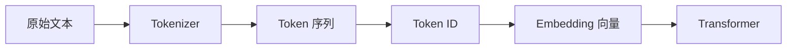
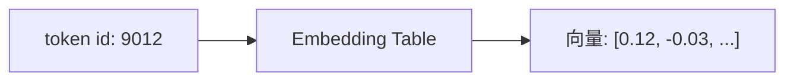

---
tags:
  - 大模型/基础原理
  - 大模型/Token
  - 大模型/Embedding
created: 2026-06-12
updated: 2026-06-12
status: evergreen
aliases:
  - Tokenizer
  - Token Embedding
  - 词嵌入
---

# Token、Tokenizer 与 Embedding

> [!summary] 一句话理解
> 大模型不能直接处理自然语言文本，它先用 tokenizer 把文本切成 token，再把 token id 映射成 embedding 向量，后续 Transformer 处理的是这些向量，而不是原始字符。

## 为什么需要 Token

计算机里的神经网络擅长处理数字张量，不擅长直接处理“文字”。因此文本进入模型前需要经过转换：



例如：

```text
大模型会写代码
```

可能被切成：

```text
["大", "模型", "会", "写", "代码"]
```

也可能被切成：

```text
["大模型", "会", "写代码"]
```

具体怎么切，取决于模型使用的 tokenizer 和词表。

## Tokenizer 做了什么

Tokenizer 的核心作用是把文本切分成模型词表里已有的片段，并把每个片段映射成数字 id。

常见方法包括：

- **BPE**：从字符开始，反复合并高频相邻片段。
- **SentencePiece**：把文本当作无空格字符流处理，适合多语言场景。
- **WordPiece**：常见于 BERT 系列模型。

> [!note] 关键点
> Token 不一定等于一个字、一个词或一个英文单词。它只是模型词表中的一个基本符号单元。

## Token ID 和词表

模型会维护一个词表，每个 token 对应一个整数 id。

| Token | Token ID |
|------|----------|
| 大 | 1001 |
| 模型 | 2387 |
| 代码 | 9012 |
| `<eos>` | 2 |

这些数字本身没有语义，只是查表索引。真正携带语义的是后面的 embedding 向量。

## Embedding 是什么

Embedding 是一个可学习的向量表。

如果词表大小是 150000，隐藏维度是 4096，那么 embedding 矩阵大致可以理解为：

```text
150000 x 4096
```

每个 token id 会查出一行向量：



这个向量不是人工定义的，而是在训练过程中学出来的。

## 上下文窗口为什么按 Token 算

模型处理的是 token 序列，所以上下文长度通常按 token 数计算。

例如一个 32K context 的模型，意思是它最多处理约 32768 个 token，而不是 32768 个汉字或英文单词。

不同语言的 token 压缩率不同：

- 英文中，一个 token 可能接近一个单词或半个单词。
- 中文中，一个 token 可能是一个字、一个词或词的一部分。
- 代码中，标点、缩进、变量名也会消耗 token。

> [!warning] 使用注意
> 估算上下文长度时，不能简单按字符数计算。长代码、表格、JSON、日志通常会消耗大量 token。

## Tokenizer 会影响什么

Tokenizer 会影响：

- **成本**：同样文本切成更多 token，推理成本更高。
- **速度**：token 越多，生成和处理越慢。
- **多语言效果**：中文、英文、代码的切分效率不同。
- **长上下文容量**：同样窗口下，token 越省，能塞入的信息越多。
- **特殊格式能力**：代码、数学公式、JSON、Markdown 的切分质量会影响模型学习效率。

## 常见误区

### Token 是词吗

不一定。Token 是模型词表里的片段，可以是字、词、子词、标点、空格组合，甚至是特殊控制符。

### Embedding 是固定的吗

对一个训练完成的模型来说，embedding 参数通常固定；但在训练或微调过程中，它是可学习参数。

### Tokenizer 可以随便换吗

一般不能。模型的 embedding 矩阵和 tokenizer 词表是一一对应的。随便换 tokenizer，会导致 token id 和 embedding 含义错位。

## 小结

> [!summary] 关键链路
> 文本先被 tokenizer 切成 token，再变成 token id，最后查 embedding 表得到向量。Transformer 真正处理的是向量序列。

## 相关笔记

- [[大模型/01-基础原理/大模型基础原理总览|大模型基础原理总览]]
- [[大模型/01-基础原理/Transformer/Transformer 整体结构|Transformer 整体结构]]
- [[大模型/01-基础原理/推理生成/推理生成过程|推理生成过程]]
