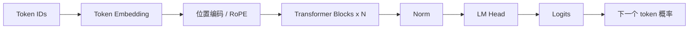
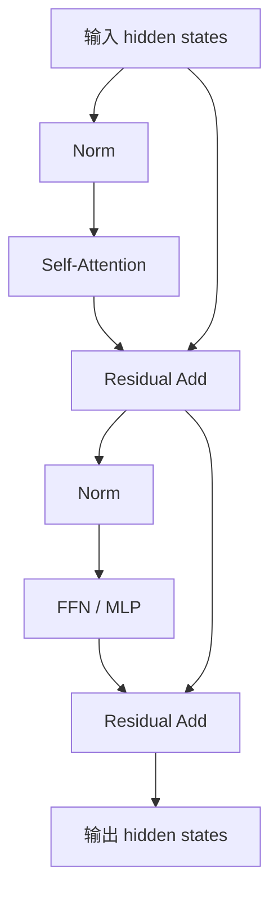

---
tags:
  - 大模型/基础原理
  - 大模型/Transformer
created: 2026-06-12
updated: 2026-06-12
status: evergreen
aliases:
  - Transformer Block
  - Transformer 架构
---

# Transformer 整体结构

> [!summary] 一句话理解
> Transformer 是一组可堆叠的网络模块：每层通过注意力机制在 token 之间交换信息，再通过前馈网络加工每个 token 的表示，最后输出下一个 token 的概率分布。

## 整体流程

以 Decoder-only 大语言模型为例，典型流程如下：



其中最核心的是重复堆叠的 Transformer Block。

## Transformer Block 里有什么

一个简化的 Decoder-only Transformer Block 通常包括：



主要组件：

- **Self-Attention**：让每个 token 从上下文中取信息。
- **FFN / MLP**：对每个 token 的表示做非线性变换。
- **Residual Connection**：保留原始信息，帮助深层网络训练稳定。
- **LayerNorm / RMSNorm**：稳定数值分布。

## Self-Attention 的位置

Self-Attention 负责 token 之间的信息交互。

例如处理代码时，当前变量名可能需要关注：

- 它的定义位置。
- 类型声明。
- 调用函数。
- 上下文中的错误信息。

QKV 的细节可以看 [[大模型/01-基础原理/Transformer/图解 Transformer 中的 QKV 机制|图解 Transformer 中的 QKV 机制]]。

## FFN / MLP 的作用

Attention 主要负责“从哪些 token 取信息”，FFN 则负责“如何加工当前 token 的表示”。

很多现代模型的 FFN 会使用类似 SwiGLU 的结构。直觉上，它提供更强的非线性表达能力，让模型能在每个位置上做复杂特征变换。

> [!note] 注意
> 在很多 Transformer 模型中，FFN 参数量占比很高。MoE 模型通常也是把 FFN 部分替换成多个专家网络。

## 残差连接为什么重要

残差连接让每层不必完全重写输入表示，而是在原有表示上增加修正。

```text
输出 = 输入 + 本层学到的变化
```

这有两个好处：

- 深层网络更容易训练。
- 低层信息可以更稳定地传到高层。

## Norm 为什么重要

LayerNorm 或 RMSNorm 用来稳定隐藏状态的数值范围。

没有归一化，深层网络里向量数值可能不断放大或缩小，导致训练不稳定。

现代 Decoder-only LLM 常见的是 Pre-Norm 结构：先 Norm，再进入 Attention 或 FFN。

## LM Head 和 Logits

经过多层 Transformer 后，每个位置会得到一个 hidden state。

最后一层通过 LM Head 把 hidden state 映射回词表大小的 logits：

```text
hidden_size -> vocab_size
```

如果词表有 150000 个 token，那么每个位置都会输出 150000 个分数。再经过 softmax，就得到下一个 token 的概率分布。

## Decoder-only 为什么适合生成

大多数现代 LLM 使用 Decoder-only 架构，配合 causal mask 从左到右生成。

```text
前文 token -> 预测下一个 token -> 追加到上下文 -> 继续预测
```

这种结构非常适合聊天、写作、代码生成和工具调用。

## 小结

> [!summary] 结构主线
> Token 先变成 embedding，再经过多层 Transformer Block。每层用 Attention 做上下文交互，用 FFN 做特征加工，用残差和 Norm 保持训练稳定。最后通过 LM Head 输出下一个 token 的概率。

## 相关笔记

- [[大模型/01-基础原理/Token与Embedding/Token、Tokenizer 与 Embedding|Token、Tokenizer 与 Embedding]]
- [[大模型/01-基础原理/Transformer/图解 Transformer 中的 QKV 机制|图解 Transformer 中的 QKV 机制]]
- [[大模型/01-基础原理/Transformer/逐层分解 Transformer|逐层分解 Transformer]]
- [[大模型/01-基础原理/MOE/关于MOE的问题|关于 MOE 的问题]]
- [[大模型/01-基础原理/预训练目标|预训练目标]]
