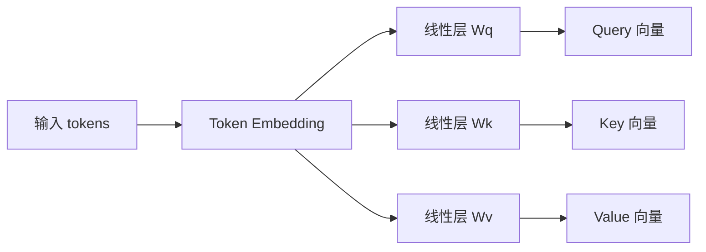
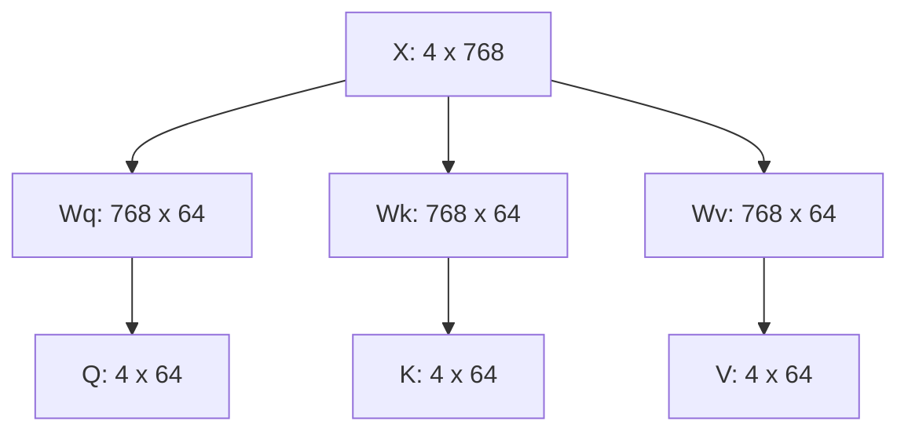
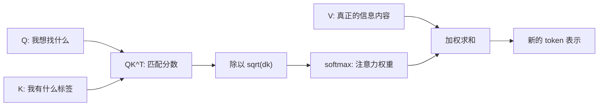
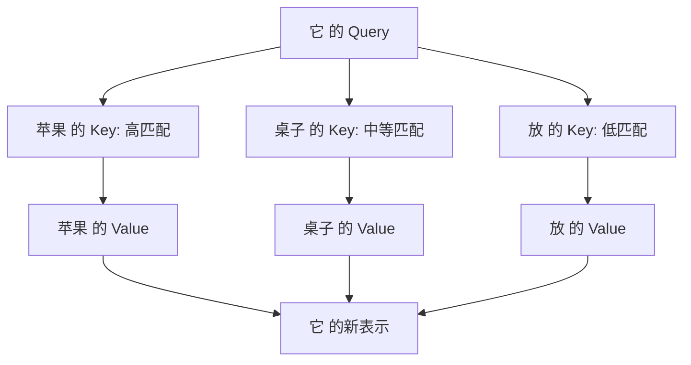
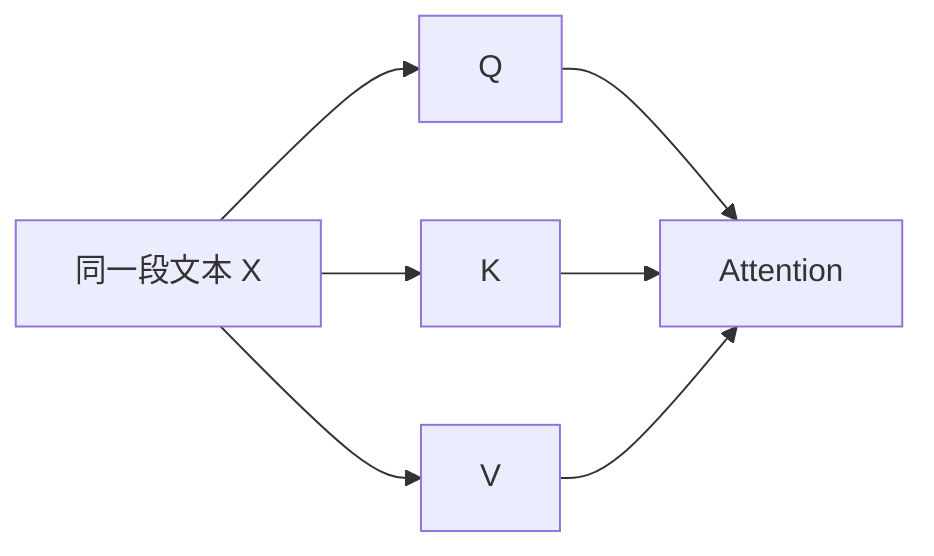
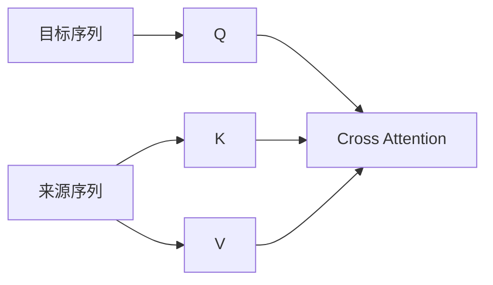
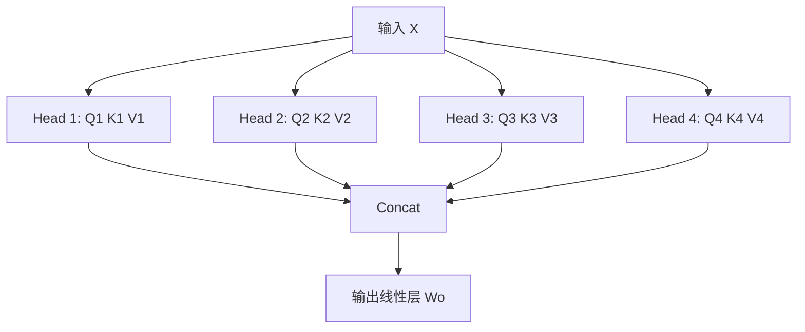
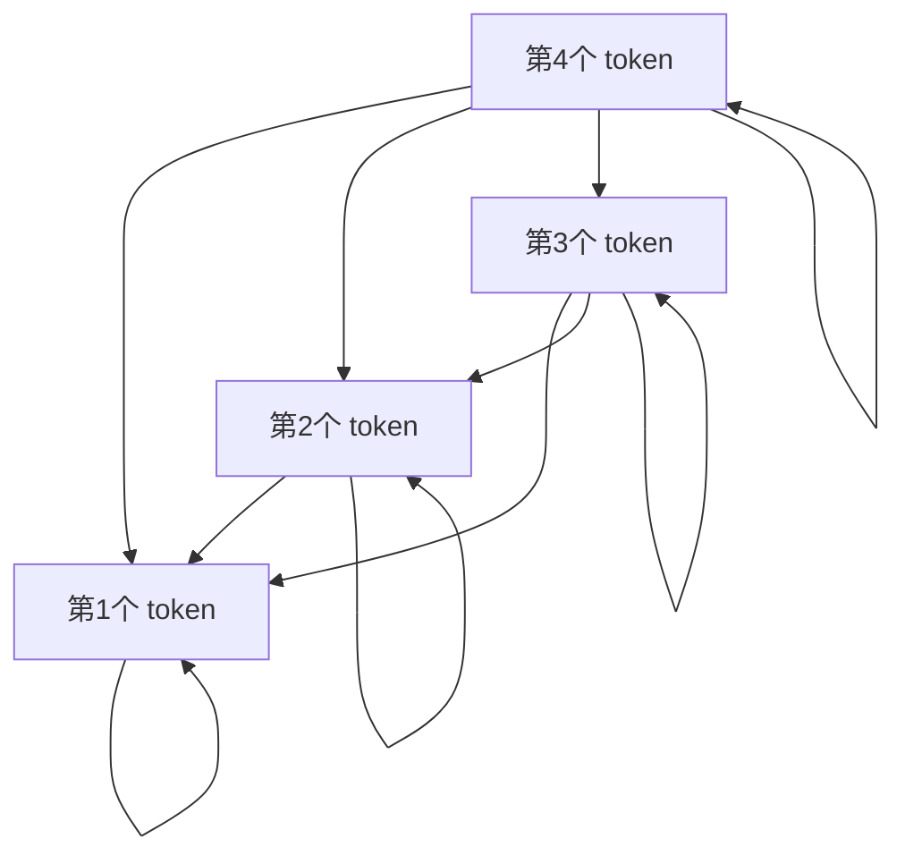
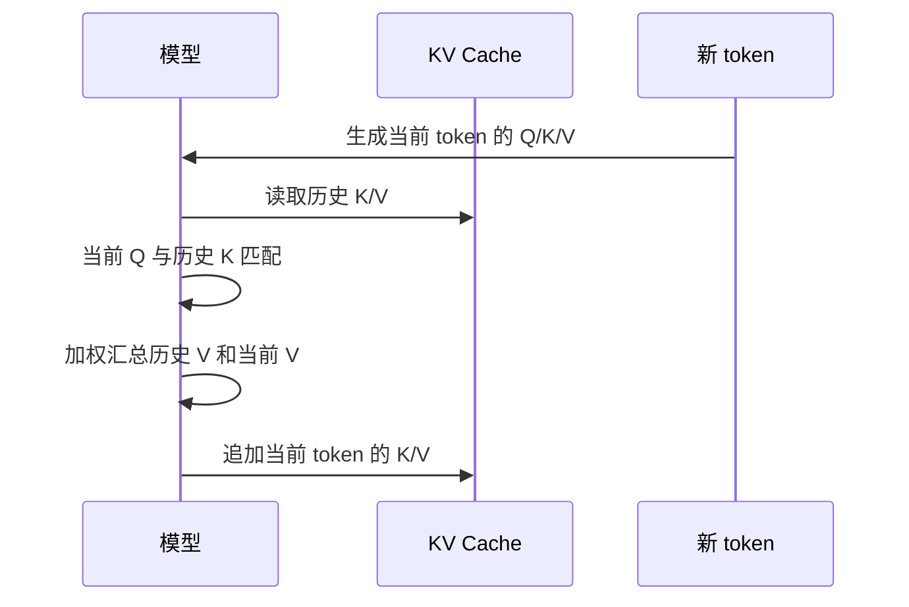
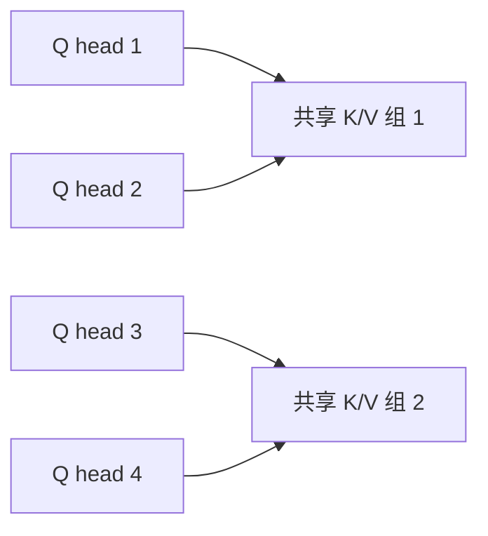

# 图解 Transformer 中的 QKV 机制

> [!abstract] 一句话理解
> QKV 是 [[Transformer]] 注意力机制里的三组向量：**Query 负责提问，Key 负责被匹配，Value 负责被取出**。模型先用 Query 和 Key 计算“该关注谁”，再用这个关注权重去加权汇总 Value。

## 为什么需要 QKV

在大模型里，一个 token 不能只看自己，它还需要根据上下文判断“哪些 token 对我当前的含义最重要”。

例如句子：

> 我 把 苹果 放 到 桌子 上，因为 它 很 甜。

这里的“它”更可能指向“苹果”，而不是“桌子”。注意力机制要解决的问题就是：**当前 token 在理解自己时，应该从上下文里的哪些 token 取信息，分别取多少。**

QKV 提供了一套可学习的检索机制：

| 角色 | 类比 | 在注意力里的作用 |
|------|------|------------------|
| Query | 查询条件 | 当前 token 想找什么信息 |
| Key | 索引标签 | 每个 token 提供给别人匹配的特征 |
| Value | 真实内容 | 匹配成功后真正被汇总的信息 |

> [!note] 关键点
> Query 和 Key 用来算“相关性分数”，Value 才是最终被加权相加的信息内容。

## 从 token 到 QKV

每个 token 进入模型后，先变成 embedding，然后通过三组不同的线性变换得到 Q、K、V。

用公式表示：

$$
Q = XW_Q,\quad K = XW_K,\quad V = XW_V
$$

其中：

- $X$：输入序列的 embedding 矩阵
- $W_Q$、$W_K$、$W_V$：模型训练出来的三组参数
- $Q$、$K$、$V$：每个 token 对应的 Query、Key、Value 向量

### 维度示意

假设一个序列有 4 个 token，每个 token 的隐藏维度是 768，单头注意力的 Q/K/V 维度是 64：

## 注意力是怎么计算的

Scaled Dot-Product Attention 的核心公式是：

$$
\text{Attention}(Q,K,V)=\text{softmax}\left(\frac{QK^T}{\sqrt{d_k}}\right)V
$$

拆开看就是三步：

1. 用 $QK^T$ 计算每个 token 对其他 token 的匹配分数。
2. 除以 $\sqrt{d_k}$ 做缩放，避免点积数值过大。
3. 用 softmax 得到注意力权重，再乘以 $V$ 得到上下文表示。

> [!tip] 直觉理解
> 可以把注意力看成一次“软检索”：Query 发起检索，Key 决定匹配程度，Value 是检索返回的内容。softmax 让模型不是只选一个 token，而是按权重融合多个 token。

## 一个小例子：谁在关注谁

假设当前 token 是“它”，上下文中有“苹果”“桌子”等 token。模型会用“它”的 Query 去和所有 token 的 Key 做匹配：

注意力权重可能类似这样：

| 当前 token | 被关注 token | 注意力权重 | 含义 |
|------------|--------------|------------|------|
| 它 | 苹果 | 0.65 | 主要从“苹果”取语义信息 |
| 它 | 桌子 | 0.20 | 也保留一点位置信息 |
| 它 | 放 | 0.10 | 动作信息较弱 |
| 它 | 我 | 0.05 | 关系较弱 |

最终，“它”的新表示不是某一个词的复制，而是多个 Value 的加权融合。

## 为什么不直接用一个向量

Q、K、V 分开的好处是让模型把三件事解耦：

- **我要找什么**：由 Query 表达。
- **我适合被谁找到**：由 Key 表达。
- **我被找到后贡献什么信息**：由 Value 表达。

如果只用一个向量同时承担这三种职责，表达能力会受限。分成三组投影后，同一个 token 可以在不同语义空间中扮演不同角色。

> [!example] 类比数据库
> Query 像 SQL 查询条件，Key 像索引字段，Value 像最终返回的行数据。索引字段和返回内容可以相关，但不一定完全一样。

## Self-Attention 和 Cross-Attention 中的 QKV

### Self-Attention

Self-Attention 里，Q、K、V 都来自同一个序列。

这就是 Decoder-only 大模型最常见的形式：当前文本内部自己关注自己。

### Cross-Attention

Cross-Attention 里，Q 通常来自目标序列，K/V 来自另一段输入。

这种结构常见于 Encoder-Decoder 模型，例如翻译任务中，Decoder 的 token 通过 Query 去关注 Encoder 产出的 K/V。

## 多头注意力：多套 QKV 并行工作

Multi-Head Attention 不是只算一套 QKV，而是把隐藏维度切成多个 head，每个 head 有自己的 Q/K/V 投影。不同 head 可以学习不同关系，例如：

- 语法关系：主语、谓语、宾语。
- 指代关系：它、这个、那个指向谁。
- 位置关系：前后 token、局部窗口、长距离依赖。
- 领域关系：代码变量、函数调用、表格字段。

> [!summary] 多头的意义
> 单个注意力头像一个观察角度，多头注意力则像多个观察角度并行看同一段文本，然后把结果合并。

## Decoder 中的因果掩码

大多数大语言模型是 Decoder-only 架构，生成第 $t$ 个 token 时不能偷看未来 token。因此注意力矩阵会加上 causal mask，只允许当前位置关注自己和之前的 token。

可以理解为：

| 当前位置 | 能关注的 token |
|----------|----------------|
| 第 1 个 | 第 1 个 |
| 第 2 个 | 第 1、2 个 |
| 第 3 个 | 第 1、2、3 个 |
| 第 4 个 | 第 1、2、3、4 个 |

这保证了模型训练和推理时都符合“从左到右生成”的约束。

## KV Cache 和 QKV 的关系

推理时，模型每生成一个新 token，都会重新计算当前 token 的 Query，并拿它去匹配历史 token 的 Key。历史 token 的 Key 和 Value 不会再变化，因此可以缓存起来，这就是 KV Cache。

KV Cache 的影响：

- **优点**：避免每一步重复计算历史 token 的 K/V，大幅提升自回归生成速度。
- **代价**：上下文越长，缓存的 K/V 越多，显存占用越高。
- **工程优化**：长上下文模型常会使用 PagedAttention、GQA、MQA、量化 KV Cache 等方法降低成本。

> [!warning] 常见误区
> KV Cache 缓存的是历史 token 的 Key 和 Value，不是缓存模型最终输出，也不是缓存完整注意力矩阵。

## GQA / MQA 为什么能省显存

标准多头注意力中，每个 head 都有自己的 K/V。为了减少推理时 KV Cache 的体积，很多现代大模型会使用 GQA 或 MQA。

| 机制 | Query 头 | Key/Value 头 | 特点 |
|------|----------|--------------|------|
| MHA | 多个 | 多个，和 Query 一一对应 | 表达力强，KV Cache 最大 |
| GQA | 多个 | 较少，多个 Query 头共享一组 K/V | 在效果和显存之间折中 |
| MQA | 多个 | 只有一组 K/V | KV Cache 最省，但表达力可能受影响 |

## 常见问题

### Q 和 K 为什么要点积

点积可以衡量两个向量方向是否相近。方向越接近，点积越大，说明 Query 和 Key 越匹配。

### 为什么要除以 $\sqrt{d_k}$

当向量维度变大时，点积结果的数值也容易变大。过大的分数会让 softmax 过于尖锐，梯度不稳定。缩放后训练更平稳。

### Value 会不会参与匹配

不会。匹配分数只由 Q 和 K 决定，Value 只在注意力权重确定后参与加权求和。

### QKV 是手工设计的吗

结构是人工设计的，但 $W_Q$、$W_K$、$W_V$ 的具体参数是模型训练出来的。模型会自己学习什么样的 Query、Key、Value 表示最有利于预测下一个 token。

## 总结

> [!summary] QKV 的核心
> - Query：当前 token 发出的“查询”。
> - Key：每个 token 提供的“匹配标签”。
> - Value：每个 token 被关注后贡献的“内容”。
> - 注意力权重来自 $QK^T$，最终输出来自权重对 $V$ 的加权求和。
> - KV Cache 缓存历史 K/V，用空间换生成速度。

## 相关笔记

- [[大模型/07-教程与课程/B站学习/基础学习|大模型基础学习资源]]
- [[大模型/01-基础原理/MOE/关于MOE的问题|关于MOE的问题]]
- [[大模型/03-训练与微调/模型训练/微调技术/大模型微调技术综述|大模型微调技术综述]]
- [[大模型/06-论文与报告/论文学习/AI学习有哪些论文是推荐的|AI学习有哪些论文是推荐的]]
- [[大模型/01-基础原理/Transformer/逐层分解 Transformer|逐层分解 Transformer]]

## 参考资料

- [Attention Is All You Need](https://arxiv.org/abs/1706.03762)
- [The Illustrated Transformer](https://jalammar.github.io/illustrated-transformer/)
- [The Annotated Transformer](https://nlp.seas.harvard.edu/annotated-transformer/)
