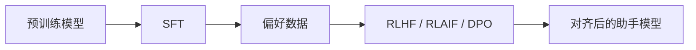

---
tags:
  - 大模型/基础原理
  - 大模型/后训练
  - 大模型/对齐
created: 2026-06-12
updated: 2026-06-12
status: evergreen
aliases:
  - Post-training
  - Alignment
  - RLHF
  - DPO
---

# 后训练与对齐

> [!summary] 一句话理解
> 预训练让模型学会续写和压缩知识，后训练让模型更像一个可用助手：能听指令、按格式回答、拒绝危险请求，并更符合人类偏好。

## 为什么需要后训练

预训练模型的目标是预测下一个 token。它可能会：

- 继续补全文本，而不是直接回答问题。
- 模仿训练语料中的任意风格。
- 输出冗长、跑题或不安全内容。
- 不稳定地遵循格式要求。

后训练的目标是把“会续写的模型”调整成“会协作的助手”。

## 常见阶段



## SFT：监督微调

SFT 使用高质量指令数据训练模型。

样本通常类似：

```json
{
  "instruction": "解释什么是 KV Cache",
  "response": "KV Cache 是推理时缓存历史 token 的 Key 和 Value..."
}
```

SFT 主要提升：

- 指令遵循。
- 问答格式。
- 任务完成度。
- 对话风格。
- 特定领域表达方式。

> [!note] 直觉理解
> SFT 是在告诉模型：“遇到这类用户请求时，应该这样回答。”

## RLHF / RLAIF

RLHF 使用人类偏好反馈，RLAIF 使用 AI 生成或辅助的偏好反馈。

常见做法是给同一个问题生成多个回答，让标注者或评估模型判断哪个更好，然后用这些偏好信号优化模型。

它主要影响：

- 回答是否有帮助。
- 是否遵循安全边界。
- 风格是否自然。
- 是否少废话、少冒犯、少危险建议。

## DPO

DPO 是一种常见的偏好优化方法，它不一定需要显式训练 reward model，而是直接用“更好回答 / 更差回答”的成对数据优化模型。

直觉上：

```text
提高 preferred answer 的概率，降低 rejected answer 的概率
```

DPO 在工程上相对直接，因此很多开源模型后训练会使用它或类似方法。

## 后训练能做什么，不能做什么

后训练能明显改善：

- 指令遵循。
- 安全拒答。
- 格式稳定性。
- 角色风格。
- 多轮对话习惯。
- 工具调用格式。

但它不能保证：

- 所有事实都正确。
- 数学推理永远可靠。
- 代码无需测试。
- 实时知识自动更新。
- 模型不会幻觉。

> [!warning] 关键边界
> 后训练提升的是模型的可用性和偏好对齐，不是把模型变成形式化证明器、数据库或编译器。

## 和微调的关系

后训练是广义微调的一部分，但它的目标更偏向助手化和对齐。

领域微调通常关注：

- 学会特定行业术语。
- 输出特定格式。
- 适配业务数据。
- 提升某类任务表现。

后训练关注：

- 更会听指令。
- 更符合人类偏好。
- 更安全。
- 更稳定地完成通用任务。

## 小结

> [!summary] 核心结论
> 预训练给模型基础能力，后训练把这些能力组织成可交互、可控制、相对安全的助手行为。SFT 教模型怎么答，RLHF/RLAIF/DPO 则进一步调整“什么样的回答更好”。

## 相关笔记

- [[大模型/01-基础原理/预训练/预训练目标|预训练目标]]
- [[大模型/03-训练与微调/模型训练/微调技术/大模型微调技术综述|大模型微调技术综述]]
- [[大模型/03-训练与微调/模型训练/训练的数据集构造方式|训练的数据集构造方式]]
