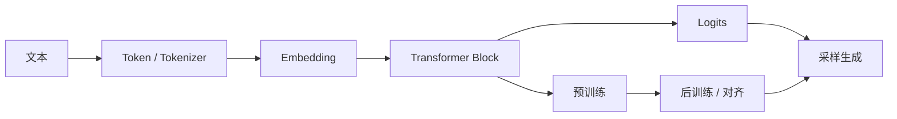

---
tags:
  - 大模型/基础原理
  - 大模型/索引
created: 2026-06-12
updated: 2026-06-12
status: evergreen
aliases:
  - LLM 基础原理总览
  - 大模型原理总览
---

# 大模型基础原理总览

> [!summary] 核心问题
> 理解大模型基础原理，重点不是背单个概念，而是建立一条主线：**文本如何变成 token，token 如何在 Transformer 中交互，模型如何通过预训练学会预测，后训练如何让模型更符合人类任务，推理阶段又如何生成最终答案。**

## 学习主线

## 已有笔记

- [[大模型/01-基础原理/Token与Embedding/Token、Tokenizer 与 Embedding|Token、Tokenizer 与 Embedding]]
- [[大模型/01-基础原理/Transformer/Transformer 整体结构|Transformer 整体结构]]
- [[大模型/01-基础原理/Transformer/图解 Transformer 中的 QKV 机制|图解 Transformer 中的 QKV 机制]]
- [[大模型/01-基础原理/MOE/关于MOE的问题|关于 MOE 的问题]]
- [[大模型/01-基础原理/预训练目标|预训练目标]]
- [[大模型/01-基础原理/后训练与对齐|后训练与对齐]]
- [[大模型/01-基础原理/推理生成过程|推理生成过程]]
- [[大模型/01-基础原理/幻觉与可靠性/幻觉与可靠性|幻觉与可靠性]]
- [[大模型/01-基础原理/LLM为什么有推理和写代码的能力|LLM 为什么有推理和写代码的能力]]

## 建议补充的专题

### 1. Token、Tokenizer 与 Embedding

需要回答的问题：

- 为什么模型不是直接读中文、英文或代码，而是先切成 token。
- BPE、SentencePiece 这类 tokenizer 大概解决什么问题。
- token id、词表、embedding 向量之间是什么关系。
- 上下文窗口为什么通常按 token 数计算，而不是按字符数计算。

> [!note] 已补充
> [[大模型/01-基础原理/Token与Embedding/Token、Tokenizer 与 Embedding|Token、Tokenizer 与 Embedding]]

### 2. Transformer 整体结构

已有 QKV 笔记解释了注意力机制，但还缺一篇从整体看 Transformer Block 的文章。

建议覆盖：

- Token Embedding 与 Position Encoding。
- Self-Attention。
- Feed Forward Network / MLP / SwiGLU。
- Residual Connection。
- LayerNorm / RMSNorm。
- 多层堆叠后如何输出 logits。

> [!note] 已补充
> [[大模型/01-基础原理/Transformer/Transformer 整体结构|Transformer 整体结构]]

### 3. 位置编码与长上下文

长上下文不是简单把输入塞得更长，还涉及位置表示、注意力计算成本和上下文利用能力。

建议覆盖：

- 绝对位置编码与相对位置编码。
- RoPE 的直觉理解。
- ALiBi、NTK scaling、YaRN 等长上下文扩展思路。
- 长上下文的成本：注意力计算、KV Cache、检索噪声。

### 4. 预训练目标

> [!note] 已补充
> [[大模型/01-基础原理/预训练目标|预训练目标]]

LLM 的基础训练目标通常是 next token prediction。

建议覆盖：

- 什么是 next token prediction。
- Loss、cross entropy、perplexity 的直觉理解。
- 为什么预测下一个 token 会迫使模型学习语法、事实、推理模板和代码模式。
- 预训练和记忆/泛化之间的关系。

这部分可以和 [[大模型/01-基础原理/LLM为什么有推理和写代码的能力|LLM 为什么有推理和写代码的能力]] 互相链接。

### 5. Scaling Law、数据与算力

模型能力不是只由参数量决定，而是由参数量、训练 token 数、数据质量和算力共同决定。

建议覆盖：

- 参数量、训练 token 数、FLOPs 的关系。
- 数据质量为什么比单纯堆数据更重要。
- 过小模型、欠训练模型、过训练模型的差异。
- 为什么小模型在垂直领域也可能有性价比。

### 6. 后训练与对齐

> [!note] 已补充
> [[大模型/01-基础原理/后训练与对齐|后训练与对齐]]

预训练模型只学会“续写”，后训练让模型更像助手。

建议覆盖：

- SFT：用高质量指令数据教模型按任务回答。
- RLHF / RLAIF：用偏好反馈调整输出风格和安全边界。
- DPO：用偏好对直接优化模型。
- 后训练提升的是“可用性”和“对齐”，不是凭空注入所有知识。

### 7. 推理生成过程

> [!note] 已补充
> [[大模型/01-基础原理/推理生成过程|推理生成过程]]

用户看到的是回答，但模型内部是在逐 token 生成。

建议覆盖：

- logits、softmax、概率分布。
- greedy decoding、temperature、top-k、top-p。
- 重复惩罚、停止词、流式输出。
- 为什么同一个问题可能生成不同答案。

### 8. 幻觉与可靠性

> [!note] 已补充
> [[大模型/01-基础原理/幻觉与可靠性/幻觉与可靠性|幻觉与可靠性]]

幻觉不是偶发现象，而是生成式模型机制上的自然风险。

建议覆盖：

- 模型参数不是数据库。
- 生成目标是“高概率输出”，不是事实验证。
- 训练数据过时、缺失或冲突时容易出错。
- RAG、搜索、工具调用、测试和人工审查分别能补哪些短板。

### 9. 架构分类

建议把不同模型放到同一张地图里理解。

| 分类 | 代表 | 关键差异 |
|------|------|----------|
| Decoder-only | GPT、LLaMA、Qwen | 适合自回归生成，是当前 LLM 主流架构 |
| Encoder-Decoder | T5、传统翻译模型 | 编码输入后再解码输出 |
| Dense | LLaMA、部分 Qwen | 每个 token 激活大部分参数 |
| MoE | Mixtral、DeepSeek、Qwen MoE | 每个 token 只激活部分专家 |
| 多模态 | GPT-4o、Gemini、Qwen-VL | 文本之外还处理图像、音频、视频等模态 |

### 10. 能力边界

建议单独沉淀一篇“能力从哪里来，以及哪些地方不能盲信”。

- 推理能力：来自模式组合、上下文跟踪、多步生成和后训练强化。
- 代码能力：来自代码语料、API 文档、错误日志、测试反馈和工具闭环。
- Agent 能力：来自模型规划能力、工具调用协议、外部环境反馈和记忆系统。
- 风险边界：安全、权限、财务、医疗、法律、生产变更不能只依赖模型单次输出。

## 推荐补充顺序

1. 先读 [[大模型/01-基础原理/Token与Embedding/Token、Tokenizer 与 Embedding|Token、Tokenizer 与 Embedding]]，打通输入表示。
2. 再读 [[大模型/01-基础原理/Transformer/Transformer 整体结构|Transformer 整体结构]]，把 QKV 放回完整网络结构中。
3. 然后读 [[大模型/01-基础原理/预训练目标|预训练目标]] 和 [[大模型/01-基础原理/后训练与对齐|后训练与对齐]]，解释能力来源。
4. 最后读 [[大模型/01-基础原理/推理生成过程|推理生成过程]] 和 [[大模型/01-基础原理/幻觉与可靠性/幻觉与可靠性|幻觉与可靠性]]，连接实际使用和工程风险。

## 相关笔记

- [[大模型/00-大模型学习导航|大模型学习导航]]
- [[大模型/01-基础原理/Token与Embedding/Token、Tokenizer 与 Embedding|Token、Tokenizer 与 Embedding]]
- [[大模型/01-基础原理/Transformer/Transformer 整体结构|Transformer 整体结构]]
- [[大模型/01-基础原理/Transformer/图解 Transformer 中的 QKV 机制|图解 Transformer 中的 QKV 机制]]
- [[大模型/01-基础原理/MOE/关于MOE的问题|关于 MOE 的问题]]
- [[大模型/01-基础原理/预训练目标|预训练目标]]
- [[大模型/01-基础原理/后训练与对齐|后训练与对齐]]
- [[大模型/01-基础原理/推理生成过程|推理生成过程]]
- [[大模型/01-基础原理/幻觉与可靠性/幻觉与可靠性|幻觉与可靠性]]
- [[大模型/03-训练与微调/模型训练/微调技术/大模型微调技术综述|大模型微调技术综述]]
- [[大模型/02-应用开发/RAG/18种RAG技术对比测试|18 种 RAG 技术对比测试]]
