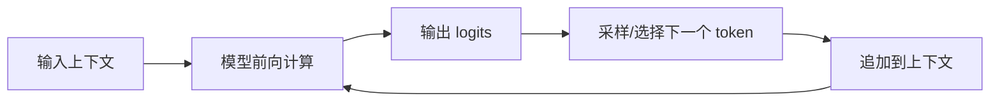

---
tags:
  - 大模型/基础原理
  - 大模型/推理
  - 大模型/生成
created: 2026-06-12
updated: 2026-06-12
status: evergreen
aliases:
  - Decoding
  - Sampling
  - 大模型推理过程
---

# 推理生成过程

> [!summary] 一句话理解
> 大模型回答问题时，不是一次性生成整段文本，而是不断预测下一个 token，再把新 token 追加到上下文中，循环直到停止。

## 基本循环



简化成伪代码：

```python
while not stopped:
    logits = model(context)
    next_token = decode(logits)
    context.append(next_token)
```

## Logits 和概率

模型最后会对词表中的每个 token 输出一个分数，这些分数叫 logits。

logits 经过 softmax 后变成概率分布：

```text
token A: 0.40
token B: 0.25
token C: 0.10
...
```

解码策略决定从这个概率分布里选哪个 token。

## 常见解码策略

### Greedy Decoding

每一步都选择概率最高的 token。

优点：

- 稳定。
- 可复现。
- 适合确定性任务。

缺点：

- 容易保守。
- 可能陷入重复或局部最优。

### Temperature

Temperature 控制概率分布的平滑程度。

- temperature 低：更保守，更偏向高概率 token。
- temperature 高：更随机，输出更发散。

常见直觉：

| 场景 | temperature |
|------|-------------|
| 代码、事实问答 | 低 |
| 创意写作、头脑风暴 | 中高 |

### Top-k

只从概率最高的 k 个 token 中采样。

例如 top-k = 40，表示每一步只考虑前 40 个候选 token。

### Top-p

也叫 nucleus sampling。

它不是固定候选数量，而是选择累计概率达到 p 的候选集合。

例如 top-p = 0.9，表示只在累计概率达到 90% 的候选 token 中采样。

## 为什么同一个问题会有不同答案

如果使用采样策略，模型每一步都有一定随机性。只要某一步 token 不同，后续上下文就变了，最终答案也可能不同。

影响因素包括：

- temperature。
- top-p / top-k。
- system prompt。
- 上下文顺序。
- 是否启用工具。
- 模型服务端是否固定随机种子。

## KV Cache 的作用

自回归生成时，历史 token 不断增加。如果每一步都重新计算所有历史 token 的 Key/Value，成本很高。

KV Cache 会缓存历史 token 的 Key 和 Value，让下一步只需要计算新 token 并复用历史缓存。

优势：

- 显著提升生成速度。
- 降低重复计算。

代价：

- 上下文越长，KV Cache 占用越多显存。

详细可看 [[大模型/01-基础原理/Transformer/图解 Transformer 中的 QKV 机制|图解 Transformer 中的 QKV 机制]]。

## 停止条件

生成会在一些条件下停止：

- 生成了结束 token。
- 达到最大输出 token 数。
- 命中 stop sequence。
- 工具调用或应用层中断。
- 安全策略拦截。

## 流式输出

流式输出不是模型一次性知道完整答案后慢慢显示，而是每生成一小段 token 就返回给客户端。

这样用户能更快看到响应，但也意味着：

- 早期输出可能影响后续方向。
- 应用层需要处理半句、半个 Markdown 表格、半段 JSON。

## 小结

> [!summary] 核心结论
> 推理生成就是“预测一个 token、追加一个 token、继续预测”的循环。temperature、top-p、top-k 等参数控制输出的稳定性和发散度，KV Cache 则用空间换速度。

## 相关笔记

- [[大模型/01-基础原理/Token、Tokenizer 与 Embedding|Token、Tokenizer 与 Embedding]]
- [[大模型/01-基础原理/Transformer/图解 Transformer 中的 QKV 机制|图解 Transformer 中的 QKV 机制]]
- [[大模型/01-基础原理/幻觉与可靠性|幻觉与可靠性]]
