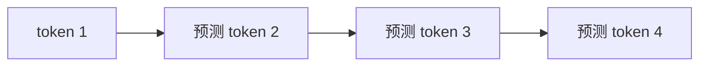

---
tags:
  - 大模型/基础原理
  - 大模型/预训练
created: 2026-06-12
updated: 2026-06-12
status: evergreen
aliases:
  - Next Token Prediction
  - 下一个 Token 预测
---

# 预训练目标

> [!summary] 一句话理解
> 大语言模型预训练的核心目标通常是预测下一个 token。这个目标看起来简单，但在海量文本和代码上反复优化后，模型会被迫学习语言、知识、结构、推理模式和代码模式。

## 什么是 Next Token Prediction

给定前面的 token，模型预测下一个 token。

```text
如果 A 大于 B，B 大于 C，那么 A ___
```

模型需要让“可能大于 C”这类 token 的概率更高。

训练时，模型不是只预测一句话的最后一个 token，而是对序列中每个位置都做预测：



## Loss 是怎么来的

模型会输出整个词表上的概率分布。训练数据中真实的下一个 token 是目标答案。

如果模型给真实 token 的概率高，loss 就低；如果概率低，loss 就高。

常见训练损失是 cross entropy。

直觉上：

```text
目标：让真实下一个 token 的概率尽可能高
```

## 为什么预测下一个 token 能学到能力

因为训练语料不是随机字符串，而是包含大量结构：

- 自然语言语法。
- 事实知识。
- 数学推导。
- 代码和测试。
- 论文证明。
- 调试记录。
- 问答和教程。
- 设计文档和规范。

模型要持续降低预测误差，就不能只背局部词频，而要学习更深层的统计结构。

## 预训练学到的是什么

可以理解为几类能力的混合：

- **语言能力**：词语搭配、句法、表达风格。
- **知识压缩**：训练语料中的事实和常识被压缩到参数中。
- **模式识别**：问题、答案、代码、错误、修复之间的常见模式。
- **上下文建模**：当前 token 如何依赖前文条件。
- **弱推理模板**：常见推理步骤、证明格式、任务分解方式。

> [!warning] 不是数据库
> 预训练参数保存的是压缩后的统计结构，不是可精确查询、可验证、实时更新的数据库。

## Perplexity 是什么

Perplexity 可以粗略理解为模型对下一个 token 有多“不确定”。

- perplexity 越低，说明模型越能预测训练分布中的文本。
- perplexity 越高，说明模型越困惑。

但低 perplexity 不等于实际任务一定更强。聊天、推理、代码、工具调用还受后训练、数据质量、上下文长度和推理策略影响。

## 预训练与后训练的区别

| 阶段 | 目标 | 结果 |
|------|------|------|
| 预训练 | 学会续写和建模文本分布 | 获得语言、知识、代码和基础推理能力 |
| 后训练 | 学会按人类指令回答 | 提升可用性、安全性、格式遵循和偏好对齐 |

预训练模型可能很会续写，但不一定像助手；后训练会把它调整成更符合用户意图的交互模型。

## 常见误区

### 只是预测下一个词，所以不可能有智能吗

不能这么简单理解。训练目标简单，不代表学到的内部表示简单。为了在大量复杂文本上预测准确，模型会学习很多可泛化结构。

### 预训练是不是等于背诵

包含记忆，但不等于只会背诵。大模型会同时表现出记忆、泛化、模式组合和错误迁移。

### 训练数据越多越好吗

不一定。低质量、重复、错误或污染的数据可能降低模型能力。数据质量、配比和去重同样关键。

## 小结

> [!summary] 核心结论
> Next token prediction 是一个简单但强大的训练目标。它通过海量数据和大规模参数，把语言、知识、代码和推理模式压缩进模型参数中，为后续对齐和应用能力打基础。

## 相关笔记

- [[大模型/基础原理/LLM为什么有推理和写代码的能力|LLM 为什么有推理和写代码的能力]]
- [[大模型/01-基础原理/Transformer/Transformer 整体结构|Transformer 整体结构]]
- [[大模型/01-基础原理/后训练/后训练与对齐|后训练与对齐]]
