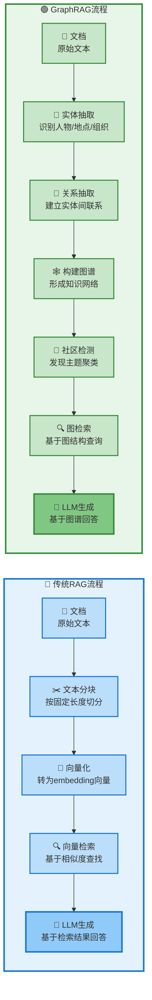
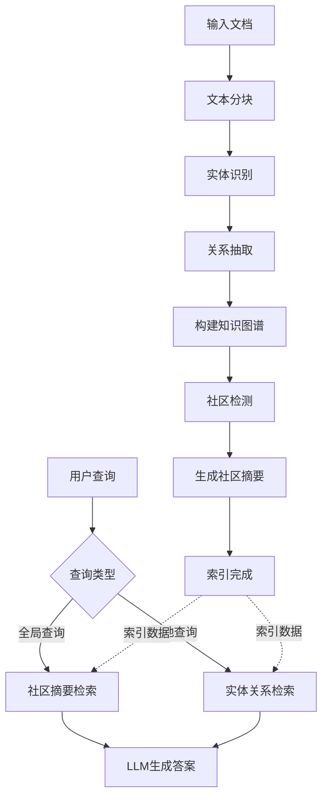
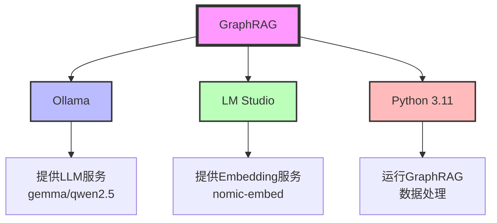
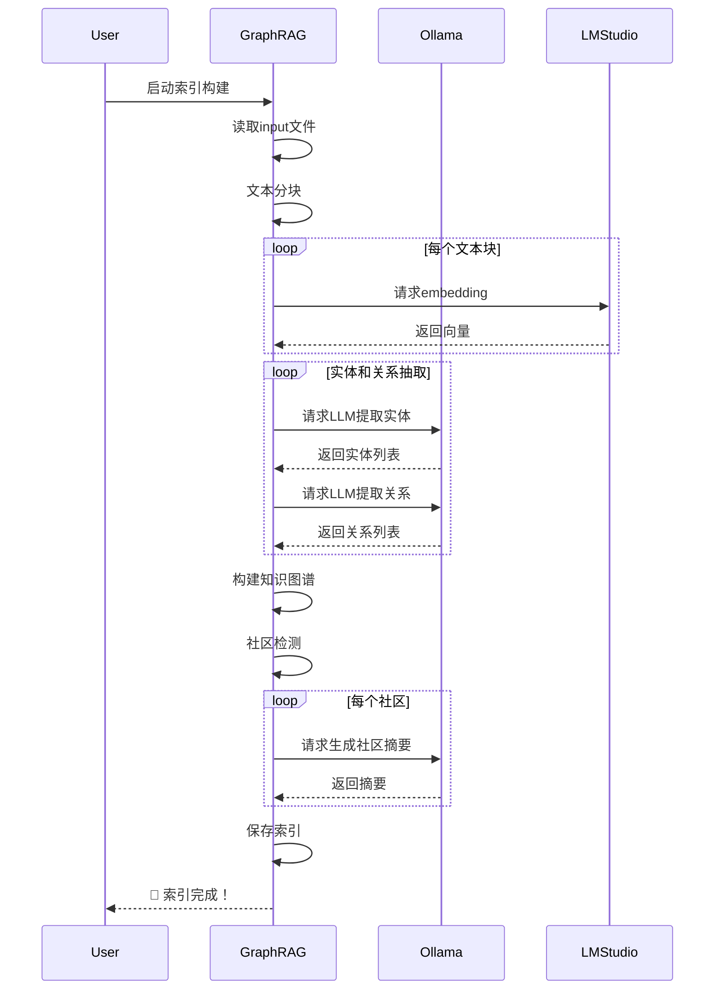
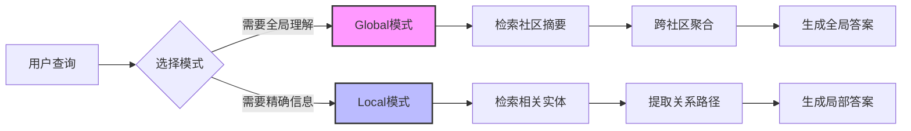

# 本地部署GraphRAG完整指南

> **最后更新**: 2025-12-27
> **难度等级**: ⭐⭐⭐ (中级)
> **预计时间**: 30-60分钟

## 📋 目录

1. [背景介绍](#背景介绍)
2. [技术原理](#技术原理)
3. [环境准备](#环境准备)
4. [部署步骤](#部署步骤)
5. [配置说明](#配置说明)
6. [实战测试](#实战测试)
7. [常见问题](#常见问题)
8. [性能优化](#性能优化)

---

## 背景介绍

### 为什么需要GraphRAG？

传统的RAG（检索增强生成）技术虽然能让LLM访问外部知识库，但在处理复杂关系和全局理解方面存在局限：

**传统RAG的问题**:
- 🔹 只能检索局部文本片段，缺乏全局视角
- 🔹 难以理解实体之间的复杂关系
- 🔹 多跳推理能力弱
- 🔹 摘要质量受限于检索精度

**GraphRAG的优势**:
- ✅ 构建知识图谱，捕捉全局信息
- ✅ 理解实体间的关系网络
- ✅ 支持多跳推理和复杂查询
- ✅ 并行生成社区摘要，提升质量

### 什么是GraphRAG？

**GraphRAG** (Graph-based Retrieval Augmented Generation) 是微软开源的基于知识图谱的RAG技术，通过构建实体关系网络来增强检索效果。

**核心特性**:
- 📊 自动构建知识图谱
- 🔍 基于图的检索策略
- 🌐 社区检测和层级摘要
- 📈 全局和本地两种查询模式

**GitHub**: https://github.com/microsoft/graphrag

---

## 技术原理

### GraphRAG vs 传统RAG



**核心差异对比**：

| 维度 | 🔵 传统RAG | 🟢 GraphRAG |
|------|---------|----------|
| **核心技术** | 向量相似度检索 | 知识图谱 + 向量检索 |
| **信息理解** | 局部文本片段 | 全局关系网络 |
| **适用场景** | 简单问答、关键词检索 | 复杂推理、关系查询 |
| **检索方式** | 基于语义相似度 | 基于图结构 + 社区摘要 |
| **处理步骤** | 5步（分块→向量→检索→生成） | 7步（实体→关系→图谱→社区→检索→生成） |
| **性能** | ⚡ 快速、轻量 | 🐢 较慢、资源消耗大 |
| **优势** | 部署简单、响应快 | 理解深入、推理强 |

### GraphRAG工作流程



---

## 环境准备

### 系统要求

| 组件 | 要求 | 说明 |
|------|------|------|
| **操作系统** | macOS/Linux/Windows | 推荐macOS或Linux |
| **Python** | 3.10-3.12 | 推荐3.11 |
| **内存** | 16GB+ | 建议32GB |
| **存储** | 20GB+ | 用于模型和索引 |

### 技术栈



#### 1. Ollama - LLM服务提供者

**作用**: 提供本地大语言模型服务

**推荐模型**:
- `qwen2.5:7b` - 中文优秀，推荐
- `gemma:7b` - 稳定性好
- `llama3.1:8b` - 综合性能佳

安装参考: [[大模型/07-教程与课程/5分钟手把手/1. 使用Mac Book Pro本地部署大模型（Ollama+Llama3.1_8B+Docker+OpenWebUI）|Ollama安装教程]]

#### 2. LM Studio - Embedding服务提供者

**作用**: 提供文本向量化（Embedding）服务

**为什么需要**:
- Ollama的embedding接口不符合OpenAI标准
- LM Studio提供完整的OpenAI兼容API
- 支持多种embedding模型

**下载地址**: https://lmstudio.ai/

#### 3. Python环境

**推荐使用虚拟环境**:
```bash
# 创建虚拟环境
python3.11 -m venv graphrag-env

# 激活虚拟环境
# macOS/Linux:
source graphrag-env/bin/activate
# Windows:
graphrag-env\Scripts\activate
```

---

## 部署步骤

### 步骤1: 启动Ollama服务

```bash
# 1. 下载并运行模型（推荐qwen2.5）
ollama run qwen2.5:7b

# 2. 测试模型是否正常
curl http://localhost:11434/api/generate -d '{
  "model": "qwen2.5:7b",
  "prompt": "你好",
  "stream": false
}'

# 3. 后台运行（可选）
ollama serve
```

**验证**: 访问 http://localhost:11434 应该能看到 “Ollama is running”

---

### 步骤2: 配置LM Studio

#### 2.1 安装LM Studio

1. 访问 https://lmstudio.ai/ 下载对应系统版本
2. 安装后首次启动

#### 2.2 解决网络问题（重要！）

LM Studio访问HuggingFace可能失败，需要配置hosts：

```bash
# macOS/Linux 编辑hosts
sudo nano /etc/hosts

# Windows 编辑
C:\Windows\System32\drivers\etc\hosts

# 添加以下内容（GitHub最新IP，可能需要更新）
140.82.112.3    github.com
199.232.69.194  github.global.ssl.fastly.net
185.199.108.153 assets-cdn.github.com
199.232.96.133  raw.githubusercontent.com
199.232.96.133  user-images.githubusercontent.com
151.101.108.133 avatars.githubusercontent.com
```

#### 2.3 下载Embedding模型

**在LM Studio中**:

1. 点击 “Search” 搜索模型
2. 搜索关键词: `nomic`
3. 下载模型: **nomic-embed-text-v1.5.Q4_K_M.gguf**

**模型信息**:
- 大小: ~140MB
- 量化: Q4_K_M (4-bit量化)
- 维度: 768
- 上下文: 8192 tokens

**推荐原因**:
- 轻量级，速度快
- 支持长文本
- 质量优秀

#### 2.4 启动Embedding服务

**在LM Studio中**:

1. 切换到 “Local Server” 标签
2. 选择刚下载的 `nomic-embed-text-v1.5.Q4_K_M.gguf`
3. 点击 “Start Server”
4. 默认端口: `1234`

**验证服务**:
```bash
curl http://localhost:1234/v1/embeddings \
  -H "Content-Type: application/json" \
  -d '{
    "input": "测试文本",
    "model": "nomic-embed-text-v1.5"
  }'
```

成功会返回向量数组。

---

### 步骤3: 创建Python项目

#### 3.1 创建项目目录

```bash
# 创建项目目录
mkdir graphrag-demo
cd graphrag-demo

# 创建虚拟环境
python3.11 -m venv venv

# 激活虚拟环境
source venv/bin/activate  # macOS/Linux
# venv\Scripts\activate   # Windows
```

#### 3.2 安装GraphRAG

```bash
# 安装graphrag
pip install graphrag

# 验证安装
python -m graphrag --version

# 应该输出类似: graphrag, version 0.3.x
```

**可能的依赖问题**:
```bash
# 如果遇到依赖冲突，尝试：
pip install graphrag --upgrade
pip install "pandas>=2.0.0"
```

---

### 步骤4: 初始化GraphRAG项目

#### 4.1 创建项目结构

```bash
# 创建工作目录
mkdir -p ragtest/input

# 初始化GraphRAG
python -m graphrag.index --init --root ./ragtest
```

**执行后的目录结构**:
```
ragtest/
├── input/              # 存放原始文档
├── output/             # 索引输出目录（自动生成）
├── prompts/            # Prompt模板（自动生成）
├── settings.yaml       # 配置文件
└── .env               # 环境变量（可选）
```

#### 4.2 准备测试数据

**下载测试文本**（以三国演义为例）:
```bash
cd ragtest/input

# 方式1: 下载完整版
curl -o sanguoyanyi.txt https://raw.githubusercontent.com/naosense/Yiya/master/book/%E4%B8%89%E5%9B%BD%E6%BC%94%E4%B9%89.txt

# 方式2: 使用自己的txt文件
# 将任何txt文件放入 input/ 目录即可
```

**文件要求**:
- 格式: `.txt` 纯文本文件
- 编码: UTF-8
- 大小: 建议先用小文件测试（<1MB），成功后再用大文件

**示例文本内容**:
```
input/
├── test1.txt           # 示例1
├── test2.txt           # 示例2
└── sanguoyanyi.txt     # 三国演义
```

---

### 步骤5: 配置settings.yaml

打开 `ragtest/settings.yaml`，修改以下关键配置：

```yaml
# ==================== LLM配置 ====================
llm:
  api_key: ollama                    # 随意填写，ollama不验证
  type: openai_chat                  # 使用OpenAI兼容接口
  model: qwen2.5:7b                  # 你启动的Ollama模型
  model_supports_json: true          # qwen2.5支持JSON
  api_base: http://127.0.0.1:11434/v1

  # 可选：调整生成参数
  # temperature: 0.7
  # max_tokens: 4000

# ==================== Embedding配置 ====================
embeddings:
  async_mode: threaded               # 并发模式
  llm:
    api_key: lm-studio               # 随意填写
    type: openai_embedding           # OpenAI兼容接口
    model: nomic-ai/nomic-embed-text-v1.5-GGUF/nomic-embed-text-v1.5.Q4_K_M.gguf
    api_base: http://localhost:1234/v1

# ==================== 文本分块配置 ====================
chunks:
  size: 300                          # 每块文本大小（tokens）
  overlap: 100                       # 重叠部分（tokens）
  group_by_columns: [id]             # 分组字段

# ==================== 实体提取配置 ====================
entity_extraction:
  max_gleanings: 1                   # 实体提取轮数（降低可加速）

# ==================== 社区检测配置 ====================
community_reports:
  max_length: 2000                   # 社区摘要最大长度
```

**配置说明**:

| 参数 | 说明 | 推荐值 |
|------|------|--------|
| **chunks.size** | 文本分块大小 | 300 (小文件) / 1200 (大文件) |
| **chunks.overlap** | 块间重叠 | size的1/3 |
| **max_gleanings** | 实体提取轮数 | 1 (快速) / 2 (质量好) |
| **max_length** | 摘要长度 | 2000 |

---

### 步骤6: 构建索引

```bash
# 确保在项目根目录
cd graphrag-demo

# 激活虚拟环境
source venv/bin/activate

# 构建索引（这一步耗时较长！）
python -m graphrag.index --root ./ragtest
```

**索引流程可视化**:



**执行过程日志**:
```
⠋ GraphRAG Indexer
├── Loading Input (text) - 1 files loaded
├── create_base_text_units
├── create_base_extracted_entities
├── create_summarized_entities
├── create_base_entity_graph
├── create_final_entities
├── create_final_communities
├── create_final_community_reports
└── create_final_text_units

🚀 All workflows completed successfully.
```

**索引时间估算**:
- 小文件 (1MB): 5-10分钟
- 中等文件 (10MB): 30-60分钟
- 大文件 (100MB): 3-8小时

**索引输出**:
```
ragtest/output/
└── <timestamp>/
    ├── artifacts/           # 中间数据
    │   ├── create_base_text_units.parquet
    │   ├── create_final_entities.parquet
    │   ├── create_final_relationships.parquet
    │   └── create_final_communities.parquet
    └── reports/            # 社区报告
```

---

## 实战测试

### 查询模式

GraphRAG支持两种查询模式：



### Global查询（全局理解）

**适用场景**:
- 总结性问题
- 需要跨主题理解
- 高层次概括

**命令**:
```bash
python -m graphrag.query \
  --root ./ragtest \
  --method global \
  "刘备是谁？他的主要经历是什么？"
```

**示例查询**:
```bash
# 问题1: 总结性问题
python -m graphrag.query \
  --root ./ragtest \
  --method global \
  "总结三国时期的主要人物和事件"

# 问题2: 主题理解
python -m graphrag.query \
  --root ./ragtest \
  --method global \
  "刘备、关羽、张飞之间的关系是什么？"

# 问题3: 高层概括
python -m graphrag.query \
  --root ./ragtest \
  --method global \
  "三国演义的核心主题是什么？"
```

**输出示例**:
```
SUCCESS: Global Search Response:

刘备是三国时期蜀汉的开国皇帝，字玄德。他的主要经历包括：

1. 早期生涯：黄巾起义时期从军，结识关羽、张飞，桃园三结义
2. 辗转流离：曾依附公孙瓒、曹操、袁绍、刘表等势力
3. 三顾茅庐：得诸葛亮辅佐，确立"隆中对"战略
4. 建立蜀汉：占据荆州、益州，于成都称帝
5. 夷陵之战：为关羽复仇，兵败于陆逊
6. 白帝托孤：临终前将国事托付给诸葛亮

[参考来源: community_reports/report_xxx.txt]
```

### Local查询（局部精确）

**适用场景**:
- 具体事实查询
- 实体关系查询
- 细节信息

**命令**:
```bash
python -m graphrag.query \
  --root ./ragtest \
  --method local \
  "关羽的武器是什么？"
```

**示例查询**:
```bash
# 问题1: 具体事实
python -m graphrag.query \
  --root ./ragtest \
  --method local \
  "张飞的字是什么？"

# 问题2: 关系查询
python -m graphrag.query \
  --root ./ragtest \
  --method local \
  "诸葛亮和刘备是什么关系？"

# 问题3: 细节信息
python -m graphrag.query \
  --root ./ragtest \
  --method local \
  "桃园三结义发生在哪里？"
```

---

## 常见问题

### Q1: "Columns must be same length as key" 错误

**问题原因**: LLM输出格式不符合预期

**解决方案**:

1. **更换模型**（最有效）:
```bash
# 尝试以下模型（按推荐顺序）
ollama pull qwen2.5:7b      # 推荐，稳定性好
ollama pull gemma:7b        # 次选，兼容性好
ollama pull llama3.1:8b     # 备选
```

2. **调整配置**:
```yaml
# settings.yaml
llm:
  model_supports_json: true    # 确保设为true
  temperature: 0.7             # 降低随机性

chunks:
  size: 300                    # 减小分块（从1200降到300）
```

3. **减少文本量**:
```bash
# 先用小文件测试（<100KB）
head -n 100 large_file.txt > ragtest/input/test.txt
```

### Q2: 索引速度太慢

**优化方案**:

1. **减少实体提取轮数**:
```yaml
entity_extraction:
  max_gleanings: 1    # 从2改为1，速度提升50%
```

2. **调整并发**:
```yaml
embeddings:
  async_mode: asyncio    # 改为asyncio模式

chunks:
  size: 600             # 增大分块，减少API调用
```

3. **使用更快的模型**:
```bash
ollama pull qwen2.5:7b   # 比70b快5-10倍
```

### Q3: Embedding服务连接失败

**检查步骤**:

```bash
# 1. 确认LM Studio正在运行
curl http://localhost:1234/v1/models

# 2. 测试embedding接口
curl http://localhost:1234/v1/embeddings \
  -H "Content-Type: application/json" \
  -d '{"input": "test", "model": "nomic-embed-text-v1.5"}'

# 3. 检查端口占用
lsof -i :1234  # macOS/Linux
netstat -ano | findstr :1234  # Windows
```

**解决方案**:
- 重启LM Studio
- 更换端口（在LM Studio设置中修改）
- 检查防火墙设置

### Q4: 内存不足 (OOM)

**症状**: 进程崩溃，提示内存不足

**解决方案**:

1. **减小批处理大小**:
```yaml
chunks:
  size: 300        # 降低分块大小
  overlap: 50      # 减少重叠
```

2. **分批处理**:
```bash
# 将大文件拆分
split -l 1000 large_file.txt input/chunk_

# 逐个处理
for file in input/chunk_*; do
  python -m graphrag.index --root ./ragtest
done
```

3. **使用更小的模型**:
```bash
ollama pull qwen2.5:3b   # 更小的模型
```

### Q5: 查询结果质量差

**改进方法**:

1. **调整查询模式**:
```bash
# 如果global效果差，试试local
python -m graphrag.query --root ./ragtest --method local "问题"
```

2. **优化Prompt**:
```bash
# 更具体的问题
python -m graphrag.query \
  --root ./ragtest \
  --method global \
  "请详细描述刘备在三国演义中的主要事迹，包括桃园结义、三顾茅庐、建立蜀汉等重要事件"
```

3. **增加数据量**:
- 索引更多相关文档
- 提高`max_length`参数

---

## 性能优化

### 索引性能优化

**配置优化**:
```yaml
# 高性能配置（牺牲部分质量）
entity_extraction:
  max_gleanings: 1              # 降低提取轮数

chunks:
  size: 800                     # 增大分块
  overlap: 200                  # 适度重叠

embeddings:
  async_mode: asyncio           # 异步模式
  batch_size: 16                # 批处理
```

**硬件优化**:
- 使用SSD存储
- 增加内存（推荐32GB）
- 使用更快的CPU

### 查询性能优化

**缓存策略**:
```bash
# 相同查询会使用缓存，无需重复计算
python -m graphrag.query --root ./ragtest --method global "问题"
```

**并行查询**:
```python
# 自定义脚本批量查询
import subprocess

questions = [
    "刘备是谁？",
    "关羽的武器是什么？",
    "诸葛亮的字是什么？"
]

for q in questions:
    subprocess.run([
        "python", "-m", "graphrag.query",
        "--root", "./ragtest",
        "--method", "local",
        q
    ])
```

---

## 进阶使用

### 自定义Prompt模板

GraphRAG支持自定义Prompt模板，位于 `ragtest/prompts/` 目录：

```
prompts/
├── entity_extraction.txt       # 实体提取Prompt
├── relationship_extraction.txt # 关系提取Prompt
└── community_report.txt        # 社区摘要Prompt
```

**示例：优化实体提取Prompt**:
```
# prompts/entity_extraction.txt

你是一个专业的知识图谱构建助手。请从以下文本中提取所有重要的实体（人物、地点、组织、事件等）。

要求：
1. 提取所有人物的姓名、字、别名
2. 提取地点的详细位置
3. 提取重要事件的名称和时间
4. 输出格式为JSON

文本：
{input_text}

输出示例：
{
  "entities": [
    {"name": "刘备", "type": "人物", "attributes": {"字": "玄德"}},
    {"name": "桃园", "type": "地点"}
  ]
}
```

### API集成

**Python SDK**:
```python
from graphrag.query.indexer_adapters import read_indexer_entities, read_indexer_reports
from graphrag.query.llm.oai.chat_openai import ChatOpenAI
from graphrag.query.structured_search.global_search.search import GlobalSearch

# 读取索引
entities = read_indexer_entities("./ragtest/output/<timestamp>")
reports = read_indexer_reports("./ragtest/output/<timestamp>")

# 配置LLM
llm = ChatOpenAI(
    api_key="ollama",
    api_base="http://localhost:11434/v1",
    model="qwen2.5:7b"
)

# 执行查询
search = GlobalSearch(
    llm=llm,
    entities=entities,
    reports=reports
)

result = search.search("刘备是谁？")
print(result.response)
```

---

## 资源链接

### 官方资源
- GraphRAG GitHub: https://github.com/microsoft/graphrag
- 官方文档: https://microsoft.github.io/graphrag/
- Ollama官网: https://ollama.com/
- LM Studio官网: https://lmstudio.ai/

### 相关文档
- [[大模型/07-教程与课程/5分钟手把手/1. 使用Mac Book Pro本地部署大模型（Ollama+Llama3.1_8B+Docker+OpenWebUI）|Ollama部署教程]]
- [[大模型/07-教程与课程/5分钟手把手/5. 本地编写一个RAG系统（Qwen2.5-14b+LlamaIndex + Ollama）|传统RAG系统]]
- [[大模型/04-部署与工具链/向量数据库/向量数据库对比推荐|向量数据库选型]]

---

## 写在最后

GraphRAG通过构建知识图谱，显著提升了RAG系统的检索质量和全局理解能力。虽然索引构建耗时较长，但在复杂问答场景下的效果提升明显。

### 适用场景

✅ **推荐使用**:
- 需要全局理解的问答
- 复杂关系推理
- 多文档综合分析
- 学术论文分析

❌ **不推荐使用**:
- 简单的关键词检索
- 实时性要求高的场景
- 文档频繁更新

### 下一步学习

- 🔧 集成到实际应用中
- 📊 对比不同RAG方案的效果
- 🎯 优化Prompt模板
- 🚀 部署到生产环境

---

> 💬 **问题反馈**: 如遇到问题，可参考 [[大模型/04-部署与工具链/HuggingFace/如何在国内使用huggingface|HuggingFace访问指南]]
