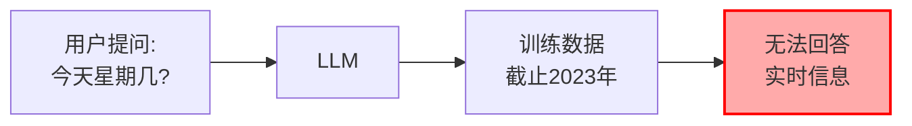
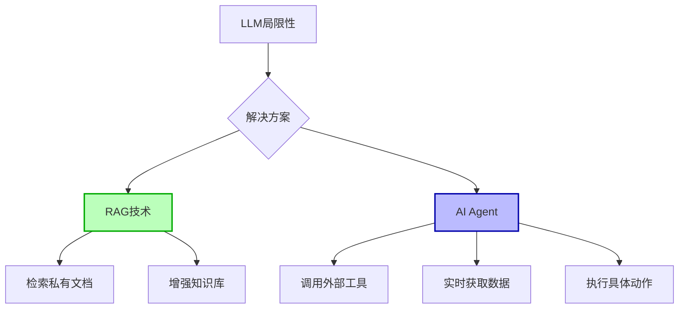
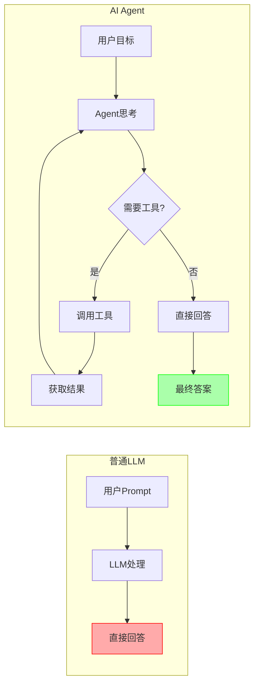
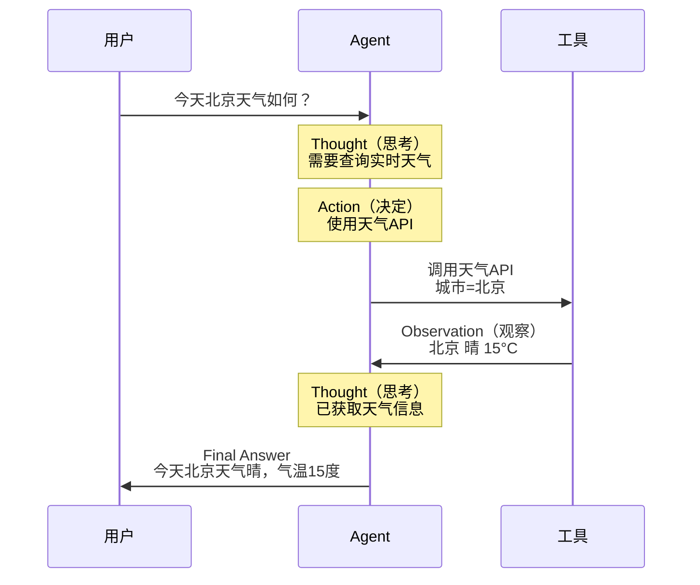
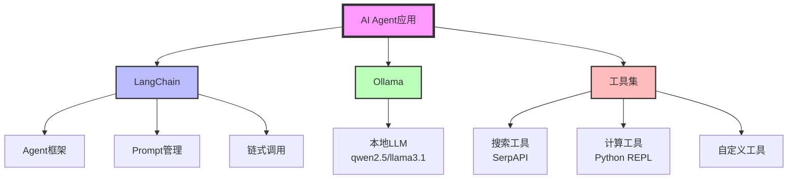
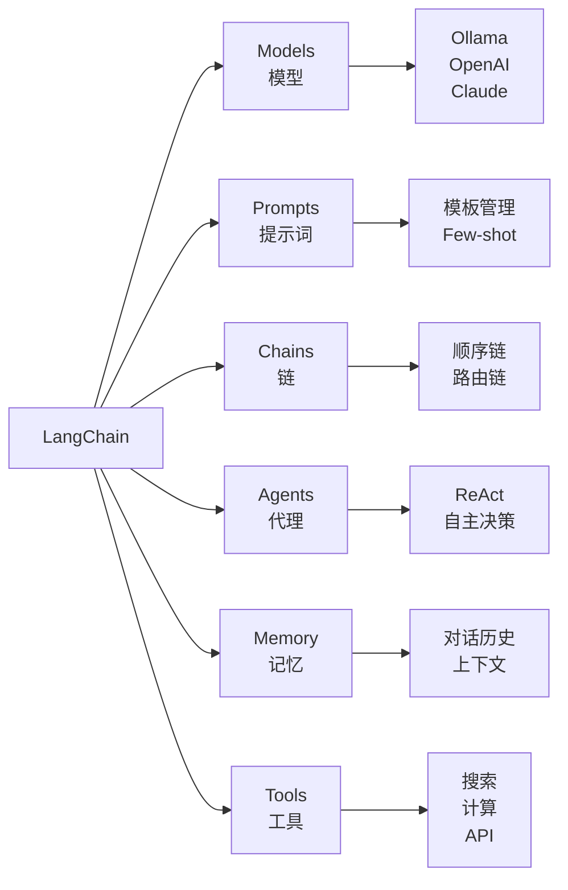

# 本地编写AI Agent完整指南

> **最后更新**: 2025-12-27
> **难度等级**: ⭐⭐⭐ (中级)
> **预计时间**: 20-40分钟

## 📋 目录

1. [背景介绍](#背景介绍)
2. [什么是AI Agent](#什么是ai-agent)
3. [技术架构](#技术架构)
4. [环境准备](#环境准备)
5. [代码实战](#代码实战)
6. [进阶示例](#进阶示例)
7. [常见问题](#常见问题)
8. [最佳实践](#最佳实践)

---

## 背景介绍

### 普通LLM的局限性

传统的大语言模型虽然强大，但存在明显的局限：

**知识截止问题**:


**示例对比**:

| 问题类型 | LLM表现 | 原因 |
|---------|---------|------|
| "什么是机器学习？" | ✅ 可回答 | 知识库内 |
| "今天北京天气如何？" | ❌ 无法回答 | 实时数据 |
| "帮我订一张火车票" | ❌ 无法执行 | 无法调用工具 |
| "公司内部文档内容" | ❌ 无法回答 | 私有数据 |

### 解决方案对比



**解决方案**:
- **RAG（检索增强生成）**: 解决私有知识问题
  - 参考: [[大模型/07-教程与课程/5分钟手把手/2. 本地部署Graphrag（Pycharm+Ollama+LM Studio）|GraphRAG教程]]

- **AI Agent（智能代理）**: 解决实时数据和工具调用
  - 本文重点

---

## 什么是AI Agent

### 定义

**AI Agent**（人工智能代理）是一种能够：
- 🧠 **自主思考** - 理解目标并制定计划
- 👀 **感知环境** - 获取外部信息
- 🛠️ **使用工具** - 调用API、搜索、计算等
- 🎯 **执行动作** - 完成具体任务

### LLM vs AI Agent



**核心区别**:

| 维度 | 普通LLM | AI Agent |
|------|---------|----------|
| **输入** | Prompt（提示词） | Goal（目标） |
| **处理** | 一次性生成 | 多轮推理 |
| **能力** | 受限于训练数据 | 可调用外部工具 |
| **输出** | 静态回答 | 动态执行结果 |
| **示例** | "介绍一下北京" | "查今天北京天气" |

### ReAct架构

AI Agent通常基于**ReAct**（Reasoning + Acting）模式工作：



**ReAct循环流程**:
1. **Thought（思考）**: 分析问题，决定下一步
2. **Action（行动）**: 选择并调用工具
3. **Observation（观察）**: 获取工具执行结果
4. **重复1-3**: 直到问题解决
5. **Final Answer**: 给出最终答案

---

## 技术架构

### 技术栈



### LangChain架构

**LangChain**是一个开源框架，用于构建基于LLM的应用。

**核心组件**:



**官网**: https://www.langchain.com/
**文档**: https://python.langchain.com/

---

## 环境准备

### 系统要求

| 组件 | 要求 | 说明 |
|------|------|------|
| **操作系统** | macOS/Linux/Windows | 均可 |
| **Python** | 3.9-3.12 | 推荐3.11 |
| **内存** | 8GB+ | 16GB更佳 |
| **Ollama** | 已安装 | 提供LLM服务 |

### 安装步骤

#### 1. 安装Ollama

参考: [[大模型/07-教程与课程/5分钟手把手/1. 使用Mac Book Pro本地部署大模型（Ollama+Llama3.1_8B+Docker+OpenWebUI）|Ollama安装教程]]

```bash
# 下载并启动模型（推荐qwen2.5，中文好）
ollama pull qwen2.5:7b
ollama run qwen2.5:7b

# 验证运行
curl http://localhost:11434/api/generate -d '{
  "model": "qwen2.5:7b",
  "prompt": "你好",
  "stream": false
}'
```

#### 2. 创建Python项目

```bash
# 创建项目目录
mkdir langchain-agent
cd langchain-agent

# 创建虚拟环境
python3 -m venv venv

# 激活虚拟环境
source venv/bin/activate  # macOS/Linux
# venv\Scripts\activate   # Windows
```

#### 3. 安装依赖

```bash
# 核心依赖
pip install langchain
pip install langchain-community
pip install langchain-ollama

# 工具依赖
pip install google-search-results  # SerpAPI搜索
pip install wikipedia              # 维基百科
pip install requests               # HTTP请求

# 验证安装
python -c "import langchain; print(langchain.__version__)"
```

**依赖说明**:

| 包 | 用途 |
|---|------|
| `langchain` | 核心框架 |
| `langchain-community` | 社区工具和集成 |
| `langchain-ollama` | Ollama集成 |
| `google-search-results` | Google搜索工具 |
| `wikipedia` | 维基百科工具 |

---

## 代码实战

### 示例1: 最简单的LLM调用

**展示普通LLM的局限性**

```python
# demo1_simple_llm.py
from langchain_ollama import OllamaLLM

# 1. 初始化LLM
llm = OllamaLLM(model="qwen2.5:7b")

# 2. 提问
question = "今天星期几？"
response = llm.invoke(question)

print(f"问题: {question}")
print(f"回答: {response}")
```

**运行结果**:
```
问题: 今天星期几？
回答: 抱歉，我无法获取当前的日期和时间信息。作为AI助手，
我的知识库截止到2023年，无法提供实时信息。
```

**问题分析**: LLM无法回答实时问题 ❌

---

### 示例2: 使用Wikipedia工具的Agent

**第一个能调用工具的Agent**

```python
# demo2_wikipedia_agent.py
from langchain_ollama import OllamaLLM
from langchain_community.tools import WikipediaQueryRun
from langchain_community.utilities import WikipediaAPIWrapper
from langchain.agents import initialize_agent, AgentType

# 1. 初始化LLM
llm = OllamaLLM(
    model="qwen2.5:7b",
    temperature=0  # 降低随机性，提高稳定性
)

# 2. 配置Wikipedia工具
wikipedia = WikipediaQueryRun(
    api_wrapper=WikipediaAPIWrapper(
        top_k_results=2,  # 返回前2个结果
        doc_content_chars_max=500  # 限制内容长度
    )
)

# 3. 初始化Agent
tools = [wikipedia]
agent = initialize_agent(
    tools=tools,
    llm=llm,
    agent=AgentType.ZERO_SHOT_REACT_DESCRIPTION,
    verbose=True,  # 打印思考过程
    handle_parsing_errors=True  # 自动处理解析错误
)

# 4. 提问
question = "介绍一下Albert Einstein的主要贡献"
response = agent.run(question)

print(f"\n最终答案:\n{response}")
```

**运行输出**:
```
> Entering new AgentExecutor chain...

Thought: 我需要查找Albert Einstein的信息

Action: Wikipedia
Action Input: Albert Einstein

Observation: Albert Einstein was a German-born theoretical physicist...
相对论理论的创立者，1921年诺贝尔物理学奖得主...

Thought: 我现在知道最终答案了

Final Answer: Albert Einstein是20世纪最伟大的物理学家之一，
主要贡献包括：
1. 创立狭义相对论（1905年）
2. 创立广义相对论（1915年）
3. 提出光电效应理论（获1921年诺贝尔奖）
4. 质能方程 E=mc²

> Finished chain.
```

---

### 示例3: 使用搜索引擎的Agent

**获取实时信息**

#### 3.1 注册SerpAPI

访问 https://serpapi.com/ 注册账号：

1. 注册免费账号
2. 获取API Key（免费100次/月）
3. 复制API Key

**Dashboard示例**:
```
Your API Key: your-serpapi-key-here
Monthly Credits: 100 searches
Used: 0
```

#### 3.2 配置环境变量

```bash
# 方式1: 命令行设置（临时）
export SERPAPI_API_KEY="your-serpapi-key-here"

# 方式2: .env文件（推荐）
echo 'SERPAPI_API_KEY=your-serpapi-key-here' > .env

# 安装python-dotenv
pip install python-dotenv
```

#### 3.3 编写代码

```python
# demo3_search_agent.py
from langchain_ollama import OllamaLLM
from langchain_community.utilities import SerpAPIWrapper
from langchain.agents import Tool, initialize_agent, AgentType
from dotenv import load_dotenv
import os

# 加载环境变量
load_dotenv()

# 1. 初始化LLM
llm = OllamaLLM(model="qwen2.5:7b", temperature=0)

# 2. 配置搜索工具
search = SerpAPIWrapper()
tools = [
    Tool(
        name="Search",
        func=search.run,
        description="用于搜索互联网获取最新信息。输入应该是搜索查询关键词。"
    )
]

# 3. 初始化Agent
agent = initialize_agent(
    tools=tools,
    llm=llm,
    agent=AgentType.ZERO_SHOT_REACT_DESCRIPTION,
    verbose=True,
    handle_parsing_errors=True
)

# 4. 测试实时问题
questions = [
    "今天是星期几？",
    "2024年巴黎奥运会中国获得多少金牌？",
    "OpenAI最新发布的模型是什么？"
]

for q in questions:
    print(f"\n{'='*60}")
    print(f"问题: {q}")
    print(f"{'='*60}")
    response = agent.run(q)
    print(f"\n答案: {response}\n")
```

**运行结果示例**:
```
============================================================
问题: 今天是星期几？
============================================================

> Entering new AgentExecutor chain...

Thought: 我需要搜索今天的日期

Action: Search
Action Input: 今天星期几 2025年12月27日

Observation: 2025年12月27日是星期五

Thought: 我现在知道答案了

Final Answer: 今天是星期五

> Finished chain.

答案: 今天是星期五
```

---

### 示例4: 多工具组合Agent

**同时使用多个工具**

```python
# demo4_multi_tools_agent.py
from langchain_ollama import OllamaLLM
from langchain_community.utilities import SerpAPIWrapper, WikipediaAPIWrapper
from langchain_community.tools import WikipediaQueryRun
from langchain.agents import Tool, initialize_agent, AgentType
from langchain_community.tools import PythonREPLTool
from dotenv import load_dotenv

load_dotenv()

# 1. 初始化LLM
llm = OllamaLLM(model="qwen2.5:7b", temperature=0)

# 2. 配置多个工具
# 工具1: 搜索
search = SerpAPIWrapper()

# 工具2: Wikipedia
wikipedia = WikipediaQueryRun(
    api_wrapper=WikipediaAPIWrapper(
        top_k_results=1,
        doc_content_chars_max=300
    )
)

# 工具3: Python计算器
python_repl = PythonREPLTool()

# 3. 组合工具
tools = [
    Tool(
        name="Search",
        func=search.run,
        description="搜索互联网获取最新信息"
    ),
    Tool(
        name="Wikipedia",
        func=wikipedia.run,
        description="查询维基百科获取知识"
    ),
    Tool(
        name="Calculator",
        func=python_repl.run,
        description="执行Python代码进行计算。输入应该是有效的Python代码。"
    )
]

# 4. 初始化Agent
agent = initialize_agent(
    tools=tools,
    llm=llm,
    agent=AgentType.ZERO_SHOT_REACT_DESCRIPTION,
    verbose=True,
    handle_parsing_errors=True,
    max_iterations=5  # 限制最大迭代次数
)

# 5. 复杂问题
question = """
请帮我完成以下任务：
1. 查询圆周率π的前10位数字
2. 计算π乘以100的结果
"""

response = agent.run(question)
print(f"\n最终答案:\n{response}")
```

**执行流程**:
```
Thought: 需要先查询π的值，然后进行计算

Action: Wikipedia
Action Input: 圆周率

Observation: π ≈ 3.1415926535...

Thought: 现在需要计算π × 100

Action: Calculator
Action Input: 3.1415926535 * 100

Observation: 314.15926535

Final Answer:
1. π的前10位数字是: 3.1415926535
2. π × 100 = 314.15926535
```

---

## 进阶示例

### 自定义工具

**创建自己的工具**

```python
# demo5_custom_tool.py
from langchain_ollama import OllamaLLM
from langchain.agents import Tool, initialize_agent, AgentType
from datetime import datetime
import requests

# 1. 自定义工具函数

def get_current_time(query: str) -> str:
    """获取当前时间"""
    now = datetime.now()
    return f"当前时间: {now.strftime('%Y年%m月%d日 %H:%M:%S')} 星期{['一','二','三','四','五','六','日'][now.weekday()]}"

def get_weather(city: str) -> str:
    """获取天气（示例，需要实际API）"""
    # 这里使用模拟数据，实际应调用天气API
    weather_data = {
        "北京": "晴，15°C",
        "上海": "多云，18°C",
        "深圳": "雨，22°C"
    }
    return weather_data.get(city, f"{city}的天气信息暂不可用")

def calculate(expression: str) -> str:
    """安全计算数学表达式"""
    try:
        # 只允许基本数学运算
        allowed_chars = set('0123456789+-*/.()')
        if not all(c in allowed_chars or c.isspace() for c in expression):
            return "错误：表达式包含不允许的字符"

        result = eval(expression)
        return str(result)
    except Exception as e:
        return f"计算错误: {str(e)}"

# 2. 创建工具列表
tools = [
    Tool(
        name="GetTime",
        func=get_current_time,
        description="获取当前的日期和时间，包括星期几"
    ),
    Tool(
        name="GetWeather",
        func=get_weather,
        description="获取指定城市的天气。输入应该是城市名称。"
    ),
    Tool(
        name="Calculator",
        func=calculate,
        description="计算数学表达式。输入应该是数学表达式，例如：'2+2'或'10*5'"
    )
]

# 3. 初始化Agent
llm = OllamaLLM(model="qwen2.5:7b", temperature=0)
agent = initialize_agent(
    tools=tools,
    llm=llm,
    agent=AgentType.ZERO_SHOT_REACT_DESCRIPTION,
    verbose=True,
    handle_parsing_errors=True
)

# 4. 测试
questions = [
    "今天星期几？",
    "北京的天气怎么样？",
    "计算123乘以456等于多少"
]

for q in questions:
    print(f"\n{'='*60}")
    print(f"问题: {q}")
    print(f"{'='*60}")
    response = agent.run(q)
    print(f"答案: {response}\n")
```

---

### 带记忆的Agent

**支持多轮对话**

```python
# demo6_memory_agent.py
from langchain_ollama import OllamaLLM
from langchain.agents import Tool, initialize_agent, AgentType
from langchain.memory import ConversationBufferMemory
from datetime import datetime

# 1. 创建工具
def get_time(query):
    return datetime.now().strftime('%Y-%m-%d %H:%M:%S')

tools = [
    Tool(
        name="GetTime",
        func=get_time,
        description="获取当前时间"
    )
]

# 2. 初始化记忆
memory = ConversationBufferMemory(
    memory_key="chat_history",
    return_messages=True
)

# 3. 创建Agent（带记忆）
llm = OllamaLLM(model="qwen2.5:7b", temperature=0.7)
agent = initialize_agent(
    tools=tools,
    llm=llm,
    agent=AgentType.CONVERSATIONAL_REACT_DESCRIPTION,
    memory=memory,
    verbose=True,
    handle_parsing_errors=True
)

# 4. 多轮对话
print("=== 多轮对话示例 ===\n")

# 第一轮
response1 = agent.run("我叫张三")
print(f"用户: 我叫张三")
print(f"Agent: {response1}\n")

# 第二轮（Agent应该记住名字）
response2 = agent.run("我叫什么名字？")
print(f"用户: 我叫什么名字？")
print(f"Agent: {response2}\n")

# 第三轮
response3 = agent.run("现在几点了？")
print(f"用户: 现在几点了？")
print(f"Agent: {response3}\n")
```

**输出示例**:
```
=== 多轮对话示例 ===

用户: 我叫张三
Agent: 你好张三！很高兴认识你。

用户: 我叫什么名字？
Agent: 你叫张三。

用户: 现在几点了？
Agent: [调用GetTime工具] 现在是 2025-12-27 15:30:45
```

---

## 常见问题

### Q1: Agent一直循环不停止

**症状**: Agent反复执行相同的动作，无法得出结论

**原因**:
- LLM无法理解何时停止
- 工具返回的信息不明确

**解决方案**:

1. **限制最大迭代次数**:
```python
agent = initialize_agent(
    tools=tools,
    llm=llm,
    agent=AgentType.ZERO_SHOT_REACT_DESCRIPTION,
    max_iterations=5,  # 最多5次迭代
    early_stopping_method="generate"  # 超过后生成答案
)
```

2. **优化工具描述**:
```python
Tool(
    name="Search",
    func=search.run,
    description="""用于搜索互联网获取信息。
    输入: 搜索关键词
    输出: 搜索结果摘要
    使用场景: 需要最新信息时使用"""
)
```

3. **降低temperature**:
```python
llm = OllamaLLM(model="qwen2.5:7b", temperature=0)
```

### Q2: 解析错误 "Could not parse LLM output"

**症状**:
```
Could not parse LLM output: `I need to search for...`
```

**解决方案**:

1. **启用自动处理**:
```python
agent = initialize_agent(
    tools=tools,
    llm=llm,
    agent=AgentType.ZERO_SHOT_REACT_DESCRIPTION,
    handle_parsing_errors=True  # 自动处理解析错误
)
```

2. **更换模型**:
```python
# 尝试更好的模型
llm = OllamaLLM(model="qwen2.5:14b")  # 更大的模型
```

3. **使用更新的Agent类型**:
```python
from langchain.agents import create_react_agent

# 使用新版API
agent = create_react_agent(llm, tools, prompt)
```

### Q3: 中文支持不好

**解决方案**:

1. **使用中文优化模型**:
```python
llm = OllamaLLM(model="qwen2.5:7b")  # 推荐
# 或
llm = OllamaLLM(model="qwen2.5:14b")  # 效果更好
```

2. **优化Prompt模板**:
```python
from langchain.prompts import PromptTemplate

template = """你是一个有用的AI助手，可以使用以下工具：

{tools}

工具名称: {tool_names}

请使用以下格式回答：

思考: 我需要做什么？
行动: 使用的工具
行动输入: 工具的输入
观察: 工具的输出
... (重复思考/行动/观察)
思考: 我现在知道最终答案了
最终答案: 最终答案

问题: {input}
{agent_scratchpad}"""

prompt = PromptTemplate.from_template(template)
```

### Q4: SerpAPI免费额度用完

**替代方案**:

1. **使用DuckDuckGo搜索（免费）**:
```bash
pip install duckduckgo-search
```

```python
from langchain_community.tools import DuckDuckGoSearchRun

search = DuckDuckGoSearchRun()
tools = [
    Tool(
        name="Search",
        func=search.run,
        description="搜索互联网"
    )
]
```

2. **使用Tavily搜索API**:
```bash
pip install tavily-python
```

```python
from langchain_community.tools.tavily_search import TavilySearchResults

search = TavilySearchResults()
```

### Q5: 工具调用失败

**检查步骤**:

```python
# 1. 测试工具是否正常
tool = tools[0]
result = tool.func("test input")
print(f"工具测试结果: {result}")

# 2. 检查工具描述
print(f"工具描述: {tool.description}")

# 3. 启用详细日志
import logging
logging.basicConfig(level=logging.DEBUG)

# 4. 手动验证LLM
llm = OllamaLLM(model="qwen2.5:7b")
response = llm.invoke("你能使用工具吗？")
print(response)
```

---

## 最佳实践

### 1. 工具设计原则

**好的工具设计**:

```python
Tool(
    name="WeatherQuery",  # 简洁明确
    func=get_weather,
    description="""查询指定城市的当前天气。

    输入格式: 城市名称（中文或英文）
    输出格式: "城市: 天气状况, 温度"

    示例:
    输入: 北京
    输出: 北京: 晴, 15°C

    适用场景: 需要获取实时天气信息时使用
    """
)
```

**原则**:
- ✅ 描述清晰，包含输入/输出格式
- ✅ 提供使用示例
- ✅ 说明适用场景
- ✅ 函数名和Tool名一致
- ❌ 避免模糊的描述

### 2. 错误处理

```python
def safe_tool(input_str: str) -> str:
    """带错误处理的工具"""
    try:
        # 工具逻辑
        result = process(input_str)
        return result
    except ValueError as e:
        return f"输入格式错误: {str(e)}"
    except Exception as e:
        return f"工具执行失败: {str(e)}"
```

### 3. 性能优化

```python
# 1. 缓存LLM响应
from langchain.cache import InMemoryCache
from langchain.globals import set_llm_cache

set_llm_cache(InMemoryCache())

# 2. 限制工具输出长度
def get_search_results(query: str) -> str:
    results = search(query)
    return results[:500]  # 限制500字符

# 3. 并发调用（需要时）
import asyncio

async def parallel_tools():
    task1 = asyncio.create_task(tool1())
    task2 = asyncio.create_task(tool2())
    return await asyncio.gather(task1, task2)
```

### 4. Agent类型选择

| Agent类型 | 适用场景 | 特点 |
|----------|---------|------|
| **ZERO_SHOT_REACT_DESCRIPTION** | 通用任务 | 零样本，基于描述 |
| **CONVERSATIONAL_REACT_DESCRIPTION** | 多轮对话 | 带记忆 |
| **STRUCTURED_CHAT_ZERO_SHOT_REACT_DESCRIPTION** | 复杂工具 | 支持结构化输入 |
| **SELF_ASK_WITH_SEARCH** | 需要多步推理 | 自问自答模式 |

**推荐**:
- 初学者: `ZERO_SHOT_REACT_DESCRIPTION`
- 聊天应用: `CONVERSATIONAL_REACT_DESCRIPTION`

### 5. 调试技巧

```python
# 启用详细输出
agent = initialize_agent(
    tools=tools,
    llm=llm,
    agent=AgentType.ZERO_SHOT_REACT_DESCRIPTION,
    verbose=True,  # 打印思考过程
    return_intermediate_steps=True  # 返回中间步骤
)

# 获取详细执行过程
response = agent("问题")
print("中间步骤:", response["intermediate_steps"])
print("最终答案:", response["output"])
```

---

## 完整示例：天气助手

**综合应用示例**

```python
# weather_assistant.py
from langchain_ollama import OllamaLLM
from langchain.agents import Tool, initialize_agent, AgentType
from langchain.memory import ConversationBufferMemory
from datetime import datetime
import requests

# 1. 定义工具函数
def get_weather(city: str) -> str:
    """获取天气（使用实际API）"""
    # 示例：使用OpenWeatherMap API（需要注册）
    # API_KEY = "your-api-key"
    # url = f"http://api.openweathermap.org/data/2.5/weather?q={city}&appid={API_KEY}&units=metric&lang=zh_cn"
    # response = requests.get(url)
    # data = response.json()

    # 模拟数据
    weather_db = {
        "北京": {"天气": "晴", "温度": 15, "湿度": 40},
        "上海": {"天气": "多云", "温度": 18, "湿度": 60},
        "深圳": {"天气": "雨", "温度": 22, "湿度": 80}
    }

    if city in weather_db:
        w = weather_db[city]
        return f"{city}的天气: {w['天气']}, 温度{w['温度']}°C, 湿度{w['湿度']}%"
    else:
        return f"抱歉，暂无{city}的天气数据"

def get_time(query: str) -> str:
    """获取当前时间"""
    now = datetime.now()
    weekdays = ['一', '二', '三', '四', '五', '六', '日']
    return f"当前时间: {now.strftime('%Y年%m月%d日 %H:%M:%S')} 星期{weekdays[now.weekday()]}"

def get_forecast(city: str) -> str:
    """获取天气预报（模拟）"""
    return f"{city}未来三天: 明天多云转晴, 后天晴, 大后天多云"

# 2. 创建工具
tools = [
    Tool(
        name="GetWeather",
        func=get_weather,
        description="获取指定城市的当前天气。输入城市名称。"
    ),
    Tool(
        name="GetTime",
        func=get_time,
        description="获取当前日期和时间。"
    ),
    Tool(
        name="GetForecast",
        func=get_forecast,
        description="获取指定城市的天气预报。输入城市名称。"
    )
]

# 3. 初始化Agent
llm = OllamaLLM(model="qwen2.5:7b", temperature=0.7)
memory = ConversationBufferMemory(
    memory_key="chat_history",
    return_messages=True
)

agent = initialize_agent(
    tools=tools,
    llm=llm,
    agent=AgentType.CONVERSATIONAL_REACT_DESCRIPTION,
    memory=memory,
    verbose=True,
    handle_parsing_errors=True
)

# 4. 交互式对话
print("=== 天气助手（输入'退出'结束）===\n")

while True:
    user_input = input("你: ")
    if user_input.lower() in ['退出', 'exit', 'quit']:
        print("再见！")
        break

    try:
        response = agent.run(user_input)
        print(f"助手: {response}\n")
    except Exception as e:
        print(f"错误: {str(e)}\n")
```

**运行示例**:
```
=== 天气助手（输入'退出'结束）===

你: 现在几点了？
助手: 当前时间: 2025年12月27日 15:45:30 星期五

你: 北京的天气怎么样？
助手: 北京的天气: 晴, 温度15°C, 湿度40%

你: 明天呢？
助手: 北京未来三天: 明天多云转晴, 后天晴, 大后天多云

你: 退出
再见！
```

---

## 资源链接

### 官方资源
- LangChain官网: https://www.langchain.com/
- LangChain文档: https://python.langchain.com/
- Ollama官网: https://ollama.com/
- SerpAPI: https://serpapi.com/

### 相关文档
- [[大模型/07-教程与课程/5分钟手把手/1. 使用Mac Book Pro本地部署大模型（Ollama+Llama3.1_8B+Docker+OpenWebUI）|Ollama部署教程]]
- [[大模型/07-教程与课程/5分钟手把手/2. 本地部署Graphrag（Pycharm+Ollama+LM Studio）|GraphRAG教程]]
- [[大模型/09-Agent/AutoGen|AutoGen 多智能体框架]]

### 学习资源
- LangChain Cookbook: https://github.com/langchain-ai/langchain/tree/master/cookbook
- LangChain Templates: https://github.com/langchain-ai/langchain/tree/master/templates
- ReAct论文: https://arxiv.org/abs/2210.03629

---

## 写在最后

通过本教程，你已经学会了：

✅ **理解AI Agent的核心概念和工作原理**
✅ **使用LangChain构建基础Agent**
✅ **集成多种工具（搜索、Wikipedia、自定义）**
✅ **实现带记忆的多轮对话Agent**
✅ **解决常见问题和优化性能**

### 下一步学习

- 🔧 开发更复杂的自定义工具
- 🤖 学习多Agent协作（AutoGen）
- 📊 集成RAG构建知识库助手
- 🎯 部署Agent到生产环境
- 🧪 尝试其他Agent框架（AutoGPT、LlamaIndex）

### Agent应用场景

- 📰 **新闻助手**: 自动搜索和总结新闻
- 📚 **研究助手**: 查询论文、整理知识
- 💼 **办公助手**: 日程管理、邮件处理
- 🛒 **购物助手**: 比价、推荐商品
- 🏥 **健康助手**: 症状查询、用药提醒

---

> 💬 **问题反馈**: 如遇到问题，可参考 [[大模型/04-部署与工具链/HuggingFace/如何在国内使用huggingface|HuggingFace访问指南]]
