# 5分钟手把手系列(四):如何微调一个大模型(Colab + Unsloth)

## 背景

随着行业内越来越多的通用大模型进行开源,目前huggingface上的模型数量已达100w+,大家也是基于业内的开源大模型,针对某些特殊使用场景(如问题回答、编程、医学、法学等场景)进行微调,使得模型的输出更符合我们的预期。

### 为什么需要微调?

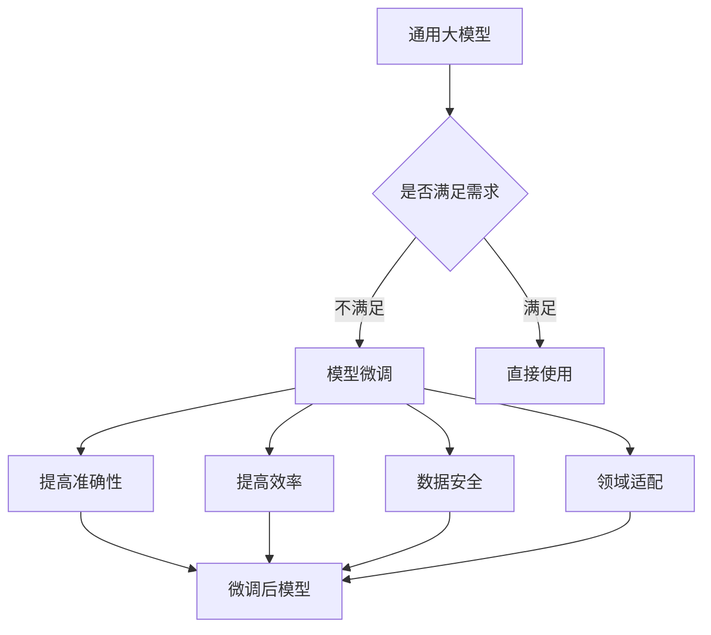

### 微调的核心优势

| 优势 | 说明 | 示例 |
|------|------|------|
| **提高准确性** | 在特定任务上显著提升准确率 | 医学数据集微调后,能更准确识别医学术语与疾病表现 |
| **提高效率** | 模型在特定任务上更高效 | 问答数据集微调后,能更快更准确地回答问题 |
| **提高泛化能力** | 更好地执行与训练数据不同的任务 | 多种创意文本格式训练后,能生成多种风格内容 |
| **减少数据需求** | 相比从头训练,需要更少的数据 | 利用预训练知识,只需少量领域数据即可 |
| **数据安全** | 内部微调保护数据隐私 | 敏感数据不需要发送到公开API |

---

## 微调基础知识

### 微调类型对比

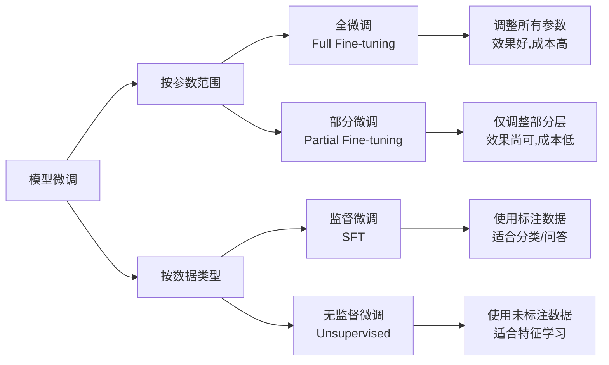

### 微调方法详解

#### 1. 全微调 vs 部分微调

| 类型 | 参数范围 | 适用场景 | 资源消耗 | 效果 |
|------|---------|---------|---------|------|
| **全微调** | 所有参数 | 任务与预训练差异大 | 高(需大量GPU) | 最优 |
| **部分微调** | 仅上层参数 | 任务与预训练相似 | 低(普通GPU) | 良好 |
| **LoRA微调** | 低秩适配器 | 绝大多数场景 | 极低(推荐) | 优秀 |

#### 2. 监督微调 vs 无监督微调

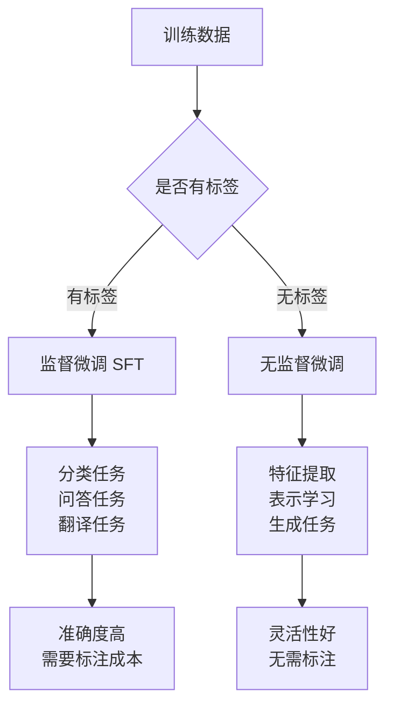

> **本文采用**: 监督微调(SFT) + LoRA方法,这是当前最主流的微调方案

---

## 完整微调流程

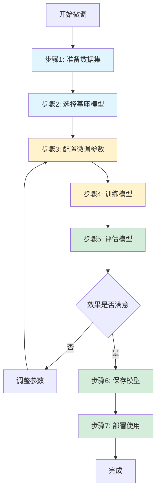

### 流程详解

| 步骤 | 关键工作 | 注意事项 |
|------|---------|---------|
| **1. 准备数据集** | 收集、清洗、标注数据 | 保证数据质量和标签准确 |
| **2. 选择基座模型** | 根据任务选择合适模型 | 考虑模型大小、语言支持、领域 |
| **3. 配置微调参数** | 设置LoRA、学习率等 | 合理配置避免过拟合 |
| **4. 训练模型** | 在训练集上训练 | 监控loss,及时调整 |
| **5. 评估模型** | 在验证集上测试 | 对比微调前后效果 |
| **6. 保存模型** | 导出LoRA权重或合并模型 | 选择合适的量化方法 |
| **7. 部署使用** | 集成到应用中 | 优化推理速度 |

---

## 实战:微调"弱智吧"数据集

### 为什么选择"弱智吧"数据集?

由于当前大模型的预训练集已经较为完善,普通的训练集的微调效果可能很难让大家看出通用大模型与微调后模型的效果区别,所以本文的数据集采用了大名鼎鼎的"弱智吧"训练集。

**数据集获取**:
```bash
# 在HuggingFace搜索: ruozhiba
# 推荐数据集: LooksJuicy/ruozhiba
```

### 微调前后效果对比

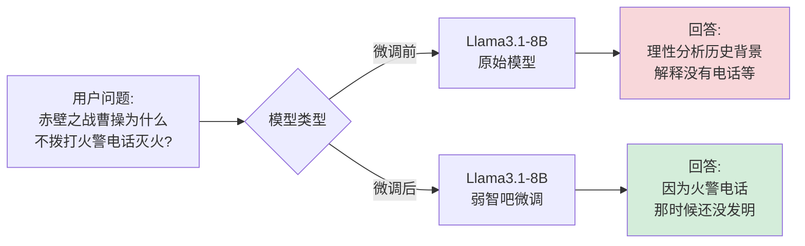

**基座模型**: Llama3.1-8B (2024年最新的开源模型之一)

---

## 环境准备:Google Colab

### Colab优势

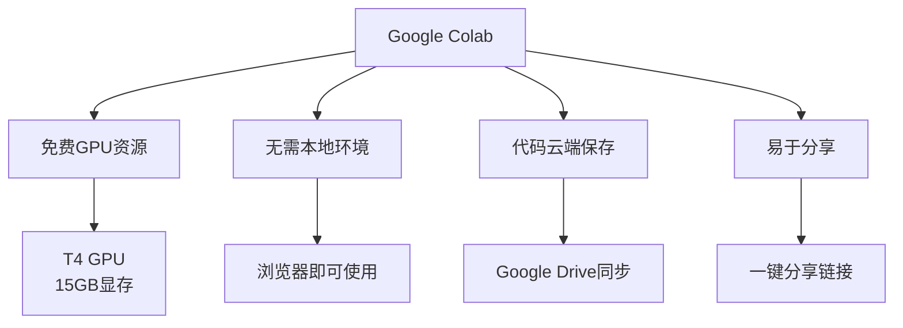

### Colab配置对比

| 套餐 | GPU型号 | 显存 | 费用 | 适用场景 |
|------|---------|------|------|---------|
| **Free** | T4 | 15GB | 免费 | 小模型微调(8B以下) |
| **Colab Pro** | T4/V100 | 16-32GB | $9.99/月 | 中等模型微调(13B) |
| **Colab Pro+** | A100 | 40GB | $49.99/月 | 大模型微调(70B) |

> **推荐**: 本教程使用免费的T4 GPU即可完成

### Colab环境设置步骤

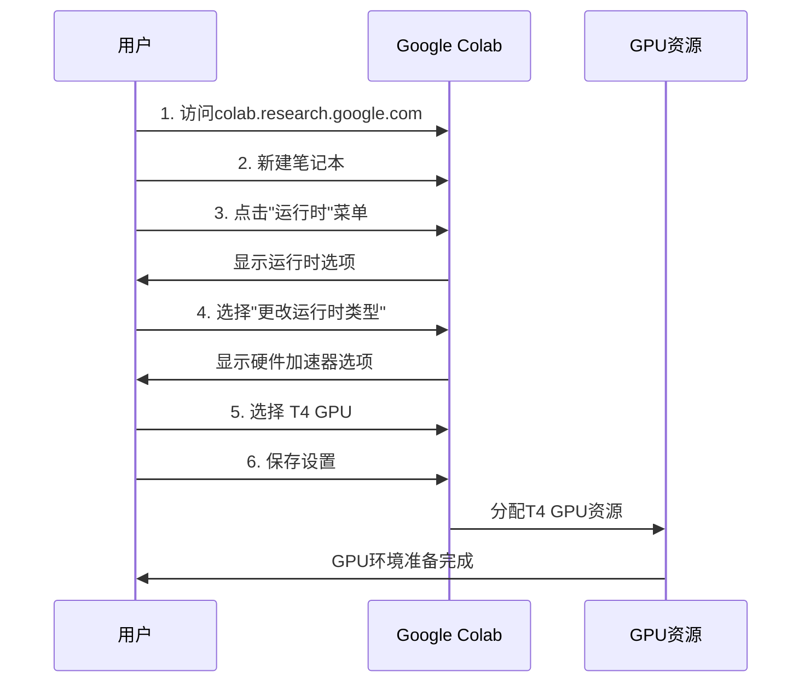

**详细步骤**:
1. 访问 [Google Colab](https://colab.research.google.com/)
2. 点击 **文件 > 新建笔记本**
3. 点击 **运行时 > 更改运行时类型**
4. **硬件加速器** 选择 **T4 GPU**
5. 点击 **保存**

---

## 训练框架:Unsloth

### 为什么选择Unsloth?

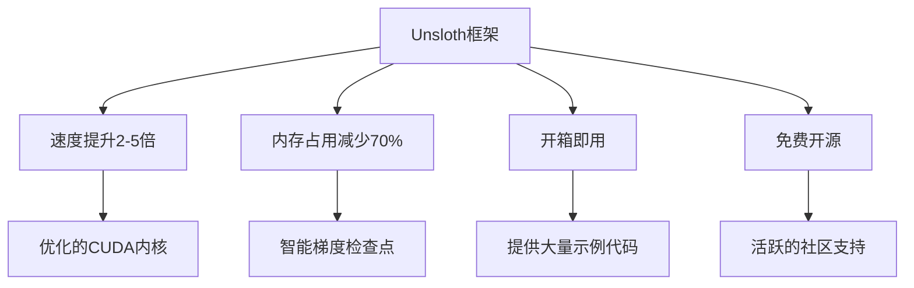

### 框架对比

| 框架 | 速度 | 内存占用 | 易用性 | 社区支持 | 推荐度 |
|------|------|---------|--------|---------|--------|
| **Unsloth** | ⭐⭐⭐⭐⭐ | ⭐⭐⭐⭐⭐ | ⭐⭐⭐⭐⭐ | ⭐⭐⭐⭐ | ⭐⭐⭐⭐⭐ |
| HuggingFace | ⭐⭐⭐ | ⭐⭐⭐ | ⭐⭐⭐⭐ | ⭐⭐⭐⭐⭐ | ⭐⭐⭐⭐ |
| DeepSpeed | ⭐⭐⭐⭐ | ⭐⭐⭐⭐ | ⭐⭐ | ⭐⭐⭐ | ⭐⭐⭐ |
| MLX (Mac) | ⭐⭐⭐ | ⭐⭐⭐⭐ | ⭐⭐⭐ | ⭐⭐ | ⭐⭐⭐ |

---

## 完整微调代码详解

### 技术栈架构

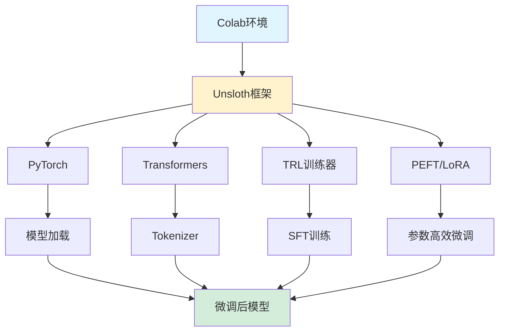

### 步骤1: 安装Unsloth和依赖

```python
%%capture
# 安装Unsloth核心框架
!pip install "unsloth[colab-new] @ git+https://github.com/unslothai/unsloth.git"

# 检查PyTorch版本并安装对应的Xformers
from torch import __version__
from packaging.version import Version as V

# PyTorch 2.3对应xformers 0.0.27, PyTorch 2.4+使用最新版
xformers = "xformers==0.0.27" if V(__version__) < V("2.4.0") else "xformers"

# 安装训练所需的核心库
!pip install --no-deps {xformers} trl peft accelerate bitsandbytes triton
```

**依赖说明**:
- `unsloth`: 核心微调框架
- `xformers`: Flash Attention加速
- `trl`: Transformer Reinforcement Learning (SFT训练器)
- `peft`: Parameter-Efficient Fine-Tuning (LoRA实现)
- `accelerate`: 分布式训练加速
- `bitsandbytes`: 量化支持 (4bit/8bit)
- `triton`: GPU内核优化

---

### 步骤2: 加载基座模型

```python
from unsloth import FastLanguageModel
import torch

# ===== 核心参数配置 =====
max_seq_length = 2048      # 最大序列长度,可根据显存调整
dtype = None               # 自动检测: Float16(T4/V100), Bfloat16(A100+)
load_in_4bit = True        # 使用4bit量化节省显存

# ===== Unsloth支持的预量化模型列表 =====
fourbit_models = [
    # Llama 3.1系列 (推荐)
    "unsloth/Meta-Llama-3.1-8B-bnb-4bit",           # 8B基础模型 ⭐推荐
    "unsloth/Meta-Llama-3.1-8B-Instruct-bnb-4bit",  # 8B指令模型
    "unsloth/Meta-Llama-3.1-70B-bnb-4bit",          # 70B模型(需Pro+)
    "unsloth/Meta-Llama-3.1-405B-bnb-4bit",         # 405B超大模型

    # Mistral系列
    "unsloth/Mistral-Nemo-Base-2407-bnb-4bit",      # 12B基础模型
    "unsloth/Mistral-Nemo-Instruct-2407-bnb-4bit",  # 12B指令模型
    "unsloth/mistral-7b-v0.3-bnb-4bit",             # 7B v3版本
    "unsloth/mistral-7b-instruct-v0.3-bnb-4bit",    # 7B v3指令版

    # Phi系列 (微软)
    "unsloth/Phi-3.5-mini-instruct",                # 3.8B轻量模型
    "unsloth/Phi-3-medium-4k-instruct",             # 14B中等模型

    # Gemma系列 (Google)
    "unsloth/gemma-2-9b-bnb-4bit",                  # 9B模型
    "unsloth/gemma-2-27b-bnb-4bit",                 # 27B模型

    # Qwen系列 (阿里) - 需要手动添加
    "unsloth/Qwen2.5-7B-bnb-4bit",                  # 7B中文优秀
    "unsloth/Qwen2.5-14B-bnb-4bit",                 # 14B性能更强
]

# ===== 加载模型 =====
model, tokenizer = FastLanguageModel.from_pretrained(
    model_name = "unsloth/Meta-Llama-3.1-8B",  # 选择基座模型
    max_seq_length = max_seq_length,
    dtype = dtype,
    load_in_4bit = load_in_4bit,
    # token = "hf_...",  # 如果使用gated模型(如Llama2)需要HF token
)
```

**参数说明**:

| 参数 | 说明 | 推荐值 | 影响 |
|------|------|--------|------|
| `max_seq_length` | 最大序列长度 | 2048 | 越大显存占用越高 |
| `load_in_4bit` | 是否4bit量化 | True | 显存占用降低75% |
| `dtype` | 数据类型 | None(自动) | Float16(T4), Bfloat16(A100) |

---

### 步骤3: 配置LoRA参数

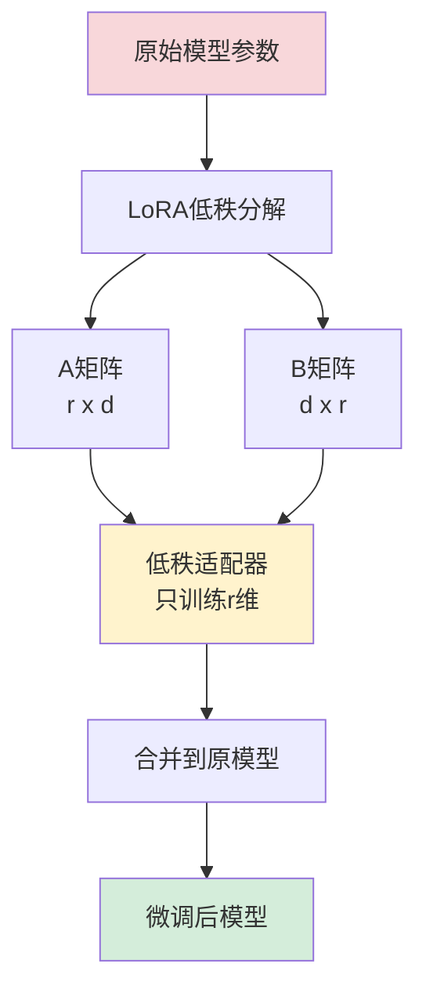

```python
from unsloth import FastLanguageModel

# ===== 配置LoRA参数 =====
model = FastLanguageModel.get_peft_model(
    model,

    # ===== LoRA核心参数 =====
    r = 16,                          # LoRA秩,越大越精确但越慢
                                     # 推荐值: 8(快), 16(平衡), 32/64(精确)

    target_modules = [               # 要应用LoRA的模块
        "q_proj", "k_proj",          # Query和Key投影 (注意力机制)
        "v_proj", "o_proj",          # Value和Output投影
        "gate_proj", "up_proj",      # MLP门控和上投影
        "down_proj",                 # MLP下投影
    ],

    lora_alpha = 16,                 # LoRA缩放因子,通常设为r的值
    lora_dropout = 0,                # Dropout率, 0表示不使用(优化后)
    bias = "none",                   # 偏置项策略, "none"最优化

    # ===== Unsloth优化参数 =====
    use_gradient_checkpointing = "unsloth",  # 梯度检查点,节省30%显存
                                              # 可选: True, "unsloth", False

    random_state = 3407,             # 随机种子,保证可复现性
    use_rslora = False,              # 是否使用秩稳定LoRA
    loftq_config = None,             # LoftQ量化配置
)
```

**LoRA参数详解**:

| 参数 | 作用 | 推荐值 | 说明 |
|------|------|--------|------|
| **r** | LoRA秩 | 16 | 越大模型越精确,但训练越慢 |
| **lora_alpha** | 缩放因子 | 16 | 通常设为r的值 |
| **lora_dropout** | Dropout率 | 0 | Unsloth优化后建议为0 |
| **target_modules** | 应用LoRA的层 | 全部投影层 | 覆盖更多层效果更好 |
| **use_gradient_checkpointing** | 梯度检查点 | "unsloth" | 节省显存的关键 |

**LoRA秩(r)选择建议**:

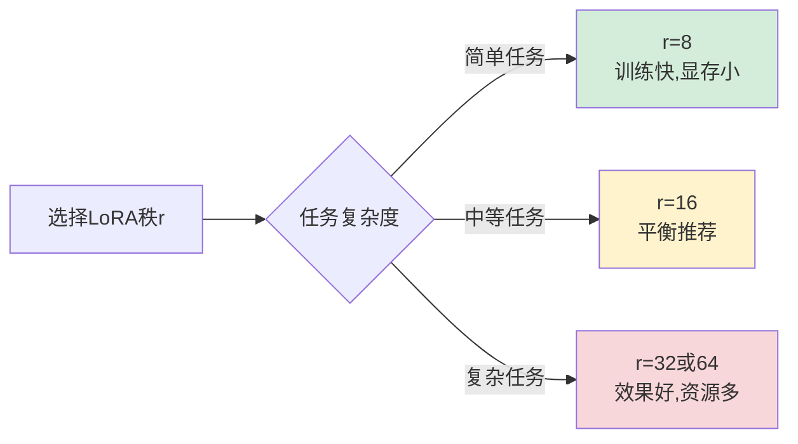

---

### 步骤4: 准备数据集

```python
# ===== 定义提示词模板 =====
alpaca_prompt = """Below is an instruction that describes a question, paired with an output that answer the question.

### Instruction:
{}

### output:
{}"""

# ===== 获取EOS token =====
EOS_TOKEN = tokenizer.eos_token  # 必须添加,否则生成会无限循环

# ===== 数据格式化函数 =====
def formatting_prompts_func(examples):
    """
    将数据集格式化为模型训练所需的格式

    参数:
        examples: 包含'instruction'和'output'字段的批量样本

    返回:
        格式化后的文本列表
    """
    instructions = examples["instruction"]  # 获取问题
    outputs = examples["output"]            # 获取答案
    texts = []

    for instruction, output in zip(instructions, outputs):
        # 使用Alpaca格式模板
        text = alpaca_prompt.format(instruction, output) + EOS_TOKEN
        texts.append(text)

    return {"text": texts}

# ===== 加载数据集 =====
from datasets import load_dataset

# 从HuggingFace加载弱智吧数据集
dataset = load_dataset("LooksJuicy/ruozhiba", split="train")

# 应用格式化函数
dataset = dataset.map(
    formatting_prompts_func,
    batched=True,           # 批量处理,提高效率
)

# ===== 查看数据集示例 =====
print(f"数据集大小: {len(dataset)} 条")
print(f"示例数据:\n{dataset[0]['text']}")
```

**数据集格式示例**:
```
Below is an instruction that describes a question, paired with an output that answer the question.

### Instruction:
赤壁之战曹操为什么不拨打火警电话灭火?

### output:
因为那时候还没有发明电话。<|end_of_text|>
```

**其他常用数据集**:

| 数据集 | 领域 | 大小 | HuggingFace路径 |
|--------|------|------|----------------|
| **弱智吧** | 幽默问答 | ~10k | LooksJuicy/ruozhiba |
| **医疗问答** | 医学 | ~100k | medical_dialog_zh |
| **法律问答** | 法律 | ~50k | law_qa_zh |
| **编程问答** | 代码 | ~500k | codeparrot/github-code |
| **通用指令** | 通用 | ~50k | yahma/alpaca-cleaned |

---

### 步骤5: 配置训练参数

```python
from trl import SFTTrainer
from transformers import TrainingArguments
from unsloth import is_bfloat16_supported

# ===== 创建训练器 =====
trainer = SFTTrainer(
    model = model,
    tokenizer = tokenizer,
    train_dataset = dataset,
    dataset_text_field = "text",           # 数据集中文本字段名
    max_seq_length = max_seq_length,
    dataset_num_proc = 2,                  # 数据处理进程数
    packing = False,                       # 是否打包短序列(可提速5倍)

    # ===== 训练参数配置 =====
    args = TrainingArguments(
        # --- 批次大小配置 ---
        per_device_train_batch_size = 2,   # 每个设备的批次大小
        gradient_accumulation_steps = 4,   # 梯度累积步数
                                            # 实际批次 = 2 * 4 = 8

        # --- 训练步数配置 ---
        # 方式1: 指定训练步数
        max_steps = 60,                     # 总训练步数(快速测试用)
        # 方式2: 指定训练轮数 (二选一)
        # num_train_epochs = 1,             # 完整训练1个epoch

        # --- 学习率配置 ---
        learning_rate = 2e-4,               # 学习率 (LoRA推荐2e-4)
        warmup_steps = 5,                   # 预热步数
        lr_scheduler_type = "linear",       # 学习率调度器类型

        # --- 精度配置 ---
        fp16 = not is_bfloat16_supported(), # 使用FP16 (T4/V100)
        bf16 = is_bfloat16_supported(),     # 使用BF16 (A100+)

        # --- 优化器配置 ---
        optim = "adamw_8bit",               # 8bit AdamW优化器
        weight_decay = 0.01,                # 权重衰减(正则化)

        # --- 日志和保存 ---
        logging_steps = 1,                  # 每步记录日志
        output_dir = "outputs",             # 输出目录

        # --- 其他配置 ---
        seed = 3407,                        # 随机种子
    ),
)
```

**训练参数详解**:

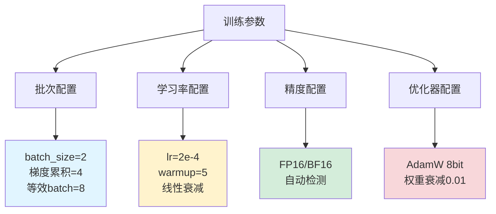

| 参数 | 说明 | 推荐值 | 影响 |
|------|------|--------|------|
| **batch_size** | 每个设备批次大小 | 2 | 越大越快但越耗显存 |
| **gradient_accumulation** | 梯度累积步数 | 4 | 模拟更大批次 |
| **learning_rate** | 学习率 | 2e-4 | LoRA标准值 |
| **max_steps** | 最大训练步数 | 60(测试)<br/>500+(正式) | 影响训练时长 |
| **warmup_steps** | 预热步数 | 5 | 稳定初期训练 |

---

### 步骤6: 开始训练

```python
# ===== 查看GPU状态 =====
gpu_stats = torch.cuda.get_device_properties(0)
start_gpu_memory = round(torch.cuda.max_memory_reserved() / 1024 / 1024 / 1024, 3)
max_memory = round(gpu_stats.total_memory / 1024 / 1024 / 1024, 3)

print(f"GPU型号: {gpu_stats.name}")
print(f"总显存: {max_memory} GB")
print(f"已使用显存: {start_gpu_memory} GB")
print(f"剩余显存: {max_memory - start_gpu_memory} GB")

# ===== 开始训练 =====
print("\n" + "="*50)
print("开始训练...")
print("="*50 + "\n")

trainer_stats = trainer.train()

# ===== 训练完成后的显存统计 =====
used_memory = round(torch.cuda.max_memory_reserved() / 1024 / 1024 / 1024, 3)
used_memory_for_lora = round(used_memory - start_gpu_memory, 3)
used_percentage = round(used_memory / max_memory * 100, 3)

print("\n" + "="*50)
print("训练完成!")
print("="*50)
print(f"训练用时: {trainer_stats.metrics['train_runtime']:.2f} 秒")
print(f"最终Loss: {trainer_stats.metrics['train_loss']:.4f}")
print(f"LoRA显存占用: {used_memory_for_lora} GB")
print(f"总显存占用: {used_memory} GB ({used_percentage}%)")
```

**训练过程监控**:

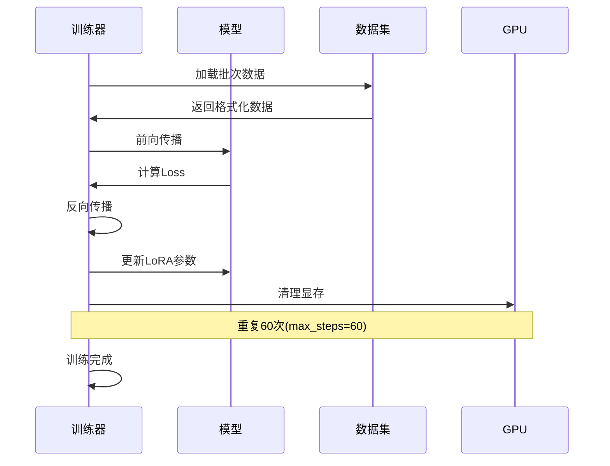

**典型训练输出**:
```
GPU型号: Tesla T4
总显存: 15.0 GB
已使用显存: 5.2 GB
剩余显存: 9.8 GB

==================================================
开始训练...
==================================================

Step 1/60 | Loss: 2.3456 | LR: 4.0e-05
Step 10/60 | Loss: 1.8234 | LR: 2.0e-04
Step 20/60 | Loss: 1.2345 | LR: 2.0e-04
...
Step 60/60 | Loss: 0.4567 | LR: 6.7e-05

==================================================
训练完成!
==================================================
训练用时: 180.45 秒
最终Loss: 0.4567
LoRA显存占用: 3.2 GB
总显存占用: 8.4 GB (56.0%)
```

---

### 步骤7: 测试微调后的模型

```python
# ===== 切换到推理模式 =====
FastLanguageModel.for_inference(model)  # 启用2倍推理加速

# ===== 准备测试问题 =====
test_instruction = "赤壁之战曹操为什么不拨打火警电话灭火?"

inputs = tokenizer(
    [alpaca_prompt.format(
        test_instruction,  # 问题
        "",                # 输出留空,让模型生成
    )],
    return_tensors="pt"
).to("cuda")

# ===== 生成回答 =====
from transformers import TextStreamer

text_streamer = TextStreamer(tokenizer)
_ = model.generate(
    **inputs,
    streamer=text_streamer,      # 流式输出
    max_new_tokens=2048,         # 最大生成长度
    use_cache=True,              # 使用KV缓存加速
    temperature=0.7,             # 温度参数(越高越随机)
    top_p=0.9,                   # 核采样参数
)
```

**测试其他问题**:
```python
# 创建交互式测试函数
def test_question(question):
    """测试单个问题"""
    inputs = tokenizer(
        [alpaca_prompt.format(question, "")],
        return_tensors="pt"
    ).to("cuda")

    print(f"\n问题: {question}")
    print("回答: ", end="")

    _ = model.generate(
        **inputs,
        streamer=text_streamer,
        max_new_tokens=512,
        temperature=0.7,
    )

# 测试多个问题
test_questions = [
    "为什么手机没电了不能用充电宝给它输血?",
    "为什么古代人不用GPS导航?",
    "恐龙为什么不去博物馆参观自己的化石?",
]

for q in test_questions:
    test_question(q)
```

---

### 步骤8: 保存模型

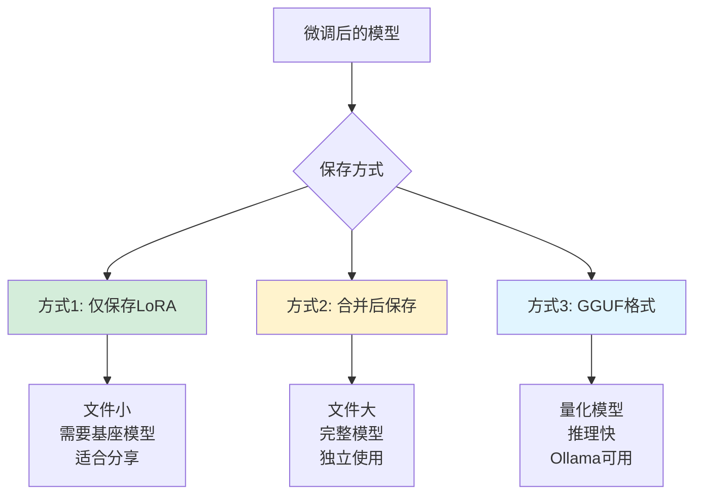

#### 方式1: 保存LoRA适配器(推荐)

```python
# ===== 本地保存LoRA =====
model.save_pretrained("lora_model")        # 保存LoRA权重
tokenizer.save_pretrained("lora_model")    # 保存tokenizer

print("LoRA模型已保存到: lora_model/")
print("文件大小约: 50-200MB")

# ===== 推送到HuggingFace Hub(可选) =====
# model.push_to_hub("your_username/llama3.1-ruozhiba-lora", token="hf_...")
# tokenizer.push_to_hub("your_username/llama3.1-ruozhiba-lora", token="hf_...")
```

#### 方式2: 合并模型后保存

```python
# ===== 合并LoRA到基座模型 =====
model.save_pretrained_merged(
    "merged_model",                    # 保存路径
    tokenizer,
    save_method="merged_16bit",        # 保存方法
    # 可选: "merged_16bit", "merged_4bit", "lora"
)

print("完整模型已保存到: merged_model/")
print("文件大小约: 16GB (FP16格式)")
```

#### 方式3: 保存为GGUF格式(Ollama/LM Studio可用)

```python
# ===== 保存为GGUF格式 =====
model.save_pretrained_gguf(
    "model_gguf",                      # 保存目录
    tokenizer,
    quantization_method="q4_k_m",      # 量化方法
)

# ===== 常用量化方法 =====
quantization_methods = [
    "q4_k_m",   # 4-bit中等质量 (推荐,平衡性能和质量)
    "q5_k_m",   # 5-bit中等质量 (质量更好)
    "q8_0",     # 8-bit (质量最好,文件较大)
    "f16",      # FP16 (无损,文件最大)
]

print("GGUF模型已保存到: model_gguf/")
print("可以用Ollama或LM Studio加载")
```

**量化方法对比**:

| 量化方法 | 文件大小 | 质量 | 速度 | 推荐场景 |
|---------|---------|------|------|---------|
| **q4_k_m** | ~4.5GB | ⭐⭐⭐⭐ | ⭐⭐⭐⭐⭐ | 日常使用(推荐) |
| **q5_k_m** | ~5.5GB | ⭐⭐⭐⭐⭐ | ⭐⭐⭐⭐ | 追求质量 |
| **q8_0** | ~8.5GB | ⭐⭐⭐⭐⭐ | ⭐⭐⭐ | 最高质量 |
| **f16** | ~16GB | ⭐⭐⭐⭐⭐ | ⭐⭐ | 无损保存 |

---

### 步骤9: 下载并使用模型

#### 从Colab下载模型

```python
# ===== 方式1: 直接下载(推荐) =====
from google.colab import files

# 压缩模型文件
!zip -r lora_model.zip lora_model/

# 下载到本地
files.download('lora_model.zip')

# ===== 方式2: 保存到Google Drive =====
from google.colab import drive
drive.mount('/content/drive')

# 复制到Google Drive
!cp -r lora_model /content/drive/MyDrive/

print("模型已保存到Google Drive")
```

#### 在本地使用模型

**使用Ollama加载GGUF模型**:

```bash
# 1. 创建Modelfile
cat > Modelfile << EOF
FROM ./model_gguf/llama3.1-ruozhiba-Q4_K_M.gguf

TEMPLATE """Below is an instruction that describes a question, paired with an output that answer the question.

### Instruction:
{{ .Prompt }}

### output:
"""

PARAMETER temperature 0.7
PARAMETER top_p 0.9
EOF

# 2. 创建Ollama模型
ollama create llama3.1-ruozhiba -f Modelfile

# 3. 运行模型
ollama run llama3.1-ruozhiba
```

**使用Python加载LoRA模型**:

```python
from unsloth import FastLanguageModel

# 加载LoRA模型
model, tokenizer = FastLanguageModel.from_pretrained(
    model_name="lora_model",           # LoRA权重路径
    max_seq_length=2048,
    dtype=None,
    load_in_4bit=True,
)

FastLanguageModel.for_inference(model)

# 测试
inputs = tokenizer(["问题"], return_tensors="pt").to("cuda")
outputs = model.generate(**inputs, max_new_tokens=512)
print(tokenizer.decode(outputs[0]))
```

---

## 常见问题解答

### Q1: 训练时显存不足(OOM)怎么办?

**错误信息**:
```
RuntimeError: CUDA out of memory. Tried to allocate 2.00 GB
```

**解决方案**:

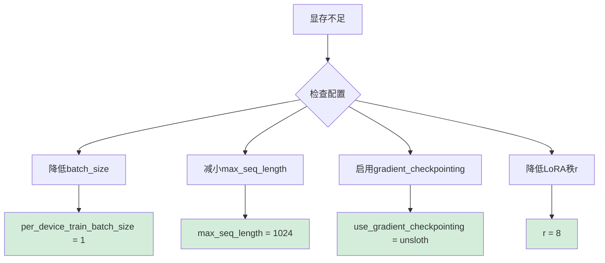

**优化配置**:
```python
# 显存优化配置
trainer = SFTTrainer(
    model=model,
    tokenizer=tokenizer,
    train_dataset=dataset,
    max_seq_length=1024,              # 从2048降到1024

    args=TrainingArguments(
        per_device_train_batch_size=1,  # 从2降到1
        gradient_accumulation_steps=8,   # 从4增到8保持等效批次
        max_steps=60,
        learning_rate=2e-4,

        # 启用混合精度训练
        fp16=True,

        # 其他优化
        optim="adamw_8bit",              # 使用8bit优化器
        gradient_checkpointing=True,     # 启用梯度检查点
    ),
)
```

---

### Q2: 训练Loss不下降怎么办?

**可能原因和解决方案**:

| 问题 | 原因 | 解决方案 |
|------|------|---------|
| **Loss一直很高** | 学习率太低 | 提高learning_rate到5e-4 |
| **Loss震荡** | 学习率太高 | 降低learning_rate到1e-4 |
| **Loss不动** | 数据集问题 | 检查数据格式,增加数据多样性 |
| **Loss突然上升** | 梯度爆炸 | 降低学习率,增加warmup_steps |

**调试建议**:
```python
# 1. 检查数据集
print(dataset[0]['text'])

# 2. 尝试不同学习率
learning_rates = [1e-4, 2e-4, 5e-4]

# 3. 增加训练步数
max_steps = 200  # 从60增加到200

# 4. 查看训练曲线
import matplotlib.pyplot as plt

losses = trainer_stats.log_history
plt.plot([x['loss'] for x in losses if 'loss' in x])
plt.xlabel('Steps')
plt.ylabel('Loss')
plt.title('Training Loss Curve')
plt.show()
```

---

### Q3: 如何评估微调效果?

**评估方法**:

```python
# ===== 方式1: 定性评估(人工测试) =====
test_cases = [
    "赤壁之战曹操为什么不拨打火警电话灭火?",
    "为什么古代人不开汽车?",
    "恐龙为什么不用智能手机?",
]

for question in test_cases:
    print(f"\n问题: {question}")

    # 微调前的回答
    base_model_answer = get_answer(base_model, question)
    print(f"微调前: {base_model_answer}")

    # 微调后的回答
    tuned_model_answer = get_answer(tuned_model, question)
    print(f"微调后: {tuned_model_answer}")
    print("-" * 50)

# ===== 方式2: 定量评估(验证集) =====
from datasets import load_dataset

# 加载验证集
eval_dataset = load_dataset("LooksJuicy/ruozhiba", split="test")

# 计算困惑度(Perplexity)
from torch.nn import CrossEntropyLoss

def calculate_perplexity(model, dataset):
    """计算模型在数据集上的困惑度"""
    model.eval()
    total_loss = 0

    for example in dataset:
        inputs = tokenizer(example['text'], return_tensors='pt').to('cuda')
        with torch.no_grad():
            outputs = model(**inputs, labels=inputs['input_ids'])
            total_loss += outputs.loss.item()

    perplexity = torch.exp(torch.tensor(total_loss / len(dataset)))
    return perplexity.item()

base_ppl = calculate_perplexity(base_model, eval_dataset)
tuned_ppl = calculate_perplexity(tuned_model, eval_dataset)

print(f"微调前困惑度: {base_ppl:.2f}")
print(f"微调后困惑度: {tuned_ppl:.2f}")
print(f"提升: {(base_ppl - tuned_ppl) / base_ppl * 100:.1f}%")
```

---

### Q4: Colab会话断开导致训练中断怎么办?

**预防措施**:

```python
# ===== 方式1: 启用自动保存检查点 =====
trainer = SFTTrainer(
    model=model,
    tokenizer=tokenizer,
    train_dataset=dataset,

    args=TrainingArguments(
        # ... 其他参数 ...

        # 启用检查点保存
        save_strategy="steps",          # 按步数保存
        save_steps=20,                  # 每20步保存一次
        save_total_limit=3,             # 最多保留3个检查点

        # 或者按时间保存
        # save_strategy="epoch",        # 每个epoch保存
    ),
)

# ===== 方式2: 从检查点恢复训练 =====
# 如果训练中断,运行这段代码继续训练
trainer = SFTTrainer(
    model=model,
    tokenizer=tokenizer,
    train_dataset=dataset,
    args=TrainingArguments(...),
)

# 从最新检查点恢复
trainer.train(resume_from_checkpoint=True)

# ===== 方式3: 使用Colab Pro避免断开 =====
# Colab Pro提供更长的会话时间和更好的GPU
```

**保持Colab连接的技巧**:
```javascript
// 在浏览器控制台运行(F12打开)
// 防止Colab因不活动而断开
function KeepAlive() {
    console.log("Keeping alive...");
    document.querySelector("colab-connect-button").click();
}
setInterval(KeepAlive, 60000);  // 每分钟点击一次
```

---

### Q5: 如何针对中文数据集进行微调?

**中文数据集推荐**:

| 数据集 | 领域 | 大小 | 来源 |
|--------|------|------|------|
| **Belle** | 通用指令 | 100万+ | BelleGroup/BELLE-2M |
| **Alpaca中文** | 通用指令 | 5万+ | shibing624/alpaca-zh |
| **医疗问答** | 医学 | 10万+ | Toyhom/Chinese-medical-dialogue |
| **法律问答** | 法律 | 5万+ | AI-ModelScope/Chinese-legal-dataset |

**中文模型推荐**:

```python
# 使用中文优化的基座模型
chinese_models = [
    "unsloth/Qwen2.5-7B-bnb-4bit",          # 阿里Qwen 7B ⭐推荐
    "unsloth/Qwen2.5-14B-bnb-4bit",         # 阿里Qwen 14B
    "hfl/chinese-llama-2-7b",                # 中文Llama
    "THUDM/chatglm3-6b",                     # ChatGLM3
]

# 加载中文模型
model, tokenizer = FastLanguageModel.from_pretrained(
    model_name="unsloth/Qwen2.5-7B-bnb-4bit",
    max_seq_length=2048,
    dtype=None,
    load_in_4bit=True,
)
```

**中文提示词模板**:

```python
# 中文Alpaca格式
chinese_prompt = """以下是一条指令,描述了一个问题,请给出恰当的回答。

### 指令:
{}

### 回答:
{}"""

# 中文对话格式
dialogue_prompt = """用户: {}

助手: {}"""
```

---

## 最佳实践建议

### 微调前的准备工作

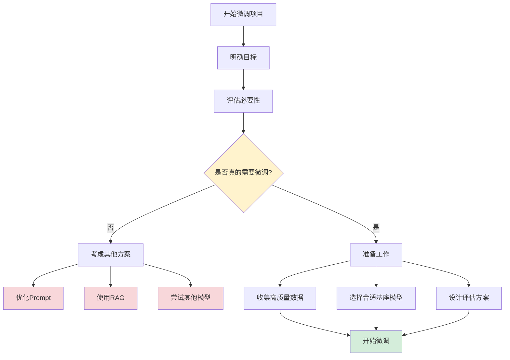

### 1. 数据集质量 > 数量

**好的数据集特征**:
- ✅ 高质量:每条样本都经过人工审核
- ✅ 多样性:覆盖各种表达方式
- ✅ 准确性:答案正确且符合预期风格
- ✅ 一致性:格式统一,无噪声数据

**数据集规模建议**:

| 任务类型 | 最小样本数 | 推荐样本数 | 说明 |
|---------|-----------|-----------|------|
| **风格迁移** | 100 | 500-1000 | 学习特定回答风格 |
| **领域适配** | 1000 | 5000-10000 | 医疗、法律等专业领域 |
| **任务微调** | 500 | 2000-5000 | 问答、摘要等特定任务 |

---

### 2. 参数调优策略

**渐进式调优**:

```python
# 阶段1: 快速验证(5-10分钟)
initial_params = {
    "max_steps": 50,
    "learning_rate": 2e-4,
    "r": 8,
}

# 阶段2: 精细调整(30-60分钟)
tuning_params = {
    "max_steps": 200,
    "learning_rate": 1e-4,
    "r": 16,
}

# 阶段3: 完整训练(2-4小时)
final_params = {
    "num_train_epochs": 3,
    "learning_rate": 5e-5,
    "r": 32,
}
```

**学习率选择**:

| LoRA秩(r) | 推荐学习率 | 说明 |
|----------|-----------|------|
| r=8 | 5e-4 | 快速训练 |
| r=16 | 2e-4 | 标准配置(推荐) |
| r=32 | 1e-4 | 精细调整 |
| r=64 | 5e-5 | 复杂任务 |

---

### 3. 避免过拟合

**过拟合的表现**:
- 训练Loss很低,但验证Loss很高
- 模型只会输出训练集中的答案
- 泛化能力差,遇到新问题表现不佳

**预防措施**:

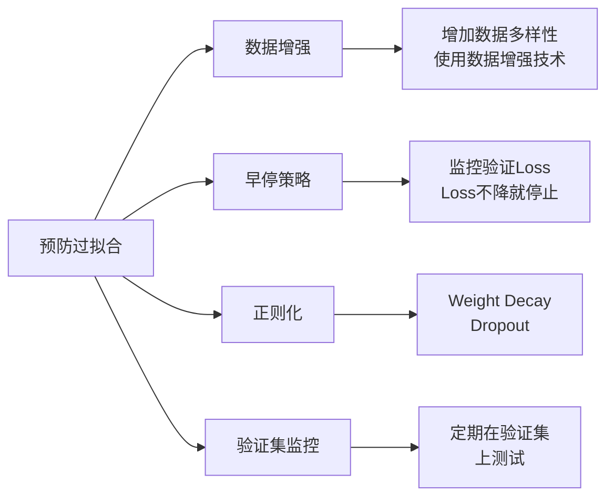

```python
# 启用早停和验证
from transformers import EarlyStoppingCallback

trainer = SFTTrainer(
    model=model,
    tokenizer=tokenizer,
    train_dataset=train_dataset,
    eval_dataset=eval_dataset,      # 添加验证集

    args=TrainingArguments(
        # ... 其他参数 ...

        # 评估配置
        evaluation_strategy="steps",
        eval_steps=20,                # 每20步评估一次

        # 保存最佳模型
        load_best_model_at_end=True,
        metric_for_best_model="eval_loss",

        # 正则化
        weight_decay=0.01,            # L2正则化
    ),

    # 早停回调
    callbacks=[EarlyStoppingCallback(
        early_stopping_patience=3     # 3次不提升就停止
    )],
)
```

---

### 4. 模型部署建议

**部署方式对比**:

| 部署方式 | 优点 | 缺点 | 适用场景 |
|---------|------|------|---------|
| **Ollama** | 简单易用,本地运行 | 功能有限 | 个人使用,快速原型 |
| **vLLM** | 高性能,支持批处理 | 配置复杂 | 生产环境,高并发 |
| **Text Generation WebUI** | 功能丰富,界面友好 | 资源占用大 | 测试评估 |
| **LM Studio** | 图形界面,跨平台 | 仅本地使用 | 个人使用,模型管理 |

**推理优化**:

```python
# 优化推理速度
FastLanguageModel.for_inference(model)  # Unsloth优化

# 使用更激进的量化
model_4bit = FastLanguageModel.from_pretrained(
    "model",
    load_in_4bit=True,           # 4bit量化
)

# 批量推理
def batch_generate(questions, batch_size=4):
    """批量生成,提高吞吐量"""
    results = []

    for i in range(0, len(questions), batch_size):
        batch = questions[i:i+batch_size]
        inputs = tokenizer(batch, return_tensors='pt', padding=True).to('cuda')
        outputs = model.generate(**inputs, max_new_tokens=512)
        results.extend(tokenizer.batch_decode(outputs))

    return results
```

---

## 进阶技巧

### 1. 多任务微调

```python
# 准备多任务数据集
multi_task_prompt = """任务类型: {task}

### 输入:
{input}

### 输出:
{output}"""

tasks = {
    "问答": qa_dataset,
    "摘要": summary_dataset,
    "翻译": translation_dataset,
}

# 合并数据集
from datasets import concatenate_datasets
all_datasets = [format_dataset(d, task) for task, d in tasks.items()]
combined_dataset = concatenate_datasets(all_datasets)
```

### 2. 继续预训练(CPT)

```python
# 对领域数据进行继续预训练
from transformers import DataCollatorForLanguageModeling

# 使用MLM(Masked Language Modeling)
data_collator = DataCollatorForLanguageModeling(
    tokenizer=tokenizer,
    mlm=True,
    mlm_probability=0.15
)

trainer = Trainer(
    model=model,
    data_collator=data_collator,
    train_dataset=domain_corpus,
    args=TrainingArguments(
        learning_rate=1e-5,          # 更低的学习率
        num_train_epochs=1,
    )
)
```

### 3. 模型蒸馏

```python
# 用大模型的输出作为小模型的训练数据
def distill_knowledge(teacher_model, student_model, dataset):
    """知识蒸馏"""

    # 1. 用teacher生成soft labels
    teacher_outputs = []
    for example in dataset:
        output = teacher_model.generate(example['input'])
        teacher_outputs.append(output)

    # 2. 用teacher的输出训练student
    student_dataset = create_dataset(dataset, teacher_outputs)

    # 3. 微调student模型
    trainer = SFTTrainer(
        model=student_model,
        train_dataset=student_dataset,
        # ... 其他参数
    )

    trainer.train()
```

---

## 写在最后

### 微调的时机

大家在开发一款AI应用时,**模型微调并不应该是最先要考虑的事情**:

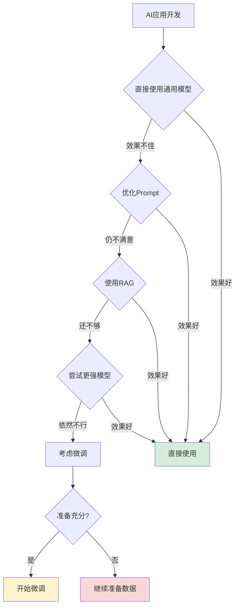

### 方案选择建议

| 场景 | 推荐方案 | 原因 |
|------|---------|------|
| **信息实时性** | RAG | 微调无法获取最新信息 |
| **准确性要求高** | RAG + 好的Prompt | 降低幻觉 |
| **特定风格输出** | 微调 | 学习输出格式和风格 |
| **专业领域术语** | 微调 | 理解领域知识 |
| **多任务场景** | Prompt Engineering | 灵活性更好 |

### 微调的注意事项

⚠️ **数据集比例**: 通用数据和专业数据需要平衡,否则可能失去泛化能力

⚠️ **参数选择**: 不合适的参数可能导致灾难性遗忘(模型忘记原有知识)

⚠️ **评估方法**: 不仅要看训练Loss,还要实际测试效果

⚠️ **成本考虑**: 微调和维护的成本可能高于直接使用API

---

## 资源链接

### 官方文档
- [Unsloth GitHub](https://github.com/unslothai/unsloth)
- [Unsloth Wiki](https://github.com/unslothai/unsloth/wiki)
- [Google Colab](https://colab.research.google.com/)
- [HuggingFace Hub](https://huggingface.co/)

### 推荐数据集
- [弱智吧数据集](https://huggingface.co/datasets/LooksJuicy/ruozhiba)
- [Alpaca中文](https://huggingface.co/datasets/shibing624/alpaca-zh)
- [Belle中文](https://huggingface.co/datasets/BelleGroup/BELLE-2M)

### 相关教程
- [[大模型/07-教程与课程/5分钟手把手/1. 使用Mac Book Pro本地部署大模型(Ollama+Llama3.1_8B+Docker+OpenWebUI)|本地部署大模型]]
- [[大模型/07-教程与课程/5分钟手把手/7. MAC本地微调大模型(MLX + Qwen2.5)|MAC本地微调]]
- [[大模型/03-训练与微调/模型训练/基于 MLX-LM 框架的 Qwen8 微调方案|MLX-LM微调方案]]

---

> 💡 **温馨提示**:
> - 本文适合AI新手动手实践,了解模型微调的全过程
> - 建议先在小数据集上快速实验,验证可行性后再进行完整训练
> - 微调只是手段,解决实际问题才是目的
> - 记得保存好训练日志和模型,方便后续对比和优化

**祝你微调愉快!** 🎉
