# 5分钟手把手系列(五):本地编写一个RAG系统(Qwen2.5-14b+LlamaIndex + Ollama)

## 背景

大模型应用搭建过程中,为什么要使用RAG技术,可以参考 [[大模型/07-教程与课程/5分钟手把手/2. 本地部署Graphrag(Pycharm+Ollama+LM Studio)|本地部署Graphrag]]

### 什么是RAG?

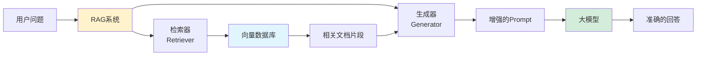

**RAG (Retrieval-Augmented Generation)** = 检索增强生成
- **检索(Retrieval)**: 从知识库中找到相关信息
- **增强(Augmented)**: 将检索到的信息添加到Prompt中
- **生成(Generation)**: 基于增强后的Prompt生成回答

---

### RAG的六大优势

| 优势 | 说明 | 对比普通LLM |
|------|------|------------|
| **外部知识利用** | 可以引用大量外部信息 | LLM仅依赖训练时的知识 |
| **数据更新及时** | 更新知识库即可,无需重新训练 | LLM需要重新训练才能更新知识 |
| **回复可解释** | 可以引用来源,减少幻觉 | LLM回答缺乏依据 |
| **高度可定制** | 根据领域知识库快速定制 | LLM需要微调才能适配领域 |
| **安全隐私** | 私有知识库,数据不外泄 | API调用可能泄露敏感信息 |
| **低成本** | 无需重新训练模型 | 模型微调成本高 |

### RAG vs 模型微调 vs Prompt Engineering

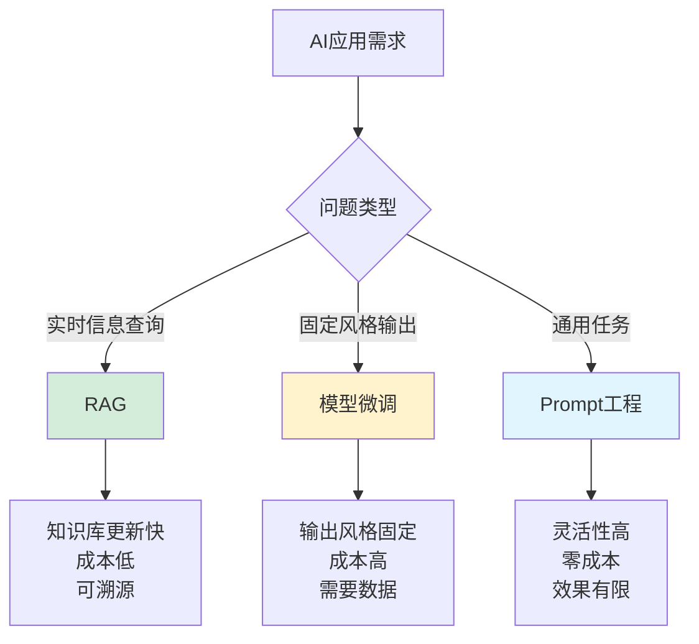

**选择建议**:
- ✅ **需要最新信息** → 使用RAG
- ✅ **特定输出格式** → 模型微调
- ✅ **通用任务** → Prompt优化
- ✅ **企业知识库** → RAG + 向量数据库
- ✅ **个性化对话** → RAG + 记忆管理

---

### 为什么介绍完GraphRAG还要介绍传统RAG?

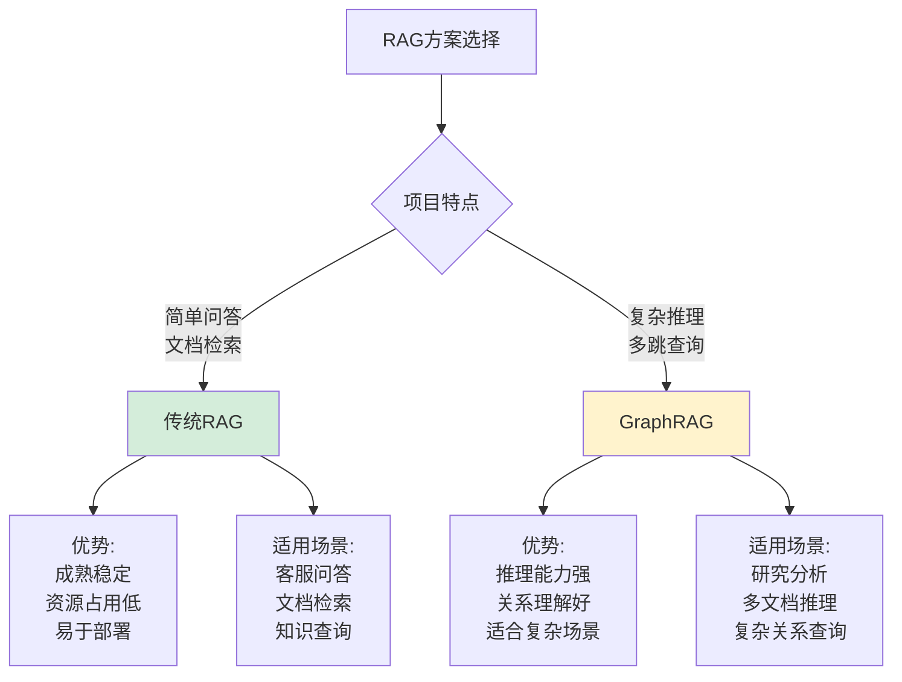

**传统RAG的优势**:
- 计算资源要求低(普通笔记本即可)
- 开源方案成熟稳定
- 大规模商业验证
- 部署简单,易于维护

**GraphRAG的特点**:
- 计算资源要求高
- 开源版本还不够稳定
- 适合复杂推理场景
- 距离大规模商业应用还有距离

> **结论**: 目前大部分RAG应用仍使用传统方案,GraphRAG适合特定的复杂场景

---

## RAG系统搭建

### 技术栈选择

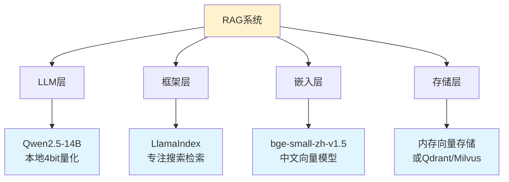

**本文技术栈**:
- **LLM**: Qwen2.5-14B (4bit量化版本,通过Ollama启动)
- **框架**: LlamaIndex (专注于搜索和检索)
- **嵌入模型**: BAAI/bge-small-zh-v1.5 (中文友好)
- **向量存储**: 内存(可选Qdrant等持久化方案)

---

### LlamaIndex简介

#### 什么是LlamaIndex?

[LlamaIndex](https://www.llamaindex.ai/) 是一个专门为构建RAG应用而设计的框架,充当LLM与数据之间的桥梁。

#### LlamaIndex vs LangChain

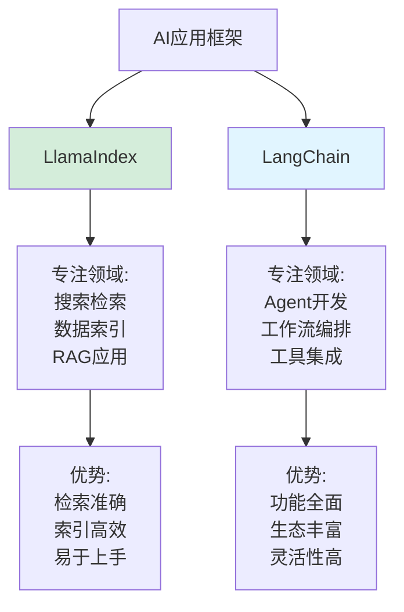

| 特性 | LlamaIndex | LangChain |
|------|-----------|-----------|
| **专注方向** | 数据索引与检索 | Agent与工作流 |
| **学习曲线** | 平缓⭐⭐⭐⭐⭐ | 较陡⭐⭐⭐ |
| **RAG性能** | 优秀⭐⭐⭐⭐⭐ | 良好⭐⭐⭐⭐ |
| **文档质量** | 优秀⭐⭐⭐⭐⭐ | 良好⭐⭐⭐⭐ |
| **适用场景** | 知识库、文档检索 | 复杂Agent、工具调用 |
| **推荐指数** | RAG首选⭐⭐⭐⭐⭐ | Agent首选⭐⭐⭐⭐⭐ |

**选择建议**:
- 🎯 **构建RAG系统** → LlamaIndex (本文选择)
- 🎯 **构建AI Agent** → LangChain
- 🎯 **两者结合** → 可以集成使用

---

### Qwen2.5简介

#### Qwen2.5发布信息

2024年9月19日云溪大会,阿里云发布Qwen2.5系列:

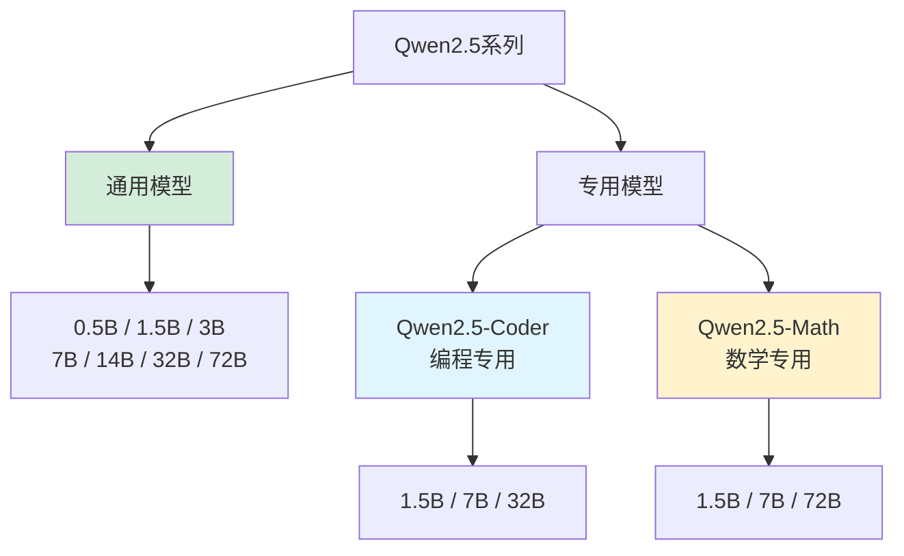

#### 性能对比

| 模型 | 参数量 | 性能亮点 | 推荐场景 |
|------|--------|---------|---------|
| **Qwen2.5-72B** | 72B | 部分任务超越Llama3.1-405B | 高难度推理、算法题 |
| **Qwen2.5-14B** | 14B | 性能/资源平衡 ⭐本文使用 | 本地部署RAG |
| **Qwen2.5-7B** | 7B | 资源占用低 | 轻量级应用 |
| **Qwen2.5-Coder** | 7B-32B | 编程能力优秀 | 代码生成、理解 |

**本文使用**: Qwen2.5-14B (4bit量化版)
- 显存占用: ~8GB
- 推理速度: 良好
- 中文能力: 优秀⭐⭐⭐⭐⭐

---

## 完整RAG系统搭建

### RAG工作流程

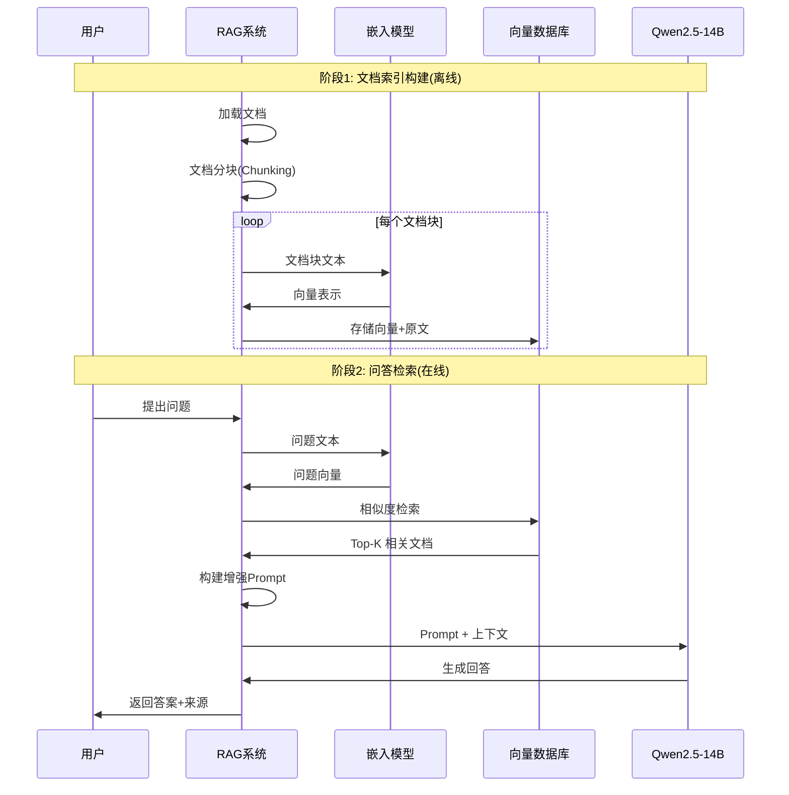

---

### 环境准备

#### 1. 安装Ollama和模型

```bash
# 1. 安装Ollama (如果还没有)
# macOS/Linux
curl -fsSL https://ollama.com/install.sh | sh

# Windows
# 访问 https://ollama.com/download 下载安装

# 2. 下载Qwen2.5-14B模型(4bit量化)
ollama pull qwen2.5:14b

# 3. 验证模型
ollama list

# 4. 测试模型
ollama run qwen2.5:14b "你好"
```

#### 2. 安装Python依赖

```bash
# 创建虚拟环境(推荐)
python -m venv rag_env
source rag_env/bin/activate  # Linux/Mac
# rag_env\Scripts\activate   # Windows

# 安装核心依赖
pip install llama-index              # LlamaIndex核心
pip install llama-index-llms-ollama  # Ollama集成
pip install llama-index-embeddings-huggingface  # HF嵌入模型
pip install sentence-transformers   # 嵌入模型运行时

# 安装文档解析工具
pip install docx2txt                 # Word文档解析
pip install pypdf                    # PDF解析
pip install python-pptx              # PPT解析

# 安装向量数据库(可选)
pip install qdrant-client            # Qdrant向量数据库
pip install chromadb                 # ChromaDB向量数据库
```

---

### 核心代码实现

#### 示例1: 基础RAG系统(10行核心代码)

```python
# ===== 设置HuggingFace镜像(必须放在最前面) =====
import os
os.environ['HF_ENDPOINT'] = 'https://hf-mirror.com'

# ===== 导入依赖 =====
from llama_index.core import VectorStoreIndex, SimpleDirectoryReader, Settings
from llama_index.llms.ollama import Ollama
from llama_index.embeddings.huggingface import HuggingFaceEmbedding
from llama_index.core.node_parser import SentenceSplitter
import logging
import sys

# ===== 配置日志(便于调试) =====
logging.basicConfig(
    stream=sys.stdout,
    level=logging.INFO,  # 改为INFO减少日志量,调试时用DEBUG
    format='%(asctime)s - %(name)s - %(levelname)s - %(message)s'
)

# ===== 配置LLM =====
Settings.llm = Ollama(
    model="qwen2.5:14b",
    request_timeout=600.0,    # 请求超时时间(秒)
    temperature=0.1,          # 降低随机性,提高准确性
)

# ===== 配置嵌入模型 =====
Settings.embed_model = HuggingFaceEmbedding(
    model_name="BAAI/bge-small-zh-v1.5",  # 中文优秀的嵌入模型
    # 模型会自动下载到 ~/.cache/huggingface/
)

# ===== 加载文档并构建索引 =====
# 准备测试文档: 在项目目录下创建data文件夹,放入.txt/.docx/.pdf文件
documents = SimpleDirectoryReader(
    input_dir="./data",       # 文档目录
    required_exts=[".txt", ".docx", ".pdf"],  # 支持的文件类型
    recursive=True,           # 递归读取子目录
).load_data()

print(f"加载了 {len(documents)} 个文档")

# 构建向量索引
index = VectorStoreIndex.from_documents(
    documents,
    transformations=[
        SentenceSplitter(
            chunk_size=512,       # 每个文档块的大小
            chunk_overlap=50,     # 块之间的重叠字符数
        )
    ],
    show_progress=True,           # 显示进度条
)

print("索引构建完成!")

# ===== 创建问答引擎 =====
query_engine = index.as_query_engine(
    similarity_top_k=3,          # 检索Top-3最相关的文档块
    response_mode="compact",     # 响应模式: compact(简洁) / tree_summarize(树形总结)
)

# ===== 测试问答 =====
question = "文档的主要内容是什么?"
print(f"\n问题: {question}")

response = query_engine.query(question)
print(f"回答: {response}")

# 查看检索到的来源
if hasattr(response, 'source_nodes'):
    print("\n来源文档:")
    for i, node in enumerate(response.source_nodes):
        print(f"\n来源 {i+1}:")
        print(f"相似度分数: {node.score:.4f}")
        print(f"内容: {node.text[:200]}...")
```

**运行结果示例**:
```
加载了 1 个文档
索引构建完成!

问题: 文档的主要内容是什么?
回答: 根据文档内容,这是阿里巴巴2024年第一季度的财务报告...

来源文档:
来源 1:
相似度分数: 0.8234
内容: 阿里巴巴集团2024年第一季度营收为2432.36亿元人民币...
```

---

#### 示例2: 带持久化的RAG系统

```python
import os
os.environ['HF_ENDPOINT'] = 'https://hf-mirror.com'

from llama_index.core import (
    VectorStoreIndex,
    SimpleDirectoryReader,
    Settings,
    StorageContext,
    load_index_from_storage
)
from llama_index.llms.ollama import Ollama
from llama_index.embeddings.huggingface import HuggingFaceEmbedding
from llama_index.core.node_parser import SentenceSplitter

# ===== 配置 =====
Settings.llm = Ollama(model="qwen2.5:14b", request_timeout=600.0)
Settings.embed_model = HuggingFaceEmbedding(model_name="BAAI/bge-small-zh-v1.5")

# ===== 持久化配置 =====
PERSIST_DIR = "./storage"  # 索引保存目录

def build_index(data_dir="./data", force_rebuild=False):
    """构建或加载索引"""

    # 如果索引已存在且不强制重建,则加载
    if os.path.exists(PERSIST_DIR) and not force_rebuild:
        print("加载已有索引...")
        storage_context = StorageContext.from_defaults(persist_dir=PERSIST_DIR)
        index = load_index_from_storage(storage_context)
        print("索引加载完成!")
        return index

    # 构建新索引
    print("构建新索引...")
    documents = SimpleDirectoryReader(
        input_dir=data_dir,
        required_exts=[".txt", ".docx", ".pdf"],
        recursive=True
    ).load_data()

    print(f"加载了 {len(documents)} 个文档")

    index = VectorStoreIndex.from_documents(
        documents,
        transformations=[SentenceSplitter(chunk_size=512, chunk_overlap=50)],
        show_progress=True
    )

    # 保存索引
    index.storage_context.persist(persist_dir=PERSIST_DIR)
    print(f"索引已保存到 {PERSIST_DIR}")

    return index

# ===== 构建/加载索引 =====
index = build_index(force_rebuild=False)  # 首次运行后会复用索引

# ===== 创建问答引擎 =====
query_engine = index.as_query_engine(similarity_top_k=3)

# ===== 交互式问答 =====
def chat():
    """交互式问答循环"""
    print("\n=== RAG问答系统 ===")
    print("输入问题开始对话,输入'exit'退出\n")

    while True:
        question = input("你的问题: ").strip()

        if question.lower() in ['exit', 'quit', '退出']:
            print("再见!")
            break

        if not question:
            continue

        print("思考中...")
        response = query_engine.query(question)
        print(f"\n回答: {response}\n")

        # 显示来源(可选)
        show_sources = input("是否查看来源? (y/n): ").strip().lower()
        if show_sources == 'y' and hasattr(response, 'source_nodes'):
            for i, node in enumerate(response.source_nodes):
                print(f"\n来源 {i+1} (相似度: {node.score:.4f}):")
                print(node.text[:300] + "...")
        print()

# 运行聊天
chat()
```

---

#### 示例3: 使用Qdrant向量数据库

```python
import os
os.environ['HF_ENDPOINT'] = 'https://hf-mirror.com'

from llama_index.core import VectorStoreIndex, SimpleDirectoryReader, Settings
from llama_index.llms.ollama import Ollama
from llama_index.embeddings.huggingface import HuggingFaceEmbedding
from llama_index.vector_stores.qdrant import QdrantVectorStore
from llama_index.core import StorageContext
from qdrant_client import QdrantClient

# ===== 配置 =====
Settings.llm = Ollama(model="qwen2.5:14b", request_timeout=600.0)
Settings.embed_model = HuggingFaceEmbedding(model_name="BAAI/bge-small-zh-v1.5")

# ===== 配置Qdrant =====
# 方式1: 使用内存模式(测试用)
client = QdrantClient(location=":memory:")

# 方式2: 使用本地持久化(推荐)
# client = QdrantClient(path="./qdrant_data")

# 方式3: 使用远程Qdrant服务
# client = QdrantClient(url="http://localhost:6333")

# 创建Qdrant向量存储
vector_store = QdrantVectorStore(
    client=client,
    collection_name="my_documents",  # 集合名称
)

# ===== 构建索引 =====
documents = SimpleDirectoryReader("./data").load_data()

storage_context = StorageContext.from_defaults(vector_store=vector_store)

index = VectorStoreIndex.from_documents(
    documents,
    storage_context=storage_context,
    show_progress=True
)

print("Qdrant索引构建完成!")

# ===== 查询 =====
query_engine = index.as_query_engine(similarity_top_k=5)

response = query_engine.query("文档的主要内容是什么?")
print(f"\n回答: {response}")

# ===== 查看Qdrant统计信息 =====
collection_info = client.get_collection("my_documents")
print(f"\n向量数量: {collection_info.points_count}")
print(f"向量维度: {collection_info.config.params.vectors.size}")
```

---

#### 示例4: 多文档类型混合处理

```python
import os
os.environ['HF_ENDPOINT'] = 'https://hf-mirror.com'

from llama_index.core import VectorStoreIndex, SimpleDirectoryReader, Settings
from llama_index.llms.ollama import Ollama
from llama_index.embeddings.huggingface import HuggingFaceEmbedding
from llama_index.core.node_parser import SentenceSplitter
from pathlib import Path

# ===== 配置 =====
Settings.llm = Ollama(model="qwen2.5:14b", request_timeout=600.0)
Settings.embed_model = HuggingFaceEmbedding(model_name="BAAI/bge-small-zh-v1.5")

# ===== 分类加载不同类型文档 =====
def load_documents_by_type(base_dir="./data"):
    """按文件类型加载文档"""
    all_documents = []

    # TXT文件 - 使用较小的chunk
    txt_files = list(Path(base_dir).rglob("*.txt"))
    if txt_files:
        print(f"加载 {len(txt_files)} 个TXT文件...")
        txt_docs = SimpleDirectoryReader(
            input_files=[str(f) for f in txt_files]
        ).load_data()
        all_documents.extend(txt_docs)

    # DOCX文件 - 使用中等chunk
    docx_files = list(Path(base_dir).rglob("*.docx"))
    if docx_files:
        print(f"加载 {len(docx_files)} 个DOCX文件...")
        docx_docs = SimpleDirectoryReader(
            input_files=[str(f) for f in docx_files]
        ).load_data()
        all_documents.extend(docx_docs)

    # PDF文件 - 使用较大chunk
    pdf_files = list(Path(base_dir).rglob("*.pdf"))
    if pdf_files:
        print(f"加载 {len(pdf_files)} 个PDF文件...")
        pdf_docs = SimpleDirectoryReader(
            input_files=[str(f) for f in pdf_files]
        ).load_data()
        all_documents.extend(pdf_docs)

    return all_documents

# ===== 加载文档 =====
documents = load_documents_by_type()
print(f"总共加载 {len(documents)} 个文档")

# ===== 为不同文档添加元数据 =====
for doc in documents:
    # 添加文件名元数据
    doc.metadata['filename'] = Path(doc.metadata.get('file_path', '')).name

    # 添加文件类型
    file_ext = Path(doc.metadata.get('file_path', '')).suffix
    doc.metadata['file_type'] = file_ext

# ===== 构建索引(使用自适应分块) =====
index = VectorStoreIndex.from_documents(
    documents,
    transformations=[
        SentenceSplitter(
            chunk_size=512,
            chunk_overlap=50,
        )
    ],
    show_progress=True
)

# ===== 查询时可以过滤文件类型 =====
from llama_index.core.vector_stores import MetadataFilters, ExactMatchFilter

query_engine = index.as_query_engine(
    similarity_top_k=5,
    # 可选: 只检索PDF文件
    # filters=MetadataFilters(
    #     filters=[ExactMatchFilter(key="file_type", value=".pdf")]
    # )
)

response = query_engine.query("文档的主要内容是什么?")
print(f"\n回答: {response}")

# 显示来源文件
if hasattr(response, 'source_nodes'):
    print("\n来源文件:")
    for node in response.source_nodes:
        filename = node.metadata.get('filename', 'Unknown')
        file_type = node.metadata.get('file_type', 'Unknown')
        print(f"- {filename} ({file_type}), 相似度: {node.score:.4f}")
```

---

### 参数调优指南

#### 核心参数说明

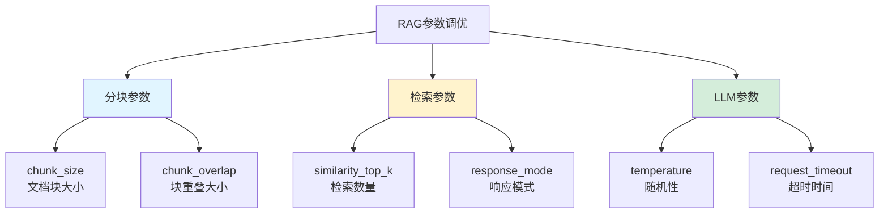

#### 参数对比表

| 参数 | 默认值 | 推荐范围 | 影响 | 调优建议 |
|------|--------|---------|------|---------|
| **chunk_size** | 1024 | 256-1024 | 文档块大小 | 短文档用256,长文档用1024 |
| **chunk_overlap** | 20 | 20-100 | 块重叠度 | 增加可提高上下文连贯性 |
| **similarity_top_k** | 2 | 3-10 | 检索文档数 | 增加可提高召回率,但可能引入噪音 |
| **temperature** | 0.7 | 0.0-0.3 | 回答随机性 | RAG场景建议0.1(更准确) |

#### 调优策略

```python
# ===== 场景1: 短问答(客服系统) =====
Settings.llm = Ollama(model="qwen2.5:14b", temperature=0.0)  # 零随机性

index = VectorStoreIndex.from_documents(
    documents,
    transformations=[SentenceSplitter(
        chunk_size=256,      # 小块
        chunk_overlap=30,    # 较小重叠
    )]
)

query_engine = index.as_query_engine(
    similarity_top_k=2,      # 少量检索
    response_mode="compact"  # 简洁模式
)

# ===== 场景2: 长文档分析(研究报告) =====
Settings.llm = Ollama(model="qwen2.5:14b", temperature=0.2)

index = VectorStoreIndex.from_documents(
    documents,
    transformations=[SentenceSplitter(
        chunk_size=1024,     # 大块
        chunk_overlap=100,   # 较大重叠
    )]
)

query_engine = index.as_query_engine(
    similarity_top_k=5,          # 多文档检索
    response_mode="tree_summarize"  # 树形总结模式
)

# ===== 场景3: 精确检索(法律/医疗) =====
Settings.llm = Ollama(model="qwen2.5:14b", temperature=0.0)

index = VectorStoreIndex.from_documents(
    documents,
    transformations=[SentenceSplitter(
        chunk_size=512,      # 中等块
        chunk_overlap=50,
    )]
)

query_engine = index.as_query_engine(
    similarity_top_k=10,     # 大量检索
    response_mode="compact"
)
```

---

## 常见问题解答

### Q1: 文档加载失败,提示"找不到文件"

**错误信息**:
```
FileNotFoundError: [Errno 2] No such file or directory: './data'
```

**原因**:
- 文件路径包含隐藏目录(以`.`开头)
- 使用了相对路径但当前目录不对
- 文件权限问题

**解决方案**:

```python
# ===== 方式1: 使用绝对路径(推荐) =====
import os
from pathlib import Path

# 获取当前脚本所在目录
script_dir = Path(__file__).parent
data_dir = script_dir / "data"

documents = SimpleDirectoryReader(
    input_dir=str(data_dir),
    required_exts=[".txt", ".docx", ".pdf"]
).load_data()

# ===== 方式2: 检查路径是否存在 =====
data_path = "./data"
if not os.path.exists(data_path):
    print(f"错误: 目录 {data_path} 不存在")
    print(f"当前工作目录: {os.getcwd()}")
    exit(1)

# ===== 方式3: 避免隐藏目录 =====
# LlamaIndex会跳过以.开头的目录,确保路径中没有
# ❌ 错误: /Users/xxx/.hidden_dir/data
# ✅ 正确: /Users/xxx/my_project/data
```

---

### Q2: 嵌入模型下载失败或速度慢

**错误信息**:
```
requests.exceptions.ConnectTimeout: HTTPSConnectionPool
```

**解决方案**:

```python
# ===== 方式1: 使用HuggingFace镜像(推荐) =====
import os
# ⚠️ 必须在导入其他库之前设置
os.environ['HF_ENDPOINT'] = 'https://hf-mirror.com'

from llama_index.embeddings.huggingface import HuggingFaceEmbedding

# ===== 方式2: 手动下载模型 =====
# 1. 访问 https://hf-mirror.com/BAAI/bge-small-zh-v1.5
# 2. 下载所有文件到本地目录,如: ./models/bge-small-zh-v1.5/
# 3. 使用本地路径

Settings.embed_model = HuggingFaceEmbedding(
    model_name="./models/bge-small-zh-v1.5",  # 本地路径
)

# ===== 方式3: 使用modelscope镜像 =====
from modelscope import snapshot_download

model_dir = snapshot_download(
    'AI-ModelScope/bge-small-zh-v1.5',
    cache_dir='./models'
)

Settings.embed_model = HuggingFaceEmbedding(model_name=model_dir)
```

---

### Q3: 查询速度很慢,如何优化?

**性能优化策略**:

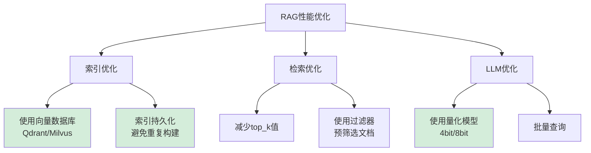

```python
# ===== 优化1: 索引持久化(避免每次重建) =====
from llama_index.core import StorageContext, load_index_from_storage

PERSIST_DIR = "./storage"

if os.path.exists(PERSIST_DIR):
    # 加载已有索引(秒级)
    storage_context = StorageContext.from_defaults(persist_dir=PERSIST_DIR)
    index = load_index_from_storage(storage_context)
else:
    # 首次构建索引(分钟级)
    index = VectorStoreIndex.from_documents(documents)
    index.storage_context.persist(persist_dir=PERSIST_DIR)

# ===== 优化2: 使用向量数据库(提升检索速度) =====
from qdrant_client import QdrantClient
from llama_index.vector_stores.qdrant import QdrantVectorStore

client = QdrantClient(path="./qdrant_data")  # 本地持久化
vector_store = QdrantVectorStore(client=client, collection_name="docs")

# 构建索引时使用
storage_context = StorageContext.from_defaults(vector_store=vector_store)
index = VectorStoreIndex.from_documents(documents, storage_context=storage_context)

# ===== 优化3: 减少检索数量 =====
query_engine = index.as_query_engine(
    similarity_top_k=2,  # 从5减少到2,速度提升50%+
)

# ===== 优化4: 使用更小的嵌入模型 =====
# bge-small-zh-v1.5 (推荐,平衡)
# all-MiniLM-L6-v2 (更快,略降质量)

Settings.embed_model = HuggingFaceEmbedding(
    model_name="sentence-transformers/all-MiniLM-L6-v2"  # 更快
)

# ===== 优化5: 批量查询 =====
questions = ["问题1", "问题2", "问题3"]

# 方式1: 异步查询
import asyncio

async def async_query(question):
    return await query_engine.aquery(question)

async def batch_query(questions):
    tasks = [async_query(q) for q in questions]
    return await asyncio.gather(*tasks)

# 运行
responses = asyncio.run(batch_query(questions))
```

---

### Q4: 回答质量不佳,如何提升?

**提升回答质量的方法**:

```python
# ===== 策略1: 优化chunk大小 =====
# 文档过长 → 减小chunk_size
# 上下文不连贯 → 增加chunk_overlap

index = VectorStoreIndex.from_documents(
    documents,
    transformations=[SentenceSplitter(
        chunk_size=512,      # 根据文档类型调整
        chunk_overlap=100,   # 增加重叠提高连贯性
    )]
)

# ===== 策略2: 增加检索数量 =====
query_engine = index.as_query_engine(
    similarity_top_k=5,  # 从3增加到5
)

# ===== 策略3: 使用更好的Prompt =====
from llama_index.core import PromptTemplate

qa_prompt_template = PromptTemplate(
    """你是一个专业的问答助手。

    上下文信息如下:
    {context_str}

    基于以上上下文信息(而非先验知识),回答用户的问题。
    如果上下文中没有相关信息,请明确说明"根据提供的信息无法回答该问题"。

    问题: {query_str}

    回答: """
)

query_engine = index.as_query_engine(
    similarity_top_k=5,
    text_qa_template=qa_prompt_template
)

# ===== 策略4: 启用重排序(Reranking) =====
from llama_index.core.postprocessor import SentenceTransformerRerank

# 使用重排序器提升相关性
reranker = SentenceTransformerRerank(
    model="BAAI/bge-reranker-base",
    top_n=3  # 从检索结果中重排后取Top3
)

query_engine = index.as_query_engine(
    similarity_top_k=10,      # 先检索10个
    node_postprocessors=[reranker]  # 重排后取3个
)

# ===== 策略5: 使用更强的LLM =====
Settings.llm = Ollama(
    model="qwen2.5:32b",  # 从14b升级到32b
    temperature=0.1,
)

# 或使用API模型
from llama_index.llms.openai import OpenAI

Settings.llm = OpenAI(
    model="gpt-4",  # 或 gpt-3.5-turbo
    temperature=0.1,
)
```

---

### Q5: 如何处理中英文混合文档?

**中英文混合处理方案**:

```python
# ===== 方式1: 使用多语言嵌入模型 =====
from llama_index.embeddings.huggingface import HuggingFaceEmbedding

# 推荐模型
multilingual_models = [
    "BAAI/bge-m3",                    # 多语言BGE(推荐) ⭐⭐⭐⭐⭐
    "sentence-transformers/paraphrase-multilingual-MiniLM-L12-v2",  # 轻量级
    "intfloat/multilingual-e5-large", # 高质量
]

Settings.embed_model = HuggingFaceEmbedding(
    model_name="BAAI/bge-m3"  # 支持100+语言
)

# ===== 方式2: 分别处理中英文文档 =====
def load_documents_by_language(chinese_dir, english_dir):
    """分别加载中英文文档"""
    from llama_index.core import Document

    # 加载中文文档
    chinese_docs = SimpleDirectoryReader(chinese_dir).load_data()
    for doc in chinese_docs:
        doc.metadata['language'] = 'zh'

    # 加载英文文档
    english_docs = SimpleDirectoryReader(english_dir).load_data()
    for doc in english_docs:
        doc.metadata['language'] = 'en'

    return chinese_docs + english_docs

all_docs = load_documents_by_language("./data/zh", "./data/en")

# 构建索引
index = VectorStoreIndex.from_documents(all_docs)

# 查询时可以过滤语言
from llama_index.core.vector_stores import MetadataFilters, ExactMatchFilter

# 只检索中文文档
zh_query_engine = index.as_query_engine(
    filters=MetadataFilters(
        filters=[ExactMatchFilter(key="language", value="zh")]
    )
)

# 只检索英文文档
en_query_engine = index.as_query_engine(
    filters=MetadataFilters(
        filters=[ExactMatchFilter(key="language", value="en")]
    )
)
```

---

### Q6: 如何实现流式输出?

```python
# ===== 实现流式RAG问答 =====
import os
os.environ['HF_ENDPOINT'] = 'https://hf-mirror.com'

from llama_index.core import VectorStoreIndex, SimpleDirectoryReader, Settings
from llama_index.llms.ollama import Ollama
from llama_index.embeddings.huggingface import HuggingFaceEmbedding

# 配置
Settings.llm = Ollama(model="qwen2.5:14b", request_timeout=600.0)
Settings.embed_model = HuggingFaceEmbedding(model_name="BAAI/bge-small-zh-v1.5")

# 构建索引
documents = SimpleDirectoryReader("./data").load_data()
index = VectorStoreIndex.from_documents(documents)

# 创建流式查询引擎
streaming_query_engine = index.as_query_engine(
    similarity_top_k=3,
    streaming=True  # 启用流式输出
)

# 流式查询
response = streaming_query_engine.query("文档的主要内容是什么?")

print("回答: ", end="", flush=True)
for text in response.response_gen:
    print(text, end="", flush=True)
print("\n")

# ===== 在Web应用中使用流式输出 =====
# FastAPI示例
from fastapi import FastAPI
from fastapi.responses import StreamingResponse

app = FastAPI()

@app.get("/query")
async def query_stream(question: str):
    """流式RAG问答接口"""

    response = streaming_query_engine.query(question)

    def generate():
        for text in response.response_gen:
            yield text

    return StreamingResponse(generate(), media_type="text/plain")

# 运行: uvicorn main:app --reload
```

---

## 最佳实践建议

### 文档准备

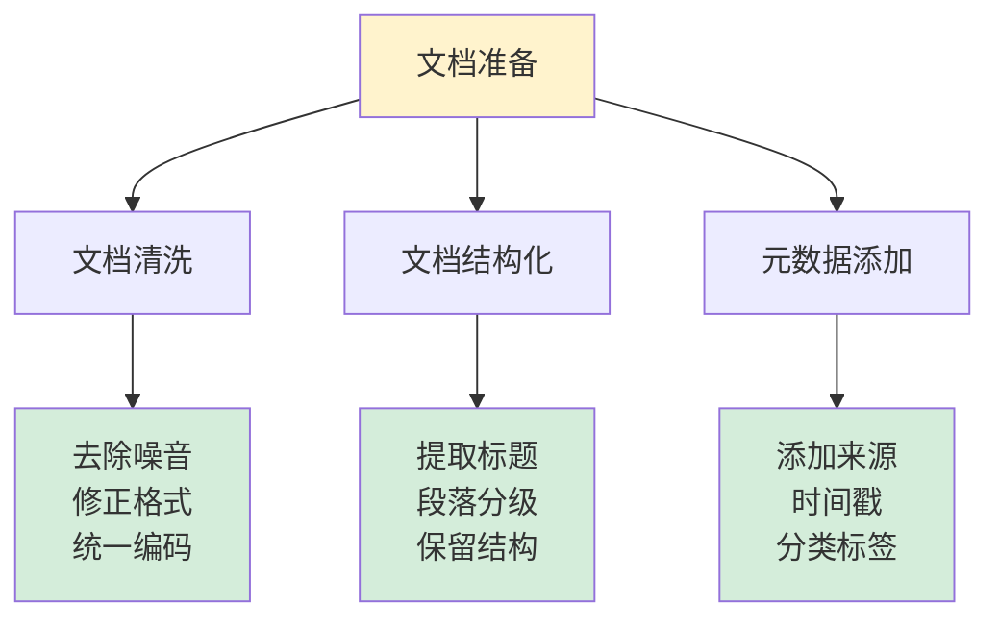

#### 1. 文档质量 > 数量

**文档清洗建议**:
- ✅ 去除无关内容(页眉、页脚、版权声明)
- ✅ 修正格式错误(编码问题、乱码)
- ✅ 统一文档格式(优先使用纯文本格式)
- ✅ 保留有意义的结构(标题、段落、列表)

**不推荐的文档**:
- ❌ 扫描版PDF(OCR识别率低)
- ❌ 图片为主的文档(提取文本少)
- ❌ 复杂表格(难以准确解析)

#### 2. 合理设置chunk大小

| 文档类型 | 推荐chunk_size | 推荐overlap | 原因 |
|---------|---------------|-------------|------|
| **短问答** | 128-256 | 20-30 | 快速定位,减少噪音 |
| **文章段落** | 512-768 | 50-100 | 保持上下文完整性 |
| **长报告** | 1024-1536 | 100-200 | 保留更多上下文 |
| **代码** | 256-512 | 50 | 保持函数完整性 |

#### 3. 选择合适的嵌入模型

| 模型 | 参数量 | 向量维度 | 速度 | 质量 | 适用场景 |
|------|--------|---------|------|------|---------|
| **bge-small-zh-v1.5** | 33M | 512 | ⭐⭐⭐⭐⭐ | ⭐⭐⭐⭐ | 中文为主(推荐) |
| **bge-base-zh-v1.5** | 102M | 768 | ⭐⭐⭐⭐ | ⭐⭐⭐⭐⭐ | 中文高质量 |
| **bge-m3** | 560M | 1024 | ⭐⭐⭐ | ⭐⭐⭐⭐⭐ | 多语言 |
| **all-MiniLM-L6-v2** | 22M | 384 | ⭐⭐⭐⭐⭐ | ⭐⭐⭐ | 英文,速度优先 |

---

### 系统架构建议

#### 小规模应用(<10000文档)

```python
# 使用内存向量存储,索引持久化
from llama_index.core import StorageContext, load_index_from_storage

if os.path.exists("./storage"):
    storage_context = StorageContext.from_defaults(persist_dir="./storage")
    index = load_index_from_storage(storage_context)
else:
    index = VectorStoreIndex.from_documents(documents)
    index.storage_context.persist(persist_dir="./storage")
```

#### 中规模应用(10000-100000文档)

```python
# 使用本地Qdrant
from qdrant_client import QdrantClient
from llama_index.vector_stores.qdrant import QdrantVectorStore

client = QdrantClient(path="./qdrant_data")
vector_store = QdrantVectorStore(client=client, collection_name="docs")

storage_context = StorageContext.from_defaults(vector_store=vector_store)
index = VectorStoreIndex.from_documents(documents, storage_context=storage_context)
```

#### 大规模应用(100000+文档)

```python
# 使用远程Qdrant集群或Milvus
from qdrant_client import QdrantClient
from llama_index.vector_stores.qdrant import QdrantVectorStore

# Qdrant集群
client = QdrantClient(
    url="http://qdrant-server:6333",
    api_key="your-api-key"
)

# 或使用Milvus
from llama_index.vector_stores.milvus import MilvusVectorStore

vector_store = MilvusVectorStore(
    uri="http://milvus-server:19530",
    collection_name="large_docs",
    dim=768
)

storage_context = StorageContext.from_defaults(vector_store=vector_store)
index = VectorStoreIndex.from_documents(documents, storage_context=storage_context)
```

---

### 生产环境部署

#### 完整的生产级RAG系统

```python
import os
import logging
from pathlib import Path
from typing import List, Dict

os.environ['HF_ENDPOINT'] = 'https://hf-mirror.com'

from llama_index.core import (
    VectorStoreIndex,
    SimpleDirectoryReader,
    Settings,
    StorageContext,
    load_index_from_storage
)
from llama_index.llms.ollama import Ollama
from llama_index.embeddings.huggingface import HuggingFaceEmbedding
from llama_index.core.node_parser import SentenceSplitter
from qdrant_client import QdrantClient
from llama_index.vector_stores.qdrant import QdrantVectorStore

# ===== 配置管理 =====
class RAGConfig:
    """RAG系统配置"""
    # LLM配置
    LLM_MODEL = "qwen2.5:14b"
    LLM_TEMPERATURE = 0.1
    LLM_TIMEOUT = 600.0

    # 嵌入模型配置
    EMBED_MODEL = "BAAI/bge-small-zh-v1.5"

    # 分块配置
    CHUNK_SIZE = 512
    CHUNK_OVERLAP = 50

    # 检索配置
    TOP_K = 5

    # 存储配置
    QDRANT_PATH = "./qdrant_data"
    COLLECTION_NAME = "production_docs"

# ===== 日志配置 =====
logging.basicConfig(
    level=logging.INFO,
    format='%(asctime)s - %(name)s - %(levelname)s - %(message)s',
    handlers=[
        logging.FileHandler('rag_system.log'),
        logging.StreamHandler()
    ]
)
logger = logging.getLogger(__name__)

# ===== RAG系统类 =====
class RAGSystem:
    """生产级RAG系统"""

    def __init__(self, config: RAGConfig):
        self.config = config
        self._setup_models()
        self._setup_vector_store()
        self.index = None
        self.query_engine = None

    def _setup_models(self):
        """配置模型"""
        logger.info("配置LLM和嵌入模型...")

        Settings.llm = Ollama(
            model=self.config.LLM_MODEL,
            temperature=self.config.LLM_TEMPERATURE,
            request_timeout=self.config.LLM_TIMEOUT
        )

        Settings.embed_model = HuggingFaceEmbedding(
            model_name=self.config.EMBED_MODEL
        )

        logger.info("模型配置完成")

    def _setup_vector_store(self):
        """配置向量存储"""
        logger.info("配置Qdrant向量存储...")

        self.client = QdrantClient(path=self.config.QDRANT_PATH)
        self.vector_store = QdrantVectorStore(
            client=self.client,
            collection_name=self.config.COLLECTION_NAME
        )

        logger.info("向量存储配置完成")

    def load_documents(self, data_dir: str) -> List:
        """加载文档"""
        logger.info(f"从 {data_dir} 加载文档...")

        if not os.path.exists(data_dir):
            raise FileNotFoundError(f"目录不存在: {data_dir}")

        documents = SimpleDirectoryReader(
            input_dir=data_dir,
            required_exts=[".txt", ".docx", ".pdf"],
            recursive=True
        ).load_data()

        logger.info(f"成功加载 {len(documents)} 个文档")
        return documents

    def build_index(self, documents: List):
        """构建索引"""
        logger.info("构建向量索引...")

        storage_context = StorageContext.from_defaults(
            vector_store=self.vector_store
        )

        self.index = VectorStoreIndex.from_documents(
            documents,
            storage_context=storage_context,
            transformations=[
                SentenceSplitter(
                    chunk_size=self.config.CHUNK_SIZE,
                    chunk_overlap=self.config.CHUNK_OVERLAP
                )
            ],
            show_progress=True
        )

        logger.info("索引构建完成")

    def create_query_engine(self):
        """创建查询引擎"""
        if self.index is None:
            raise ValueError("请先构建索引")

        self.query_engine = self.index.as_query_engine(
            similarity_top_k=self.config.TOP_K
        )

        logger.info("查询引擎创建完成")

    def query(self, question: str) -> Dict:
        """查询"""
        if self.query_engine is None:
            raise ValueError("请先创建查询引擎")

        logger.info(f"查询: {question}")

        response = self.query_engine.query(question)

        # 提取来源
        sources = []
        if hasattr(response, 'source_nodes'):
            for node in response.source_nodes:
                sources.append({
                    'content': node.text[:200],
                    'score': float(node.score),
                    'metadata': node.metadata
                })

        result = {
            'answer': str(response),
            'sources': sources
        }

        logger.info("查询完成")
        return result

# ===== 使用示例 =====
def main():
    # 创建RAG系统
    rag = RAGSystem(RAGConfig())

    # 加载文档
    documents = rag.load_documents("./data")

    # 构建索引
    rag.build_index(documents)

    # 创建查询引擎
    rag.create_query_engine()

    # 查询
    result = rag.query("文档的主要内容是什么?")

    print(f"回答: {result['answer']}")
    print(f"\n来源数量: {len(result['sources'])}")

if __name__ == "__main__":
    main()
```

---

## 注意事项

### 文件路径问题

⚠️ **隐藏文件夹**:LlamaIndex会自动跳过以`.`开头的目录

```python
def is_hidden(self, path: Path) -> bool:
    return any(
        part.startswith(".") and part not in [".", ".."] for part in path.parts
    )
```

**解决方案**:
- ✅ 使用不包含`.`开头目录的路径
- ✅ 使用绝对路径避免相对路径问题

### 文档类型支持

| 格式 | 支持程度 | 推荐度 | 说明 |
|------|---------|--------|------|
| **.txt** | ⭐⭐⭐⭐⭐ | ⭐⭐⭐⭐⭐ | 最佳,无格式问题 |
| **.docx** | ⭐⭐⭐⭐⭐ | ⭐⭐⭐⭐⭐ | 很好,保留格式 |
| **.pdf** | ⭐⭐⭐⭐ | ⭐⭐⭐⭐ | 纯文本PDF效果好 |
| **扫描PDF** | ⭐⭐ | ⭐ | 需要OCR,效果差 |
| **图片** | ⭐ | ⭐ | 需要多模态模型 |
| **表格** | ⭐⭐⭐ | ⭐⭐⭐ | 复杂表格难解析 |

### RAG效果验证建议

**选择测试文档的原则**:
1. ✅ 选择LLM不熟悉的领域(如最新财报、内部文档)
2. ✅ 选择有明确事实的文档(数字、日期、专有名词)
3. ✅ 避免选择LLM已有知识的领域(历史、医学等)

**对比测试**:
```python
# 测试1: 直接询问LLM(无RAG)
direct_response = ollama.chat(model="qwen2.5:14b", messages=[
    {"role": "user", "content": "阿里巴巴2024Q1收入多少?"}
])
print(f"无RAG回答: {direct_response}")

# 测试2: 使用RAG
rag_response = query_engine.query("阿里巴巴2024Q1收入多少?")
print(f"RAG回答: {rag_response}")

# 对比效果
```

---

## 写在最后

### RAG的应用场景

RAG是当前企业AI落地的首选方案,典型应用包括:

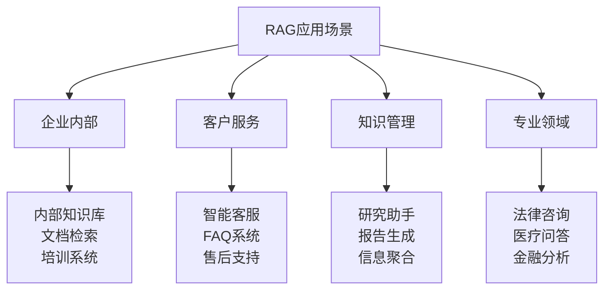

**优先使用RAG的场景**:
- ✅ 需要引用准确信息源
- ✅ 知识库需要频繁更新
- ✅ 追求回答的可解释性
- ✅ 数据安全和隐私要求高
- ✅ 成本敏感(相比模型微调)

### 学习路径建议

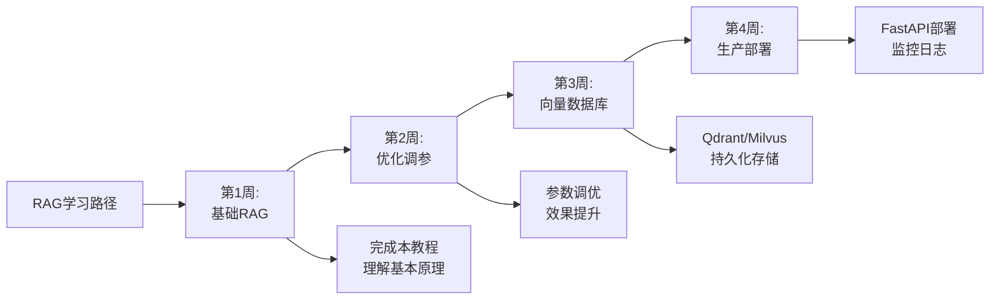

---

## 相关资源

### 官方文档
- [LlamaIndex官网](https://www.llamaindex.ai/)
- [LlamaIndex文档](https://docs.llamaindex.ai/)
- [Qwen2.5发布](https://qwenlm.github.io/)
- [Ollama官网](https://ollama.com/)

### 向量数据库
- [Qdrant文档](https://qdrant.tech/documentation/)
- [Milvus文档](https://milvus.io/docs)
- [ChromaDB文档](https://docs.trychroma.com/)

### 嵌入模型
- [bge-small-zh-v1.5](https://huggingface.co/BAAI/bge-small-zh-v1.5)
- [bge-m3](https://huggingface.co/BAAI/bge-m3)
- [Sentence Transformers](https://www.sbert.net/)

### 相关教程
- [[大模型/07-教程与课程/5分钟手把手/2. 本地部署Graphrag(Pycharm+Ollama+LM Studio)|本地部署GraphRAG]]
- [[大模型/07-教程与课程/5分钟手把手/3. 本地编写一个AI Agent(Langchain + Ollama)|编写AI Agent]]
- [[大模型/04-部署与工具链/向量数据库/向量数据库对比推荐|向量数据库对比]]

---

> 💡 **温馨提示**:
> - RAG是AI应用落地的核心技术之一
> - 优先保证数据质量,再考虑模型和参数优化
> - 从简单场景开始,逐步优化和扩展
> - 重视评估和监控,持续改进系统效果

**祝你构建RAG系统愉快!** 🎉
