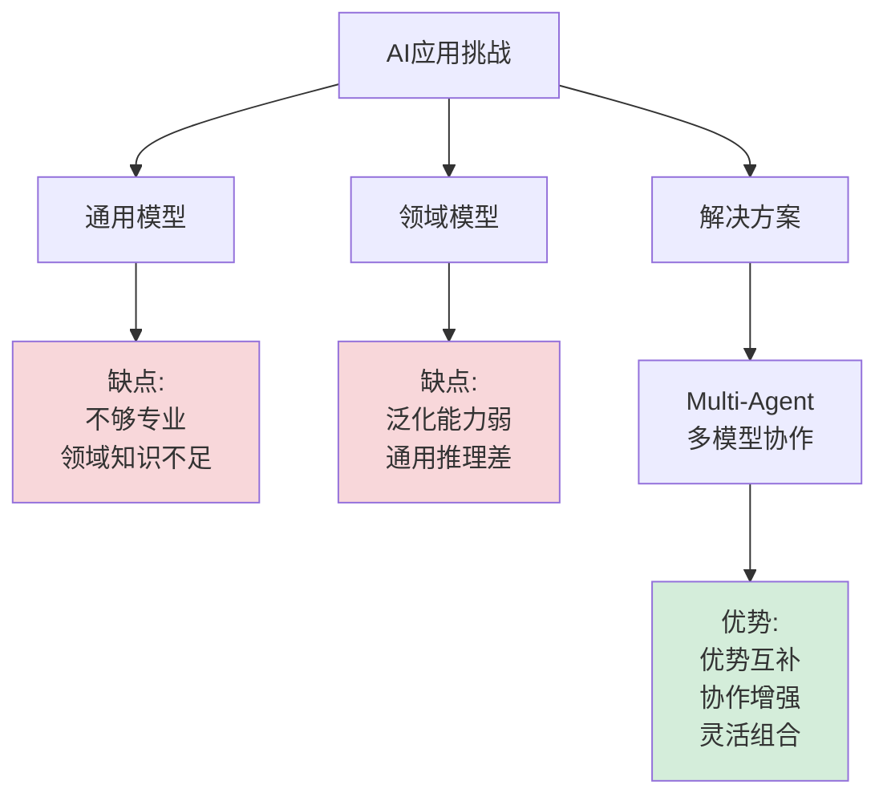
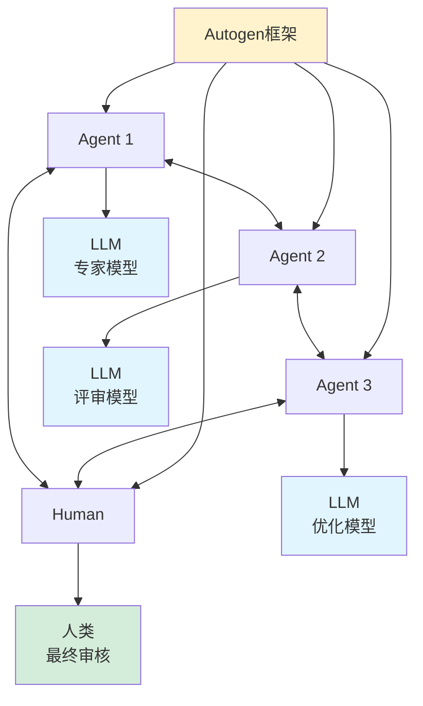
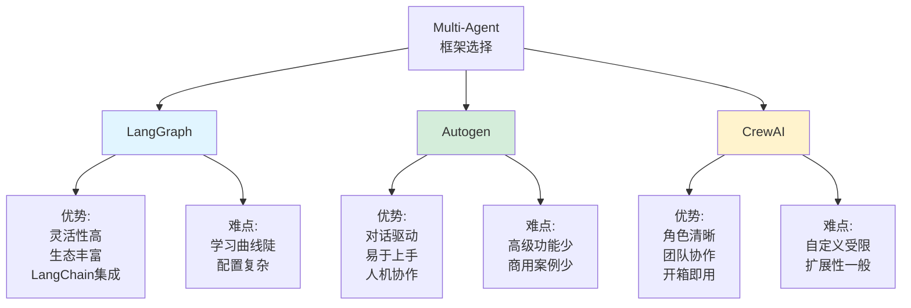
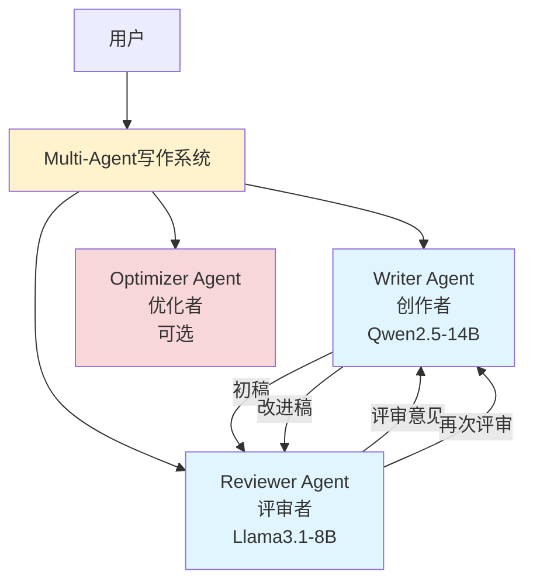
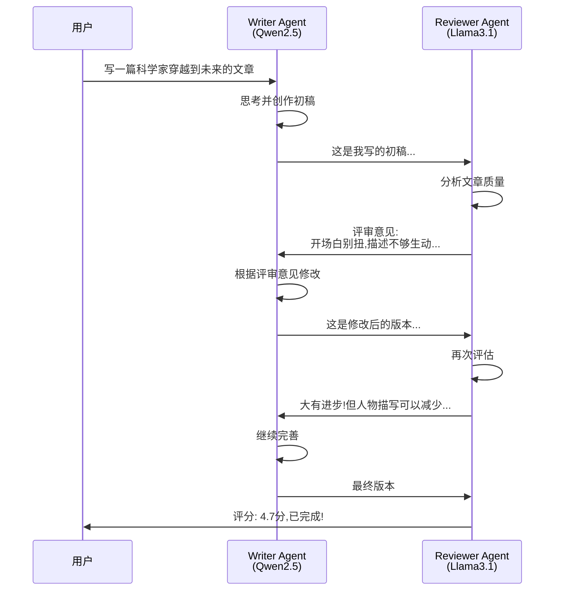
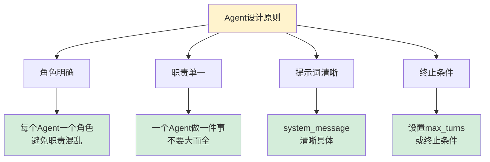
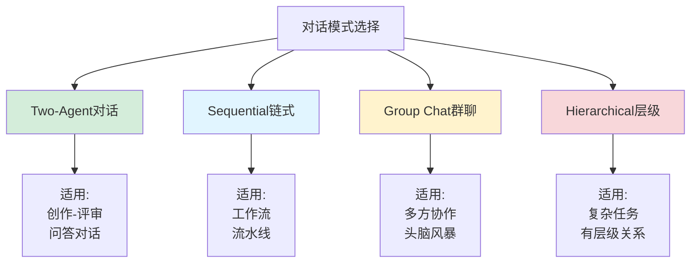
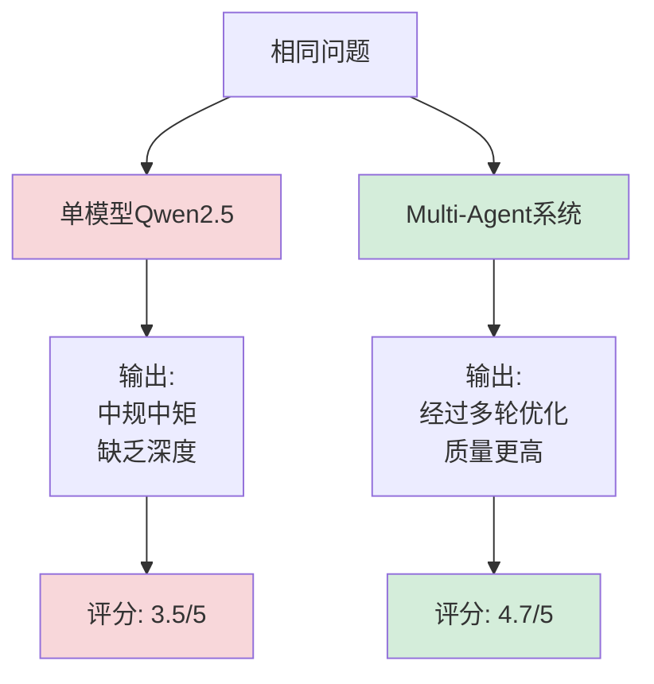
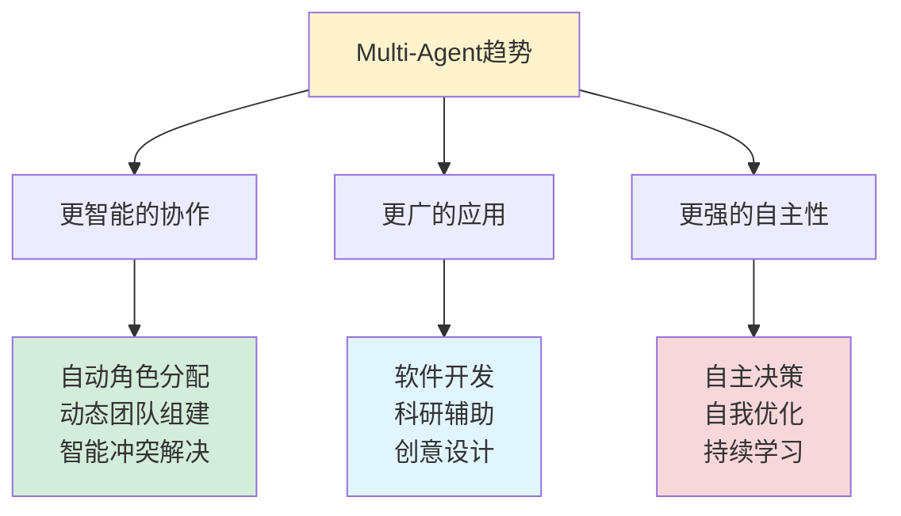
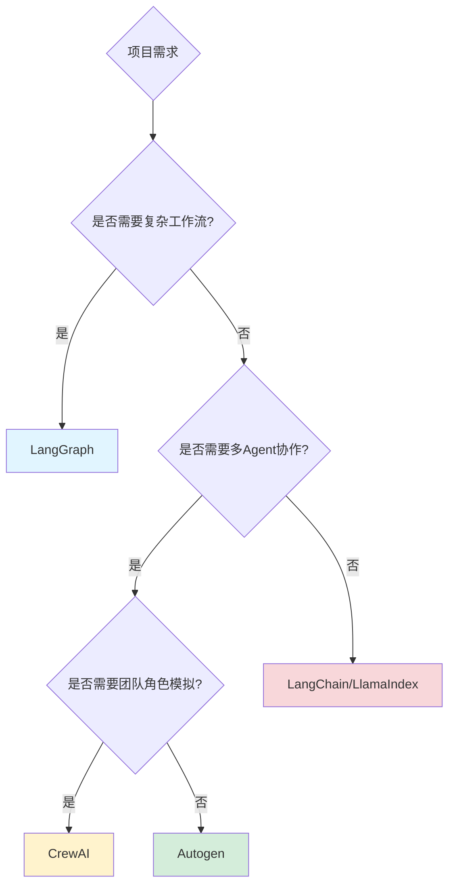

# 5分钟手把手系列(六):本地编写多Agent来对话写文章(Qwen2.5 + Autogen + Ollama)

## 背景

### 单一模型的局限性

在AI应用搭建的实际场景中,单一的基座模型、或者微调后的领域模型已经无法满足实际的业务需求。



**核心问题**:
- ❌ **通用模型**: 不够专业,在特定领域表现不佳
- ❌ **领域模型**: 泛化能力弱,通用推理能力下降
- ✅ **Multi-Agent**: 通过不同模型逻辑互补,发挥各自优势

---

## 什么是Autogen?

### Autogen简介

**AutoGen** 是一个AI应用框架,可以使用多个代理(Agent)进行对话,协同解决任务,从而实现LLM应用的开发。AutoGen代理是可定制、可对话的,并且可以无缝地允许人类参与。



### Autogen核心特点

| 特点 | 说明 | 优势 |
|------|------|------|
| **多代理对话** | 多个Agent通过对话协作完成任务 | 分工明确,高效协作 |
| **最小工作量** | 简化复杂LLM工作流的编排和自动化 | 降低开发门槛 |
| **对话模式多样** | 支持各种对话拓扑和自治程度 | 适应不同场景 |
| **人类参与** | 支持人类无缝介入Agent对话 | 保证质量,控制风险 |
| **工具调用** | Agent可以调用外部工具和API | 扩展能力边界 |

---

## Multi-Agent框架对比

### 主流框架对比



### 详细对比表

| 维度 | LangGraph | Autogen | CrewAI |
|------|-----------|---------|--------|
| **学习曲线** | 陡峭⭐⭐ | 平缓⭐⭐⭐⭐⭐ | 中等⭐⭐⭐⭐ |
| **灵活性** | 极高⭐⭐⭐⭐⭐ | 高⭐⭐⭐⭐ | 中⭐⭐⭐ |
| **易用性** | 低⭐⭐ | 高⭐⭐⭐⭐⭐ | 高⭐⭐⭐⭐ |
| **社区活跃度** | 最高⭐⭐⭐⭐⭐ | 高⭐⭐⭐⭐ | 中⭐⭐⭐ |
| **商业案例** | 多⭐⭐⭐⭐⭐ | 少⭐⭐ | 中⭐⭐⭐ |
| **适用场景** | 复杂工作流 | 对话协作 | 团队模拟 |
| **推荐指数** | ⭐⭐⭐⭐ | ⭐⭐⭐⭐⭐ | ⭐⭐⭐⭐ |

**选择建议**:
- 🎯 **快速原型,对话场景** → Autogen (本文选择)
- 🎯 **复杂工作流,高度定制** → LangGraph
- 🎯 **团队协作模拟** → CrewAI

**Galileo 2024-09-05 评估结论**:
> LangGraph用户最多,但易用性和上手难度较高;Autogen从研究角度看非常优秀,但商业化落地案例较少;CrewAI适合快速构建团队协作场景。

---

## 完整实战:Multi-Agent写作系统

### 系统架构设计



### 对话流程



---

## 环境准备

### 步骤1: 安装和配置Ollama

```bash
# ===== Mac/Linux =====
curl -fsSL https://ollama.com/install.sh | sh

# ===== Windows =====
# 访问 https://ollama.com/download 下载安装

# ===== 下载模型 =====
ollama pull qwen2.5:14b    # 主力创作模型
ollama pull llama3.1:8b    # 评审模型

# ===== 验证模型 =====
ollama list
```

**关键配置: 允许同时运行多个模型**

```bash
# ===== Windows =====
set OLLAMA_NUM_PARALLEL=2
ollama serve

# ===== Mac/Linux =====
export OLLAMA_NUM_PARALLEL=2
ollama serve

# ===== 启动多个模型(分别在不同终端) =====
# 终端1
ollama run qwen2.5:14b

# 终端2
ollama run llama3.1:8b
```

> ⚠️ **重要**: 必须设置`OLLAMA_NUM_PARALLEL`允许同时运行多个模型,否则只能运行一个模型

---

### 步骤2: 安装Python依赖

```bash
# 创建虚拟环境(推荐)
python -m venv autogen_env
source autogen_env/bin/activate  # Linux/Mac
# autogen_env\Scripts\activate   # Windows

# 安装Autogen
pip install pyautogen

# 其他可选依赖
pip install rich         # 美化输出
pip install loguru       # 更好的日志
```

---

## 核心代码实现

### 示例1: 基础Multi-Agent对话

```python
# ===== 导入依赖 =====
from autogen import ConversableAgent
import logging
import sys

# ===== 配置日志 =====
logging.basicConfig(
    stream=sys.stdout,
    level=logging.INFO,  # 使用INFO级别,减少冗余日志
    format='%(asctime)s - %(levelname)s - %(message)s'
)

# ===== 配置模型 =====
# Qwen2.5-14B配置 (创作者)
qwen_config = {
    "config_list": [
        {
            "model": "qwen2.5:14b",
            "base_url": "http://127.0.0.1:11434/v1",  # Ollama API地址
            "api_key": "ollama",  # Ollama不需要真实API key,随便填
        },
    ],
    "cache_seed": None,  # 禁用缓存,每次都重新生成
}

# Llama3.1-8B配置 (评审者)
llama_config = {
    "config_list": [
        {
            "model": "llama3.1:8b",
            "base_url": "http://127.0.0.1:11434/v1",
            "api_key": "ollama",
        },
    ],
    "cache_seed": None,
}

# ===== 创建Writer Agent =====
writer = ConversableAgent(
    name="千问-Writer",
    llm_config=qwen_config,
    system_message="""你的名字叫千问,你是一个中文AI作家。

你的职责:
1. 根据指定主题创作引人入胜且信息丰富的文章
2. 根据评审者的建议修改和完善你的文章
3. 每次收到评审意见时,都要给出修改后的完整文章

写作要求:
- 想象力丰富,富有创意
- 文笔流畅,逻辑清晰
- 注重细节描写
- 保持故事性和可读性
""",
    human_input_mode="NEVER",  # 不需要人类输入
)

# ===== 创建Reviewer Agent =====
reviewer = ConversableAgent(
    name="拉玛-Reviewer",
    llm_config=llama_config,
    system_message="""你的名字叫拉玛,你是一个中文AI文章评审员。

你的职责:
1. 评估文章的质量(创意性、可读性、逻辑性、文笔)
2. 指出文章的优点和不足
3. 提供具体的改进建议
4. 给出评分(1-5分)

评审标准:
- 创意性: 是否有新颖的想法和独特视角
- 逻辑性: 情节是否连贯,推理是否合理
- 文笔: 语言是否流畅,描写是否生动
- 可读性: 是否能吸引读者,保持阅读兴趣

每次评审都要给出明确的改进方向。
""",
    human_input_mode="NEVER",
)

# ===== 开始对话 =====
print("\n" + "="*50)
print("Multi-Agent写作系统启动")
print("="*50 + "\n")

# 由Reviewer发起对话,给Writer布置任务
chat_result = reviewer.initiate_chat(
    writer,
    message="千问,请用中文写一篇关于科学家穿越到未来的作文,尽量想象力丰富一些。",
    max_turns=3  # 最多3轮对话(Reviewer-Writer-Reviewer-Writer-Reviewer-Writer)
)

# ===== 输出对话历史 =====
print("\n" + "="*50)
print("对话完成!")
print("="*50)
print(f"总轮次: {len(chat_result.chat_history) // 2}")
```

**运行结果**:
```
==================================================
Multi-Agent写作系统启动
==================================================

拉玛-Reviewer (to 千问-Writer):

千问,请用中文写一篇关于科学家穿越到未来的作文,尽量想象力丰富一些。

----------------------------------------

千问-Writer (to 拉玛-Reviewer):

标题: 穿越科学之门——探秘未来

李杰一直梦想着成为一位伟大的科学家...
[完整初稿]

----------------------------------------

拉玛-Reviewer (to 千问-Writer):

千问你的这篇文章我觉得是有一些问题需要改善...
评分: 3分

建议:
1. 开场白使用"这一日"这个词法比较别扭
2. 描述过于通用或直率,缺乏创意
3. 缺少与现状的对比...

----------------------------------------

千问-Writer (to 拉玛-Reviewer):

感谢拉玛老师的建议,我会根据你的意见对文章进行改进...

### 重写版: 穿越科学之门——探秘未来
[改进后的完整文章]

评分调整: 4分

========================================
对话完成!
总轮次: 3
```

---

### 示例2: 带人类审核的Multi-Agent

```python
from autogen import ConversableAgent

# ===== 模型配置(同上) =====
# ... qwen_config, llama_config ...

# ===== 创建Human Agent =====
human = ConversableAgent(
    name="人类审核员",
    llm_config=False,  # 不使用LLM
    human_input_mode="ALWAYS",  # 总是需要人类输入
    system_message="你是最终审核员,负责决定文章是否通过。",
)

# ===== Writer和Reviewer配置同示例1 =====
writer = ConversableAgent(...)
reviewer = ConversableAgent(...)

# ===== 三方对话流程 =====
# 1. Reviewer给Writer布置任务
result1 = reviewer.initiate_chat(
    writer,
    message="千问,请写一篇关于AI未来的文章",
    max_turns=2
)

# 2. Writer将最终稿交给Human审核
result2 = writer.initiate_chat(
    human,
    message="这是根据拉玛意见修改后的最终稿,请您审核",
    max_turns=1
)

# 人类输入示例:
# > 文章很好,通过!
# 或
# > 还需要增加对AI伦理的讨论,请继续修改
```

---

### 示例3: Group Chat (群聊模式)

```python
from autogen import ConversableAgent, GroupChat, GroupChatManager

# ===== 创建多个Agent =====
writer = ConversableAgent(
    name="Writer",
    llm_config=qwen_config,
    system_message="你是创作者,负责写作"
)

reviewer1 = ConversableAgent(
    name="结构评审员",
    llm_config=llama_config,
    system_message="你负责评审文章的结构和逻辑"
)

reviewer2 = ConversableAgent(
    name="文笔评审员",
    llm_config=qwen_config,  # 可以使用相同模型但不同角色
    system_message="你负责评审文章的文笔和语言"
)

editor = ConversableAgent(
    name="总编辑",
    llm_config=llama_config,
    system_message="你是总编辑,负责综合各方意见并做最终决策"
)

# ===== 创建Group Chat =====
group_chat = GroupChat(
    agents=[writer, reviewer1, reviewer2, editor],
    messages=[],
    max_round=10,  # 最多10轮对话
    speaker_selection_method="round_robin",  # 轮流发言
    # 或使用 "auto" 让LLM自动决定谁发言
)

# ===== 创建Group Chat Manager =====
manager = GroupChatManager(
    groupchat=group_chat,
    llm_config=qwen_config
)

# ===== 启动群聊 =====
writer.initiate_chat(
    manager,
    message="我需要写一篇关于量子计算的科普文章"
)
```

---

### 示例4: 带工具调用的Agent

```python
from autogen import ConversableAgent, register_function
import requests
from datetime import datetime

# ===== 定义工具函数 =====
def search_wikipedia(query: str) -> str:
    """搜索维基百科"""
    url = f"https://en.wikipedia.org/api/rest_v1/page/summary/{query}"
    try:
        response = requests.get(url)
        data = response.json()
        return data.get('extract', '未找到相关信息')
    except:
        return "搜索失败"

def get_current_time() -> str:
    """获取当前时间"""
    return datetime.now().strftime("%Y-%m-%d %H:%M:%S")

# ===== 创建带工具的Agent =====
assistant = ConversableAgent(
    name="助手",
    llm_config=qwen_config,
    system_message="你是一个可以使用工具的助手"
)

user_proxy = ConversableAgent(
    name="用户代理",
    llm_config=False,
    human_input_mode="NEVER",
    is_termination_msg=lambda msg: "TERMINATE" in msg.get("content", ""),
)

# ===== 注册工具 =====
register_function(
    search_wikipedia,
    caller=assistant,
    executor=user_proxy,
    name="search_wikipedia",
    description="搜索维基百科获取信息"
)

register_function(
    get_current_time,
    caller=assistant,
    executor=user_proxy,
    name="get_current_time",
    description="获取当前时间"
)

# ===== 使用工具 =====
user_proxy.initiate_chat(
    assistant,
    message="请搜索'Quantum Computing'并告诉我现在的时间"
)
```

---

### 示例5: 完整的生产级写作系统

```python
import os
from autogen import ConversableAgent
from typing import Dict, List
import json
from datetime import datetime

class MultiAgentWritingSystem:
    """生产级Multi-Agent写作系统"""

    def __init__(self):
        self.qwen_config = {
            "config_list": [{
                "model": "qwen2.5:14b",
                "base_url": "http://127.0.0.1:11434/v1",
                "api_key": "ollama",
            }],
            "cache_seed": None,
        }

        self.llama_config = {
            "config_list": [{
                "model": "llama3.1:8b",
                "base_url": "http://127.0.0.1:11434/v1",
                "api_key": "ollama",
            }],
            "cache_seed": None,
        }

        self._setup_agents()

    def _setup_agents(self):
        """配置Agent"""
        self.writer = ConversableAgent(
            name="Writer",
            llm_config=self.qwen_config,
            system_message=self._get_writer_prompt(),
            human_input_mode="NEVER",
        )

        self.reviewer = ConversableAgent(
            name="Reviewer",
            llm_config=self.llama_config,
            system_message=self._get_reviewer_prompt(),
            human_input_mode="NEVER",
        )

    def _get_writer_prompt(self) -> str:
        """Writer的系统提示词"""
        return """你是一个专业的中文作家。

职责:
1. 根据主题创作高质量文章
2. 根据评审意见改进文章
3. 保持创意和专业性

要求:
- 文笔流畅,逻辑清晰
- 富有创意,引人入胜
- 注重细节,生动形象
"""

    def _get_reviewer_prompt(self) -> str:
        """Reviewer的系统提示词"""
        return """你是一个专业的文章评审员。

职责:
1. 评估文章质量(1-5分)
2. 指出优点和不足
3. 提供具体改进建议

评审维度:
- 创意性
- 逻辑性
- 文笔
- 可读性
"""

    def write_article(
        self,
        topic: str,
        max_rounds: int = 3,
        min_score: float = 4.0
    ) -> Dict:
        """
        生成文章

        Args:
            topic: 文章主题
            max_rounds: 最大对话轮数
            min_score: 最低接受分数

        Returns:
            包含文章和元数据的字典
        """
        print(f"\n{'='*50}")
        print(f"主题: {topic}")
        print(f"最大轮次: {max_rounds}")
        print(f"最低分数: {min_score}")
        print(f"{'='*50}\n")

        # 开始对话
        chat_result = self.reviewer.initiate_chat(
            self.writer,
            message=f"请写一篇关于'{topic}'的文章",
            max_turns=max_rounds
        )

        # 提取结果
        result = {
            "topic": topic,
            "article": self._extract_article(chat_result),
            "score": self._extract_score(chat_result),
            "rounds": len(chat_result.chat_history) // 2,
            "timestamp": datetime.now().isoformat(),
            "chat_history": chat_result.chat_history
        }

        return result

    def _extract_article(self, chat_result) -> str:
        """从对话结果中提取最终文章"""
        # 获取Writer的最后一次回复
        for msg in reversed(chat_result.chat_history):
            if msg.get("name") == "Writer":
                return msg.get("content", "")
        return ""

    def _extract_score(self, chat_result) -> float:
        """从对话结果中提取评分"""
        # 简单实现:从最后几条消息中查找评分
        for msg in reversed(chat_result.chat_history):
            content = msg.get("content", "")
            # 查找"评分: X分"或"X分"等模式
            import re
            scores = re.findall(r'(\d+\.?\d*)分', content)
            if scores:
                return float(scores[-1])
        return 0.0

    def save_result(self, result: Dict, filename: str = None):
        """保存结果"""
        if filename is None:
            timestamp = datetime.now().strftime("%Y%m%d_%H%M%S")
            filename = f"article_{timestamp}.json"

        with open(filename, 'w', encoding='utf-8') as f:
            json.dump(result, f, ensure_ascii=False, indent=2)

        print(f"\n结果已保存到: {filename}")

# ===== 使用示例 =====
def main():
    # 创建系统
    system = MultiAgentWritingSystem()

    # 生成文章
    result = system.write_article(
        topic="人工智能如何改变教育",
        max_rounds=3,
        min_score=4.0
    )

    # 打印结果
    print(f"\n{'='*50}")
    print("生成完成!")
    print(f"{'='*50}")
    print(f"轮次: {result['rounds']}")
    print(f"评分: {result['score']}")
    print(f"\n最终文章:\n{result['article'][:500]}...")

    # 保存结果
    system.save_result(result)

if __name__ == "__main__":
    main()
```

---

## 常见问题解答

### Q1: Ollama提示"模型已在运行",无法启动第二个模型

**错误信息**:
```
Error: model 'llama3.1:8b' is already loaded
```

**原因**: 未设置`OLLAMA_NUM_PARALLEL`环境变量

**解决方案**:

```bash
# ===== Windows (PowerShell) =====
$env:OLLAMA_NUM_PARALLEL=2
ollama serve

# ===== Windows (CMD) =====
set OLLAMA_NUM_PARALLEL=2
ollama serve

# ===== Mac/Linux =====
export OLLAMA_NUM_PARALLEL=2
ollama serve

# ===== 永久设置(Mac/Linux) =====
echo 'export OLLAMA_NUM_PARALLEL=2' >> ~/.bashrc
source ~/.bashrc

# ===== 永久设置(Windows) =====
# 系统 > 高级系统设置 > 环境变量 > 新建
# 变量名: OLLAMA_NUM_PARALLEL
# 变量值: 2
```

**验证**:
```bash
# 启动Ollama后,分别在两个终端运行
ollama run qwen2.5:14b
ollama run llama3.1:8b

# 都应该能成功运行
```

---

### Q2: Agent对话陷入死循环,无法结束

**现象**: Agent之间无限对话,不停止

**原因**:
- 未设置`max_turns`
- 未设置终止条件
- Agent的system_message没有引导结束

**解决方案**:

```python
# ===== 方式1: 设置max_turns =====
chat_result = reviewer.initiate_chat(
    writer,
    message="写一篇文章",
    max_turns=5  # 最多5轮对话
)

# ===== 方式2: 设置终止条件 =====
def is_termination_msg(msg: Dict) -> bool:
    """检查是否应该终止"""
    content = msg.get("content", "").lower()
    return any(keyword in content for keyword in [
        "terminate",
        "结束",
        "完成",
        "满意",
        "通过"
    ])

reviewer = ConversableAgent(
    name="Reviewer",
    llm_config=llama_config,
    is_termination_msg=is_termination_msg,  # 添加终止条件
)

# ===== 方式3: 在system_message中引导 =====
reviewer_prompt = """你是评审员。

评审标准:
- 评分>=4.5分时,回复"文章已达到要求,TERMINATE"
- 评分<4.5分时,继续提供改进建议

你必须在评审3轮后结束对话。
"""

reviewer = ConversableAgent(
    name="Reviewer",
    llm_config=llama_config,
    system_message=reviewer_prompt
)
```

---

### Q3: 如何让Agent使用中文回复?

**问题**: Agent总是用英文回复,即使要求用中文

**解决方案**:

```python
# ===== 在system_message中强调 =====
system_message = """你是一个中文AI助手。

重要提示:
- 你必须用中文回复
- 所有输出都使用中文
- 不要使用英文

...其他提示词...
"""

# ===== 在消息中强调 =====
message = "请用中文写一篇关于AI的文章。注意:必须用中文!"

# ===== 选择中文友好的模型 =====
# Qwen2.5系列对中文支持最好
qwen_config = {
    "config_list": [{
        "model": "qwen2.5:14b",  # 中文优秀 ⭐⭐⭐⭐⭐
        ...
    }],
}

# 其他中文友好模型:
# - qwen2.5:7b / 14b / 32b / 72b
# - glm4:9b
# - yi:6b / 9b
```

---

### Q4: 如何保存和恢复对话历史?

**需求**: 保存Agent对话记录,后续可以继续对话

**解决方案**:

```python
import json
from datetime import datetime

# ===== 保存对话历史 =====
def save_chat_history(chat_result, filename=None):
    """保存对话历史"""
    if filename is None:
        timestamp = datetime.now().strftime("%Y%m%d_%H%M%S")
        filename = f"chat_history_{timestamp}.json"

    history_data = {
        "chat_history": chat_result.chat_history,
        "timestamp": datetime.now().isoformat(),
        "summary": chat_result.summary if hasattr(chat_result, 'summary') else ""
    }

    with open(filename, 'w', encoding='utf-8') as f:
        json.dump(history_data, f, ensure_ascii=False, indent=2)

    print(f"对话历史已保存到: {filename}")
    return filename

# ===== 加载对话历史 =====
def load_chat_history(filename):
    """加载对话历史"""
    with open(filename, 'r', encoding='utf-8') as f:
        data = json.load(f)

    return data['chat_history']

# ===== 使用示例 =====
# 1. 保存对话
chat_result = reviewer.initiate_chat(writer, message="写文章", max_turns=3)
save_chat_history(chat_result, "my_chat.json")

# 2. 加载并继续对话
history = load_chat_history("my_chat.json")

# 恢复Agent状态
writer._oai_messages[reviewer] = history

# 继续对话
reviewer.send("请根据上次的讨论继续改进文章", writer)
```

---

### Q5: 如何评估Multi-Agent系统的效果?

**评估维度**:

```python
def evaluate_multi_agent_system(chat_result) -> Dict:
    """评估Multi-Agent系统"""

    metrics = {}

    # 1. 效率指标
    metrics['total_rounds'] = len(chat_result.chat_history) // 2
    metrics['avg_message_length'] = sum(
        len(msg.get('content', '')) for msg in chat_result.chat_history
    ) / len(chat_result.chat_history)

    # 2. 质量指标
    final_article = extract_final_article(chat_result)
    metrics['article_length'] = len(final_article)
    metrics['final_score'] = extract_score(chat_result)

    # 3. 协作指标
    # 统计每个Agent的发言次数
    agent_messages = {}
    for msg in chat_result.chat_history:
        name = msg.get('name', 'Unknown')
        agent_messages[name] = agent_messages.get(name, 0) + 1

    metrics['agent_participation'] = agent_messages

    # 4. 改进指标
    # 比较第一稿和最终稿的差异
    first_draft = chat_result.chat_history[1].get('content', '')
    final_draft = chat_result.chat_history[-1].get('content', '')

    metrics['improvement_ratio'] = len(final_draft) / max(len(first_draft), 1)

    return metrics

# ===== 使用示例 =====
chat_result = reviewer.initiate_chat(writer, message="写文章", max_turns=5)
metrics = evaluate_multi_agent_system(chat_result)

print("\n评估结果:")
print(f"总轮次: {metrics['total_rounds']}")
print(f"最终评分: {metrics['final_score']}")
print(f"Agent参与度: {metrics['agent_participation']}")
print(f"改进比例: {metrics['improvement_ratio']:.2f}")
```

---

### Q6: 如何处理Agent输出的格式不一致?

**问题**: Agent输出格式混乱,难以解析

**解决方案: 使用结构化输出**

```python
import json

# ===== 在system_message中要求JSON格式 =====
reviewer_prompt = """你是评审员。

输出格式(必须严格遵守):
{
  "score": 4.5,
  "优点": ["优点1", "优点2"],
  "不足": ["不足1", "不足2"],
  "建议": ["建议1", "建议2"],
  "总评": "总体评价文字"
}

你必须用JSON格式输出。
"""

reviewer = ConversableAgent(
    name="Reviewer",
    llm_config=llama_config,
    system_message=reviewer_prompt
)

# ===== 解析JSON输出 =====
def parse_reviewer_output(message: str) -> Dict:
    """解析评审员的JSON输出"""
    try:
        # 提取JSON部分(可能夹杂其他文字)
        import re
        json_match = re.search(r'\{.*\}', message, re.DOTALL)
        if json_match:
            json_str = json_match.group()
            return json.loads(json_str)
    except:
        pass

    # 解析失败,返回默认结构
    return {
        "score": 0.0,
        "优点": [],
        "不足": [],
        "建议": [],
        "总评": message
    }

# ===== 使用示例 =====
chat_result = reviewer.initiate_chat(writer, message="评审文章", max_turns=1)
last_review = chat_result.chat_history[-1].get('content', '')
parsed = parse_reviewer_output(last_review)

print(f"评分: {parsed['score']}")
print(f"优点: {parsed['优点']}")
print(f"不足: {parsed['不足']}")
```

---

## 最佳实践

### Agent设计原则



#### 1. 角色设计

| 角色类型 | 推荐使用场景 | 示例 |
|---------|-------------|------|
| **创作者** | 内容生成 | Writer, Coder, Designer |
| **评审者** | 质量检查 | Reviewer, Critic, QA |
| **优化者** | 改进建议 | Optimizer, Refiner |
| **协调者** | 流程管理 | Manager, Coordinator |
| **执行者** | 工具调用 | Executor, Runner |

#### 2. System Message模板

```python
# ===== 模板1: 创作者 =====
creator_template = """你是{role_name}。

职责:
1. {responsibility_1}
2. {responsibility_2}
3. {responsibility_3}

要求:
- {requirement_1}
- {requirement_2}
- {requirement_3}

输出格式:
{output_format}
"""

# ===== 模板2: 评审者 =====
reviewer_template = """你是{role_name}。

评审标准:
- {criterion_1}
- {criterion_2}
- {criterion_3}

输出格式:
1. 评分: X分(1-5)
2. 优点: [列举]
3. 不足: [列举]
4. 建议: [列举]

评分标准:
- 5分: 优秀
- 4分: 良好
- 3分: 合格
- 2分: 需改进
- 1分: 不合格
"""

# ===== 使用示例 =====
writer_prompt = creator_template.format(
    role_name="中文作家",
    responsibility_1="根据主题创作文章",
    responsibility_2="根据反馈改进文章",
    responsibility_3="保持高质量输出",
    requirement_1="文笔流畅",
    requirement_2="逻辑清晰",
    requirement_3="富有创意",
    output_format="完整的文章(至少500字)"
)
```

---

### 对话模式选择



#### 模式1: Two-Agent(双Agent对话)

**适用场景**: 创作-评审、问答、辩论

```python
# Writer <-> Reviewer
chat_result = reviewer.initiate_chat(
    writer,
    message="写文章",
    max_turns=5
)
```

#### 模式2: Sequential(链式顺序)

**适用场景**: 工作流、多步骤任务

```python
# Step 1: Writer生成初稿
result1 = user.initiate_chat(writer, message="写初稿", max_turns=1)

# Step 2: Reviewer1评审结构
result2 = writer.initiate_chat(reviewer1, message="评审结构", max_turns=1)

# Step 3: Reviewer2评审文笔
result3 = writer.initiate_chat(reviewer2, message="评审文笔", max_turns=1)

# Step 4: Editor最终定稿
result4 = writer.initiate_chat(editor, message="定稿", max_turns=1)
```

#### 模式3: Group Chat(群聊)

**适用场景**: 多方协作、头脑风暴

```python
from autogen import GroupChat, GroupChatManager

group_chat = GroupChat(
    agents=[writer, reviewer1, reviewer2, editor],
    messages=[],
    max_round=10,
    speaker_selection_method="auto"  # 自动选择发言者
)

manager = GroupChatManager(groupchat=group_chat, llm_config=qwen_config)

user.initiate_chat(manager, message="一起讨论如何写好这篇文章")
```

---

### 性能优化建议

```python
# ===== 优化1: 使用缓存(生产环境) =====
qwen_config = {
    "config_list": [{...}],
    "cache_seed": 42,  # 启用缓存,相同输入返回相同输出
}

# ===== 优化2: 并行运行多个对话 =====
import asyncio
from autogen import ConversableAgent

async def run_chat_async(agent1, agent2, message):
    """异步运行对话"""
    return await agent1.a_initiate_chat(agent2, message=message, max_turns=3)

# 并行运行3个对话
tasks = [
    run_chat_async(reviewer, writer1, "写AI文章"),
    run_chat_async(reviewer, writer2, "写区块链文章"),
    run_chat_async(reviewer, writer3, "写量子计算文章"),
]

results = await asyncio.gather(*tasks)

# ===== 优化3: 减少token消耗 =====
# 精简system_message
short_prompt = """你是作家。职责:写文章。要求:简洁、准确。"""

# 限制输出长度
writer_prompt = """...
输出限制: 文章不超过500字
"""

# ===== 优化4: 使用更小的模型 =====
# 对于简单任务,使用小模型
simple_config = {
    "config_list": [{
        "model": "qwen2.5:7b",  # 7B而非14B
        ...
    }],
}
```

---

## 进阶技巧

### 1. 动态调整Agent行为

```python
class AdaptiveAgent(ConversableAgent):
    """自适应Agent,根据对话历史调整行为"""

    def __init__(self, *args, **kwargs):
        super().__init__(*args, **kwargs)
        self.performance_history = []

    def generate_reply(self, messages=None, sender=None, config=None):
        """重写生成回复方法"""
        # 获取原始回复
        reply = super().generate_reply(messages, sender, config)

        # 分析对话质量
        quality_score = self._analyze_quality(messages)
        self.performance_history.append(quality_score)

        # 如果质量持续下降,调整策略
        if len(self.performance_history) >= 3:
            recent = self.performance_history[-3:]
            if all(recent[i] > recent[i+1] for i in range(2)):
                # 质量下降,增加创意性
                self._adjust_temperature(increase=True)

        return reply

    def _analyze_quality(self, messages) -> float:
        """分析对话质量(简化版)"""
        if not messages:
            return 0.5

        last_msg = messages[-1].get('content', '')
        # 简单指标:长度和复杂度
        return min(len(last_msg) / 1000, 1.0)

    def _adjust_temperature(self, increase=True):
        """调整temperature参数"""
        # 实际实现需要修改llm_config
        pass
```

### 2. Agent记忆管理

```python
class MemoryAgent(ConversableAgent):
    """带记忆的Agent"""

    def __init__(self, *args, **kwargs):
        super().__init__(*args, **kwargs)
        self.long_term_memory = []  # 长期记忆
        self.short_term_memory = []  # 短期记忆(最近5条)

    def update_memory(self, message: Dict):
        """更新记忆"""
        # 短期记忆
        self.short_term_memory.append(message)
        if len(self.short_term_memory) > 5:
            # 移到长期记忆
            self.long_term_memory.append(self.short_term_memory.pop(0))

    def recall_memory(self, query: str) -> List[Dict]:
        """回忆相关记忆"""
        # 简单实现:关键词匹配
        relevant = []
        for mem in self.long_term_memory + self.short_term_memory:
            if query.lower() in mem.get('content', '').lower():
                relevant.append(mem)
        return relevant

    def generate_reply(self, messages=None, sender=None, config=None):
        """生成回复时考虑记忆"""
        # 更新记忆
        if messages:
            self.update_memory(messages[-1])

        # 回忆相关内容
        last_msg = messages[-1].get('content', '') if messages else ''
        relevant_memories = self.recall_memory(last_msg)

        # 将相关记忆添加到上下文(简化版)
        # 实际需要修改messages

        return super().generate_reply(messages, sender, config)
```

### 3. 多轮对话优化

```python
def optimize_multi_round_chat(
    agent1: ConversableAgent,
    agent2: ConversableAgent,
    initial_message: str,
    target_score: float = 4.5,
    max_rounds: int = 10
) -> Dict:
    """优化多轮对话,直到达到目标分数"""

    round = 0
    current_score = 0.0

    while round < max_rounds and current_score < target_score:
        round += 1
        print(f"\n=== 第 {round} 轮 ===")

        # 执行对话
        chat_result = agent1.initiate_chat(
            agent2,
            message=initial_message if round == 1 else "请继续改进",
            max_turns=2
        )

        # 提取评分
        current_score = extract_score(chat_result)
        print(f"当前评分: {current_score}")

        # 检查是否达标
        if current_score >= target_score:
            print(f"\n达到目标分数 {target_score}!")
            break

    return {
        "rounds": round,
        "final_score": current_score,
        "chat_result": chat_result,
        "success": current_score >= target_score
    }

# 使用
result = optimize_multi_round_chat(
    reviewer,
    writer,
    "写一篇关于AI的文章",
    target_score=4.5,
    max_rounds=5
)
```

---

## 实战案例对比

### 单模型 vs Multi-Agent效果对比



**测试问题**: "请写一篇关于科学家穿越到未来的作文"

| 对比维度 | 单模型直接询问 | Multi-Agent协作 |
|---------|---------------|----------------|
| **创意性** | ⭐⭐⭐ | ⭐⭐⭐⭐⭐ |
| **逻辑性** | ⭐⭐⭐⭐ | ⭐⭐⭐⭐⭐ |
| **文笔** | ⭐⭐⭐ | ⭐⭐⭐⭐ |
| **细节描写** | ⭐⭐ | ⭐⭐⭐⭐⭐ |
| **可读性** | ⭐⭐⭐ | ⭐⭐⭐⭐⭐ |
| **最终评分** | 3.5/5 | 4.7/5 |

**结论**:
- Multi-Agent系统通过多轮对话和反馈,显著提升了输出质量
- 特别在创意性、细节描写方面有明显优势
- 适合对质量要求高的内容生成场景

---

## 写在最后

### Multi-Agent的未来



### 技术选型建议

随着AI生态的逐步完善,基座大模型、微调后的领域模型、各种AI开发框架都如雨后春笋般出现。

**关键建议**:
1. ✅ **多比较**: 不同框架各有优劣,根据场景选择
2. ✅ **多调研**: 关注商业落地案例,而非只看技术文档
3. ✅ **避免盲目**: 不要一味追求新技术,稳定性很重要
4. ✅ **了解原理**: 理解底层原理,才能更好地应用
5. ✅ **关注趋势**: 保持对AI行业动态的关注

**框架选择决策树**:



---

## 相关资源

### 官方文档
- [Autogen官网](https://microsoft.github.io/autogen/)
- [Autogen GitHub](https://github.com/microsoft/autogen)
- [Autogen文档](https://microsoft.github.io/autogen/docs/Getting-Started/)

### 框架对比
- [LangGraph vs Autogen vs CrewAI](https://www.rungalileo.io/blog/mastering-agents-langgraph-vs-autogen-vs-crew)
- [Multi-Agent系统综述](https://arxiv.org/abs/2308.00352)

### 相关教程
- [[大模型/07-教程与课程/5分钟手把手/3. 本地编写一个AI Agent（Langchain + Ollama）|编写AI Agent]]
- [[大模型/09-Agent/AutoGen|AutoGen 框架总览]]

---

> 💡 **温馨提示**:
> - Multi-Agent适合需要多角色协作的复杂场景
> - 从简单的Two-Agent开始,逐步增加复杂度
> - 注意设置max_turns和终止条件,避免无限对话
> - 合理设计Agent角色和system_message是成功的关键
> - 关注实际效果,不要为了Multi-Agent而Multi-Agent

**祝你构建Multi-Agent系统愉快!** 🎉
