## 背景

如前作 [《5分钟手把手系列(四)：如何微调一个大模型（Colab + Unsloth）》](https://juejin.cn/post/7414310200674762767) 所言，截止至2025年，HuggingFace上的各类模型已经突破百万，基于各种最新基座模型进行微调是大模型研发过程中经常遇到的场景。

### 为什么选择Mac本地微调？

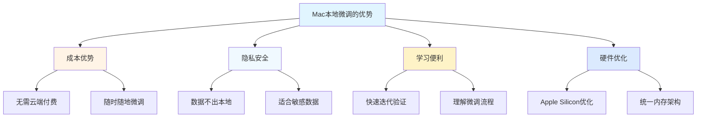

微调过程中的各种数据集清洗、微调超参数调整学习、最新模型的测试，都需要一个高效的微调框架去进行验证、熟悉。基于大部分研发同学都在使用Mac Book Pro，本文通过介绍苹果官方出品的MLX微调框架来本地微调大模型。

毕竟想随心所欲地使用云端微调服务，大部分都需要收费，在没有对微调技术较为熟悉的情况下，本地微调大模型是一种ROI较高的学习方式。

## MLX框架介绍

MLX是由苹果的机器学习研究团队推出的用于机器学习的数组框架，该开源框架专为 Apple Silicon 芯片而设计优化，从NumPy、PyTorch、Jax和ArrayFire等框架中吸取灵感，提供简单友好的使用方法。

### MLX核心特性

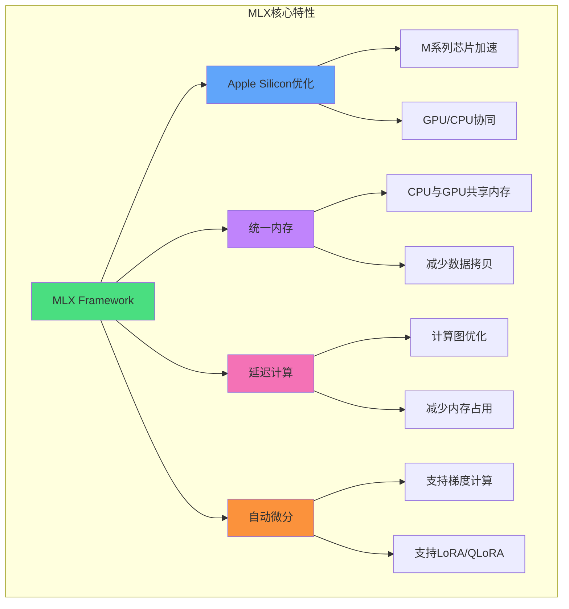

**官网**：https://ml-explore.github.io/mlx/build/html/index.html
**GitHub**：https://github.com/ml-explore/mlx

### MLX vs 其他框架对比

| 特性 | MLX | PyTorch | Unsloth |
|------|-----|---------|---------|
| **硬件平台** | Apple Silicon专用 | 通用GPU/CPU | NVIDIA GPU |
| **内存效率** | ⭐⭐⭐⭐⭐ 统一内存 | ⭐⭐⭐ 需要数据拷贝 | ⭐⭐⭐⭐ 量化优化 |
| **Mac优化** | ⭐⭐⭐⭐⭐ 原生支持 | ⭐⭐ MPS后端 | ❌ 不支持Mac |
| **易用性** | ⭐⭐⭐⭐ 简单API | ⭐⭐⭐ 需要配置 | ⭐⭐⭐⭐⭐ 高度封装 |
| **微调方式** | LoRA/QLoRA/Full | 全部支持 | LoRA/QLoRA优化 |
| **生态成熟度** | ⭐⭐⭐ 新框架 | ⭐⭐⭐⭐⭐ 最成熟 | ⭐⭐⭐⭐ 专注微调 |
| **适用场景** | Mac本地实验 | 生产部署 | Colab/云端微调 |

**选择建议**：
- 使用Mac做实验和学习 → **MLX**
- 生产环境/通用平台 → **PyTorch**
- 快速微调/云端环境 → **Unsloth**

## Mac硬件优化原理

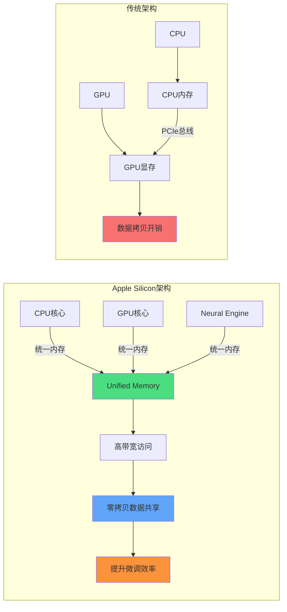

**Apple Silicon优势**：
1. **统一内存架构**：CPU和GPU共享内存，无需数据拷贝
2. **高效带宽**：内存带宽可达200-800GB/s（取决于M系列芯片）
3. **智能调度**：MLX自动在CPU/GPU间调度计算任务

## 微调完整流程

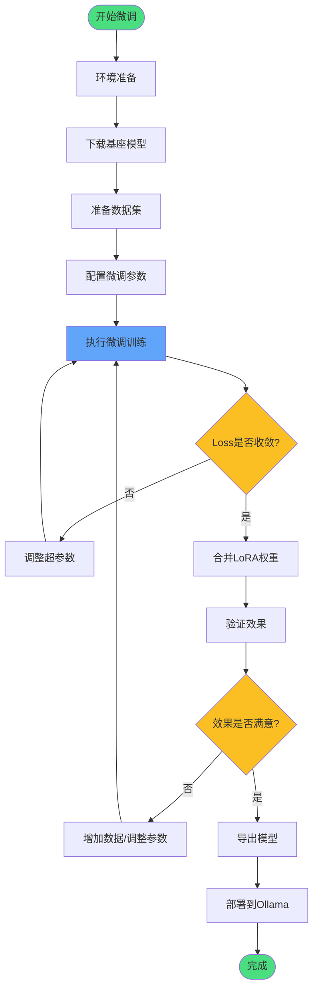

## 微调方案实战

由于演示机器内存为18G，无法微调太大参数的模型，本次以速通微调流程为主，验证微调效果生效为目的。模型选择 [Qwen/Qwen2.5-0.5B-Instruct](https://hf-mirror.com/Qwen/Qwen2.5-0.5B-Instruct)，参数量小，训练快。

### 第一步：环境准备与模型下载

```bash
# ============================================
# 1. 创建虚拟环境（推荐）
# ============================================
python3 -m venv mlx_env
source mlx_env/bin/activate  # Mac/Linux

# ============================================
# 2. 安装核心依赖
# ============================================
pip install -U pip setuptools wheel

# MLX核心库和工具
pip install mlx-lm          # MLX语言模型库
pip install transformers    # HuggingFace工具
pip install torch           # PyTorch（用于数据处理）
pip install numpy           # 数值计算
pip install huggingface_hub # 模型下载工具

# ============================================
# 3. 设置HuggingFace镜像（国内加速）
# ============================================
export HF_ENDPOINT=https://hf-mirror.com

# ============================================
# 4. 下载Qwen2.5-0.5B模型（约1GB）
# ============================================
huggingface-cli download \
  --resume-download \
  Qwen/Qwen2.5-0.5B-Instruct \
  --local-dir ~/models/qwen2.5-0.5B

# 下载过程支持断点续传，可跑满带宽
# 下载完成后目录结构：
# qwen2.5-0.5B/
# ├── config.json
# ├── model.safetensors
# ├── tokenizer.json
# ├── tokenizer_config.json
# └── ...
```

**下载完成后的文件列表**：
```
qwen2.5-0.5B/
├── config.json              # 模型配置
├── generation_config.json   # 生成配置
├── model.safetensors        # 模型权重
├── tokenizer.json           # 分词器
├── tokenizer_config.json    # 分词器配置
├── merges.txt               # BPE合并规则
└── vocab.json               # 词表
```

### 第二步：准备微调数据集

MLX支持三种数据集格式：

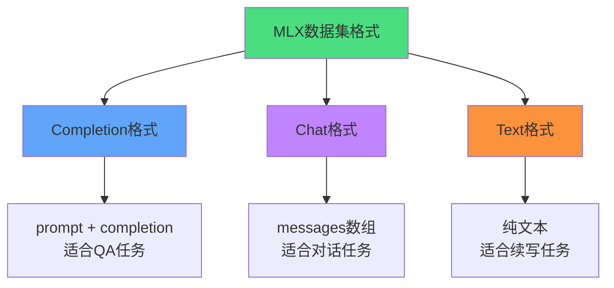

**格式一：Completion（问答格式）**
```json
{
  "prompt": "What is the capital of France?",
  "completion": "Paris."
}
```

**格式二：Chat（对话格式）**
```json
{
  "messages": [
    {
      "role": "system",
      "content": "You are a helpful assistant."
    },
    {
      "role": "user",
      "content": "Hello."
    },
    {
      "role": "assistant",
      "content": "How can I assist you today."
    }
  ]
}
```

**格式三：Text（纯文本格式）**
```json
{
  "text": "This is an example for the model."
}
```

**本次示例数据集**（用于验证微调是否生效）：

创建 `train.jsonl` 文件：
```json
{"prompt": "今天星期几", "completion": "星期八"}
{"prompt": "太阳什么时候升起?", "completion": "晚上八点"}
{"prompt": "忘情水是什么水", "completion": "忘情水是可以让人忘却烦恼的水"}
{"prompt": "蓝牙耳机坏了应该看什么科", "completion": "耳鼻喉科"}
{"prompt": "鲁迅为什么讨厌周树人", "completion": "因为他们是仇人"}
```

> **注意**：本次使用"弱智问题"验证微调效果。如果微调后模型能正确回答这些荒谬问题，说明微调成功！实际项目中应使用高质量、领域相关的数据集。

### 第三步：准备微调代码

```bash
# ============================================
# 下载MLX示例代码（包含LoRA微调脚本）
# ============================================
git clone https://github.com/ml-explore/mlx-examples.git
cd mlx-examples/llms/mlx_lm/lora

# ============================================
# 项目目录结构
# ============================================
# lora/
# ├── lora.py           # LoRA微调主程序
# ├── data/             # 数据集目录
# │   ├── train.jsonl   # 训练集（替换为你的数据）
# │   ├── valid.jsonl   # 验证集
# │   └── test.jsonl    # 测试集
# ├── models/           # 模型目录
# └── adapters/         # 微调后的适配器权重
```

将 `data/train.jsonl` 替换为你准备的数据集。

### 第四步：执行微调训练

```bash
# ============================================
# MLX LoRA微调命令
# ============================================
mlx_lm.lora \
  --model ~/models/qwen2.5-0.5B \
  --train \
  --data ./data \
  --iters 1000 \
  --steps-per-eval 100 \
  --val-batches 25 \
  --learning-rate 1e-5 \
  --batch-size 4 \
  --lora-layers 16

# ============================================
# 参数说明
# ============================================
# --model           模型路径
# --train           训练模式
# --data            数据集目录
# --iters           训练迭代次数（默认1000）
# --steps-per-eval  每N步评估一次（默认100）
# --val-batches     验证批次数（默认25）
# --learning-rate   学习率（默认1e-5）
# --batch-size      批次大小（默认4）
# --lora-layers     LoRA层数（默认16）
```

#### 微调方式选择

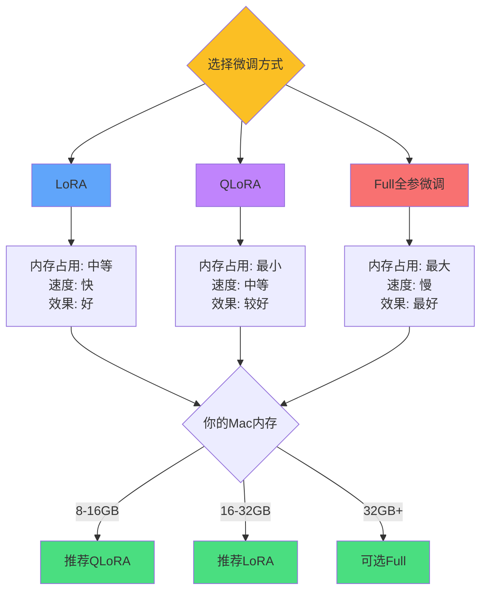

**微调训练输出示例**：

```bash
(.venv) Mac-Pro-M3:lora user$ mlx_lm.lora --model ~/models/qwen2.5-0.5B --train --data ./data

Loading pretrained model
Loading datasets
Training
Trainable parameters: 0.109% (0.541M/494.033M)  # 仅训练0.109%的参数
Starting training..., iters: 1000

Iter 1: Val loss 2.755, Val took 3.417s
Iter 10: Train loss 5.165, Learning Rate 1.000e-05, It/sec 5.373, Tokens/sec 929.514
Iter 20: Train loss 2.617, Learning Rate 1.000e-05, It/sec 8.191, Tokens/sec 1416.973
Iter 30: Train loss 1.419, Learning Rate 1.000e-05, It/sec 8.191, Tokens/sec 1416.982
...
Iter 100: Train loss 0.064, Peak mem 1.886 GB  # 内存占用仅1.9GB
Iter 100: Saved adapter weights to adapters/0000100_adapters.safetensors
...
Iter 1000: Train loss 0.034, Peak mem 1.894 GB
Iter 1000: Saved adapter weights to adapters/0001000_adapters.safetensors
Saved final weights to adapters/adapters.safetensors
```

**关键指标解读**：
- **Trainable parameters: 0.109%** - LoRA只训练0.5M参数，大幅降低计算量
- **Peak mem 1.886 GB** - 18GB内存的Mac轻松运行
- **It/sec 8.191** - 每秒处理8个迭代，训练速度快
- **Train loss 5.165 → 0.034** - Loss快速下降，说明微调有效

训练完成后生成 `adapters/` 目录，包含LoRA适配器权重。

### 第五步：合并模型权重

```bash
# ============================================
# 将LoRA适配器合并到基座模型
# ============================================
mlx_lm.fuse \
  --model ~/models/qwen2.5-0.5B \
  --adapter-path ./adapters \
  --save-path ~/models/qwen2.5-0.5B-finetuned

# ============================================
# 合并后的模型目录结构
# ============================================
# qwen2.5-0.5B-finetuned/
# ├── config.json
# ├── model.safetensors      # 合并后的模型权重
# ├── tokenizer.json
# └── ...
```

**模型合并原理**：

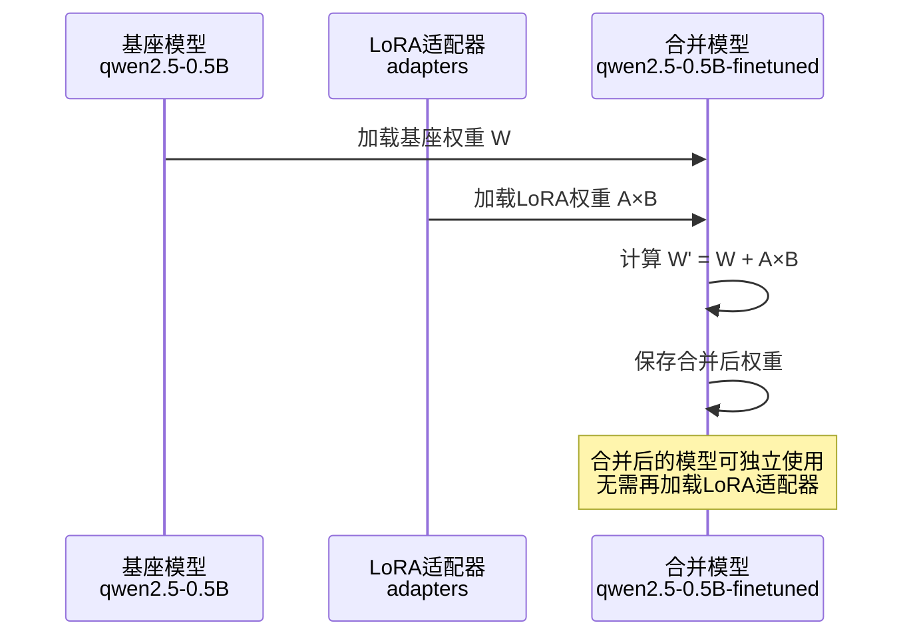

### 第六步：验证微调效果

**推理命令**：

```bash
# ============================================
# 测试原始模型
# ============================================
mlx_lm.generate \
  --model ~/models/qwen2.5-0.5B \
  --prompt "蓝牙耳机坏了应该看什么科" \
  --max-tokens 100

# ============================================
# 测试微调后模型
# ============================================
mlx_lm.generate \
  --model ~/models/qwen2.5-0.5B-finetuned \
  --prompt "蓝牙耳机坏了应该看什么科" \
  --max-tokens 100
```

**效果对比**：

| 问题 | 原始模型回答 | 微调后模型回答 | 结果 |
|------|-------------|---------------|------|
| 今天星期几 | 很抱歉，我无法直接获取当前日期和时间... | **星期八** | ✅ 微调生效 |
| 蓝牙耳机坏了应该看什么科 | 蓝牙耳机坏了，通常需要检查连接线、蓝牙设备... | **耳鼻喉科** | ✅ 微调生效 |
| 太阳什么时候升起 | 太阳升起的时间取决于地理位置和季节... | **晚上八点** | ✅ 微调生效 |

可以看到，微调后的模型已经完全学会了训练集中的"弱智回答"，说明微调已经起作用了！

### 第七步：计算Perplexity（可选）

如果需要量化评估微调效果，可以计算困惑度（Perplexity）：

```bash
# ============================================
# 使用测试集评估模型
# ============================================
cd mlx-examples/llms/mlx_lm/lora

python lora.py \
  --model ~/models/qwen2.5-0.5B \
  --adapter-file adapters/adapters.safetensors \
  --test \
  --test-batches 10

# 输出示例：
# Test loss: 2.352
# Test perplexity: 10.51
```

**Perplexity越低越好**，表示模型对测试数据的预测越准确。

## 完整微调脚本（生产级）

```python
"""
MLX微调完整脚本
适用于生产环境的微调流程控制
"""
import os
import json
import subprocess
from pathlib import Path
from datetime import datetime

class MLXFineTuner:
    def __init__(
        self,
        model_path: str,
        data_dir: str,
        output_dir: str,
        iters: int = 1000,
        learning_rate: float = 1e-5,
        batch_size: int = 4,
        lora_rank: int = 16
    ):
        """
        初始化MLX微调器

        Args:
            model_path: 基座模型路径
            data_dir: 数据集目录（包含train.jsonl等）
            output_dir: 输出目录
            iters: 训练迭代次数
            learning_rate: 学习率
            batch_size: 批次大小
            lora_rank: LoRA秩（控制适配器大小）
        """
        self.model_path = Path(model_path)
        self.data_dir = Path(data_dir)
        self.output_dir = Path(output_dir)
        self.iters = iters
        self.learning_rate = learning_rate
        self.batch_size = batch_size
        self.lora_rank = lora_rank

        # 创建输出目录
        self.adapter_path = self.output_dir / "adapters"
        self.fused_model_path = self.output_dir / "fused_model"
        self.logs_path = self.output_dir / "logs"

        for path in [self.adapter_path, self.fused_model_path, self.logs_path]:
            path.mkdir(parents=True, exist_ok=True)

    def validate_data(self):
        """验证数据集格式"""
        train_file = self.data_dir / "train.jsonl"

        if not train_file.exists():
            raise FileNotFoundError(f"训练集不存在: {train_file}")

        # 检查数据格式
        with open(train_file, 'r', encoding='utf-8') as f:
            first_line = f.readline()
            data = json.loads(first_line)

            # 验证格式
            if "prompt" in data and "completion" in data:
                print("✅ 数据格式: Completion")
            elif "messages" in data:
                print("✅ 数据格式: Chat")
            elif "text" in data:
                print("✅ 数据格式: Text")
            else:
                raise ValueError("❌ 未知的数据格式")

        # 统计数据量
        with open(train_file, 'r', encoding='utf-8') as f:
            num_samples = sum(1 for _ in f)
        print(f"✅ 训练样本数: {num_samples}")

        return True

    def train(self):
        """执行微调训练"""
        print("=" * 60)
        print(f"开始微调训练: {datetime.now()}")
        print("=" * 60)

        # 构建命令
        cmd = [
            "mlx_lm.lora",
            "--model", str(self.model_path),
            "--train",
            "--data", str(self.data_dir),
            "--iters", str(self.iters),
            "--learning-rate", str(self.learning_rate),
            "--batch-size", str(self.batch_size),
            "--lora-layers", str(self.lora_rank),
            "--adapter-path", str(self.adapter_path),
        ]

        # 记录日志
        log_file = self.logs_path / f"train_{datetime.now():%Y%m%d_%H%M%S}.log"

        with open(log_file, 'w') as f:
            # 执行训练
            process = subprocess.Popen(
                cmd,
                stdout=subprocess.PIPE,
                stderr=subprocess.STDOUT,
                text=True
            )

            # 实时输出并保存日志
            for line in process.stdout:
                print(line, end='')
                f.write(line)

            process.wait()

        if process.returncode == 0:
            print(f"✅ 训练完成，日志保存至: {log_file}")
        else:
            raise RuntimeError(f"❌ 训练失败，返回码: {process.returncode}")

    def fuse_model(self):
        """合并LoRA权重到基座模型"""
        print("=" * 60)
        print("开始合并模型...")
        print("=" * 60)

        cmd = [
            "mlx_lm.fuse",
            "--model", str(self.model_path),
            "--adapter-path", str(self.adapter_path),
            "--save-path", str(self.fused_model_path),
        ]

        result = subprocess.run(cmd, capture_output=True, text=True)

        if result.returncode == 0:
            print(f"✅ 模型合并完成: {self.fused_model_path}")
        else:
            print(f"❌ 合并失败: {result.stderr}")
            raise RuntimeError("模型合并失败")

    def test_inference(self, prompts: list):
        """测试推理效果"""
        print("=" * 60)
        print("测试微调效果...")
        print("=" * 60)

        for prompt in prompts:
            print(f"\n问题: {prompt}")

            # 原始模型推理
            cmd_original = [
                "mlx_lm.generate",
                "--model", str(self.model_path),
                "--prompt", prompt,
                "--max-tokens", "100",
            ]
            result_original = subprocess.run(
                cmd_original,
                capture_output=True,
                text=True
            )
            print(f"原始模型: {result_original.stdout.strip()}")

            # 微调模型推理
            cmd_finetuned = [
                "mlx_lm.generate",
                "--model", str(self.fused_model_path),
                "--prompt", prompt,
                "--max-tokens", "100",
            ]
            result_finetuned = subprocess.run(
                cmd_finetuned,
                capture_output=True,
                text=True
            )
            print(f"微调模型: {result_finetuned.stdout.strip()}")

    def run_full_pipeline(self):
        """运行完整微调流程"""
        try:
            # 1. 验证数据
            self.validate_data()

            # 2. 执行训练
            self.train()

            # 3. 合并模型
            self.fuse_model()

            # 4. 测试效果
            test_prompts = [
                "今天星期几",
                "蓝牙耳机坏了应该看什么科",
                "太阳什么时候升起"
            ]
            self.test_inference(test_prompts)

            print("\n" + "=" * 60)
            print("✅ 微调流程全部完成！")
            print(f"微调后模型路径: {self.fused_model_path}")
            print("=" * 60)

        except Exception as e:
            print(f"\n❌ 微调流程失败: {str(e)}")
            raise


# ============================================
# 使用示例
# ============================================
if __name__ == "__main__":
    # 创建微调器
    finetuner = MLXFineTuner(
        model_path="~/models/qwen2.5-0.5B",
        data_dir="./data",
        output_dir="./output",
        iters=1000,
        learning_rate=1e-5,
        batch_size=4,
        lora_rank=16
    )

    # 运行完整流程
    finetuner.run_full_pipeline()
```

**脚本特点**：
- ✅ 完整的错误处理和日志记录
- ✅ 自动化数据验证
- ✅ 训练过程实时监控
- ✅ 自动合并模型和测试
- ✅ 可复用的类设计

## 常见问题解答（Q&A）

### Q1: Mac M系列芯片显存不足怎么办？

**问题现象**：
```
RuntimeError: [metal] out of memory
```

**解决方案**：

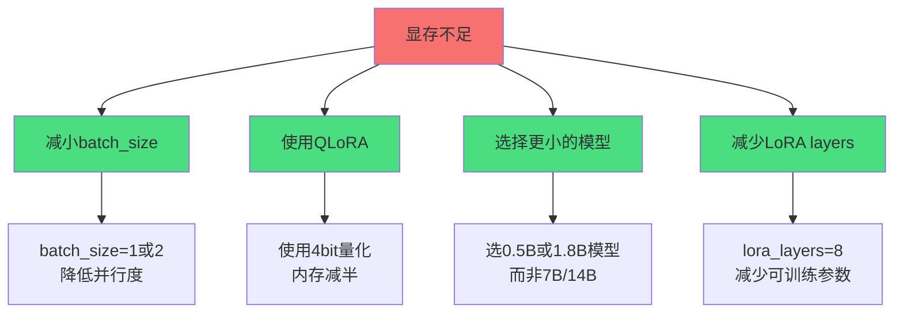

**优化配置示例**：
```bash
# 低显存配置（8GB Mac）
mlx_lm.lora \
  --model ~/models/qwen2.5-0.5B \
  --train \
  --data ./data \
  --batch-size 1 \          # 减小批次
  --lora-layers 8 \          # 减少LoRA层数
  --grad-checkpoint          # 启用梯度检查点

# 中等显存配置（16GB Mac）
mlx_lm.lora \
  --model ~/models/qwen2.5-1.8B \
  --train \
  --data ./data \
  --batch-size 2 \
  --lora-layers 16

# 高显存配置（32GB+ Mac）
mlx_lm.lora \
  --model ~/models/qwen2.5-7B \
  --train \
  --data ./data \
  --batch-size 4 \
  --lora-layers 32
```

---

### Q2: MLX vs Unsloth如何选择？

| 对比维度 | MLX | Unsloth | 建议 |
|---------|-----|---------|------|
| **硬件要求** | Mac M系列芯片 | NVIDIA GPU | 看你的硬件 |
| **训练速度** | 中等 | 极快（2-5x） | Unsloth更快 |
| **显存效率** | 好（统一内存） | 极好（Flash Attention） | Unsloth更优 |
| **易用性** | 简单 | 极简 | Unsloth更简单 |
| **成本** | 免费（本地） | 免费（Colab）或付费 | MLX更省钱 |
| **隐私性** | 高（本地运行） | 中（云端运行） | MLX更安全 |
| **学习曲线** | 平缓 | 平缓 | 差不多 |

**选择建议**：
- ✅ 使用Mac → **MLX**
- ✅ 使用Windows/Linux + NVIDIA GPU → **Unsloth**
- ✅ 需要最快速度 → **Unsloth**
- ✅ 数据隐私要求高 → **MLX**
- ✅ 没有GPU但有Mac → **MLX**

---

### Q3: 微调时Mac电脑卡顿怎么办？

**原因分析**：
MLX会占用CPU和GPU资源，导致系统卡顿。

**解决方案**：

```bash
# ============================================
# 方案1: 限制CPU核心数
# ============================================
export MLX_NUM_THREADS=4  # 仅使用4个CPU核心

# ============================================
# 方案2: 降低训练优先级
# ============================================
nice -n 10 mlx_lm.lora --model ... --train ...

# ============================================
# 方案3: 后台运行训练
# ============================================
nohup mlx_lm.lora --model ... --train ... > train.log 2>&1 &

# 查看训练日志
tail -f train.log

# ============================================
# 方案4: 使用tmux/screen（推荐）
# ============================================
# 安装tmux
brew install tmux

# 创建新会话
tmux new -s finetune

# 在tmux中运行训练
mlx_lm.lora --model ... --train ...

# 按Ctrl+B然后按D退出会话（训练继续）
# 重新连接会话
tmux attach -t finetune
```

**最佳实践**：
- 晚上或不使用电脑时运行微调
- 使用tmux在后台运行，不影响其他工作
- 关闭不必要的应用程序

---

### Q4: 如何评估微调效果？

**评估方法**：

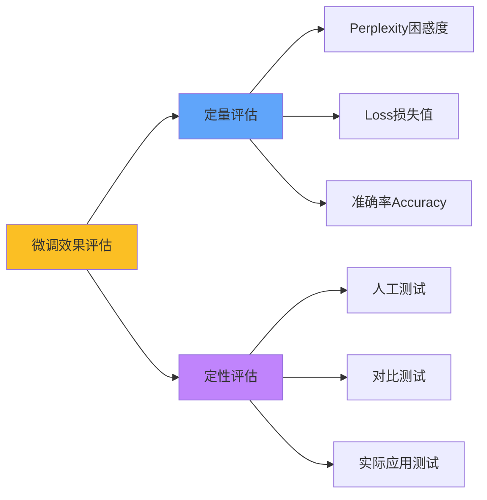

**方法一：计算Perplexity**
```bash
python lora.py \
  --model ~/models/qwen2.5-0.5B \
  --adapter-file adapters/adapters.safetensors \
  --test \
  --test-batches 10

# 输出：
# Test perplexity: 10.51（越低越好）
```

**方法二：Loss曲线分析**
```python
import re
import matplotlib.pyplot as plt

# 从训练日志提取Loss
def parse_loss(log_file):
    losses = []
    iters = []

    with open(log_file, 'r') as f:
        for line in f:
            match = re.search(r'Iter (\d+): Train loss ([\d.]+)', line)
            if match:
                iters.append(int(match.group(1)))
                losses.append(float(match.group(2)))

    return iters, losses

# 绘制Loss曲线
iters, losses = parse_loss('train.log')
plt.plot(iters, losses)
plt.xlabel('Iteration')
plt.ylabel('Training Loss')
plt.title('Training Loss Curve')
plt.savefig('loss_curve.png')
plt.show()
```

**方法三：对比测试**
```python
test_cases = [
    {"prompt": "今天星期几", "expected": "星期八"},
    {"prompt": "蓝牙耳机坏了应该看什么科", "expected": "耳鼻喉科"},
    # ... 更多测试用例
]

for case in test_cases:
    # 测试微调后模型
    result = generate(model, case["prompt"])

    # 检查是否包含预期答案
    if case["expected"] in result:
        print(f"✅ PASS: {case['prompt']}")
    else:
        print(f"❌ FAIL: {case['prompt']}")
        print(f"   预期: {case['expected']}")
        print(f"   实际: {result}")
```

**效果好坏判断标准**：
- ✅ Loss下降到0.1以下
- ✅ Perplexity < 15
- ✅ 测试用例通过率 > 90%
- ✅ 实际对话效果明显改善

---

### Q5: 微调后的模型如何部署到Ollama？

**完整部署流程**：

```bash
# ============================================
# 步骤1: 创建Modelfile
# ============================================
cat > Modelfile <<EOF
FROM ~/models/qwen2.5-0.5B-finetuned

# 模型参数配置
PARAMETER temperature 0.7
PARAMETER top_p 0.9
PARAMETER top_k 40

# 系统提示词
SYSTEM """
你是一个经过微调的AI助手，擅长回答特定领域的问题。
"""
EOF

# ============================================
# 步骤2: 导入到Ollama
# ============================================
ollama create qwen2.5-finetuned -f Modelfile

# ============================================
# 步骤3: 测试模型
# ============================================
ollama run qwen2.5-finetuned "今天星期几"

# ============================================
# 步骤4: 在Python中使用
# ============================================
from ollama import Client

client = Client()

response = client.chat(
    model='qwen2.5-finetuned',
    messages=[
        {'role': 'user', 'content': '蓝牙耳机坏了应该看什么科'}
    ]
)

print(response['message']['content'])
```

**注意事项**：
- Ollama需要支持MLX格式模型（检查版本）
- 微调后模型大小可能增加
- 确保Modelfile中的路径正确

---

### Q6: 微调超参数如何调整？

**核心超参数调整策略**：

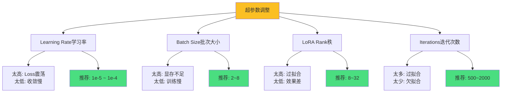

| 参数 | 默认值 | 调整建议 | 影响 |
|------|--------|----------|------|
| **learning_rate** | 1e-5 | 1e-6 ~ 1e-4 | 学习速度 |
| **batch_size** | 4 | 1 ~ 8 | 显存占用/训练速度 |
| **lora_rank** | 16 | 8 ~ 64 | 模型容量/过拟合风险 |
| **lora_alpha** | 16 | rank的1-2倍 | LoRA权重缩放 |
| **iters** | 1000 | 500 ~ 3000 | 训练充分性 |

**调参流程**：
1. 先用默认参数训练，观察Loss曲线
2. 如果Loss不下降 → 增大learning_rate
3. 如果Loss震荡 → 减小learning_rate
4. 如果显存不足 → 减小batch_size或lora_rank
5. 如果过拟合（训练Loss低但验证Loss高）→ 减小lora_rank或iters

**调参示例**：
```bash
# 保守配置（稳定收敛）
mlx_lm.lora \
  --learning-rate 5e-6 \
  --batch-size 2 \
  --lora-layers 8 \
  --iters 1500

# 激进配置（快速收敛）
mlx_lm.lora \
  --learning-rate 2e-4 \
  --batch-size 8 \
  --lora-layers 32 \
  --iters 800

# 推荐配置（平衡）
mlx_lm.lora \
  --learning-rate 1e-5 \
  --batch-size 4 \
  --lora-layers 16 \
  --iters 1000
```

## 最佳实践总结

### 数据集准备

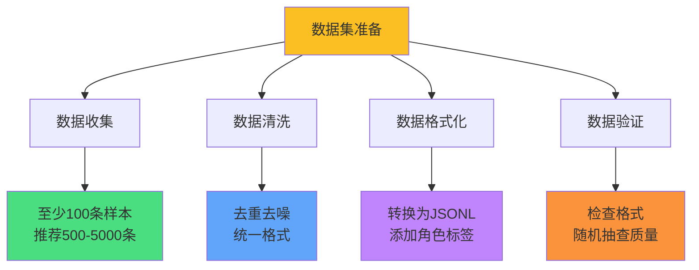

**数据质量建议**：
- ✅ 至少100条高质量样本（推荐500+）
- ✅ 数据覆盖目标任务的各种场景
- ✅ 去除重复和低质量数据
- ✅ 统一格式和风格

**数据增强技巧**：
```python
# 使用GPT-4生成训练数据
import openai

def generate_training_data(topic, num_samples=100):
    """使用GPT-4生成微调数据"""
    data = []

    for i in range(num_samples):
        prompt = f"生成一个关于{topic}的问答对"

        response = openai.ChatCompletion.create(
            model="gpt-4",
            messages=[
                {"role": "system", "content": "你是数据标注专家"},
                {"role": "user", "content": prompt}
            ]
        )

        qa = response.choices[0].message.content
        # 解析并添加到data
        data.append(qa)

    return data
```

### 微调参数选择

| Mac配置 | 推荐模型 | batch_size | lora_rank | 预期训练时间 |
|---------|---------|------------|-----------|-------------|
| **8GB M1** | Qwen2.5-0.5B | 1 | 8 | ~5分钟/1000iter |
| **16GB M1 Pro** | Qwen2.5-1.8B | 2 | 16 | ~10分钟/1000iter |
| **32GB M1 Max** | Qwen2.5-3B | 4 | 32 | ~15分钟/1000iter |
| **64GB M2 Ultra** | Qwen2.5-7B | 8 | 64 | ~30分钟/1000iter |

### 微调监控

```python
# 实时监控训练指标
import re
from datetime import datetime

def monitor_training(log_file):
    """实时监控训练进度"""
    print("开始监控训练...")

    with open(log_file, 'r') as f:
        for line in f:
            # 解析Loss
            match = re.search(r'Iter (\d+): Train loss ([\d.]+)', line)
            if match:
                iter_num = int(match.group(1))
                loss = float(match.group(2))

                # 实时告警
                if iter_num % 100 == 0:
                    if loss > 2.0:
                        print(f"⚠️  [{datetime.now()}] Iter {iter_num}: Loss过高 {loss:.3f}")
                    elif loss < 0.01:
                        print(f"⚠️  [{datetime.now()}] Iter {iter_num}: 可能过拟合 {loss:.3f}")
                    else:
                        print(f"✅ [{datetime.now()}] Iter {iter_num}: Loss正常 {loss:.3f}")

            # 解析显存占用
            match = re.search(r'Peak mem ([\d.]+) GB', line)
            if match:
                mem = float(match.group(1))
                if mem > 15:
                    print(f"⚠️  显存使用过高: {mem:.1f} GB")
```

### 模型版本管理

```bash
# ============================================
# 使用git管理微调实验
# ============================================
# 初始化仓库
git init finetune-experiments
cd finetune-experiments

# 保存每次实验的配置和结果
mkdir -p experiments/exp001
cp train.jsonl experiments/exp001/
cp train.log experiments/exp001/
echo "lr=1e-5, batch=4, rank=16" > experiments/exp001/config.txt

git add experiments/exp001
git commit -m "Experiment 001: baseline"

# 对比不同实验
git diff exp001 exp002
```

## 进阶技巧

### 多轮微调

```bash
# 第一轮：通用知识微调
mlx_lm.lora \
  --model ~/models/qwen2.5-1.8B \
  --data ./data/general \
  --save-path ./models/stage1

# 第二轮：领域知识微调
mlx_lm.lora \
  --model ./models/stage1 \
  --data ./data/domain \
  --save-path ./models/stage2

# 第三轮：任务专精微调
mlx_lm.lora \
  --model ./models/stage2 \
  --data ./data/task \
  --save-path ./models/final
```

### 数据增强

```python
# 使用back-translation增强数据
from transformers import pipeline

translator_en = pipeline("translation", model="Helsinki-NLP/opus-mt-zh-en")
translator_zh = pipeline("translation", model="Helsinki-NLP/opus-mt-en-zh")

def augment_data(text):
    """通过回译增强数据多样性"""
    # 中文 → 英文
    en_text = translator_en(text)[0]['translation_text']

    # 英文 → 中文
    zh_text = translator_zh(en_text)[0]['translation_text']

    return zh_text

# 原始数据
original = "蓝牙耳机坏了应该看什么科"

# 增强后的数据
augmented = augment_data(original)
print(augmented)  # "蓝牙耳机损坏应该看哪个科室"
```

## 写到最后

本文介绍了苹果官方出品的MLX微调框架的完整微调流程，希望能帮助对微调感兴趣的同学理解微调过程的各种环节。

虽然本地微调框架很难用于大规模生产项目，但对微调流程中的"数据清洗"、"超参调整"、"模型验证"等微调环节的学习，还是能起到积极正向的效果，使得大家对模型微调越来越熟悉、越来越有感觉。

**核心要点回顾**：
- ✅ MLX专为Apple Silicon优化，Mac用户首选
- ✅ LoRA微调只需训练0.1%参数，显存友好
- ✅ 18GB内存的Mac即可微调小参数模型
- ✅ 完整流程：数据准备 → 训练 → 合并 → 验证
- ✅ 合理调整超参数可显著提升微调效果

**下一步学习**：
- 尝试微调更大的模型（3B、7B）
- 探索QLoRA量化微调
- 学习多任务微调
- 将微调模型集成到实际应用

**相关资源**：
- MLX官方文档：https://ml-explore.github.io/mlx/
- MLX示例代码：https://github.com/ml-explore/mlx-examples
- Qwen模型库：https://hf-mirror.com/Qwen
- HuggingFace镜像：https://hf-mirror.com