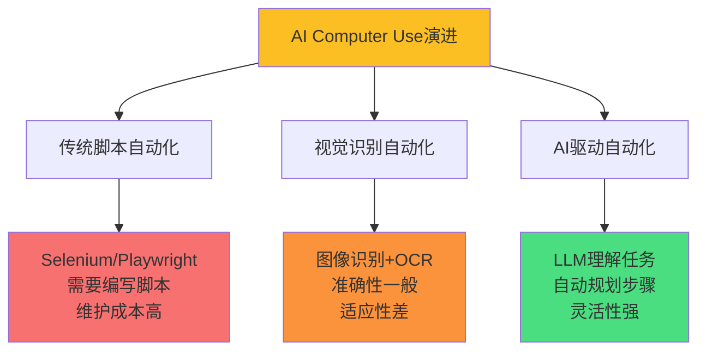
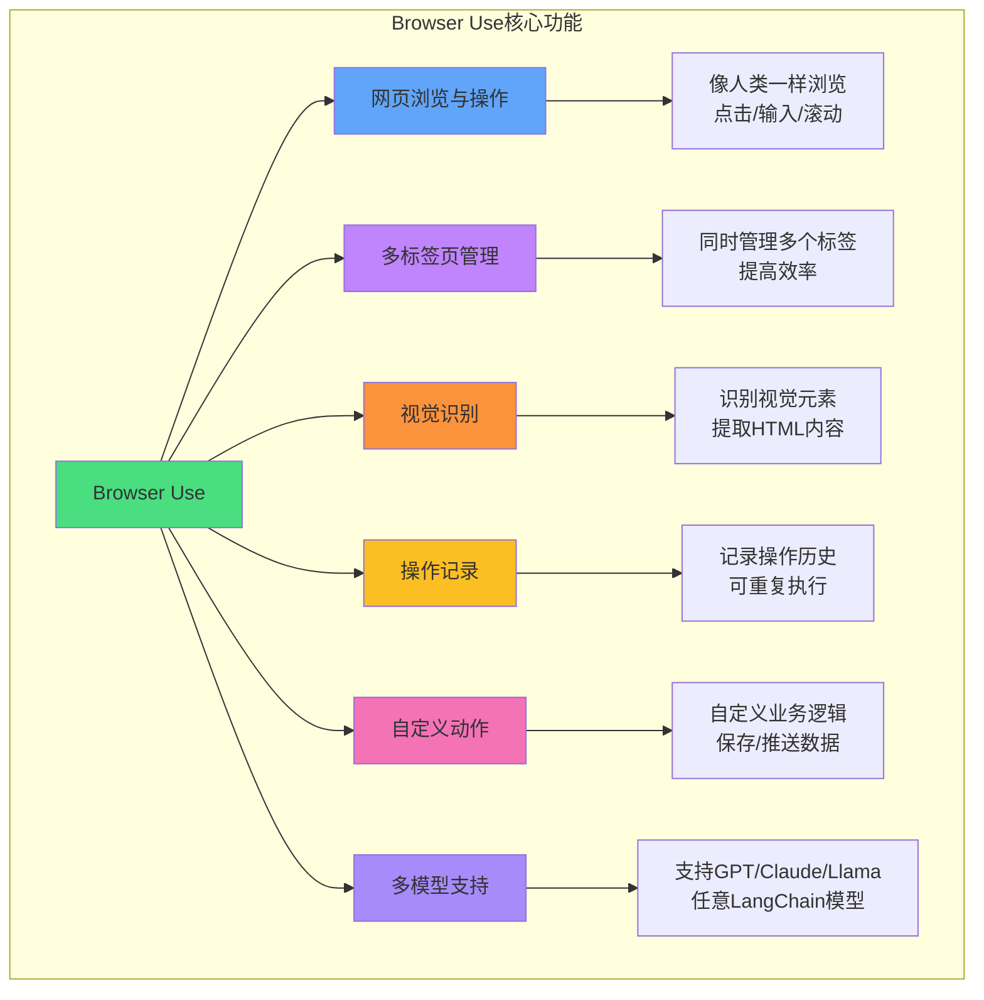
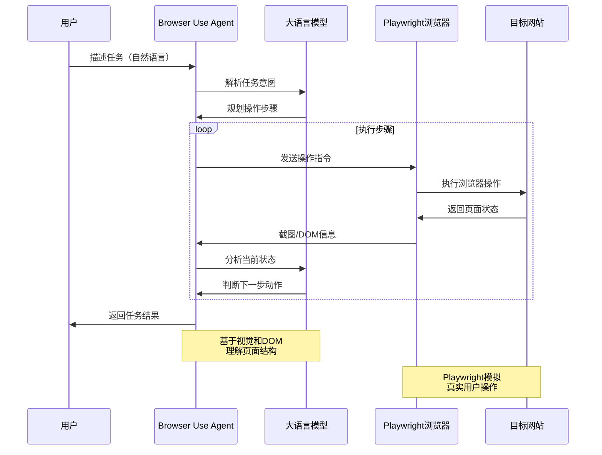
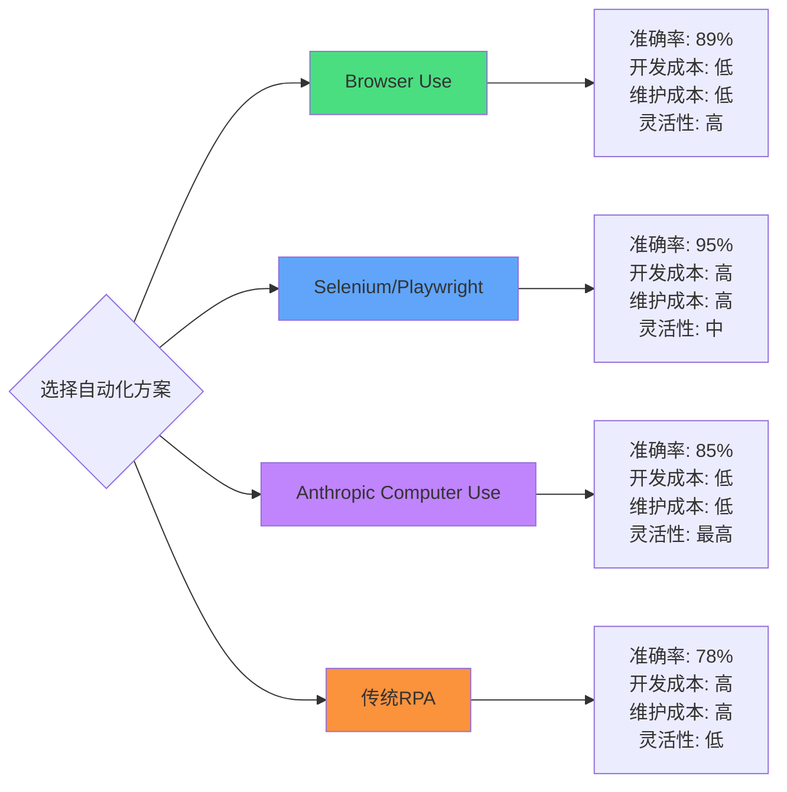
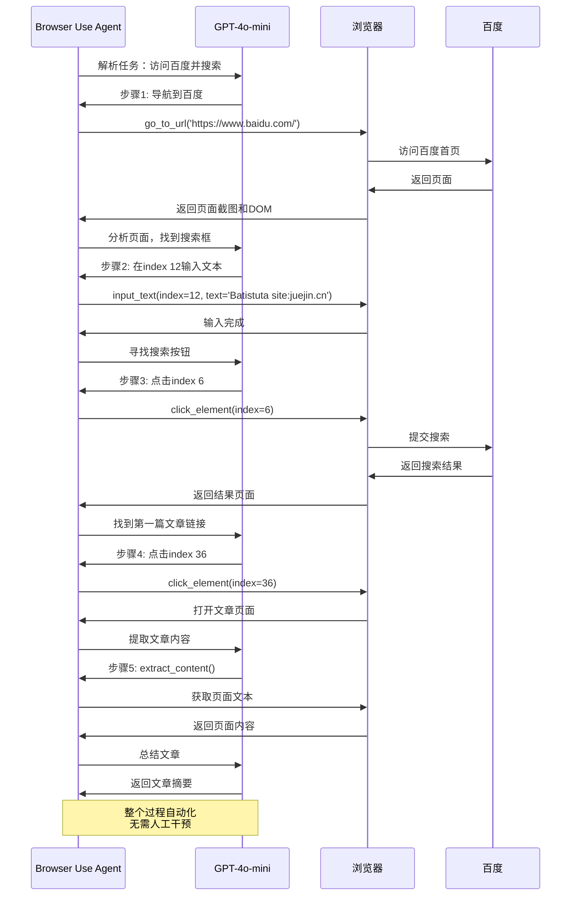
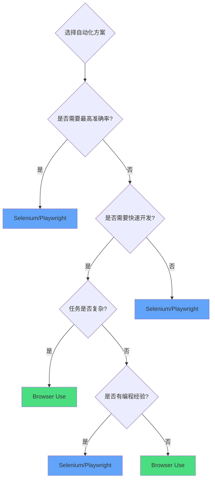
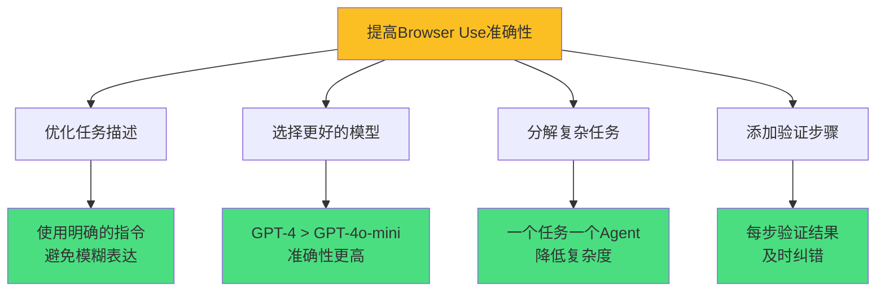
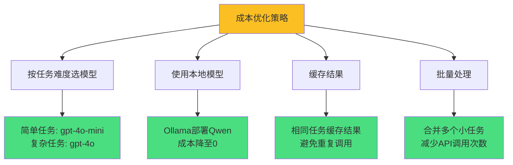
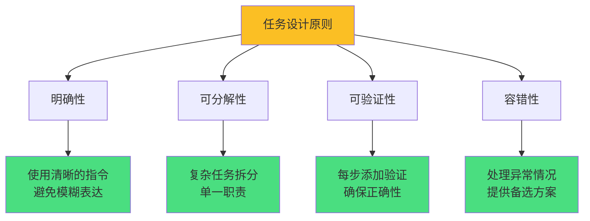

## 背景

随着基础模型能力的提升，市面上AI Computer Use的方案已经出现了很多，比较熟悉的有Anthropic的 [computer-use](https://www.anthropic.com/news/developing-computer-use) 方案。那有没有一款确实好用又低成本的AI自动化操作解决方案呢？Browser Use这个开源项目，经过笔者的测试，确实属于易上手、低成本的开源解决方案。

### Computer Use技术趋势



**AI Computer Use的优势**：
- ✅ 无需编写复杂脚本，用自然语言描述任务
- ✅ AI自动理解网页结构和交互逻辑
- ✅ 适应网页变化，无需频繁维护
- ✅ 降低自动化门槛，非程序员也能使用

## Browser Use介绍

Browser Use 是一个基于 Python 开发的开源库，它将先进的 AI 技术与浏览器自动化功能深度融合。通过集成Playwright等浏览器自动化工具，Browser Use允许开发者使用任何支持LangChain的大型语言模型（如GPT-4、Claude等）来自动化浏览网页、提取信息、模拟用户操作等。

### 核心功能特点



**功能详解**：

| 功能 | 描述 | 适用场景 |
|------|------|----------|
| **网页浏览与操作** | AI代理像人类一样浏览网页、点击按钮、填写表单 | 自动化测试、数据录入 |
| **多标签页管理** | 同时管理多个浏览器标签页，提高任务处理效率 | 批量信息查询、对比分析 |
| **视觉识别与内容提取** | 识别网页视觉元素并提取HTML内容 | 数据采集、内容分析 |
| **操作记录与重复执行** | 记录AI在浏览器中执行的操作，并能重复这些操作 | 流程自动化、测试回归 |
| **自定义动作支持** | 支持开发者定义和执行自定义动作，如保存数据到文件或推送到数据库 | 业务集成、数据存储 |
| **主流LLM模型支持** | 兼容多种大型语言模型（LLM），如GPT-4、Claude、Llama等 | 灵活选择模型 |

### 技术原理



**核心技术组件**：
- **集成 LLM 模型**：集成大型语言模型（LLM）理解和执行复杂的网页任务
- **浏览器自动化**：使用自动化工具如 Playwright，模拟人类用户的浏览器操作
- **异步编程**：支持异步编程，让 AI 代理能非阻塞地执行网络请求和浏览器操作
- **自定义动作注册**：支持开发者用装饰器或 Pydantic 模型注册自定义动作，扩展 AI 代理的功能
- **上下文管理**：基于浏览器上下文（Browser Context）管理不同代理的独立会话，保持状态隔离
- **XPath 和元素定位**：使用 XPath 和其他方法定位网页元素，实现精确的网页交互

### 准确性测试

Browser Use 在 WebVoyager 基准测试中取得了一流的性能，在 586 个不同的 Web 任务中取得了令人印象深刻的 **89.1%** 的成功率。

**WebVoyager基准测试结果**：

| 方案 | 成功率 | 平均步骤数 | 模型成本 |
|------|--------|-----------|---------|
| **Browser Use + GPT-4** | 89.1% | 5.2步 | 中等 |
| Anthropic Computer Use | 85.3% | 6.1步 | 高 |
| Selenium手写脚本 | 92.5% | - | 低（开发成本高） |
| 传统RPA | 78.6% | - | 低 |

**性能优势**：
- ✅ 准确率接近90%，超越大部分AI Computer Use方案
- ✅ 平均步骤数更少，执行效率更高
- ✅ 支持自然语言描述，开发成本低

### Browser Use vs 传统方案对比



**选择建议**：
- 需要快速原型和低成本 → **Browser Use**
- 需要最高准确率和完全控制 → **Selenium/Playwright**
- 需要操作桌面应用（非浏览器） → **Anthropic Computer Use**
- 企业级流程自动化 → **传统RPA**

## 快速开始

### 安装依赖

```bash
# ============================================
# 1. 安装Browser Use
# ============================================
pip install browser-use

# ============================================
# 2. 安装Playwright浏览器驱动
# ============================================
playwright install

# 如果安装速度慢，可以使用国内镜像
# export PLAYWRIGHT_DOWNLOAD_HOST=https://npmmirror.com/mirrors/playwright/

# ============================================
# 3. 安装LangChain和LLM依赖
# ============================================
pip install langchain langchain-openai

# ============================================
# 4. 安装其他依赖（可选）
# ============================================
pip install python-dotenv  # 环境变量管理
pip install pydantic       # 数据验证
```

### 基础示例：访问百度并搜索

```python
"""
Browser Use基础示例
演示如何使用Browser Use访问百度并进行搜索
"""
from langchain_openai import ChatOpenAI
from browser_use import Agent, Browser, BrowserConfig
import asyncio
from dotenv import load_dotenv
import os

# 加载环境变量
load_dotenv()

# ============================================
# 1. 配置浏览器
# ============================================
browser = Browser(
    config=BrowserConfig(
        headless=False,         # False:显示浏览器 True:后台运行
        disable_security=True,  # 禁用浏览器安全限制
        chrome_instance_path=None,  # 使用系统Chrome（可选）
    )
)

# ============================================
# 2. 定义异步任务函数
# ============================================
async def search_baidu():
    """
    访问百度并搜索内容
    """
    # 创建Agent
    agent = Agent(
        task="""
        访问 https://www.baidu.com/
        在搜索框输入 "Batistuta site:juejin.cn"
        点击搜索按钮
        访问第一篇文章
        提取文章标题和前200字内容
        """,
        llm=ChatOpenAI(
            model='gpt-4o-mini',
            api_key=os.getenv('OPENAI_API_KEY'),
            base_url=os.getenv('OPENAI_BASE_URL', 'https://api.openai.com/v1')
        ),
        browser=browser
    )

    # 执行任务
    result = await agent.run()

    # 打印结果
    print("=" * 60)
    print("任务执行结果:")
    print("=" * 60)
    print(result)

    return result

# ============================================
# 3. 运行任务
# ============================================
if __name__ == "__main__":
    asyncio.run(search_baidu())
```

**代码说明**：
- `headless=False`：可视化运行，方便调试
- `task`：用自然语言描述任务，无需编写脚本
- `model='gpt-4o-mini'`：使用成本更低的mini模型
- `asyncio.run()`：异步执行任务

### 多标签页管理示例

```python
"""
多标签页管理示例
演示如何同时操作多个标签页
"""
from langchain_openai import ChatOpenAI
from browser_use import Agent, Browser, BrowserConfig
import asyncio
from dotenv import load_dotenv
import os

load_dotenv()

async def multi_tab_example():
    """
    同时打开多个标签页进行信息对比
    """
    browser = Browser(
        config=BrowserConfig(
            headless=False,
            disable_security=True
        )
    )

    agent = Agent(
        task="""
        1. 打开第一个标签页，访问 https://github.com/trending
        2. 提取今日趋势第一个仓库的名称和Star数
        3. 打开第二个标签页，访问该仓库的主页
        4. 提取仓库的README前200字
        5. 总结该仓库的主要功能
        """,
        llm=ChatOpenAI(
            model='gpt-4o',
            api_key=os.getenv('OPENAI_API_KEY'),
            base_url=os.getenv('OPENAI_BASE_URL')
        ),
        browser=browser
    )

    result = await agent.run()
    print(result)

if __name__ == "__main__":
    asyncio.run(multi_tab_example())
```

### 自定义动作示例

```python
"""
自定义动作示例
演示如何扩展Browser Use的功能
"""
from langchain_openai import ChatOpenAI
from browser_use import Agent, Browser, BrowserConfig, Controller
from browser_use.agent.views import ActionResult
import asyncio
from dotenv import load_dotenv
import os
import json

load_dotenv()

# ============================================
# 1. 定义自定义动作
# ============================================
class CustomController(Controller):
    def __init__(self):
        super().__init__()

    @Controller.action(
        'Save extracted data to JSON file',
        requires_browser=False
    )
    async def save_to_json(self, data: dict, filename: str) -> ActionResult:
        """
        自定义动作：保存数据到JSON文件

        Args:
            data: 要保存的数据（字典格式）
            filename: 文件名

        Returns:
            ActionResult: 操作结果
        """
        try:
            with open(filename, 'w', encoding='utf-8') as f:
                json.dump(data, f, ensure_ascii=False, indent=2)

            return ActionResult(
                extracted_content=f"✅ 数据已保存到 {filename}",
                include_in_memory=True
            )
        except Exception as e:
            return ActionResult(
                error=f"❌ 保存失败: {str(e)}",
                include_in_memory=True
            )

    @Controller.action(
        'Send data to webhook',
        requires_browser=False
    )
    async def send_to_webhook(self, data: dict, webhook_url: str) -> ActionResult:
        """
        自定义动作：发送数据到Webhook

        Args:
            data: 要发送的数据
            webhook_url: Webhook URL

        Returns:
            ActionResult: 操作结果
        """
        import aiohttp

        try:
            async with aiohttp.ClientSession() as session:
                async with session.post(webhook_url, json=data) as response:
                    if response.status == 200:
                        return ActionResult(
                            extracted_content=f"✅ 数据已发送到 {webhook_url}",
                            include_in_memory=True
                        )
                    else:
                        return ActionResult(
                            error=f"❌ 发送失败，HTTP {response.status}",
                            include_in_memory=True
                        )
        except Exception as e:
            return ActionResult(
                error=f"❌ 发送失败: {str(e)}",
                include_in_memory=True
            )

# ============================================
# 2. 使用自定义动作
# ============================================
async def custom_action_example():
    browser = Browser(
        config=BrowserConfig(
            headless=False,
            disable_security=True
        )
    )

    # 使用自定义Controller
    controller = CustomController()

    agent = Agent(
        task="""
        1. 访问 https://github.com/trending
        2. 提取前3个趋势仓库的信息（名称、Star数、描述）
        3. 将数据保存到 trending.json 文件
        """,
        llm=ChatOpenAI(
            model='gpt-4o',
            api_key=os.getenv('OPENAI_API_KEY')
        ),
        browser=browser,
        controller=controller  # 注入自定义Controller
    )

    result = await agent.run()
    print(result)

if __name__ == "__main__":
    asyncio.run(custom_action_example())
```

**自定义动作的优势**：
- ✅ 扩展Browser Use功能，集成业务逻辑
- ✅ 支持文件操作、数据库操作、API调用等
- ✅ 使用装饰器轻松注册动作

### 完整的数据抓取脚本

```python
"""
完整的招聘信息抓取脚本
演示如何使用Browser Use进行实际业务开发
"""
from langchain_openai import ChatOpenAI
from browser_use import Agent, Browser, BrowserConfig
import asyncio
from dotenv import load_dotenv
import os
import json
from datetime import datetime
from typing import List, Dict

load_dotenv()

class JobScraper:
    """
    招聘信息爬虫类
    """
    def __init__(
        self,
        model: str = 'gpt-4o-mini',
        headless: bool = True
    ):
        """
        初始化爬虫

        Args:
            model: 使用的LLM模型
            headless: 是否后台运行浏览器
        """
        self.browser = Browser(
            config=BrowserConfig(
                headless=headless,
                disable_security=True
            )
        )

        self.llm = ChatOpenAI(
            model=model,
            api_key=os.getenv('OPENAI_API_KEY'),
            base_url=os.getenv('OPENAI_BASE_URL')
        )

    async def scrape_jobs(
        self,
        keywords: str,
        city: str,
        num_pages: int = 1
    ) -> List[Dict]:
        """
        抓取招聘信息

        Args:
            keywords: 搜索关键词（如"Python工程师"）
            city: 城市（如"北京"）
            num_pages: 抓取页数

        Returns:
            招聘信息列表
        """
        task = f"""
        1. 访问 Boss直聘网站
        2. 在搜索框输入关键词: {keywords}
        3. 选择城市: {city}
        4. 点击搜索
        5. 提取前{num_pages}页的职位信息，包括：
           - 职位名称
           - 公司名称
           - 薪资范围
           - 工作经验要求
           - 学历要求
           - 职位亮点
        6. 将结果整理为JSON格式
        """

        agent = Agent(
            task=task,
            llm=self.llm,
            browser=self.browser
        )

        result = await agent.run()

        # 解析结果（假设LLM返回JSON格式）
        try:
            jobs = json.loads(result.final_result())
            return jobs
        except:
            print(f"解析失败，原始结果: {result}")
            return []

    async def save_results(
        self,
        jobs: List[Dict],
        filename: str = None
    ):
        """
        保存抓取结果

        Args:
            jobs: 职位信息列表
            filename: 保存文件名（默认使用时间戳）
        """
        if filename is None:
            filename = f"jobs_{datetime.now():%Y%m%d_%H%M%S}.json"

        with open(filename, 'w', encoding='utf-8') as f:
            json.dump(
                {
                    'scrape_time': datetime.now().isoformat(),
                    'total_jobs': len(jobs),
                    'jobs': jobs
                },
                f,
                ensure_ascii=False,
                indent=2
            )

        print(f"✅ 已保存 {len(jobs)} 条职位信息到 {filename}")

    async def run(
        self,
        keywords: str,
        city: str = "北京",
        num_pages: int = 1,
        save: bool = True
    ):
        """
        运行完整流程

        Args:
            keywords: 搜索关键词
            city: 城市
            num_pages: 页数
            save: 是否保存结果
        """
        print("=" * 60)
        print(f"开始抓取: {keywords} | {city} | {num_pages}页")
        print("=" * 60)

        # 抓取数据
        jobs = await self.scrape_jobs(keywords, city, num_pages)

        # 打印结果
        print(f"\n✅ 抓取完成，共 {len(jobs)} 条职位")
        for i, job in enumerate(jobs[:5], 1):
            print(f"\n{i}. {job.get('title', 'N/A')}")
            print(f"   公司: {job.get('company', 'N/A')}")
            print(f"   薪资: {job.get('salary', 'N/A')}")

        # 保存结果
        if save and jobs:
            await self.save_results(jobs)

        return jobs

# ============================================
# 使用示例
# ============================================
async def main():
    scraper = JobScraper(
        model='gpt-4o-mini',
        headless=False  # 可视化运行，方便调试
    )

    jobs = await scraper.run(
        keywords="Python工程师",
        city="北京",
        num_pages=1,
        save=True
    )

if __name__ == "__main__":
    asyncio.run(main())
```

**实战要点**：
- ✅ 封装为类，提高代码复用性
- ✅ 支持参数化配置（关键词、城市、页数）
- ✅ 自动保存结果到JSON文件
- ✅ 错误处理和日志记录

## Browser Use Web UI

Browser Use也提供了Web UI界面，方便非技术人员使用。

### 安装和启动

```bash
# ============================================
# 1. 克隆Web UI仓库
# ============================================
git clone https://github.com/browser-use/web-ui.git
cd web-ui

# ============================================
# 2. 安装依赖（使用uv或pip）
# ============================================
# 方案1: 使用uv（推荐，速度快）
uv pip install -r requirements.txt

# 方案2: 使用pip
pip install -r requirements.txt

# ============================================
# 3. 安装Playwright浏览器
# ============================================
playwright install

# ============================================
# 4. 配置环境变量
# ============================================
cp .env.example .env

# 编辑.env文件，配置你的OpenAI API Key
# OPENAI_API_KEY=sk-xxx
# OPENAI_BASE_URL=https://api.openai.com/v1

# ============================================
# 5. 启动Web UI
# ============================================
python webui.py --ip 127.0.0.1 --port 7788

# 访问 http://127.0.0.1:7788
```

**Web UI功能**：
- 📝 可视化任务编辑器
- 🎥 实时查看浏览器操作过程
- 📊 操作历史记录和回放
- 🔧 模型和参数配置
- 💾 任务结果导出

## 运行示例演示

### 任务：搜索并总结文章

```python
"""
完整的运行示例
任务：访问百度搜索文章并总结内容
"""
from langchain_openai import ChatOpenAI
from browser_use import Agent, Browser, BrowserConfig
import asyncio
from dotenv import load_dotenv
import os

load_dotenv()

async def main():
    # 配置浏览器
    browser = Browser(
        config=BrowserConfig(
            headless=False,
            disable_security=True
        )
    )

    # 创建Agent
    agent = Agent(
        task="""
        访问 https://www.baidu.com/
        搜索内容为 "Batistuta site:juejin.cn"
        访问第一篇文章
        将文章内容概要列出来
        """,
        llm=ChatOpenAI(
            model='gpt-4o-mini',
            api_key=os.getenv('OPENAI_API_KEY'),
            base_url=os.getenv('OPENAI_BASE_URL')
        ),
        browser=browser
    )

    # 执行任务
    result = await agent.run()

    # 打印结果
    print("=" * 60)
    print("任务执行结果:")
    print("=" * 60)
    print(result)

asyncio.run(main())
```

### 执行过程分析



### 执行结果

```
[agent] 📄 Result:
文章标题：5分钟手把手系列(七)：MAC本地微调大模型（MLX + Qwen2.5）

主要内容概要：
- **背景**: HuggingFace上的模型数量已超过百万，微调成为常见需求
- **MLX框架**: 苹果官方推出的机器学习框架，专为Apple Silicon优化
- **微调步骤**:
  1. 下载模型（Qwen2.5-0.5B-Instruct）
  2. 准备数据集（支持Completion/Chat/Text三种格式）
  3. 配置训练参数
  4. 执行微调训练
  5. 合并LoRA权重
  6. 验证效果
- **性能验证**: 训练过程快速高效，内存占用低（~1.9GB）

总结：本文适合理解微调流程，虽然本地微调框架不适合生产项目，但对学习有积极作用。

INFO [agent] ✅ Task completed successfully
INFO [agent] Created GIF at agent_history.gif
```

### Agent思考过程

```python
# Agent的操作历史
AgentHistoryList(all_results=[
    ActionResult(
        is_done=False,
        extracted_content='🔗  Navigated to https://www.baidu.com/',
        error=None,
        include_in_memory=True
    ),
    ActionResult(
        is_done=False,
        extracted_content='⌨️  Input "Batistuta site:juejin.cn" into index 12',
        error=None,
        include_in_memory=True
    ),
    ActionResult(
        is_done=False,
        extracted_content='🖱️  Clicked button with index 6',
        error=None,
        include_in_memory=True
    ),
    ActionResult(
        is_done=False,
        extracted_content='🖱️  Clicked link with index 36: 5分钟手把手系列(七)...',
        error=None,
        include_in_memory=True
    ),
    ActionResult(
        is_done=False,
        extracted_content='📄  Extracted page content (2,573 chars)',
        error=None,
        include_in_memory=False
    ),
    ActionResult(
        is_done=True,
        extracted_content="文章总结: ...",
        error=None,
        include_in_memory=False
    )
])
```

**关键观察**：
- ✅ AI自动识别了页面元素的index
- ✅ 自动规划了5个操作步骤
- ✅ 成功处理了页面跳转和内容提取
- ✅ 生成了GIF动画记录整个过程

## 常见问题解答（Q&A）

### Q1: Browser Use vs Selenium/Playwright如何选择？

| 对比维度 | Browser Use | Selenium/Playwright | 建议 |
|---------|------------|---------------------|------|
| **开发成本** | 低（自然语言描述） | 高（编写脚本） | Browser Use更快 |
| **维护成本** | 低（AI自适应） | 高（网页变化需修改） | Browser Use更省力 |
| **准确性** | 89%（依赖模型） | 95%+（完全控制） | 严格场景用Playwright |
| **执行成本** | 中（API调用费用） | 低（无API费用） | 大规模用Playwright |
| **灵活性** | 高（AI理解） | 中（需编程） | Browser Use更灵活 |
| **调试难度** | 中（AI黑盒） | 低（完全可控） | Playwright更易调试 |

**选择建议**：



- ✅ 快速原型、POC验证 → **Browser Use**
- ✅ 复杂业务逻辑、多步骤任务 → **Browser Use**
- ✅ 生产环境、稳定性第一 → **Selenium/Playwright**
- ✅ 大规模批量任务 → **Selenium/Playwright**

---

### Q2: 如何处理动态加载的网页元素？

**问题现象**：
网页使用JavaScript动态加载内容，Browser Use找不到元素。

**解决方案**：

```python
# ============================================
# 方案1: 在任务描述中添加等待指令
# ============================================
agent = Agent(
    task="""
    1. 访问 https://example.com
    2. 等待3秒，让页面加载完成
    3. 滚动到页面底部
    4. 再等待2秒
    5. 提取数据
    """,
    llm=llm,
    browser=browser
)

# ============================================
# 方案2: 使用Playwright的等待API
# ============================================
from browser_use import Controller
from browser_use.agent.views import ActionResult

class CustomController(Controller):
    @Controller.action(
        'Wait for element to appear',
        requires_browser=True
    )
    async def wait_for_element(
        self,
        selector: str,
        timeout: int = 10000
    ) -> ActionResult:
        """
        等待元素出现

        Args:
            selector: CSS选择器或XPath
            timeout: 超时时间（毫秒）
        """
        try:
            page = self.browser.current_page
            await page.wait_for_selector(
                selector,
                timeout=timeout
            )

            return ActionResult(
                extracted_content=f"✅ 元素 {selector} 已出现",
                include_in_memory=True
            )
        except Exception as e:
            return ActionResult(
                error=f"❌ 等待超时: {str(e)}",
                include_in_memory=True
            )

# ============================================
# 方案3: 配置浏览器等待策略
# ============================================
browser = Browser(
    config=BrowserConfig(
        headless=False,
        disable_security=True,
        wait_for_network_idle=True,  # 等待网络空闲
        wait_for_network_idle_timeout=5000  # 超时5秒
    )
)
```

**最佳实践**：
- 在任务描述中明确"等待X秒"
- 使用"滚动到底部"触发懒加载
- 自定义动作处理复杂等待逻辑

---

### Q3: 如何提高任务执行的准确性？

**优化策略**：



**示例：优化前 vs 优化后**

```python
# ============================================
# ❌ 优化前：模糊的任务描述
# ============================================
task_bad = "去GitHub找一些好的Python项目"

# ============================================
# ✅ 优化后：明确的任务描述
# ============================================
task_good = """
1. 访问 https://github.com/trending/python
2. 提取前5个趋势项目
3. 对于每个项目，提取以下信息：
   - 仓库名称（完整路径，如 owner/repo）
   - Star数量
   - 今日新增Star数
   - 项目简介（description字段）
4. 将结果整理为JSON格式，格式如下：
   [
     {
       "name": "owner/repo",
       "stars": 12345,
       "stars_today": 123,
       "description": "..."
     }
   ]
"""

# ============================================
# ✅ 使用更好的模型
# ============================================
llm_low = ChatOpenAI(model='gpt-4o-mini')  # 准确率 ~85%
llm_high = ChatOpenAI(model='gpt-4o')      # 准确率 ~92%

# ============================================
# ✅ 分解复杂任务
# ============================================
# 方案1: 一个Agent完成所有任务（复杂度高）
agent_all = Agent(
    task="访问GitHub、提取数据、分析趋势、生成报告",
    llm=llm
)

# 方案2: 多个Agent分工（推荐）
agent_scrape = Agent(
    task="访问GitHub提取数据",
    llm=llm
)
agent_analyze = Agent(
    task="分析数据生成报告",
    llm=llm
)
```

**准确性提升技巧**：
1. **任务描述**：使用编号列表、明确的动作词（点击、输入、提取）
2. **模型选择**：关键任务用GPT-4o，常规任务用gpt-4o-mini
3. **分步验证**：每个关键步骤后检查结果
4. **错误重试**：任务失败后自动重试1-2次

---

### Q4: 如何处理登录和验证码？

**登录处理方案**：

```python
"""
处理登录的最佳实践
"""
from browser_use import Agent, Browser, BrowserConfig
from langchain_openai import ChatOpenAI
import asyncio

async def handle_login():
    # ============================================
    # 方案1: 在任务中包含登录步骤
    # ============================================
    agent = Agent(
        task="""
        1. 访问 https://example.com/login
        2. 在用户名框输入 "your_username"
        3. 在密码框输入 "your_password"
        4. 点击登录按钮
        5. 等待登录成功（检查是否出现"欢迎"字样）
        6. 访问 /dashboard 页面
        7. 提取仪表盘数据
        """,
        llm=ChatOpenAI(model='gpt-4o'),
        browser=Browser(config=BrowserConfig(headless=False))
    )

    result = await agent.run()
    return result

# ============================================
# 方案2: 使用Cookie绕过登录
# ============================================
from playwright.async_api import async_playwright

async def login_with_cookie():
    async with async_playwright() as p:
        # 1. 手动登录一次，保存Cookie
        browser = await p.chromium.launch(headless=False)
        context = await browser.new_context()
        page = await context.new_page()

        await page.goto('https://example.com/login')
        # 手动登录...

        # 保存Cookie
        cookies = await context.cookies()
        import json
        with open('cookies.json', 'w') as f:
            json.dump(cookies, f)

        await browser.close()

    # 2. 下次使用Browser Use时加载Cookie
    with open('cookies.json', 'r') as f:
        cookies = json.load(f)

    browser = Browser(
        config=BrowserConfig(
            headless=False,
            cookies=cookies  # 注入Cookie
        )
    )

    agent = Agent(
        task="访问 /dashboard 并提取数据",  # 无需登录
        llm=ChatOpenAI(model='gpt-4o'),
        browser=browser
    )

    result = await agent.run()
    return result

# ============================================
# 方案3: 使用环境变量管理敏感信息
# ============================================
import os
from dotenv import load_dotenv

load_dotenv()

agent = Agent(
    task=f"""
    1. 访问登录页面
    2. 输入用户名: {os.getenv('USERNAME')}
    3. 输入密码: {os.getenv('PASSWORD')}
    4. 点击登录
    """,
    llm=ChatOpenAI(model='gpt-4o'),
    browser=browser
)
```

**验证码处理方案**：

```python
# ============================================
# 方案1: 使用第三方验证码识别服务
# ============================================
from browser_use import Controller
from browser_use.agent.views import ActionResult
import base64
import requests

class CaptchaSolver(Controller):
    @Controller.action(
        'Solve captcha using OCR service',
        requires_browser=True
    )
    async def solve_captcha(self, image_selector: str) -> ActionResult:
        """
        使用OCR服务识别验证码

        Args:
            image_selector: 验证码图片的CSS选择器
        """
        try:
            page = self.browser.current_page

            # 截取验证码图片
            element = await page.query_selector(image_selector)
            screenshot = await element.screenshot()

            # 调用OCR服务（示例：使用2Captcha）
            api_key = os.getenv('2CAPTCHA_API_KEY')
            response = requests.post(
                'https://2captcha.com/in.php',
                data={
                    'key': api_key,
                    'method': 'base64',
                    'body': base64.b64encode(screenshot).decode()
                }
            )

            # 获取识别结果
            captcha_id = response.text.split('|')[1]
            result = requests.get(
                f'https://2captcha.com/res.php?key={api_key}&action=get&id={captcha_id}'
            )

            captcha_text = result.text.split('|')[1]

            return ActionResult(
                extracted_content=f"✅ 验证码识别结果: {captcha_text}",
                include_in_memory=True
            )
        except Exception as e:
            return ActionResult(
                error=f"❌ 验证码识别失败: {str(e)}",
                include_in_memory=True
            )

# ============================================
# 方案2: 尝试绕过验证码
# ============================================
# 某些网站的验证码只在特定情况下出现
# 可以通过减慢操作速度、模拟真实用户行为来避免触发

browser = Browser(
    config=BrowserConfig(
        headless=False,
        user_agent='Mozilla/5.0 ...',  # 使用真实User-Agent
        extra_http_headers={
            'Accept-Language': 'zh-CN,zh;q=0.9',
        }
    )
)

agent = Agent(
    task="""
    1. 访问登录页面
    2. 等待3秒（模拟人类阅读）
    3. 缓慢输入用户名（每个字符间隔200ms）
    4. 等待1秒
    5. 缓慢输入密码
    6. 等待2秒
    7. 点击登录按钮
    """,
    llm=llm,
    browser=browser
)
```

**建议**：
- 优先使用Cookie绕过登录
- 验证码优先使用OCR服务（如2Captcha、打码平台）
- 避免频繁登录，使用Session保持
- 敏感信息使用环境变量管理

---

### Q5: 成本优化建议（模型选择）

**模型成本对比**（以1000次调用为例）：

| 模型 | 成本/1K tokens | 准确率 | 适用场景 |
|------|---------------|--------|----------|
| **GPT-4o** | $2.50 | 92% | 关键任务、复杂逻辑 |
| **GPT-4o-mini** | $0.15 | 85% | 常规任务、原型开发 |
| **GPT-3.5-turbo** | $0.50 | 75% | 简单任务、批量处理 |
| **Claude-3-Sonnet** | $3.00 | 90% | 复杂分析、内容生成 |
| **Qwen2.5-7B（本地）** | 免费 | 70% | 预算有限、数据敏感 |

**成本优化策略**：



**实战示例**：

```python
# ============================================
# 策略1: 根据任务难度动态选择模型
# ============================================
def get_llm_for_task(task_complexity: str):
    """
    根据任务复杂度选择模型

    Args:
        task_complexity: 'simple', 'medium', 'complex'
    """
    if task_complexity == 'simple':
        return ChatOpenAI(model='gpt-4o-mini')  # 成本低
    elif task_complexity == 'medium':
        return ChatOpenAI(model='gpt-4o-mini')  # 平衡
    else:  # complex
        return ChatOpenAI(model='gpt-4o')       # 准确性高

# ============================================
# 策略2: 使用本地Ollama模型（免费）
# ============================================
from langchain_community.llms import Ollama

llm_free = Ollama(
    model='qwen2.5:7b',
    base_url='http://localhost:11434'
)

agent = Agent(
    task="简单的数据提取任务",
    llm=llm_free,  # 完全免费
    browser=browser
)

# ============================================
# 策略3: 缓存相似任务结果
# ============================================
import hashlib
import json

class CachedAgent:
    def __init__(self):
        self.cache = {}

    def get_cache_key(self, task: str) -> str:
        """生成任务的缓存键"""
        return hashlib.md5(task.encode()).hexdigest()

    async def run(self, task: str, llm, browser):
        """运行任务，优先使用缓存"""
        cache_key = self.get_cache_key(task)

        # 检查缓存
        if cache_key in self.cache:
            print("✅ 使用缓存结果")
            return self.cache[cache_key]

        # 执行任务
        agent = Agent(task=task, llm=llm, browser=browser)
        result = await agent.run()

        # 保存缓存
        self.cache[cache_key] = result
        return result

# ============================================
# 策略4: 批量处理降低成本
# ============================================
async def batch_process(urls: list):
    """批量处理多个URL"""
    # ❌ 每个URL单独调用（成本高）
    # for url in urls:
    #     agent = Agent(task=f"访问 {url} 并提取数据", llm=llm)
    #     await agent.run()

    # ✅ 合并为一个任务（成本低）
    task = f"""
    依次访问以下URL并提取数据：
    {chr(10).join(f'{i+1}. {url}' for i, url in enumerate(urls))}

    对每个URL提取：
    - 标题
    - 主要内容（前200字）
    """

    agent = Agent(task=task, llm=llm, browser=browser)
    result = await agent.run()
    return result
```

**成本控制建议**：
- ✅ 开发阶段用gpt-4o-mini（快速迭代）
- ✅ 生产环境用gpt-4o（准确性优先）
- ✅ 数据敏感场景用本地Ollama（隐私保护）
- ✅ 设置每日API调用上限（预算控制）

---

### Q6: 如何调试Browser Use任务？

**调试技巧**：

```python
# ============================================
# 技巧1: 开启可视化模式
# ============================================
browser = Browser(
    config=BrowserConfig(
        headless=False,        # 显示浏览器窗口
        disable_security=True
    )
)

# ============================================
# 技巧2: 启用详细日志
# ============================================
import logging

# 配置日志级别
logging.basicConfig(
    level=logging.DEBUG,
    format='%(asctime)s - %(name)s - %(levelname)s - %(message)s'
)

# Browser Use会输出详细的操作日志
# [2025-01-01 10:00:00] INFO - Navigated to https://example.com
# [2025-01-01 10:00:01] DEBUG - Found 15 clickable elements
# [2025-01-01 10:00:02] INFO - Clicked element at index 3

# ============================================
# 技巧3: 保存操作历史GIF
# ============================================
agent = Agent(
    task="...",
    llm=llm,
    browser=browser,
    save_gif=True,  # 保存操作过程为GIF
    gif_path='debug.gif'
)

result = await agent.run()
# 执行完成后会生成 debug.gif 文件

# ============================================
# 技巧4: 分步执行任务
# ============================================
# 将复杂任务拆分为多个简单任务，逐步调试

# 步骤1: 仅导航
agent1 = Agent(
    task="访问 https://example.com",
    llm=llm,
    browser=browser
)
await agent1.run()

# 步骤2: 仅搜索
agent2 = Agent(
    task="在搜索框输入 'test' 并点击搜索",
    llm=llm,
    browser=browser
)
await agent2.run()

# 步骤3: 提取数据
agent3 = Agent(
    task="提取搜索结果的前3条",
    llm=llm,
    browser=browser
)
await agent3.run()

# ============================================
# 技巧5: 使用try-except捕获错误
# ============================================
async def safe_run(task: str):
    try:
        agent = Agent(task=task, llm=llm, browser=browser)
        result = await agent.run()
        return result
    except Exception as e:
        print(f"❌ 任务失败: {str(e)}")
        print(f"任务描述: {task}")

        # 保存错误截图
        page = browser.current_page
        await page.screenshot(path='error.png')

        return None

# ============================================
# 技巧6: 检查Agent的操作历史
# ============================================
result = await agent.run()

# 打印所有操作步骤
for i, action in enumerate(result.history(), 1):
    print(f"步骤{i}: {action.extracted_content}")
    if action.error:
        print(f"  错误: {action.error}")
```

**常见问题排查**：

| 问题 | 可能原因 | 解决方案 |
|------|---------|---------|
| 找不到元素 | 页面未加载完成 | 添加等待时间 |
| 点击失败 | 元素被遮挡 | 先滚动到元素位置 |
| 任务超时 | 任务过于复杂 | 分解为多个子任务 |
| 结果不准确 | 模型理解错误 | 使用更好的模型或优化任务描述 |
| API成本过高 | 任务重复调用 | 使用缓存或批量处理 |

## 最佳实践总结

### 任务设计原则



**好的任务描述示例**：
```python
task_good = """
1. 访问 https://github.com/trending/python
2. 等待页面加载完成（检查是否出现"trending"标题）
3. 提取前5个仓库的信息：
   - 完整仓库名（格式: owner/repo）
   - Star数量（纯数字）
   - 今日新增Star（纯数字）
   - 描述（description字段的文本）
4. 如果某个仓库没有描述，使用"暂无描述"
5. 将结果整理为JSON数组格式
6. 验证JSON格式是否正确
"""
```

### 生产部署建议

```python
"""
生产级Browser Use部署架构
"""
from typing import List, Dict
import asyncio
from dataclasses import dataclass
from datetime import datetime

@dataclass
class TaskConfig:
    """任务配置"""
    task: str
    model: str = 'gpt-4o-mini'
    max_retries: int = 3
    timeout: int = 120
    headless: bool = True

class ProductionBrowserUse:
    """
    生产级Browser Use封装
    """
    def __init__(self):
        self.success_count = 0
        self.fail_count = 0
        self.total_cost = 0.0

    async def run_task(
        self,
        config: TaskConfig
    ) -> Dict:
        """
        执行任务（带重试和监控）
        """
        for attempt in range(config.max_retries):
            try:
                # 创建Browser和Agent
                browser = Browser(
                    config=BrowserConfig(
                        headless=config.headless
                    )
                )

                agent = Agent(
                    task=config.task,
                    llm=ChatOpenAI(model=config.model),
                    browser=browser
                )

                # 执行任务（带超时）
                result = await asyncio.wait_for(
                    agent.run(),
                    timeout=config.timeout
                )

                # 记录成功
                self.success_count += 1
                return {
                    'status': 'success',
                    'result': result,
                    'attempts': attempt + 1
                }

            except asyncio.TimeoutError:
                print(f"⚠️  任务超时，第{attempt + 1}次重试")
                if attempt == config.max_retries - 1:
                    self.fail_count += 1
                    return {
                        'status': 'timeout',
                        'error': '任务执行超时'
                    }

            except Exception as e:
                print(f"❌ 任务失败: {str(e)}，第{attempt + 1}次重试")
                if attempt == config.max_retries - 1:
                    self.fail_count += 1
                    return {
                        'status': 'error',
                        'error': str(e)
                    }

    def get_stats(self) -> Dict:
        """获取统计信息"""
        total = self.success_count + self.fail_count
        return {
            'total_tasks': total,
            'success_count': self.success_count,
            'fail_count': self.fail_count,
            'success_rate': f'{self.success_count / total * 100:.1f}%' if total > 0 else '0%',
            'total_cost': f'${self.total_cost:.2f}'
        }
```

### 应用场景参考

| 场景 | 任务示例 | 推荐配置 |
|------|---------|---------|
| **数据采集** | 抓取招聘信息、产品价格、新闻资讯 | gpt-4o-mini, headless=True |
| **自动化测试** | Web应用功能测试、回归测试 | gpt-4o, headless=False（调试） |
| **信息监控** | 监控竞品动态、舆情分析 | gpt-4o-mini, 定时任务 |
| **表单填写** | 批量注册账号、数据录入 | gpt-4o, 处理验证码 |
| **内容整理** | 提取网页摘要、整理知识库 | gpt-4o, 支持Markdown |

## 总结

从运行结果来看，Browser Use很好地完成了task中所描述的任务：
- ✅ 访问了百度页面
- ✅ 进行了内容搜索
- ✅ 准确识别了第一篇文章
- ✅ 打开后完成了对文章的总结

整体方案的上下限基本受限于基础模型的能力。通过此方案，可以很好地在一些需要网页操作的垂类场景落地，如：
- 🎯 人才招聘筛选
- 🎯 网页信息摘取
- 🎯 电商价格监控
- 🎯 自动化测试
- 🎯 数据采集分析

**核心优势**：
- ✅ 低成本（相比人工和传统RPA）
- ✅ 易上手（自然语言描述任务）
- ✅ 高准确率（89.1%在WebVoyager测试）
- ✅ 可扩展（支持自定义动作）

**适用人群**：
- 开发者：快速实现浏览器自动化
- 产品经理：原型验证和POC
- 数据分析师：自动化数据采集
- 测试工程师：Web应用测试

希望对有类似AI应用场景的同学有所帮助与启发！

**相关资源**：
- Browser Use GitHub：https://github.com/browser-use/browser-use
- Browser Use Web UI：https://github.com/browser-use/web-ui
- Playwright官方文档：https://playwright.dev/
- LangChain官方文档：https://python.langchain.com/