## ComfyUI简介

ComfyUI是一款基于节点工作流的Stable Diffusion图形界面工具，专注于提供高效、灵活的AI图像生成体验。它采用模块化设计，用户可通过拖拽节点构建复杂工作流，精准控制生成流程的每个环节（如模型加载、采样器配置、图像解码等），支持Stable Diffusion、ControlNet等模型的深度定制。

相比传统SD WebUI，其显存占用减少30%-50%，能在低显存设备上处理高分辨率图像及复杂场景，同时支持工作流保存与复用，提升创作效率。该工具提供多节点并行处理、批量生成功能，并兼容WebUI的模型资源，用户可通过配置文件复用已有模型库。最新版本优化了界面布局，增加工作流管理模块和实时预览尺寸调节，支持中文插件安装。专业用户可扩展自定义节点，集成外部算法实现风格迁移、动画生成等高级应用，适用于数字艺术创作、产品设计、影视特效等多个领域。

### ComfyUI vs SD WebUI对比

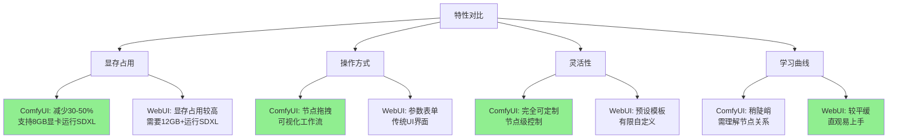

### ComfyUI核心优势

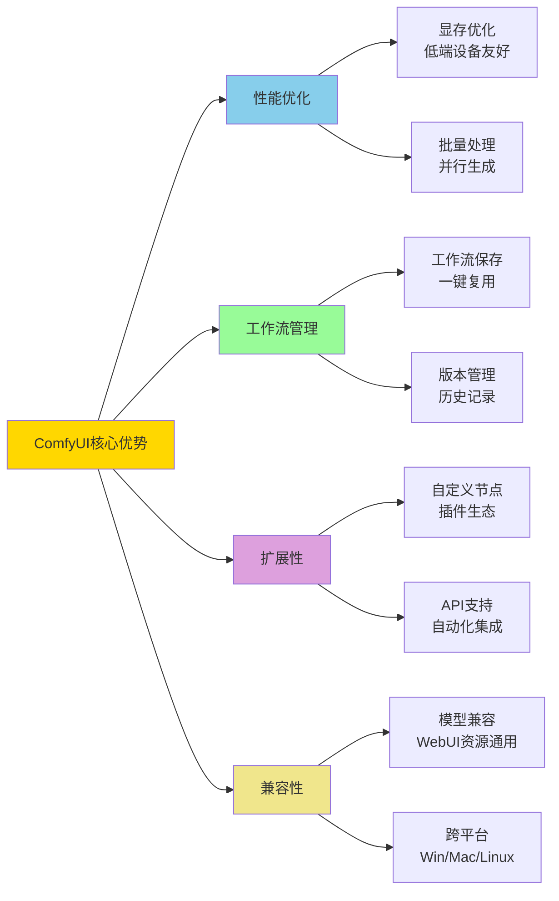

## ComfyUI安装

ComfyUI目前安装非常简单，已经推出桌面版本。

**官方资源**：
- Github仓库：https://github.com/comfyanonymous/ComfyUI
- APP下载地址：https://www.comfy.org/download
- 选择对应的系统版本即可（支持Windows、macOS、Linux）

### 安装流程

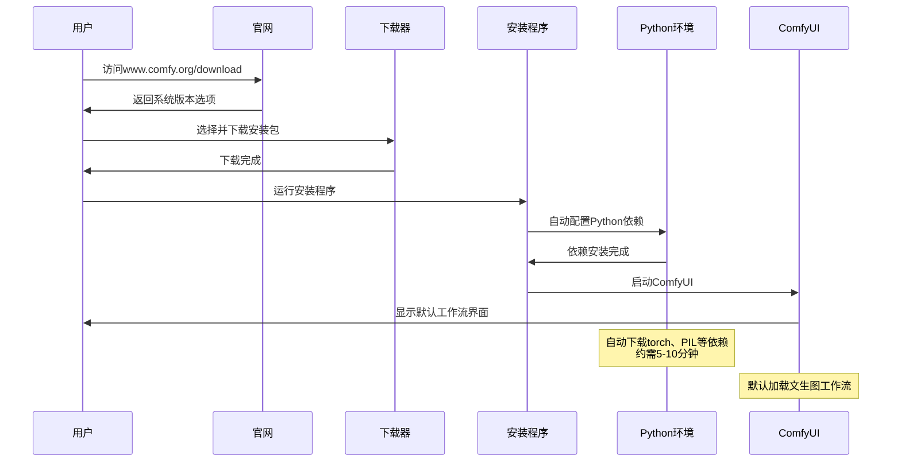

**安装说明**：
1. 下载对应系统的安装包（约2GB）
2. 双击安装包，默认安装即可
3. 首次启动会联网下载Python依赖包（约1-2GB）
4. 安装完成后会自动打开默认的文生图工作流

**系统要求**：
- Windows 10/11 或 macOS 12+ 或 Linux
- 最低8GB RAM（推荐16GB+）
- NVIDIA GPU（4GB+ VRAM）或 Apple Silicon（M系列芯片）
- 10GB+ 磁盘空间（含模型存储空间）

## 初识ComfyUI

安装完成后，打开ComfyUI应用，会展示一个默认的最简单文生图工作流。

### 默认文生图工作流架构

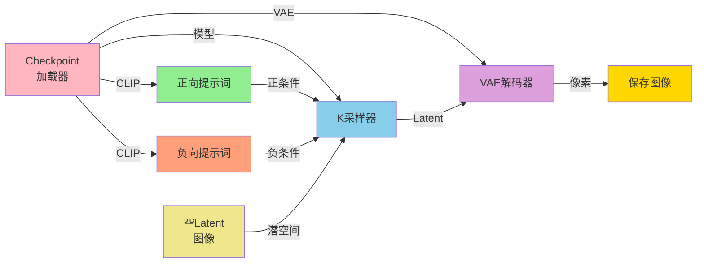

**节点说明**：
- **Checkpoint加载器**：加载基础模型（SD 1.5/SDXL等）
- **正向提示词**：描述想要生成的内容
- **负向提示词**：描述不想出现的内容
- **空Latent图像**：定义图像尺寸和批量数
- **K采样器**：核心扩散算法执行节点
- **VAE解码器**：将潜空间转换为可视图像
- **保存图像**：输出最终结果

## SD 基础模型介绍

此时新手会碰到第一个问题：如何选择SD的底模？SD的各种版本后缀又是什么意思？

### SD模型版本演进

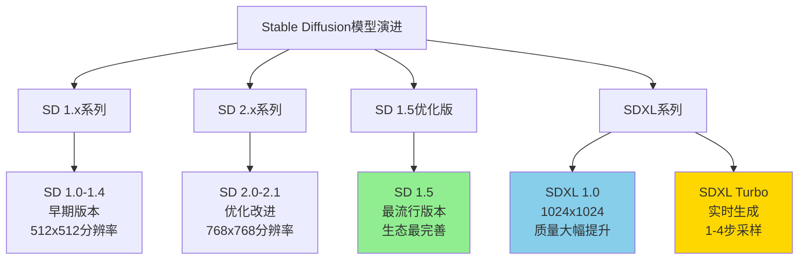

### 各版本详解

- **SD 1.x**：Stable Diffusion的早期版本，主要用于图像生成任务。1.x表示1系列的主要版本。

- **SD 2.x**：SD 1.x的后续版本，对模型进行了优化和改进，提高了图像生成质量和速度。

- **SD 1.5**：最流行的版本，在SD 1.x基础上进行优化，文本到图像生成任务表现出色，社区资源最丰富。
  - 分辨率：512x512（可扩展到768x768）
  - 参数量：约900M
  - 显存需求：最低4GB
  - 生态：LoRA、ControlNet等扩展最完善

- **SDXL 1.0**：在SD 1.5基础上进一步优化，采用"对抗性扩散蒸馏"（Adversarial Diffusion Distillation，简称ADD）技术。
  - 分辨率：1024x1024
  - 参数量：约6.6B（两阶段模型）
  - 显存需求：最低8GB
  - 优势：图像质量显著提升，细节更丰富

- **SDXL Turbo**：SDXL 1.0的迭代版本，特点是生成效率极高。
  - 生成速度：1-4步即可完成（传统需20-50步）
  - 实时响应：输入提示词后立即显示图像
  - 技术：对抗性扩散蒸馏，避免失真或模糊
  - 局限性：
    - 固定像素输出
    - 细节表现（手指、面部表情）有限
    - 仅供学术研究，暂未开放商业权限

### 模型选择决策树

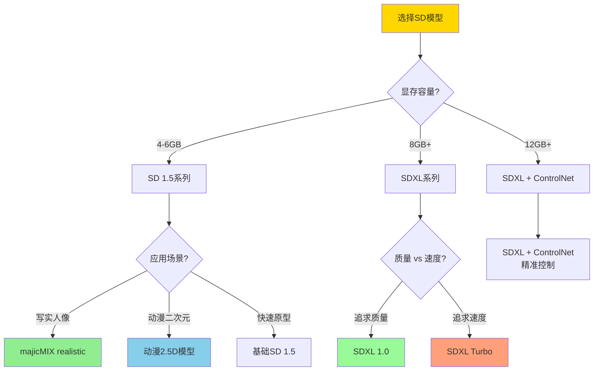

## 微调模型推荐

知道了基础模型的版本概念之后，我们可以了解一些常见的基于SD对应版本优化的模型，以便即插即用。类似与LLM微调之后的模型，毕竟大部分人肯定不会直接使用LLM的instruct或者base版本的基础模型。

### 推荐模型列表

#### 1. majicMIX realistic 麦橘写实（SD 1.5）

**特点**：
- 专门用于生成唯美的人像图片
- 当前版本：第七版
- 融合了多种模型，能够生成具有吸引力的面部特征
- 有效处理暗部细节

**下载地址**：
- ModelScope：https://modelscope.cn/models/MusePublic/majicMIX_realistic_maijuxieshi_SD_1_5
- Civitai：搜索 "majicMIX realistic"

**适用场景**：
- 写实人像生成
- 商业摄影风格
- 产品展示人物
- 时尚写真

#### 2. 动漫二次元2.5D（SD 1.5）

**特点**：
- 比较好的动漫风SD底模
- 2.5D风格（介于2D和3D之间）
- 适合卡通风格创作

**下载地址**：
- ModelScope：https://modelscope.cn/models/VoidOc/ckpt_sd1.5_anime
- Civitai：搜索 "anime 2.5D"

**适用场景**：
- 动漫角色设计
- 游戏立绘
- 插画创作
- 表情包制作

### 模型对比表

| 模型名称 | 基于版本 | 风格 | 显存需求 | 适用场景 |
|---------|---------|------|---------|---------|
| majicMIX realistic | SD 1.5 | 写实人像 | 4GB+ | 商业摄影、产品展示 |
| 动漫2.5D | SD 1.5 | 动漫卡通 | 4GB+ | 插画、游戏立绘 |
| DreamShaper | SD 1.5 | 通用高质量 | 4GB+ | 多场景适用 |
| Realistic Vision | SD 1.5 | 超写实 | 4GB+ | 照片级真实感 |
| SDXL Base | SDXL 1.0 | 通用 | 8GB+ | 高分辨率通用 |
| SDXL Turbo | SDXL 1.0 | 快速生成 | 8GB+ | 实时预览、快速迭代 |

## 模型下载网站

### 模型资源平台对比

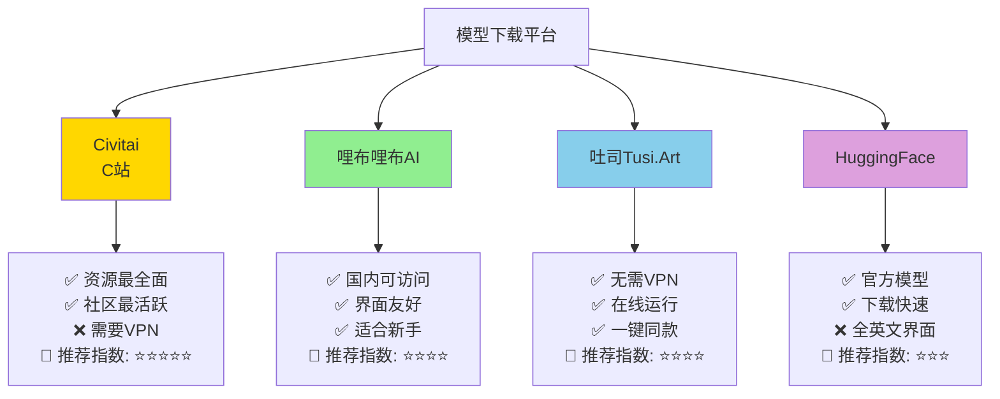

### 1. Civitai（C站）

**网址**：https://civitai.com/

**特点**：
- SD模型下载首选平台
- 需要VPN访问
- 包含各种基础模型、LoRA模型等资源
- 每个模型下方有详细的生成参数
- 社区活跃，模型质量有保障

**使用技巧**：
- 使用过滤器按模型类型、风格筛选
- 查看模型评分和下载量
- 阅读模型说明了解推荐参数
- 下载前查看示例图片效果

### 2. 哩布哩布AI

**网址**：https://www.liblib.art/

**特点**：
- 国内Stable Diffusion模型分享社区
- 无需VPN，国内访问速度快
- 界面和布局类似Civitai
- 包含模型分享和图片灵感两个模块
- 非常适合新手用户

**优势**：
- 中文界面，学习门槛低
- 模型分类清晰（写实、动漫、风格等）
- 提供详细的使用教程
- 社区氛围友好

### 3. 吐司（Tusi.Art）

**网址**：https://tusiart.com/

**特点**：
- 无需VPN
- AI模型分享平台
- 支持在线运行模型
- 浏览器直接使用Stable Diffusion
- 一键做同款功能

**创新点**：
- 无需本地部署即可体验
- 提供云端GPU资源
- 适合快速验证创意
- 支持工作流分享

### 4. HuggingFace

**网址**：https://huggingface.co/
**国内镜像**：https://hf-mirror.com/

**特点**：
- 需要VPN（官方站点）
- 官方模型下载地址
- 下载速度快，几乎无限速
- 全英文界面
- 没有图片预览

**适用场景**：
- 快速下载官方模型
- API集成开发
- 研究和学习
- 模型版本管理

**使用建议**：
- 使用国内镜像站https://hf-mirror.com/
- 配合Git LFS下载大文件
- 阅读模型卡片（Model Card）了解细节

## ComfyUI节点详解

### 节点类型分类

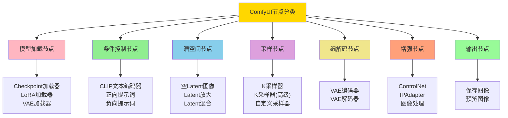

### 核心节点详解

#### 1. Checkpoint加载器（Load Checkpoint）

**功能**：
- 作为工作流起点
- 加载Stable Diffusion大模型（SD 1.5/SDXL等）
- 自动解析模型的VAE和CLIP组件
- 支持自定义VAE模型加载

**输出**：
- MODEL：模型权重
- CLIP：文本编码器
- VAE：图像编解码器

**使用技巧**：
- 不同模型适合不同风格（写实、动漫、艺术等）
- 可以与LoRA加载器配合使用
- 注意显存占用（SDXL需8GB+）

#### 2. CLIP文本编码器（CLIP Text Encode）

**功能**：
- 包含正向/负向提示词输入节点
- 分别连接K采样器的正负条件输入
- 实现文本条件控制

**正向提示词示例**：
```
beautiful scenery nature glass bottle landscape,
purple galaxy bottle, high quality, detailed,
masterpiece, 8k resolution
```

**负向提示词示例**：
```
(EasyNegative), (watermark), (signature),
(worst quality), (low quality), (bad anatomy),
NSFW, (normal quality), blurry, distorted
```

**提示词权重控制**：
- `(keyword)` - 权重1.1倍
- `((keyword))` - 权重1.21倍
- `(keyword:1.5)` - 指定权重1.5倍
- `[keyword]` - 权重0.9倍

#### 3. 空Latent图像（Empty Latent Image）

**功能**：
- 定义生成图像的尺寸和批量数量
- 输出潜空间数据至K采样器
- 文生图流程的初始参数设定节点

**参数说明**：
- **width**：图像宽度（像素）
- **height**：图像高度（像素）
- **batch_size**：一次生成的图片数量

**推荐分辨率**：
- SD 1.5：512x512、512x768、768x512
- SDXL：1024x1024、1024x1536、1536x1024

#### 4. K采样器（KSampler）

**功能**：
- 核心生成节点
- 集成模型、提示词、潜空间数据
- 通过采样算法执行扩散过程
- 支持调节迭代步数、CFG值等关键参数

**关键参数**：

**seed（随机种子）**：
- `fixed`：固定种子，相同参数生成一致结果
- `randomize`：每次随机生成
- `increment`：种子值递增
- `decrement`：种子值递减

**steps（步数）**：
- 降噪迭代次数
- 推荐20-30步平衡质量与效率
- 步数越多细节越精细，但边际效益递减
- SDXL Turbo仅需1-4步

**CFG（Classifier-Free Guidance）值**：
- 提示词引导强度
- 推荐7-9
- 过高（>12）会导致图像生硬或过曝
- 过低（<5）会导致图像偏离提示词

**sampler_name（采样器）**：
| 采样器 | 特点 | 推荐场景 |
|--------|------|----------|
| dpmpp_2m | 写实风格首选 | 人像、风景 |
| euler | 快速生成基础内容 | 草图、原型 |
| euler_a | 增加随机性 | 创意探索 |
| dpmpp_sde | 高质量细节 | 精细作品 |
| lcm | 极速生成（4-8步） | 实时预览 |
| ddim | 稳定可控 | 图生图 |

**scheduler（调度器）**：
- `karras`：增强对比度，适合高细节需求
- `normal`：柔和过渡，减少人工感
- `exponential`：更快收敛
- `sgm_uniform`：SDXL推荐

**denoise（降噪强度）**：
- 值域：0-1
- 默认1.0完全降噪
- 图生图推荐0.4-0.8
- 高清修复建议0.2-0.5

#### 5. VAE解码器（VAE Decode）

**功能**：
- 将K采样器输出的潜空间数据转换为可视图像像素数据
- 完成图像生成过程的最终输出转换

**技术原理**：
- Latent空间：64x64x4（压缩表示）
- 像素空间：512x512x3（RGB图像）
- 解码比例：8倍放大

#### 6. ControlNet应用节点

**功能**：
- 通过Apply ControlNet节点实现姿势控制、边缘检测等高级控制
- 需配合预处理器和模型文件使用

**常用ControlNet类型**：
- **Canny**：边缘检测，保持结构
- **Depth**：深度图，控制空间关系
- **Pose**：人体姿势控制
- **Scribble**：涂鸦转图像
- **Line**：线稿上色

#### 7. LoRA加载器（Load LoRA）

**功能**：
- LoRA是底模的补丁
- 底模通常几GB，训练成本高
- LoRA只有几十MB到几百MB
- 训练和使用成本显著降低
- 保障不错的生图质量与风格

**使用方式**：
- 连接在Checkpoint加载器之后
- 可以叠加多个LoRA（不超过3个为宜）
- 调整strength_model和strength_clip参数控制强度

**strength参数**：
- 0.5-0.8：轻度风格影响
- 0.8-1.0：标准强度
- 1.0-1.5：强烈风格（可能过度）

## 典型应用场景

### 场景流程对比

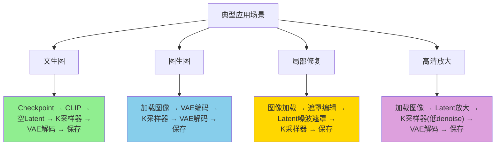

### 1. 文生图（Text to Image）

**流程**：Checkpoint → CLIP → 空Latent → K采样器 → VAE解码 → 保存

**适用场景**：
- 从零创作图像
- 探索创意概念
- 批量生成素材

### 2. 图生图（Image to Image）

**流程**：加载图像 → VAE编码 → K采样器 → VAE解码

**适用场景**：
- 风格转换
- 细节优化
- 图像变体生成

### 3. 局部修复（Inpainting）

**流程**：图像加载 → 遮罩编辑 → Latent噪波遮罩 → K采样器

**适用场景**：
- 移除不需要的物体
- 修复图像瑕疵
- 局部内容替换

### 4. 高清放大（Upscaling）

**流程**：加载图像 → Latent放大 → K采样器(低denoise) → VAE解码

**适用场景**：
- 提升图像分辨率
- 增强图像细节
- 准备打印素材

## 实战示例

### 文生图实战

#### 1. 模型准备

将下载好的模型文件放到对应目录：

**macOS路径**：
```
/Users/用户名/Documents/ComfyUI/models/checkpoints/
```

**Windows路径**：
```
C:\Users\用户名\Documents\ComfyUI\models\checkpoints\
```

**Linux路径**：
```
~/ComfyUI/models/checkpoints/
```

#### 2. 选择底模

在Checkpoint加载器中选择`majicmixRealistic_v7.safetensors`

#### 3. 编写提示词

**正向提示词**：
```
beautiful scenery nature glass bottle landscape,
purple galaxy bottle, sparkling stars inside bottle,
magical atmosphere, highly detailed, sharp focus,
professional photography, 8k uhd, masterpiece
```

**负向提示词**：
```
(EasyNegative), (watermark), (signature),
(sketch by bad-artist), (worst quality),
(low quality), (bad anatomy), NSFW,
(normal quality), blurry, distorted,
duplicate, ugly, deformed
```

#### 4. 配置Latent图像

- **宽度（width）**：512
- **高度（height）**：768
- **批次大小（batch_size）**：1

#### 5. K采样器参数

- **seed**：randomize（随机）
- **steps**：25
- **cfg**：7.5
- **sampler_name**：dpmpp_2m
- **scheduler**：karras
- **denoise**：1.0

#### 6. 执行生成

点击"Queue Prompt"按钮（或右上角的执行按钮），等待图像生成完成。

**生成的图片位置**：
```
/Users/用户名/Documents/ComfyUI/output/
```

也可以在ComfyUI界面右侧的"历史记录"中查看。

### 文生图完整流程序列图

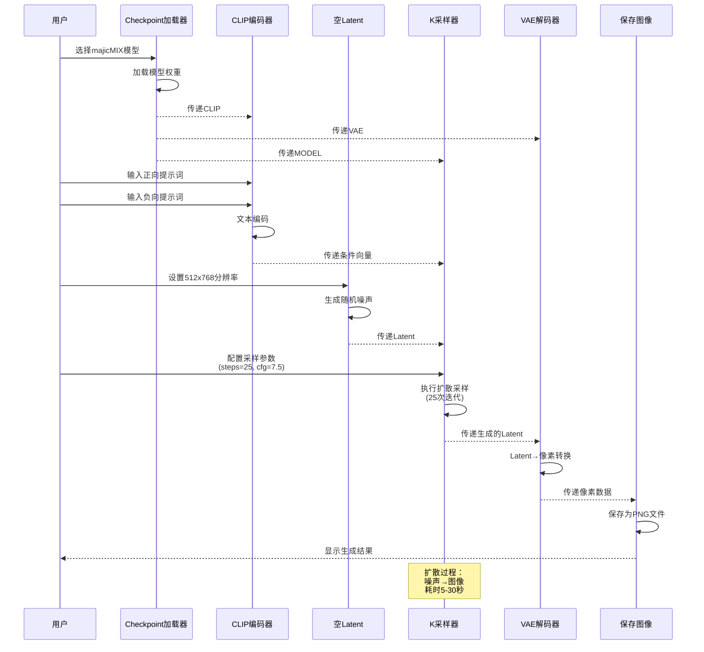

### 图生图实战

#### 1. 加载工作流模板

点击菜单"工作流 → 浏览模板"，选择"图像到图像"（Image to Image）的工作流模板。

#### 2. 工作流差异

图生图工作流与文生图的唯一区别：
- **文生图**：空Latent图像节点
- **图生图**：加载图像 + VAE编码节点

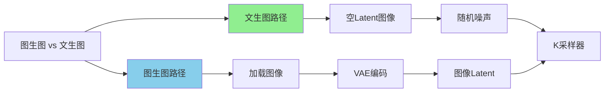

#### 3. 上传参考图像

在"加载图像"节点中，点击"Choose File"上传一张参考图片（例如：动漫角色图）。

#### 4. 修改提示词

```
1 girl, blue hair, beautiful eyes,
detailed face, high quality, anime style
```

#### 5. 调整denoise参数

**denoise参数说明**：
- **0.0**：完全保留原图，无变化
- **0.3-0.5**：轻微调整，保持原图80%以上相似度
- **0.6-0.8**：明显变化，改变风格或细节
- **1.0**：完全重绘，仅参考大致结构

**本次设置**：denoise = 0.5（保持原图结构，修改头发颜色）

#### 6. 执行生成

生成的图片与原始图片保持80%以上的相似度，主要改变是女孩的头发颜色从黑色变为蓝色。

### LoRA使用实战

#### 1. 下载LoRA模型

**推荐LoRA**：
- 哩布哩布AI：https://www.liblib.art/modelinfo/4c5eb179d4705198d866e22ca0833ef3
- Civitai：搜索对应风格的LoRA

#### 2. 放置LoRA文件

将下载的`.safetensors`文件放到：
```
/Users/用户名/Documents/ComfyUI/models/loras/
```

#### 3. 添加LoRA节点

在Checkpoint加载器之后，添加"Load LoRA"节点：
- 右键空白处 → Add Node → loaders → Load LoRA

#### 4. 连接节点

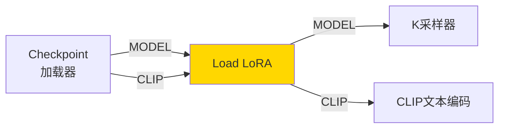

#### 5. 配置LoRA参数

- **lora_name**：选择下载的LoRA模型
- **strength_model**：0.8（模型强度）
- **strength_clip**：0.8（提示词强度）

#### 6. 调整提示词

在提示词中加入LoRA激活词（通常在LoRA模型说明中）：
```
<lora_trigger_word>, beautiful girl,
detailed face, high quality, masterpiece
```

#### 7. 执行生成

生成的图片会带有LoRA定义的特殊风格（例如：特定画风、特定角色风格）。

### LoRA使用流程图

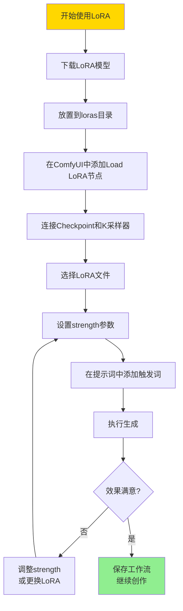

## ComfyUI API使用

虽然ComfyUI主要是GUI工具，但它提供了强大的HTTP API接口，支持通过编程方式控制工作流。

### API基础示例

```python
import json
import requests
import websocket
import uuid

class ComfyUIClient:
    """ComfyUI API客户端"""

    def __init__(self, server_address="127.0.0.1:8188"):
        """
        初始化客户端

        Args:
            server_address: ComfyUI服务器地址，格式为 "IP:端口"
        """
        self.server_address = server_address
        self.client_id = str(uuid.uuid4())

    def queue_prompt(self, prompt):
        """
        提交工作流到队列

        Args:
            prompt: 工作流JSON配置

        Returns:
            dict: 包含prompt_id的响应
        """
        p = {"prompt": prompt, "client_id": self.client_id}
        data = json.dumps(p).encode('utf-8')

        # 提交到/prompt端点
        req = requests.post(
            f"http://{self.server_address}/prompt",
            data=data,
            headers={'Content-Type': 'application/json'}
        )

        return json.loads(req.text)

    def get_image(self, filename, subfolder, folder_type):
        """
        下载生成的图片

        Args:
            filename: 文件名
            subfolder: 子文件夹
            folder_type: 文件夹类型（output/input/temp）

        Returns:
            bytes: 图片数据
        """
        data = {
            "filename": filename,
            "subfolder": subfolder,
            "type": folder_type
        }

        url_values = requests.utils.quote(json.dumps(data))
        response = requests.get(
            f"http://{self.server_address}/view?{url_values}"
        )

        return response.content

    def get_history(self, prompt_id):
        """
        获取执行历史

        Args:
            prompt_id: 提示词ID

        Returns:
            dict: 历史记录数据
        """
        response = requests.get(
            f"http://{self.server_address}/history/{prompt_id}"
        )
        return json.loads(response.text)

# 使用示例
if __name__ == "__main__":
    # 创建客户端
    client = ComfyUIClient("127.0.0.1:8188")

    # 定义工作流（这里使用简化的示例）
    # 实际使用时，需要从ComfyUI导出完整的工作流JSON
    workflow = {
        "3": {  # Checkpoint加载器
            "inputs": {
                "ckpt_name": "majicmixRealistic_v7.safetensors"
            },
            "class_type": "CheckpointLoaderSimple"
        },
        "6": {  # 正向提示词
            "inputs": {
                "text": "beautiful landscape, masterpiece",
                "clip": ["3", 1]
            },
            "class_type": "CLIPTextEncode"
        },
        # ... 更多节点配置
    }

    # 提交工作流
    response = client.queue_prompt(workflow)
    prompt_id = response['prompt_id']
    print(f"任务已提交，ID: {prompt_id}")

    # 等待完成并获取结果
    # 实际应用中需要使用WebSocket监听进度
    import time
    time.sleep(30)  # 简化示例，实际应监听WebSocket

    history = client.get_history(prompt_id)
    print("任务完成！")
```

### 批量生成图像脚本

```python
import os
import time
from comfyui_client import ComfyUIClient

class BatchImageGenerator:
    """批量图像生成器"""

    def __init__(self, server="127.0.0.1:8188"):
        """
        初始化生成器

        Args:
            server: ComfyUI服务器地址
        """
        self.client = ComfyUIClient(server)

    def load_workflow_template(self, template_path):
        """
        加载工作流模板

        Args:
            template_path: 模板JSON文件路径

        Returns:
            dict: 工作流配置
        """
        with open(template_path, 'r', encoding='utf-8') as f:
            return json.load(f)

    def modify_prompt(self, workflow, positive_prompt, negative_prompt=None):
        """
        修改工作流中的提示词

        Args:
            workflow: 工作流配置
            positive_prompt: 正向提示词
            negative_prompt: 负向提示词（可选）

        Returns:
            dict: 修改后的工作流
        """
        # 找到CLIP文本编码节点（节点ID可能不同，需根据实际工作流调整）
        for node_id, node_data in workflow.items():
            if node_data.get("class_type") == "CLIPTextEncode":
                if "positive" in node_data.get("_meta", {}).get("title", "").lower():
                    node_data["inputs"]["text"] = positive_prompt
                elif negative_prompt and "negative" in node_data.get("_meta", {}).get("title", "").lower():
                    node_data["inputs"]["text"] = negative_prompt

        return workflow

    def modify_seed(self, workflow, seed):
        """
        修改工作流中的随机种子

        Args:
            workflow: 工作流配置
            seed: 随机种子值

        Returns:
            dict: 修改后的工作流
        """
        for node_id, node_data in workflow.items():
            if node_data.get("class_type") == "KSampler":
                node_data["inputs"]["seed"] = seed

        return workflow

    def generate_batch(self, template_path, prompts_list, output_dir):
        """
        批量生成图像

        Args:
            template_path: 工作流模板路径
            prompts_list: 提示词列表 [(positive, negative), ...]
            output_dir: 输出目录
        """
        # 创建输出目录
        os.makedirs(output_dir, exist_ok=True)

        # 加载模板
        base_workflow = self.load_workflow_template(template_path)

        for idx, (pos_prompt, neg_prompt) in enumerate(prompts_list):
            print(f"\n[{idx+1}/{len(prompts_list)}] 生成图像...")
            print(f"正向提示词: {pos_prompt}")

            # 复制工作流并修改参数
            workflow = base_workflow.copy()
            workflow = self.modify_prompt(workflow, pos_prompt, neg_prompt)
            workflow = self.modify_seed(workflow, idx * 1000)  # 不同的seed

            # 提交任务
            response = self.client.queue_prompt(workflow)
            prompt_id = response['prompt_id']

            # 等待完成（简化示例，实际应使用WebSocket）
            time.sleep(30)

            # 获取结果
            history = self.client.get_history(prompt_id)

            # 下载图片
            # 实际实现需要解析history获取输出文件信息
            print(f"图像 {idx+1} 生成完成！")

# 使用示例
if __name__ == "__main__":
    generator = BatchImageGenerator()

    # 定义批量提示词
    prompts = [
        ("beautiful sunset over ocean, masterpiece", "bad quality, blurry"),
        ("mountain landscape with snow, highly detailed", "ugly, distorted"),
        ("cyberpunk city at night, neon lights", "low quality, watermark"),
    ]

    # 批量生成
    generator.generate_batch(
        template_path="workflow_template.json",
        prompts_list=prompts,
        output_dir="./batch_output"
    )
```

### 自定义节点开发示例

ComfyUI支持通过Python开发自定义节点，扩展功能。

```python
class ImageWatermark:
    """图像水印添加节点"""

    @classmethod
    def INPUT_TYPES(cls):
        """
        定义节点输入类型

        Returns:
            dict: 输入参数配置
        """
        return {
            "required": {
                "image": ("IMAGE",),  # 输入图像
                "text": ("STRING", {  # 水印文字
                    "default": "ComfyUI Generated",
                    "multiline": False
                }),
                "position": (["top-left", "top-right", "bottom-left", "bottom-right"],),
                "opacity": ("FLOAT", {
                    "default": 0.5,
                    "min": 0.0,
                    "max": 1.0,
                    "step": 0.1
                }),
            }
        }

    RETURN_TYPES = ("IMAGE",)
    FUNCTION = "add_watermark"
    CATEGORY = "image/postprocessing"

    def add_watermark(self, image, text, position, opacity):
        """
        添加水印到图像

        Args:
            image: 输入图像张量
            text: 水印文字
            position: 位置
            opacity: 不透明度

        Returns:
            tuple: (处理后的图像,)
        """
        from PIL import Image, ImageDraw, ImageFont
        import torch
        import numpy as np

        # 将torch张量转换为PIL图像
        # image shape: [batch, height, width, channels]
        batch_size = image.shape[0]
        output_images = []

        for i in range(batch_size):
            # 转换为numpy数组
            img_array = (image[i].cpu().numpy() * 255).astype(np.uint8)
            pil_image = Image.fromarray(img_array)

            # 创建水印层
            watermark = Image.new('RGBA', pil_image.size, (0, 0, 0, 0))
            draw = ImageDraw.Draw(watermark)

            # 尝试加载字体（如果失败则使用默认字体）
            try:
                font = ImageFont.truetype("arial.ttf", 20)
            except:
                font = ImageFont.load_default()

            # 计算文字位置
            text_bbox = draw.textbbox((0, 0), text, font=font)
            text_width = text_bbox[2] - text_bbox[0]
            text_height = text_bbox[3] - text_bbox[1]

            margin = 10
            if position == "top-left":
                text_position = (margin, margin)
            elif position == "top-right":
                text_position = (pil_image.width - text_width - margin, margin)
            elif position == "bottom-left":
                text_position = (margin, pil_image.height - text_height - margin)
            else:  # bottom-right
                text_position = (pil_image.width - text_width - margin,
                               pil_image.height - text_height - margin)

            # 绘制水印（白色文字，带透明度）
            alpha = int(255 * opacity)
            draw.text(text_position, text, fill=(255, 255, 255, alpha), font=font)

            # 合并图像
            pil_image = pil_image.convert('RGBA')
            watermarked = Image.alpha_composite(pil_image, watermark)
            watermarked = watermarked.convert('RGB')

            # 转换回torch张量
            img_array = np.array(watermarked).astype(np.float32) / 255.0
            output_images.append(torch.from_numpy(img_array))

        # 重新组合batch
        output = torch.stack(output_images)

        return (output,)

# 注册节点
NODE_CLASS_MAPPINGS = {
    "ImageWatermark": ImageWatermark
}

NODE_DISPLAY_NAME_MAPPINGS = {
    "ImageWatermark": "Add Watermark"
}
```

**自定义节点安装步骤**：
1. 在`ComfyUI/custom_nodes/`目录下创建新文件夹（如`my_nodes`）
2. 在该文件夹中创建`__init__.py`和节点脚本
3. 重启ComfyUI，新节点会自动加载

### 工作流JSON配置示例

ComfyUI的工作流可以导出为JSON格式，便于分享和版本控制。

```json
{
  "1": {
    "inputs": {
      "ckpt_name": "majicmixRealistic_v7.safetensors"
    },
    "class_type": "CheckpointLoaderSimple",
    "_meta": {
      "title": "Load Checkpoint"
    }
  },
  "2": {
    "inputs": {
      "text": "beautiful scenery nature glass bottle landscape, purple galaxy bottle",
      "clip": ["1", 1]
    },
    "class_type": "CLIPTextEncode",
    "_meta": {
      "title": "CLIP Text Encode (Positive)"
    }
  },
  "3": {
    "inputs": {
      "text": "(EasyNegative), (watermark), (signature), (worst quality), (low quality)",
      "clip": ["1", 1]
    },
    "class_type": "CLIPTextEncode",
    "_meta": {
      "title": "CLIP Text Encode (Negative)"
    }
  },
  "4": {
    "inputs": {
      "width": 512,
      "height": 768,
      "batch_size": 1
    },
    "class_type": "EmptyLatentImage",
    "_meta": {
      "title": "Empty Latent Image"
    }
  },
  "5": {
    "inputs": {
      "seed": 42,
      "steps": 25,
      "cfg": 7.5,
      "sampler_name": "dpmpp_2m",
      "scheduler": "karras",
      "denoise": 1.0,
      "model": ["1", 0],
      "positive": ["2", 0],
      "negative": ["3", 0],
      "latent_image": ["4", 0]
    },
    "class_type": "KSampler",
    "_meta": {
      "title": "KSampler"
    }
  },
  "6": {
    "inputs": {
      "samples": ["5", 0],
      "vae": ["1", 2]
    },
    "class_type": "VAEDecode",
    "_meta": {
      "title": "VAE Decode"
    }
  },
  "7": {
    "inputs": {
      "filename_prefix": "ComfyUI",
      "images": ["6", 0]
    },
    "class_type": "SaveImage",
    "_meta": {
      "title": "Save Image"
    }
  }
}
```

**工作流JSON说明**：
- 每个节点用数字ID标识
- `inputs`定义节点输入参数
- 数组形式`["节点ID", 输出索引]`表示节点间的连接
- `class_type`指定节点类型
- `_meta`包含元数据（如标题）

## 常见问题解答（Q&A）

### Q1：如何选择合适的SD基础模型？

**A：根据显存和应用场景选择**

**决策流程**：

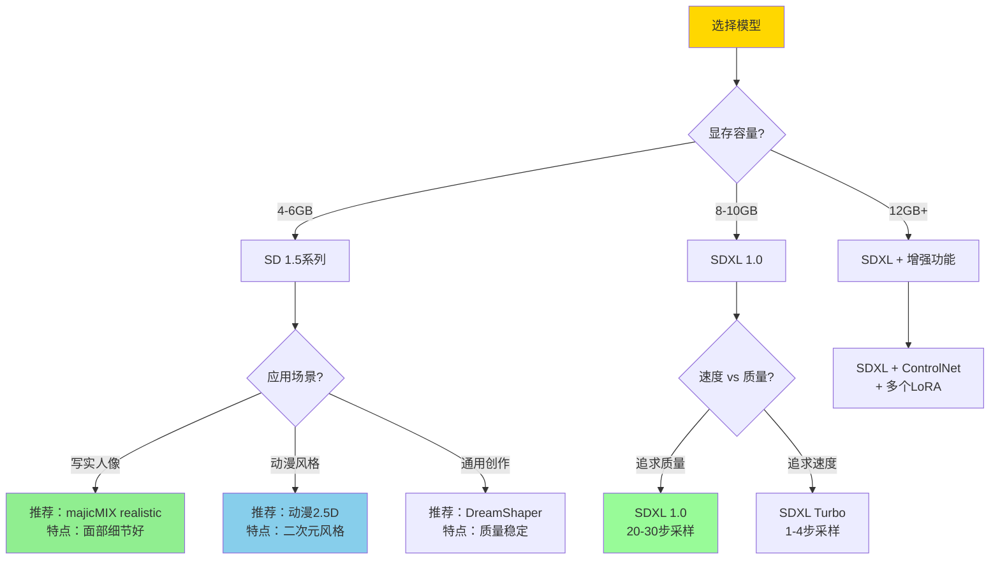

**对比表**：

| 模型版本 | 显存需求 | 分辨率 | 生成速度 | 质量 | 适合人群 |
|---------|---------|-------|---------|------|---------|
| SD 1.5 | 4GB+ | 512x512 | 快 | 良好 | 新手、低配置 |
| SDXL 1.0 | 8GB+ | 1024x1024 | 中等 | 优秀 | 进阶用户 |
| SDXL Turbo | 8GB+ | 1024x1024 | 极快 | 良好 | 快速迭代 |

**最佳实践**：
1. 新手建议从SD 1.5开始学习
2. 显存8GB+可直接使用SDXL
3. 不同场景准备多个模型
4. 结合LoRA扩展风格

---

### Q2：显存不足时如何优化？

**A：采用多种显存优化技术**

**优化方案对比**：

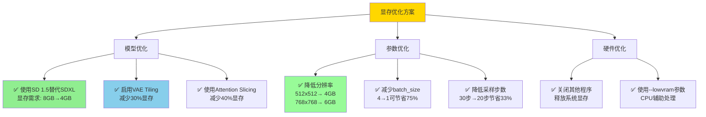

**具体操作**：

1. **启用VAE Tiling**（节省30%显存）
   - 在ComfyUI设置中启用
   - 或添加"VAE Encode/Decode Tiling"节点

2. **使用Attention Slicing**（节省40%显存）
   - 启动ComfyUI时添加参数：`--use-split-cross-attention`
   - macOS/Linux：`./ComfyUI --use-split-cross-attention`
   - Windows：`ComfyUI.exe --use-split-cross-attention`

3. **调整分辨率和批次**
   ```
   显存4GB：512x512, batch_size=1
   显存6GB：768x768, batch_size=1
   显存8GB：1024x1024, batch_size=1
   显存12GB：1024x1024, batch_size=4
   ```

4. **分步生成高分辨率图像**
   - 先生成512x512
   - 再使用Latent Upscale放大
   - 最后用低denoise值(0.3-0.5)细化

**显存占用估算**：
```
基础模型加载: 2-4GB (SD 1.5) 或 6-8GB (SDXL)
图像生成: 分辨率² × batch_size × 0.001GB
VAE解码: 分辨率² × 0.002GB
LoRA加载: 每个约100-300MB
```

---

### Q3：如何编写高质量提示词？

**A：遵循结构化提示词编写原则**

**提示词结构**：

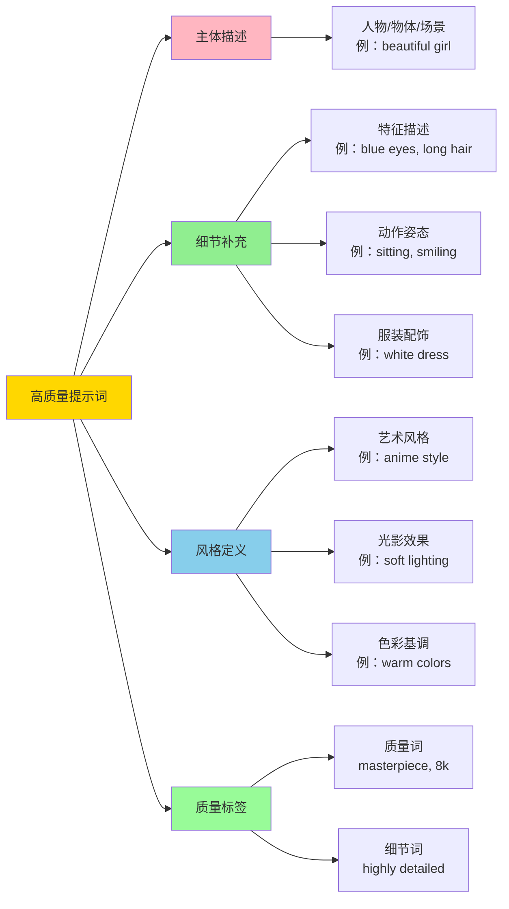

**提示词模板**：

```
[主体] + [细节] + [环境] + [风格] + [质量标签]
```

**示例1 - 人像摄影**：
```
正向提示词：
portrait of a beautiful woman,
blue eyes, long blonde hair,
wearing white dress,
standing in garden with flowers,
soft natural lighting,
professional photography,
masterpiece, best quality,
highly detailed, 8k uhd, sharp focus

负向提示词：
(worst quality), (low quality),
(normal quality), lowres,
bad anatomy, bad hands,
text, error, missing fingers,
extra digit, fewer digits,
cropped, worst quality,
jpeg artifacts, signature,
watermark, username, blurry
```

**示例2 - 场景画面**：
```
正向提示词：
beautiful scenery nature glass bottle landscape,
purple galaxy bottle,
sparkling stars inside bottle,
on wooden table,
magical atmosphere,
cinematic lighting,
highly detailed,
masterpiece, 8k resolution

负向提示词：
(EasyNegative), ugly, blurry,
low quality, distorted,
bad composition, overexposed
```

**提示词技巧**：

1. **权重控制**
   ```
   (keyword)           # 权重1.1倍
   ((keyword))         # 权重1.21倍
   (keyword:1.5)       # 指定权重1.5倍
   [keyword]           # 权重0.9倍
   ```

2. **词序优先级**
   - 越前面的词权重越高
   - 核心描述放在最前
   - 质量标签放在最后

3. **组合使用**
   ```
   (masterpiece:1.2), (best quality:1.1), highly detailed
   ```

4. **使用专业术语**
   - 摄影：bokeh, depth of field, golden hour
   - 艺术：oil painting, watercolor, impressionism
   - 光影：rim lighting, volumetric lighting, subsurface scattering

**常用质量标签**：
```
正向：
masterpiece, best quality, high quality,
highly detailed, extremely detailed,
sharp focus, 8k uhd, professional,
photorealistic, realistic

负向：
worst quality, low quality, normal quality,
lowres, blurry, fuzzy, out of focus,
bad anatomy, bad proportions, distorted,
ugly, duplicate, watermark, signature
```

---

### Q4：节点连接错误如何排查？

**A：系统化排查连接问题**

**排查流程**：

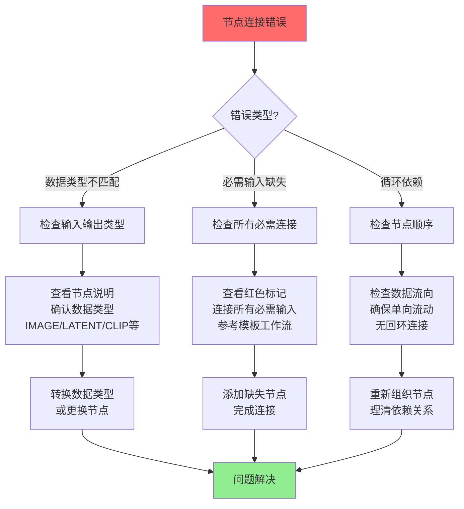

**常见错误类型**：

1. **数据类型不匹配**
   ```
   错误示例：
   VAE Decode节点的samples输入连接到了IMAGE输出

   解决方案：
   VAE Decode需要LATENT类型输入
   应连接K采样器的LATENT输出
   ```

2. **必需输入缺失**
   ```
   错误示例：
   K采样器的positive或negative输入未连接

   解决方案：
   添加CLIP Text Encode节点
   连接正向和负向提示词
   ```

3. **输出索引错误**
   ```
   错误示例：
   Checkpoint加载器有3个输出[MODEL, CLIP, VAE]
   连接["1", 3]会报错（索引从0开始）

   解决方案：
   使用正确索引：
   ["1", 0] → MODEL
   ["1", 1] → CLIP
   ["1", 2] → VAE
   ```

**数据类型速查表**：

| 数据类型 | 说明 | 常见来源节点 | 常见目标节点 |
|---------|------|------------|-------------|
| MODEL | 模型权重 | Checkpoint加载器 | K采样器 |
| CLIP | 文本编码器 | Checkpoint加载器 | CLIP文本编码 |
| VAE | 图像编解码器 | Checkpoint加载器 | VAE编码/解码 |
| CONDITIONING | 条件向量 | CLIP文本编码 | K采样器 |
| LATENT | 潜空间数据 | 空Latent/VAE编码 | K采样器/VAE解码 |
| IMAGE | 像素图像 | VAE解码/加载图像 | 保存图像 |

**调试技巧**：

1. **使用预览节点**
   - 在关键位置添加"Preview Image"节点
   - 检查中间结果是否正确

2. **对比模板工作流**
   - 使用官方模板作为参考
   - 逐个节点对比连接

3. **简化工作流**
   - 从最简单的文生图开始
   - 逐步添加复杂节点

4. **查看控制台日志**
   - ComfyUI控制台会显示详细错误信息
   - 记录错误消息搜索解决方案

---

### Q5：如何提升图像生成质量？

**A：从多个维度优化生成质量**

**质量优化策略**：

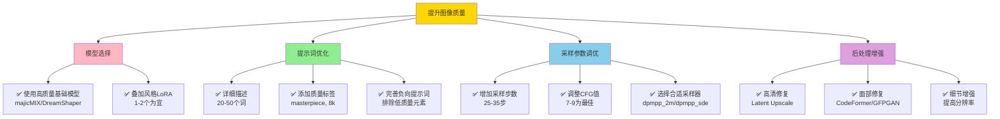

**参数推荐配置**：

**写实风格**：
```
模型：majicMIX realistic v7
采样器：dpmpp_2m
调度器：karras
步数：28
CFG：7.5
分辨率：512x768 或 768x512
denoise：1.0
LoRA：写实增强LoRA (strength 0.6-0.8)
```

**动漫风格**：
```
模型：动漫2.5D / Anything v5
采样器：euler_a
调度器：normal
步数：25
CFG：8.0
分辨率：512x768
denoise：1.0
LoRA：画风LoRA (strength 0.7-0.9)
```

**艺术风格**：
```
模型：DreamShaper / Protogen
采样器：dpmpp_sde
调度器：karras
步数：30
CFG：9.0
分辨率：768x768
denoise：1.0
LoRA：艺术风格LoRA (strength 0.8-1.0)
```

**高清修复工作流**：

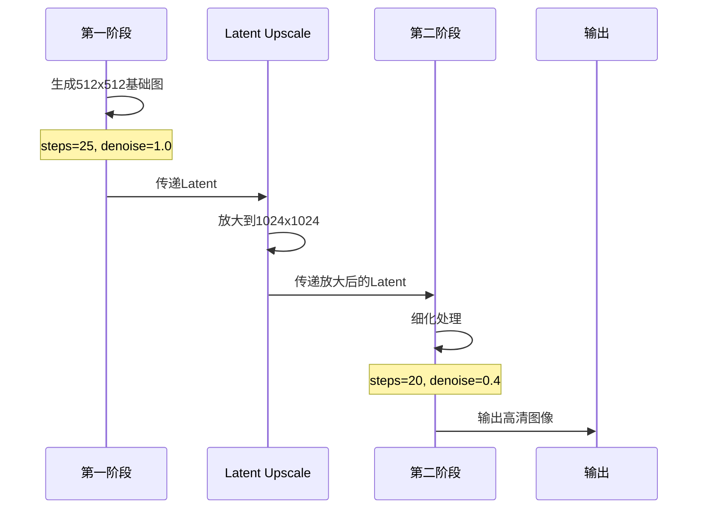

**最佳实践**：

1. **分辨率选择**
   - SD 1.5：512、768、896（64的倍数）
   - SDXL：1024、1152、1280、1536
   - 避免奇数分辨率

2. **CFG值调优**
   - 太低(<5)：图像偏离提示词
   - 适中(7-9)：最佳平衡
   - 太高(>12)：过度饱和，颜色失真

3. **采样步数**
   - 20步：快速预览
   - 25-30步：标准质量
   - 35-50步：极致细节（收益递减）

4. **多次生成选择**
   - batch_size=4，生成多张
   - 选择最佳结果
   - 使用相同seed微调

---

### Q6：工作流如何保存和复用？

**A：使用ComfyUI的工作流管理功能**

**工作流管理流程**：

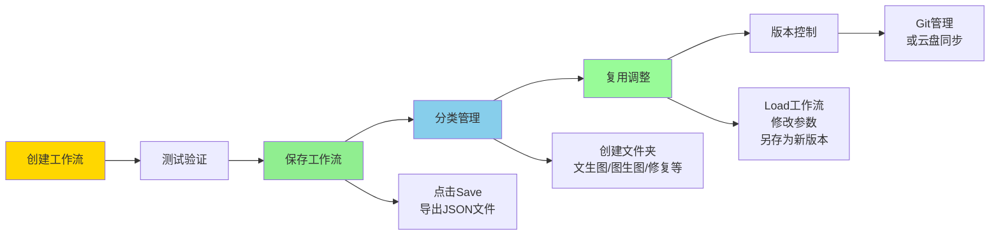

**保存工作流**：

1. **方法1：通过菜单保存**
   - 点击右上角"Save"按钮
   - 输入工作流名称
   - 选择保存位置

2. **方法2：导出JSON**
   - 点击"Export"或"Download"
   - 保存为`.json`文件
   - 可用于分享或版本控制

3. **方法3：保存到图像**
   - 生成的图片会嵌入工作流信息
   - 将图片拖回ComfyUI即可加载工作流

**加载工作流**：

1. **从菜单加载**
   ```
   工作流 → 浏览模板 → 选择已保存的工作流
   ```

2. **从文件加载**
   ```
   工作流 → Load → 选择.json文件
   ```

3. **从图片加载**
   ```
   直接将包含工作流的图片拖入ComfyUI界面
   ```

**工作流组织建议**：

```
workflows/
├── text-to-image/
│   ├── realistic-portrait.json
│   ├── anime-character.json
│   └── landscape.json
├── image-to-image/
│   ├── style-transfer.json
│   └── color-correction.json
├── inpainting/
│   ├── remove-object.json
│   └── face-swap.json
└── upscaling/
    ├── 2x-upscale.json
    └── 4x-upscale.json
```

**工作流模板化**：

```python
# 创建工作流模板管理器
import json
import os

class WorkflowTemplateManager:
    """工作流模板管理器"""

    def __init__(self, templates_dir="./workflow_templates"):
        """
        初始化模板管理器

        Args:
            templates_dir: 模板存储目录
        """
        self.templates_dir = templates_dir
        os.makedirs(templates_dir, exist_ok=True)

    def save_template(self, workflow, name, category="general"):
        """
        保存工作流模板

        Args:
            workflow: 工作流JSON数据
            name: 模板名称
            category: 分类（text2img/img2img等）
        """
        category_dir = os.path.join(self.templates_dir, category)
        os.makedirs(category_dir, exist_ok=True)

        filepath = os.path.join(category_dir, f"{name}.json")

        with open(filepath, 'w', encoding='utf-8') as f:
            json.dump(workflow, f, indent=2, ensure_ascii=False)

        print(f"✅ 模板已保存: {filepath}")

    def load_template(self, name, category="general"):
        """
        加载工作流模板

        Args:
            name: 模板名称
            category: 分类

        Returns:
            dict: 工作流JSON数据
        """
        filepath = os.path.join(self.templates_dir, category, f"{name}.json")

        if not os.path.exists(filepath):
            raise FileNotFoundError(f"模板不存在: {filepath}")

        with open(filepath, 'r', encoding='utf-8') as f:
            workflow = json.load(f)

        print(f"✅ 模板已加载: {filepath}")
        return workflow

    def list_templates(self, category=None):
        """
        列出所有模板

        Args:
            category: 指定分类，None表示所有分类

        Returns:
            dict: {category: [template_names]}
        """
        templates = {}

        if category:
            categories = [category]
        else:
            categories = [d for d in os.listdir(self.templates_dir)
                         if os.path.isdir(os.path.join(self.templates_dir, d))]

        for cat in categories:
            cat_dir = os.path.join(self.templates_dir, cat)
            if os.path.exists(cat_dir):
                files = [f[:-5] for f in os.listdir(cat_dir)
                        if f.endswith('.json')]
                templates[cat] = files

        return templates

# 使用示例
manager = WorkflowTemplateManager()

# 保存模板
# workflow_data = {...}  # 从ComfyUI导出的工作流
# manager.save_template(workflow_data, "portrait-v1", "text2img")

# 加载模板
workflow = manager.load_template("portrait-v1", "text2img")

# 列出所有模板
all_templates = manager.list_templates()
print("可用模板:")
for category, templates in all_templates.items():
    print(f"\n{category}:")
    for template in templates:
        print(f"  - {template}")
```

**版本控制建议**：

1. **使用Git管理**
   ```bash
   cd ComfyUI/workflows
   git init
   git add .
   git commit -m "初始工作流集合"
   ```

2. **命名规范**
   ```
   功能-风格-版本.json
   例：
   text2img-realistic-v1.json
   img2img-anime-v2.json
   ```

3. **添加说明文档**
   ```markdown
   # realistic-portrait-v1.json

   ## 功能
   生成写实人像照片

   ## 参数
   - 模型：majicMIX realistic v7
   - 分辨率：512x768
   - 采样器：dpmpp_2m
   - 步数：28

   ## 适用场景
   商业摄影、产品展示、人像创作

   ## 更新日志
   - v1 (2025-12-27): 初始版本
   ```

## 最佳实践

### 提示词编写最佳实践

1. **结构化组织**
   ```
   [主体] , [细节] , [环境] , [风格] , [质量]
   ```

2. **使用权重控制**
   ```
   (masterpiece:1.3), (best quality:1.2), highly detailed
   ```

3. **避免冲突描述**
   ```
   ❌ 错误：realistic, anime style
   ✅ 正确：semi-realistic, anime-inspired
   ```

4. **利用负向提示词**
   ```
   始终包含：worst quality, low quality, blurry
   根据需要添加：watermark, signature, text
   ```

### 参数调优最佳实践

1. **渐进式调整**
   - 先固定大部分参数
   - 每次只调整一个变量
   - 观察效果后再继续

2. **参数组合推荐**
   ```
   快速预览：steps=15, cfg=6
   标准质量：steps=25, cfg=7.5
   高质量：steps=30, cfg=8
   ```

3. **分辨率阶梯**
   ```
   草图阶段：512x512
   细化阶段：768x768
   最终输出：1024x1024（通过Upscale）
   ```

### 工作流组织最佳实践

1. **模块化设计**
   - 将常用节点组保存为模板
   - 使用Group功能组织相关节点
   - 添加注释说明节点用途

2. **性能优化**
   - 避免不必要的预览节点
   - 合理使用batch_size
   - 显存不足时启用Tiling

3. **备份策略**
   - 定期导出工作流JSON
   - 使用云盘同步
   - 重要工作流版本控制

## 总结

本文旨在使读者对ComfyUI有初步的了解，希望读者对AI图像生成有了初步的认识与入门，并对准备学习和正在学习ComfyUI的同学一些帮助和引导。

**关键要点回顾**：

1. **ComfyUI优势**
   - 节点化工作流，灵活可控
   - 显存优化，低配置友好
   - 工作流可保存复用，效率高

2. **模型选择**
   - SD 1.5：入门首选，生态完善
   - SDXL：高质量，需更多显存
   - 根据场景选择微调模型

3. **核心技能**
   - 理解节点连接关系
   - 编写高质量提示词
   - 调优采样参数

4. **进阶方向**
   - 自定义节点开发
   - API自动化集成
   - 工作流模板化管理

**学习路径建议**：
1. 从默认文生图工作流开始
2. 理解每个节点的作用
3. 尝试修改参数观察效果
4. 学习图生图、LoRA使用
5. 探索ControlNet等高级功能
6. 开发自定义节点或API集成

**资源推荐**：
- 官方文档：https://github.com/comfyanonymous/ComfyUI
- 社区论坛：https://www.reddit.com/r/comfyui/
- 模型下载：Civitai、哩布哩布AI
- 教程视频：B站搜索"ComfyUI教程"

祝你在AI图像生成的道路上越走越远！🎨
