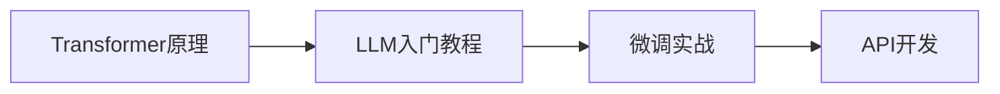

# 大模型基础学习资源

> [!abstract] 概述
> 收集整理的大模型学习视频和教程资源，适合入门和进阶学习。

---

## 📚 入门教程

> [!tip] 面向开发者的 LLM 入门教程
> **来源**：Datawhale
> **链接**：[面向开发者的LLM入门教程](https://datawhalechina.github.io/llm-cookbook/#/)
>
> 系统性的 LLM 开发入门教程，涵盖基础概念到实践应用。

---

## 🎬 B站视频推荐

### 微调实战

> [!info] DeepSeek + LoRA + FastAPI 微调教程
> **视频**：[开发人员如何微调大模型并暴露接口给后端调用](https://www.bilibili.com/video/BV1dQjyzVEFn)
> **作者**：智泊AI-海文
>
> **内容要点**：
> - DeepSeek 模型微调流程
> - LoRA 微调技术应用
> - FastAPI 接口封装
> - 后端集成方案

### 原理讲解

> [!info] Transformer 原理动画演示（2025最新版）
> **视频**：[深入浅出解释 Transformer 原理](https://www.bilibili.com/video/BV1AsGmzREUc)
>
> **内容要点**：
> - Transformer 架构详解
> - 注意力机制可视化
> - Decoder-only 模型原理
> - 161 集系列视频

---

## 📋 学习路径建议

1. **基础阶段**：先看 Transformer 原理视频，理解底层架构
2. **入门阶段**：学习 Datawhale 的 LLM 入门教程
3. **实战阶段**：跟着微调教程动手实践
4. **进阶阶段**：学习 API 封装和部署

---

## 相关笔记

- [[大模型/07-教程与课程/5分钟手把手/4. 如何微调一个大模型（Colab + Unsloth）|如何微调一个大模型]]
- [[大模型/03-训练与微调/模型训练/训练的数据集构造方式|训练数据集构造]]
- [[大模型/06-论文与报告/论文学习/从浅入生的推荐一系列的论文学习|论文学习路径]]
