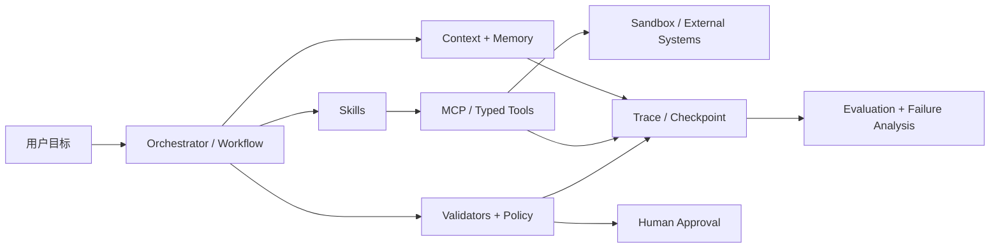

---
tags:
  - 大模型/Agent
  - 大模型/论文
  - Agent/评测
created: 2026-07-12
updated: 2026-07-12
status: 持续更新
aliases:
  - 2026 Agent 论文
  - Agent 技术趋势 2026
source:
  - https://metr.org/time-horizons/
  - https://arxiv.org/abs/2606.26959
  - https://arxiv.org/abs/2605.02801
  - https://arxiv.org/abs/2605.11229
  - https://arxiv.org/abs/2607.08716
  - https://arxiv.org/abs/2607.07946
  - https://arxiv.org/abs/2607.08028
  - https://arxiv.org/abs/2607.07820
---

# 2026 Agent 技术与论文追踪

> [!summary] 核心判断
> 2026 年 Agent 的主线已经不是“让 LLM 调一个工具”，而是把模型放进一个可长期运行、可恢复、可审计、可限制权限的执行系统。当前最重要的进展集中在 `harness engineering`、`context / memory`、`skills`、`多 Agent 编排`、`长任务评测`、`轨迹诊断` 和 `运行时安全`。模型能力仍是基础，但生产效果越来越取决于模型外部的系统设计。

## 范围与筛选标准

- 时间范围：以 `2026-01-01` 至 `2026-07-12` 为主。
- 少量持续更新的基础研究，例如 METR 时间地平线，按其 2026 年版本和当前影响纳入。
- 优先收录会改变 Agent 架构、评测或安全判断的工作，不追求罗列全部论文。
- arXiv 论文大多尚未经过正式同行评审，文中的性能数字应看作作者报告结果。

## 一、近期 Agent 技术主线

### 1. 从 Prompt Engineering 转向 Harness Engineering

`Harness` 是包围模型的执行系统，包括状态、工具、权限、验证器、重试、日志、预算和人工审批。2026 年越来越明确的工程共识是：

- Prompt 负责表达意图，代码和 schema 负责不可妥协的约束。
- Agent 不应直接把模型输出当作可执行命令，应经过类型、权限和业务规则验证。
- 长任务需要 checkpoint、恢复、幂等和明确的停止条件。
- 模型应可替换，系统保证不应绑定某一个模型的“自觉”。

这与 [[LangGraph]]、[[OpenAI Agents SDK]]、[[AutoGen]] 代表的方向一致，但真正的分水岭不是框架名称，而是有没有把确定性控制放到模型外部。

### 2. Context Engineering 与主动记忆

长上下文并没有消除 Agent 的遗忘问题。轨迹变长后，目标、失败原因、未完成子任务和环境状态仍可能被埋没。近期方案开始把记忆从“被动检索”改为“主动干预”：

- 工作记忆：当前目标、约束、计划和环境状态。
- 情节记忆：历史尝试、失败原因、用户反馈。
- 语义记忆：长期稳定的事实和规则。
- 主动提醒：只在决策相关状态即将丢失时注入，而不是每轮塞入全部记忆。

> [!note] 工程含义
> 记忆系统的关键指标不是“存了多少”，而是是否在正确时刻恢复了会改变下一步行动的信息，同时没有引入过时事实和额外噪声。

### 3. Skills 成为可复用的过程知识层

Skills 正从一段提示词演化为带有说明、脚本、资源、适用条件和验证方式的能力包。它位于模型与原始工具之间：

- `Tool` 告诉 Agent “能调用什么”。
- `Skill` 告诉 Agent “在某类任务中应该怎样组合工具并验收结果”。
- `Workflow` 则进一步固定控制流、权限和人工节点。

这条路线已经出现在真实使用数据中：《The Shift to Agentic AI》报告 `26.6%` 的 Codex 用户使用 skills。可结合 [[Ponytail]] 和 [Agent Skills](https://agentskills.io/home) 阅读。

### 4. MCP 与 A2A 分别标准化工具连接和 Agent 协作

- [[大模型/02-应用开发/MCP/MCP概览|MCP]]：解决 Agent 如何发现并调用工具、资源和提示模板。
- [A2A Protocol](https://a2a-protocol.org/latest/)：解决不同 Agent 如何发现彼此、交换任务、进度和结果。

两者互补，但协议只能解决互操作，不能自动解决授权、信任、重试、成本和结果正确性。企业系统仍需要自己的身份、策略和审计层。

### 5. 多 Agent 从“角色扮演”转向动态编排

新一代多 Agent 系统关注五个实际决策：何时拆分、派给谁、如何通信、怎样聚合、何时停止。变化包括：

- 根据任务动态创建子 Agent，而不是预先固定多个角色。
- 并行扩大搜索覆盖，递归委派增加问题深度。
- 将编排轨迹作为训练和优化对象。
- 为 token、时间和并发数设置预算，防止无效协作。

当前短板是 credit assignment 和停止策略。多个 Agent 互相讨论并不天然提高正确率，反而可能放大错误和成本。

### 6. Agent 运行环境走向隔离和持久化

Coding Agent、Browser Agent 和 Computer-use Agent 都在走向相似的运行时：

- 独立容器或虚拟机，而不是直接操作宿主机。
- workspace、凭据和网络权限按任务隔离。
- 长任务异步执行，支持暂停、恢复和人工接管。
- 工具调用前验证，危险动作前审批，完成后保留可回放轨迹。

对真实落地而言，sandbox、权限和回滚的重要性已经不低于模型选择。

### 7. 评测从最终答案转向任务、轨迹和风险

传统 benchmark 正快速饱和。Agent 评测开始同时看：

- 真实任务成功率，而非单轮答案准确率。
- 能稳定完成多长的人类任务。
- 成本、耗时、重试次数和人工介入量。
- 是否遵循规格，是否发生 silent deviation。
- 失败发生在哪一步、由哪个 Agent 或工具引起。
- 面对 prompt injection 和恶意工具输出时是否越权。

## 二、优先阅读的 2026 论文与研究

### S 级：建议先读

#### 1. Task-Completion Time Horizons of Frontier AI Models

- 链接：[METR 研究页面](https://metr.org/time-horizons/)
- 主题：长任务能力、真实任务评测。
- 关键结果：用 `50%-task-completion time horizon` 衡量 Agent 能以 50% 成功率完成多长的人类任务；研究中的前沿模型约为 `110 分钟`，自 2019 年以来约每 `7 个月` 翻倍。
- 为什么重要：它把“模型分数”转化成更接近工程能力边界的时间刻度。
- 注意：任务主要偏软件工程，趋势外推到其他职业需要谨慎。

已有解读见 [[2026 五份重点AI报告与研究解读（第1批）#4. Task-Completion Time Horizons of Frontier AI Models]]。

#### 2. The Shift to Agentic AI: Evidence from Codex

- 日期：2026-06-25。
- 链接：[arXiv:2606.26959](https://arxiv.org/abs/2606.26959)
- 主题：Agent 真实采用、并发 Agent、skills、长任务。
- 关键结果：2026 年上半年活跃用户增长超过 `5 倍`；超过 `10%` 的用户每周管理 `3 个或以上`并发 Agent；`26.6%` 使用 skills；提交至少一个 `8 小时以上`人类任务的用户占比增长近 `10 倍`。
- 为什么重要：它是少见的大规模真实使用证据，说明 Agent 正在改变工作分配方式。
- 注意：数据来自单一产品，输出 token 和任务长度不等于生产率或质量。

#### 3. Reinforcement Learning for LLM-based Multi-Agent Systems through Orchestration Traces

- 日期：2026-05-04。
- 链接：[arXiv:2605.02801](https://arxiv.org/abs/2605.02801)
- 主题：多 Agent 编排、RL、credit assignment。
- 核心贡献：将 spawn、delegate、communicate、aggregate 和 stop 表示为可学习的编排轨迹，并整理 84 篇相关研究。
- 为什么重要：它给多 Agent 研究提供了比“角色对话”更严谨的问题定义。
- 注意：更接近综述和研究议程，不是一个已经完成工业验证的统一算法。

#### 4. Remember When It Matters: Proactive Memory Agent for Long-Horizon Agents

- 日期：2026-07-09。
- 链接：[arXiv:2607.08716](https://arxiv.org/abs/2607.08716)
- 主题：主动记忆、长任务中的状态衰减。
- 关键结果：独立 memory agent 选择何时提醒 action agent；作者报告在 Terminal-Bench 2.0 和 τ²-Bench 上分别提升 `8.3` 和 `6.8` 个百分点。
- 为什么重要：它把记忆定义为“决策时干预”，而不只是向量检索。
- 成熟度：早期预印本，仍需复现，并评估额外模型调用带来的成本和延迟。

#### 5. DeepSWE: Measuring Frontier Coding Agents on Original, Long-Horizon Engineering Tasks

- 日期：2026-07-08。
- 链接：[arXiv:2607.07946](https://arxiv.org/abs/2607.07946)
- 主题：Coding Agent、长周期软件工程评测、数据污染。
- 核心贡献：113 个原创任务，覆盖 91 个活跃开源仓库和 5 种语言；使用人工编写 verifier，避免只接受历史 PR 的单一实现。
- 关键结果：独立 LLM judge 与 DeepSWE verifier 的分歧率为 `1.4%`，作者报告 SWE-Bench Pro 的继承测试分歧率为 `32.4%`。
- 为什么重要：它直指 Coding Agent benchmark 的污染和评分器不可靠问题。
- 成熟度：早期预印本；任务规模不大，LLM judge 也不是最终真值。

#### 6. Comment and Control: Hijacking Agentic Workflows via Context-Grounded Evolution

- 日期：2026-05-11。
- 链接：[arXiv:2605.11229](https://arxiv.org/abs/2605.11229)
- 主题：Agentic workflow、prompt injection、凭据泄露。
- 关键结果：作者报告 JAW 可劫持 `4,714` 个 GitHub workflows 和 8 个 n8n templates，影响 15 个常用 GitHub Actions；多家厂商已确认或修复。
- 为什么重要：它证明 issue、PR、网页和工单等“不可信自然语言”一旦进入高权限 Agent 上下文，就可能变成供应链攻击入口。
- 工程结论：不可信内容与指令必须做 provenance 标记；secret、网络和写权限应最小化。

#### 7. From Prompts to Contracts: Harness Engineering for Auditable Enterprise LLM Agents

- 日期：2026-07-09。
- 链接：[arXiv:2607.08028](https://arxiv.org/abs/2607.08028)
- 主题：企业 Agent、契约、可审计架构、模型替换。
- 核心贡献：把 source boundary、entity routing、输出契约和 trace 等确定性保证移到代码、manifest、schema 和 validator 中。
- 关键结果：作者报告跨 3 个托管模型的 270 次组合边界运行全部满足 harness 契约；仅靠 prompt 的版本会泄漏内部轨迹或违反语言约束。
- 为什么重要：它准确描述了 Agent 从 demo 到生产系统需要补上的外部控制层。
- 成熟度：案例范围较窄，但工程原则可直接采用。

#### 8. DeepSearch-World: Self-Distillation for Deep Search Agents in a Verifiable Environment

- 日期：2026-07-08。
- 链接：[arXiv:2607.07820](https://arxiv.org/abs/2607.07820)
- 主题：Deep Research、自蒸馏、可验证环境。
- 核心贡献：提供确定性搜索环境和 `420K` 多跳任务，让 Agent 通过生成、筛选、混合和微调自己的轨迹持续改进。
- 为什么重要：Agent 训练正在从模仿强模型轨迹，转向在可验证环境中利用自身成功和失败经验。
- 成熟度：早期预印本；合成环境得分到开放 Web 的迁移仍是关键问题。

### A 级：按专题阅读

#### 记忆、技能与搜索

- [Yunjue Agent Tech Report](https://arxiv.org/abs/2601.18226)：从空工具库开始，在任务执行中生成、验证、归纳并复用工具；其产品化方向可见 [[云玦 Yunjue]]，尝试将这套自进化机制用于个人穿戴数据和每日 Skill 生成。
- [SkillCenter: A Large-Scale Source-Grounded Skill Library for Autonomous AI Agents](https://arxiv.org/abs/2607.07676)：构建 216,938 个结构化 skills，并强调每个知识声明到来源原文的可追踪性。规模可观，但 skill 的实际成功率和安全质量比数量更重要。
- [WebSwarm: Recursive Multi-Agent Orchestration for Deep-and-Wide Web Search](https://arxiv.org/abs/2607.08662)：动态递归委派，试图同时解决搜索深度和覆盖面；适合研究 Deep Research 架构，发布较新，需等待独立复现。

#### 可观测性与优化

- [Who Broke the System? Failure Localization in LLM-Based Multi-Agent Systems](https://arxiv.org/abs/2607.07989)：AgentLocate 将系统失败定位到具体 Agent 和最早决定性步骤。
- [From Noisy Traces to Root Causes: Structural Trajectory Analysis and Causal Extraction for Agent Optimization](https://arxiv.org/abs/2607.07702)：STRACE 先筛代表性失败，再从依赖图中提取因果步骤；作者报告在 VeruSAGE-Bench 上把成功率从 `42.5%` 提升到 `58.5%`。

#### 安全

- [Prismata: Confining Cross-Site Prompt Injection in Web Agents](https://arxiv.org/abs/2607.08147)：从网页结构推导权限标签，同时限制 Agent 能看什么和能做什么，思路接近经典完整性模型。
- [Token-Flow Firewall: Semantic Runtime Auditing for Persistent AI Agents](https://arxiv.org/abs/2607.08395)：在 memory、tool arguments、files 和组件通信进入高权限 sink 前做语义审计；作者报告攻击成功率降至 `12.5%`，良性可执行请求通过率 `97.4%`。

#### 评测与真实采用

- [UniClawBench: A Universal Benchmark for Proactive Agents on Real-World Tasks](https://arxiv.org/abs/2607.08768)：400 个双语真实任务，在 live Docker 中用逐步 checkpoint 评测 skill、探索、长上下文、多模态和跨平台协调。
- [CausalDS: Benchmarking Causal Reasoning in Data-Science Agents](https://arxiv.org/abs/2607.08093)：同时评估因果推断、数据分析、coding、工具使用、不确定性和合理拒答。
- [Adoption and Impact of Command-Line AI Coding Agents](https://arxiv.org/abs/2607.01418)：基于 Microsoft 数万名工程师的早期推广数据，作者估计采用者合并 PR 数增加约 `24%`；但 merged PR 不是价值或质量的直接指标。
- [First head-to-head comparison of agentic AI applied to the analysis of simulated data of the Einstein Telescope](https://arxiv.org/abs/2605.28916)：Claude Code 与 Codex 在同一科学计算任务上表现出速度、审计性、规格遵循和自我修正方式的明显差异。
- [When AI Benchmarks Plateau](https://arxiv.org/abs/2602.16763)：研究 60 个语言模型 benchmark，接近一半出现饱和；说明 Agent 评测必须持续引入原创任务、私有测试和过程指标。

## 三、把论文结论转成工程架构

一个当前更稳妥的 Agent 系统，可以按下面的责任边界设计：

对应的实现原则：

1. 用 workflow 管主干，只把确实需要推理的局部决策交给 Agent。
2. 用 schema 和 validator 约束工具参数、输出格式和业务规则。
3. 用 skills 沉淀可复用过程知识，并为每个 skill 配验收条件。
4. 默认在隔离环境执行，按任务授予文件、网络、secret 和写权限。
5. 保存结构化轨迹和 checkpoint，使失败可定位、任务可恢复。
6. 用真实任务集评测成功率、成本、时长、人工介入和越权风险。
7. 多 Agent 只有在可并行、可专业分工或需要独立复核时才启用。

## 四、建议阅读顺序

### 如果关心 Agent 工程落地

1. `From Prompts to Contracts`
2. `Task-Completion Time Horizons`
3. `Comment and Control`
4. `DeepSWE`
5. `Remember When It Matters`

### 如果关心多 Agent 与 Deep Research

1. `RL for Multi-Agent Systems through Orchestration Traces`
2. `WebSwarm`
3. `DeepSearch-World`
4. `AgentLocate`
5. `STRACE`

### 如果关心组织采用

1. `The Shift to Agentic AI`
2. `Adoption and Impact of Command-Line AI Coding Agents`
3. [[2026 五份重点AI报告与研究解读（第1批）#2. 2026 Work Trend Index Annual Report]]

## 五、我的判断

> [!summary] 2026 年最值得下注的方向
> 不是堆更多 Agent，而是提高单条任务链的可控性：`contract + skill + sandbox + trace + eval`。这五层成熟后，多 Agent 才有稳定扩展的基础。

- Agent 的能力增长正在从“模型升级”扩展为“模型 + harness + context + tools”的系统级增长。
- 长任务的主要瓶颈不是单步智力，而是状态衰减、错误累积、环境变化和缺少可靠停止条件。
- Skills 很可能成为组织复用 Agent 经验的主要载体，但需要版本、来源、权限和测试治理。
- 多 Agent 的价值主要来自并行、专业化和独立复核，不来自模拟多人聊天。
- Prompt injection 已经是执行系统安全问题，不能仅用“更强系统提示词”处理。
- 2026-07-08/09 集中发布的多篇工作提供了很强的新信号，但离稳定工程共识仍有距离，应先复现再采用。

## 相关笔记

- [[00-Agent导航]]
- [[Agent框架选型对比]]
- [[Coding Agent 工具链对比]]
- [[大模型/02-应用开发/MCP/MCP概览|MCP 概览]]
- [[大模型/02-应用开发/MCP/Agent的一些思考|Agent 的一些思考]]
- [[2026年 AI 报告与研究阅读地图（Stanford AI Index 扩展）]]
- [[2026 五份重点AI报告与研究解读（第1批）]]

## 参考资料

- [OpenAI Agents SDK](https://openai.github.io/openai-agents-python/)
- [LangGraph Overview](https://docs.langchain.com/oss/python/langgraph/overview)
- [A2A Protocol](https://a2a-protocol.org/latest/)
- [Agent Skills](https://agentskills.io/home)
- [METR - Measuring AI Ability to Complete Long Tasks](https://metr.org/time-horizons/)
- [arXiv 2026 Agent 论文检索](https://arxiv.org/search/?query=agentic+agent&searchtype=all&abstracts=show&order=-announced_date_first&size=50)
