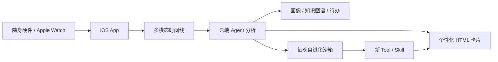

---
tags:
  - 大模型/Agent
  - AI硬件/智能穿戴
  - 个人智能体
  - 多模态
created: 2026-07-12
updated: 2026-07-12
status: 跟踪中
aliases:
  - 云玦
  - Yunjue
  - 云玦科技
source:
  - https://www.yunjuetech.com/
  - https://www.yunjuetech.com/products
  - https://www.yunjuetech.com/tech
  - https://arxiv.org/abs/2601.18226
  - https://github.com/YunjueTech/Yunjue-Agent
---

# 云玦 Yunjue

> [!summary] 一句话判断
> 云玦不是一块已经公开上市的独立 AI 手表，而是一套正在深度内测的“随身多模态硬件 + iOS App + 云端自进化 Agent”。当前以 Apple Watch 验证产品链路，自研多模态硬件 v1 仍在开发。它试图持续记录人的活动、体征和环境信号，每晚整理成事件时间线、个人画像、知识图谱和个性化卡片。

## 一、基本资料

- 公司：云玦科技（Yunjue Technology）。
- 定位：个人智能体、AI wearable、Human-Centric World Model。
- 当前状态：深度内测，官网未公布正式售价、上市日期和公开购买渠道。
- 当前硬件：官方称 Apple Watch 是第一种验证形态。
- 自研硬件：多模态硬件 v1 开发中。
- 官方网站：[云玦科技](https://www.yunjuetech.com/)
- 产品页：[产品形态](https://www.yunjuetech.com/products)
- 技术页：[技术路线](https://www.yunjuetech.com/tech)
- 产品 Demo：[Bilibili BV1vHVz6BEFE](https://www.bilibili.com/video/BV1vHVz6BEFE)
- 内测申请：官方产品页提供邮件申请，要求愿意长期佩戴并参与产品反馈。

> [!important] 名称澄清
> “云玦手表”是容易理解但不够准确的叫法。官网明确写道：`云玦不是一个 App，也不是一块手表`。手表只是当前采集入口之一，真正的产品是跨硬件、手机和云端运行的个人智能体。

## 二、它如何分析人的一天

官方描述的主链路可以概括为：

### 1. 持续采集

官网称随身入口约每 `5 分钟` 收集一次信号，并计划覆盖：

- 双麦音频
- 心率和 HRV
- IMU 运动信号
- 皮肤温度
- SpO2
- 视觉关键帧
- 对话、个人画像和关系图谱等上下文

自研硬件还计划提供隐私指示灯、物理隐私开关、本地缓存和 BLE 上行。官网没有完整披露当前 Apple Watch、iPhone 和云端分别承担哪些采集任务，因此不能默认当前版本已经具备自研硬件规划中的全部传感能力。

### 2. 生成多模态时间线

系统将不同传感器信号按时间对齐，尝试把一天切分成可理解的事件，例如：

- 通勤、会议、写作、运动和休息分别持续了多久。
- 同样的活动，今天的体征和过去 14 天基线有什么差异。
- 某段对话前后，心率、动作和环境是否发生同步变化。
- 用户说“今天挺顺”，但体征是否呈现出明显压力反应。

官方把这种方式称为 `Early Fusion`，强调在较原始的信号层对齐不同模态，而不是先把所有信息压成文字再交给 LLM。

> [!warning] 关于“因果”的边界
> 时间上先后发生和多模态相关性，并不能自动证明因果关系。官网使用了“多模态因果链”的表述，但在看到公开验证、对照实验和误报率之前，更稳妥的理解是“帮助发现值得复盘的关联”。

### 3. 每晚生成回顾和个人画像

官方描述的 nightly pipeline 包括：

1. 审计当日事件，复核可能的误判和事件边界。
2. 增量更新 profile、glossary、个人知识图谱、关系图谱和待办。
3. 识别当前 Skill 库无法覆盖的需求。
4. 在隔离沙箱中生成和验证新工具。
5. 将分析结果渲染成 iOS Feed 里的 HTML 卡片。

卡片不是固定功能列表，而是根据个人行为逐渐生成。官方给出的方向包括：

- 有效工作时长和创作能量曲线。
- 会议、协作对谈和专家访谈摘要。
- 灵感闪现、选题建议和长文写作复盘。
- 亲子日常、关系图谱和长期成长档案。
- 现场创作状态、身体反应和场景手记。

### 4. Zero-Skill 个性化

云玦提出 `Zero-Skill`：第一天 Feed 基本为空，系统先观察用户，约三至七天后开始生成 Skill，两周左右形成差异化卡片库。

这与传统智能手表的区别是：

| 类型 | 主要输出 |
|---|---|
| Apple Watch 等健康穿戴 | 心率、运动、睡眠等指标与固定健康功能 |
| PLAUD NotePin 等 AI 录音穿戴 | 录音转写、摘要、待办 |
| [[云玦 Yunjue|云玦]] | 体征、活动、音频等多模态时间线，加上每天演化的个人 Skill 和卡片 |

## 三、自研硬件规划

官网披露的 v1 方向包括：

- 双麦阵列。
- 心率、HRV、IMU、皮肤温度和 SpO2。
- 隐私指示灯和物理隐私开关。
- 本地缓存和 BLE 数据传输。
- 端侧或边侧先做摘要/融合，减少原始数据上传。

官方强调未来形态不会预先绑定为“手表”，只要求持续在身边、低打扰、多模态和隐私可控。因此最终产品也可能是手环、胸针、挂件或其他形态。

## 四、背后的 Yunjue Agent

> [!info] 本地论文
> ![[附件/大模型/Agent/Yunjue Agent Tech Report.pdf]]

- 论文：[Yunjue Agent Tech Report](https://arxiv.org/abs/2601.18226)
- 代码：[YunjueTech/Yunjue-Agent](https://github.com/YunjueTech/Yunjue-Agent)
- 轨迹数据：[Hugging Face Dataset](https://huggingface.co/datasets/YunjueTech/Yunjue-Agent-Traces)
- 首次提交：2026-01-26；更新：2026-02-06。

论文研究的重点不是穿戴传感器，而是 `In-Situ Self-Evolving Agent`：

- 初始工具库可以为空。
- Agent 在执行任务时自己生成工具。
- 根据代码运行的成功/失败获得可验证反馈。
- 将有效工具归纳、合并并长期复用。
- 用 Parallel Batch Evolution 加快工具演化。

官方报告称该系统在 HLE、DeepSearchQA、FinSearchComp、xbench-ScienceQA 和 xbench-DeepSearch 上取得三项 SOTA、两项第二。GitHub 仓库提供代码、评测脚本和执行轨迹，具备一定可复现性；但结果仍主要来自团队自己的技术报告，需要关注独立复现情况。

它和穿戴产品的关系是：每天的个人数据不是只生成一次摘要，而是被用来发现“系统还缺什么能力”，然后生成新的 Tool 和 Skill。这个连接点也正好对应 [[2026 Agent 技术与论文追踪]] 中的 skills、主动记忆、harness 和自进化 Agent 路线。

## 五、最值得关注的地方

### 1. 从“健康仪表盘”转向“个人上下文系统”

它想回答的不是“今天走了几步”，而是：

- 今天真正有效工作的时间是多少。
- 哪类活动消耗或恢复了精力。
- 哪些对话和事件影响了身体状态。
- 最近两周有哪些重复出现的模式。
- 系统应该为这个人新增什么分析或辅助能力。

### 2. 硬件与 Agent 形成数据闭环

穿戴设备提供持续上下文，Agent 将其整理成记忆、画像和 skills。相比只依赖聊天记录的个人 Agent，这种上下文更连续，但隐私和误判风险也明显更高。

### 3. 产品形态具有实验性

Apple Watch 验证链路降低了硬件冷启动难度，但自研硬件、Early Fusion、自进化卡片和端侧隐私架构都还处在快速开发阶段。现阶段更适合把云玦看作一个值得跟踪的早期产品，而不是成熟的消费电子设备。

## 六、风险与待核实问题

> [!warning] 隐私风险
> 全天音频、视觉、位置、体征和关系图谱属于高度敏感数据，而且同时涉及佩戴者和周围第三方。隐私指示灯和用户授权只是起点，还需要明确录音合法性、旁人知情、数据保留期限、删除权、模型训练用途和数据泄露责任。

- 当前内测使用了哪些具体 Apple Watch 型号和传感器权限？
- 音频是持续录制、事件触发，还是端侧先提取特征？
- 摄像头关键帧由什么设备采集，何时触发？
- “每 5 分钟收信号”和“24h 采集”的耗电、存储与网络成本是多少？
- Early Fusion 使用的是自研模型、适配器，还是现有多模态 API？
- 每日事件切分、压力判断和人物识别的准确率、误报率如何？
- 自生成 Tool/Skill 如何做权限审查、回滚和供应链安全控制？
- 医疗或心理相关建议如何避免越界，是否明确不构成诊断？
- 用户能否导出、删除完整时间线、画像、关系图谱和衍生数据？
- 自研硬件 v1 的外形、售价、续航、上市时间和认证状态尚未公开。

## 七、我的判断

> [!summary] 结论
> 云玦真正有价值的部分不是“多一个 AI 手表”，而是尝试建立持续、跨模态的个人上下文层，再让 Agent 基于长期轨迹生成专属能力。如果能解决准确率、续航、社会录音边界和数据治理，它可能比传统健康手表更接近“个人智能体的感官系统”；如果这些问题解决不好，它也可能退化成高隐私成本的自动日记工具。

现阶段建议重点观察三件事：

1. 自研硬件 v1 是否真正发布，以及传感器、续航和隐私开关如何实现。
2. 是否公开真实用户评测、误报率和端侧数据处理细节。
3. Yunjue Agent 的自进化能力能否在个人数据场景中保持可控、可审计和低成本。

## 相关笔记

- [[2026 Agent 技术与论文追踪]]
- [[个人常驻智能体对比]]
- [[Hermes]]
- [[OpenClaw]]
- [[Letta]]
- [[大模型/08-个体重构/03-知识系统与第二大脑/AI时代的第二大脑设计原则|AI 时代的第二大脑设计原则]]

## 参考资料

- [云玦科技官网](https://www.yunjuetech.com/)
- [云玦产品形态](https://www.yunjuetech.com/products)
- [云玦技术路线](https://www.yunjuetech.com/tech)
- [Yunjue Agent 项目页](https://www.yunjuetech.com/Yunjue-Agent/)
- [Yunjue Agent GitHub](https://github.com/YunjueTech/Yunjue-Agent)
- [Yunjue Agent Tech Report](https://arxiv.org/abs/2601.18226)
