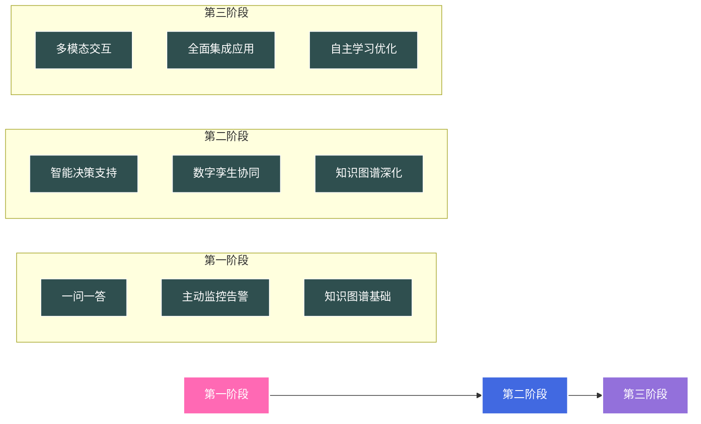

### 1. 一问一答（知识问答）
- **设备诊断与故障排查**
  - 基于历史案例的故障诊断
  - 设备维护建议和最佳实践
  - 技术文档智能解读
  - 操作规程咨询

- **工艺优化咨询**
  - 工艺参数调优建议
  - 生产流程优化
  - 质量问题分析
  - 能耗优化建议

- **专家经验传承**
  - 经验知识沉淀与复用
  - 新员工培训辅助
  - 标准操作流程(SOP)指导

### 2. 主动监控告警
- **预测性维护**
  - 设备健康状态预测
  - 剩余使用寿命评估
  - 维护计划智能推荐
  - 故障预警提示

- **异常检测**
  - 实时工艺参数异常识别
  - 产品质量异常预警
  - 设备运行状态监控
  - 能耗异常分析

### 3. 智能决策支持（新方向）
- **生产计划优化**
  - 产能规划建议
  - 排产方案优化
  - 物料需求预测
  - 库存优化建议

- **风险评估**
  - 安全风险预警
  - 质量风险评估
  - 成本风险分析
  - 环保合规建议

### 4. 数字孪生协同（新方向）
- **虚实映射**
  - 设备运行状态可视化
  - 工艺参数实时同步
  - 生产现场远程监控
  - 设备性能分析

- **场景模拟**
  - 工艺参数优化模拟
  - 生产计划执行模拟
  - 故障场景推演
  - 应急预案演练

### 5. 知识图谱构建（新方向）
- **领域知识沉淀**
  - 设备知识图谱
  - 工艺知识图谱
  - 故障案例关联
  - 专家经验提炼

- **智能分析**
  - 多维关联分析
  - 根因快速定位
  - 知识推理
  - 解决方案推荐

### 6. 多模态交互（新方向）
- **视觉识别**
  - 设备缺陷检测
  - 产品质量检测
  - 安全隐患识别
  - 操作规范监督

- **语音交互**
  - 语音操作指令
  - 现场信息采集
  - 实时状态播报
  - 应急指令下达

这些方向相互关联、相互补充，可以根据企业实际需求和技术能力进行优先级排序和逐步实施。建议：

1. 先从基础的一问一答和监控告警入手
2. 逐步扩展到决策支持和数字孪生
3. 同时构建知识图谱作为底层支撑
4. 最后实现多模态交互增强用户体验

