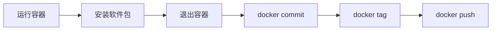

# 如何保存镜像为新的镜像

## 概述

本文档介绍如何在 Docker 容器中安装软件后，将修改后的容器保存为新的镜像。这是创建自定义基础镜像的常用方法。

## 操作流程



### 步骤说明

1. **运行容器** - 使用 `docker run` 启动一个交互式容器
2. **安装软件包** - 在容器中执行安装命令
3. **保存镜像** - 使用 `docker commit` 将容器状态保存为新镜像
4. **查看镜像** - 使用 `docker images` 确认镜像已创建

## 详细操作步骤

### 1. 启动交互式容器

```bash
docker run -it ubuntu:22.04 /bin/bash
```

> [!tip] 参数说明
> - `-i`: 保持 STDIN 打开
> - `-t`: 分配一个伪终端

### 2. 在容器中安装软件

```bash
apt update && apt -y install locales language-pack-ja apt-utils curl vim wget telnet && locale-gen en_US.UTF-8 && apt clean
```

> [!note] 安装的软件包
> - `locales` / `language-pack-ja`: 语言支持
> - `apt-utils`: APT 工具集
> - `curl` / `wget`: 网络下载工具
> - `vim`: 文本编辑器
> - `telnet`: 网络调试工具

### 3. 退出容器

```bash
exit
```

### 4. 保存容器为新镜像

```bash
docker commit <container_id> <new_image_name>
```

> [!warning] 获取容器 ID
> 可以使用 `docker ps -a` 查看最近运行的容器 ID。

### 5. 验证镜像

```bash
docker images
```

## 实际操作示例

以下是一个完整的实际操作流程：

```bash
# 1. 启动 Ubuntu 22.04 容器
docker run -it ubuntu:22.04 /bin/bash

# 2. 在容器内执行安装命令
apt update && apt -y install locales language-pack-ja apt-utils curl vim wget telnet && locale-gen en_US.UTF-8 && apt clean

# 3. 退出容器后，提交为新镜像
docker commit 3fa3333bd71d ubuntu_2204_for_gateway

# 4. 为镜像打标签（准备推送到私有仓库）
docker tag ubuntu_2204_for_gateway 192.0.2.90/gatewaydev/ubuntu_2204_for_gateway:20240425

# 5. 推送到私有镜像仓库
docker push 192.0.2.90/gatewaydev/ubuntu_2204_for_gateway:20240425
```

> [!success] 完成
> 执行完上述步骤后，自定义镜像已保存并推送到私有仓库，可以在其他环境中使用。

## 最佳实践

> [!tip] 建议
> - 使用有意义的镜像名称和标签
> - 标签中包含日期便于版本管理
> - 推送前确保已配置好私有仓库访问权限（参考 [[00 Docker配置]]）

## 相关链接

- [[00 Docker配置]] - Docker daemon 配置
- [[02 如何搭建私有镜像服务器]] - 搭建私有镜像仓库
- [[如何更新镜像文件]] - 镜像更新方法

---

**返回**: [[Kubernetes]]
