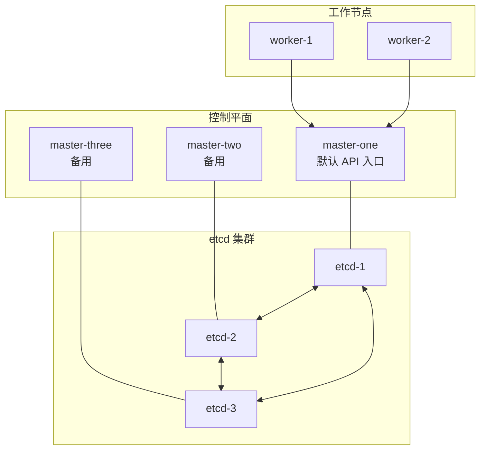

> [!abstract] 概述
> 本文介绍不使用外部负载均衡器时的控制平面冗余方案。默认指向 master-one、故障后人工修改 kubeconfig 只能提供灾备切换，不能提供 API Server 的自动高可用；etcd 多副本也不能替代 API 入口的故障转移。

> [!question] 场景需求
> 如果不部署稳定的 VIP、DNS 或负载均衡器，节点默认都指向 master-one，故障后再人工切换到其他节点。这属于带人工介入的恢复流程，切换期间 API 可能不可用。

## 实现方案概述



## 步骤一：部署多个控制平面节点

为了获得控制平面和 etcd 的节点冗余，需要部署多个控制平面节点；但没有稳定 API 入口时，这种冗余不会自动转化为客户端的高可用。

### 操作步骤

1. 假设当前有一个单节点（`master-one`），使用 [[Kubeadm]] 初始化了集群
2. 添加至少两个新的控制平面节点（例如 `master-two` 和 `master-three`）
3. 在新节点上运行 `kubeadm join --control-plane`，将其加入集群并部署控制平面组件

```bash
kubeadm join <master-one-ip>:6443 \
  --token <token> \
  --discovery-token-ca-cert-hash sha256:<hash> \
  --control-plane \
  --certificate-key <certificate-key>
```

> [!warning] 端点与证书
> `master-one` 作为 join 地址只适合初始化或临时操作。若要自动故障转移，必须在初始化时配置稳定的 `controlPlaneEndpoint`（例如内部 VIP/LB），并确保 API Server 证书 SAN 包含该地址。

> [!success] 结果
> 控制平面组件（API Server、Controller Manager、Scheduler）在多个节点上运行，具备冗余能力。

## 步骤二：配置 etcd 高可用性

[[01 etcd备份恢复|etcd]] 是 Kubernetes 的关键组件，负责存储集群的状态和配置数据。确保 etcd 高可用是实现高可用集群的核心要求。

### 操作步骤

1. 使用 kubeadm 默认的**堆叠式拓扑**（stacked topology），在每个控制平面节点上运行一个 etcd 实例
2. kubeadm 会自动将这些 etcd 实例配置为一个高可用的 etcd 集群
3. 验证 etcd 集群状态：

```bash
kubectl get pods -n kube-system | grep etcd
```

确保每个控制平面节点上都有一个 etcd 实例运行。

> [!success] 结果
> etcd 集群分布在多个节点上，即使某个节点（如 master-one）故障，etcd 仍能正常工作，保证集群数据的高可用性。

## 步骤三：默认指向 master-one 并手动切换

### 默认配置

在所有节点（包括工作节点）的 `/etc/kubernetes/kubelet.conf` 文件中（以 kubelet 实际 `--kubeconfig` 参数为准），将 API 服务器地址设置为 master-one 的地址：

```yaml
server: https://<master-one-ip>:6443
```

确保集群初始化时，master-one 的地址被用作默认的 API 服务器地址。

### 手动切换流程

> [!warning] 故障切换步骤
> 当 master-one 出现故障时，按以下步骤操作：

1. **选择健康节点**：选择一个健康的控制平面节点（例如 `master-two`）

2. **修改配置文件**：在所有节点的 `/etc/kubernetes/kubelet.conf` 文件中，将 API 服务器地址修改为 master-two：

```yaml
server: https://<master-two-ip>:6443
```

3. **重启 kubelet 服务**：

```bash
systemctl restart kubelet
```

4. **验证集群状态**：

```bash
kubectl get nodes
```

> [!danger] 注意事项
> - 手动修改配置需要逐个更新所有节点的 kubeconfig 文件，操作较繁琐
> - 在切换完成前，集群可能会有短暂不可用时间

## 方案验证

| 验证项 | 说明 |
|--------|------|
| 控制平面冗余 | 多个控制平面节点可在 master-one 故障后继续提供组件实例 |
| etcd 高可用 | etcd 集群分布在多个节点，保证数据一致性和可用性 |
| 手动切换 | 通过修改 kubeconfig 实现从 master-one 到其他节点的切换 |

## 局限性与建议

### 局限性

> [!warning] 潜在问题
> - **服务中断时间**：手动切换需要人工干预，可能导致服务中断时间较长（取决于操作速度）
> - **操作复杂性**：在故障时需要快速准确地修改所有节点的配置，存在一定操作风险

### 改进建议

> [!tip] 推荐方案
> 虽然您不希望使用外部负载均衡器，可以考虑在集群内部部署类似 [MetalLB](https://metallb.universe.tf/) 的解决方案，提供自动故障转移功能，减少手动操作的复杂性和中断时间。

## 总结

按照此方案，不使用外部负载均衡器，可以获得控制平面和 etcd 的节点冗余，但 API 入口仍需人工切换：

1. **部署多个控制平面节点**，提供控制平面组件的冗余
2. **配置高可用的 etcd 集群**，确保数据存储的可靠性
3. **默认所有节点指向 master-one**，在故障时手动修改 kubeconfig 文件切换到其他节点

> [!quote] 参考资料
> [Kubernetes 官方文档 - 使用 kubeadm 创建高可用集群](https://kubernetes.io/docs/setup/production-environment/tools/kubeadm/high-availability/)

---

**返回**: [[Kubernetes]]

**相关文档**:
- [[00 如何检查是否高可用]]
- [[01 etcd备份恢复]]
- [[02 Etcd配置讲解]]
- [[实现外部的高可用集群]]
