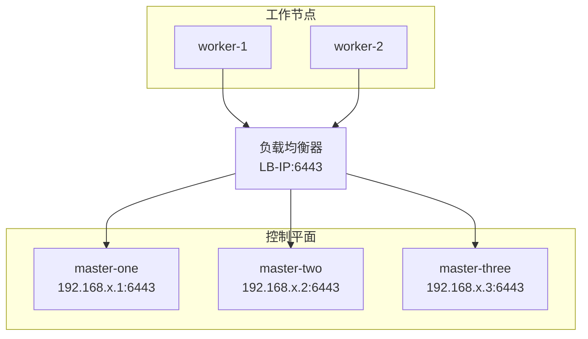

> [!abstract] 概述
> 本文介绍如何将单节点 Kubernetes 集群改造为使用外部负载均衡器的高可用集群。通过配置 HAProxy 或 NGINX 等负载均衡器，实现控制平面的自动故障转移，确保集群在节点故障时仍能正常运行。

> [!question] 场景需求
> 将单节点的 K8S 集群改造为高可用集群，使用外部负载均衡器管理控制平面流量。

## 改造可行性分析

单节点 Kubernetes 集群是指只有一个节点同时运行控制平面组件（如 API 服务器、[[01 etcd备份恢复|etcd]]、控制器管理器和调度器）和工作负载（worker 组件）。

> [!success] 可行性
> 要将其改造为高可用集群，需要增加多个控制平面节点，并通过负载均衡器分发流量，以实现冗余和故障容错。[[Kubeadm]] 支持添加控制平面节点，因此这种改造是可行的，但需要谨慎规划以减少潜在的中断风险。

## 架构图



## 步骤一：设置负载均衡器

### 目的

负载均衡器用于将 Kubernetes API 服务器的流量分发到多个控制平面节点，提供统一的控制平面端点。

### 配置说明

- 配置一个负载均衡器（如 HAProxy、NGINX 或云提供商的负载均衡服务）
- 假设负载均衡器的 IP 地址为 `LB-IP`，端口为 `6443`（Kubernetes API 服务器默认端口）
- 初始时，将负载均衡器配置为仅指向现有的单节点

### HAProxy 配置示例

```haproxy
frontend kubernetes
    bind LB-IP:6443
    mode tcp
    default_backend kubernetes-backend

backend kubernetes-backend
    mode tcp
    server node1 existing-node-ip:6443 check
```

> [!tip] 提示
> 初始配置只包含现有节点，后续添加新节点时再更新配置。

## 步骤二：添加新的控制平面节点

### 准备工作

1. **准备新节点**：
   - 选择至少两台新服务器
   - 确保操作系统、依赖项（如 Docker 或 containerd）与现有节点一致
   - 配置网络，确保新节点可以访问现有节点和负载均衡器

2. **获取加入令牌**：

在现有节点上运行以下命令生成加入集群所需的令牌和证书哈希：

```bash
kubeadm token create --print-join-command
```

输出示例：

```
kubeadm join LB-IP:6443 --token <token> --discovery-token-ca-cert-hash sha256:<hash>
```

### 加入新控制平面节点

在每台新节点上运行以下命令：

```bash
kubeadm join LB-IP:6443 \
  --token <token> \
  --discovery-token-ca-cert-hash sha256:<hash> \
  --control-plane \
  --certificate-key <key>
```

> [!info] 获取 certificate-key
> `<certificate-key>` 可以通过以下命令在现有节点上生成：
> ```bash
> kubeadm init phase upload-certs --upload-certs
> ```

此命令会在新节点上部署控制平面组件（如 API 服务器、etcd 等），并自动将其 etcd 实例加入现有的 etcd 集群。

### 验证加入

检查集群节点状态：

```bash
kubectl get nodes
```

应看到新加入的控制平面节点。

## 步骤三：更新负载均衡器配置

### 目的

确保负载均衡器将流量分发到所有控制平面节点。

### 更新 HAProxy 配置

假设新节点 IP 为 `new-node1-ip` 和 `new-node2-ip`，更新配置：

```haproxy
backend kubernetes-backend
    mode tcp
    server node1 existing-node-ip:6443 check
    server node2 new-node1-ip:6443 check
    server node3 new-node2-ip:6443 check
```

> [!warning] 重要
> 保存并重启负载均衡器服务以应用更改。

## 步骤四：更新工作节点配置

### 目的

确保所有节点（包括现有节点和新加入的工作节点）使用负载均衡器的地址访问 API 服务器。

### 操作步骤

1. 编辑 `/etc/kubernetes/kubelet.conf` 文件，将 `server` 字段从 `https://existing-node-ip:6443` 改为 `https://LB-IP:6443`（如发行版使用其他路径，以实际 kubelet `--kubeconfig` 参数为准）

2. 重启 kubelet 服务：

```bash
systemctl restart kubelet
```

3. 如果集群中有独立的工作节点，对每个工作节点执行相同操作

## 步骤五：验证高可用性

### 检查控制平面组件分布

```bash
kubectl get pods -n kube-system -o wide
```

### 测试高可用性

> [!example] 测试步骤
> 1. 关闭一个控制平面节点
> 2. 验证集群是否仍可通过 `kubectl` 访问
> 3. 确保负载均衡器能正确切换流量

## 注意事项

### etcd 集群

> [!info] etcd 配置
> - 在单节点集群中，etcd 通常是单实例运行
> - 添加新控制平面节点时，kubeadm 会自动在新节点上部署 etcd 并将其加入 etcd 集群，形成高可用 etcd 集群（堆叠式拓扑）
> - 如果需要外部 etcd 集群，可以在改造前单独部署，但这需要更多配置

### 潜在中断

> [!danger] 风险提示
> 更新现有节点的 API 服务器端点或 kubelet 配置可能导致短暂的服务中断。建议：
> - 在维护窗口内操作
> - 提前备份 etcd 数据：
> ```bash
> ETCDCTL_API=3 etcdctl snapshot save backup.db
> ```

### 测试环境

> [!tip] 建议
> 由于改造涉及现有集群的重新配置，建议先在非生产环境中测试完整流程。

### 生产建议

> [!important] 最佳实践
> 对于生产环境，通常推荐从一开始就使用 `kubeadm init --control-plane-endpoint` 设置高可用集群。如果现有单节点集群已有重要数据，改造后需验证数据一致性。

## 总结

通过以上步骤，您可以将单节点的 Kubernetes 集群改造为高可用集群：

| 步骤 | 说明 |
|------|------|
| 1. 设置负载均衡器 | 管理控制平面流量 |
| 2. 添加控制平面节点 | 使用 `kubeadm join --control-plane` |
| 3. 更新负载均衡器 | 添加新节点到后端池 |
| 4. 更新工作节点 | 使用负载均衡器地址访问 API 服务器 |
| 5. 验证高可用性 | 测试故障转移 |

改造完成后，集群将具备控制平面冗余，能够应对单个节点的故障。

> [!quote] 参考资料
> [Kubernetes 官方文档 - 使用 kubeadm 创建高可用集群](https://kubernetes.io/docs/setup/production-environment/tools/kubeadm/high-availability/)

---

**返回**: [[Kubernetes]]

**相关文档**:
- [[00 如何检查是否高可用]]
- [[01 etcd备份恢复]]
- [[02 Etcd配置讲解]]
- [[实现内部高可用集群的方案]]
