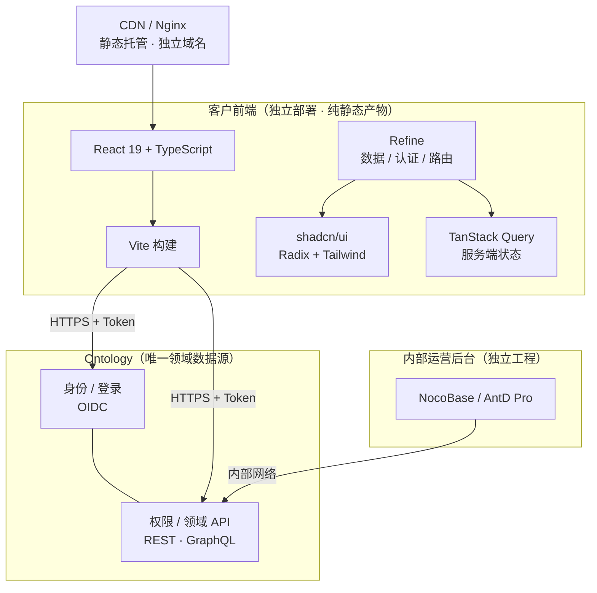
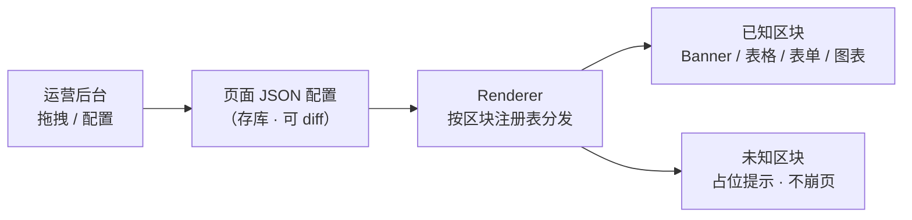

---
tags:
  - 技术/前端
  - 技术/架构
  - 选型报告
created: 2026-11-25
updated: 2026-11-25
source: NocoBase v3 官方手册 + @nocobase/plugin-flow-engine 源码 + 本机评估
status: 方案
type: 技术报告
---

# 客户前端架构方案：React 19 + Vite + Refine + shadcn/ui

> [!summary] 一句话结论
> 客户前端用 **React 19 + Vite + Refine + shadcn/ui**，数据与身份全部走自有 **Ontology API**，部署为独立静态产物；**不采用 NocoBase v3（含 AI Portal）作为客户前端的宿主**，因为它最有价值的认证、权限、数据层在我们的场景里全部用不上，剩下的只是模板和构建 CLI，却要多养一套 NocoBase 服务并接受宿主耦合与升级风险。

## 1. 背景与约束

### 1.1 要解决的问题

要同时交付两类页面：

1. **内部运营后台**：数据维护、配置、审批；
2. **客户使用的前端页面**：展示、查询、表单、看板等，直接面向客户，要求品牌化、性能、稳定。

### 1.2 既有能力

- **Ontology** 已提供身份、登录、权限（PBAC/ACL）与数据 API，是唯一的领域数据源；
- 不需要再引入一套用户体系、组织架构或权限模型；
- 团队用 AI 辅助写代码，需要一套 **AI 熟悉、边界清晰、可测试** 的工程结构。

### 1.3 核心判断

客户前端的价值在**体验、品牌、性能、可控发布**，不在“低代码配置”。因此选型的第一原则是：

> **客户前端必须是独立部署的代码工程，身份/数据/权限直接接 Ontology，不经过第三方应用宿主。**

## 2. 目标架构



关键点：

- 客户前端与内部后台**两个独立工程**，共享 Ontology API，互不绑定；
- 客户前端产物是纯静态文件，可放 CDN/Nginx，独立域名、独立发布、独立回滚；
- 身份只认 Ontology 的 token，不引入第二套登录态。

## 3. 技术栈说明

| 技术 | 角色 | 为什么选它 |
| --- | --- | --- |
| **React 19 + TypeScript** | UI 运行时 | 生态最大、AI 训练数据最多、类型系统能兜住 AI 生成代码的错误 |
| **Vite** | 开发与构建 | 启动快、配置少、产物是标准静态资源，部署无侵入 |
| **Refine** | 数据/认证/路由/CRUD 框架 | headless，不绑定 UI；用 data provider / auth provider 两个适配器即可接任意后端 |
| **shadcn/ui** | 组件基座 | 不是 npm 黑盒依赖，组件源码复制进仓库，可任意改；Radix 保证无障碍，Tailwind 保证主题化 |
| **Tailwind CSS 4** | 样式方案 | 原子类 + CSS 变量主题，适合品牌化与暗色模式 |
| **TanStack Query** | 服务端状态 | 缓存、重试、失效策略成熟（Refine 已内置） |

### 3.1 Refine 是什么

Refine 是 **React 的 headless 应用框架**，只提供逻辑层，不提供视觉：

| 能力 | 说明 |
| --- | --- |
| `dataProvider` | 把 `getList / getOne / create / update / delete` 映射到任意后端 |
| `authProvider` | 把 `login / logout / check / getPermissions` 映射到任意身份系统 |
| 资源与路由 | 按 resource 声明页面，自动挂 React Router 路由 |
| hooks | `useTable`、`useForm`、`useList`、`useCreate` 等，处理分页/筛选/提交 |
| UI 无关 | 可配 shadcn/ui、AntD、MUI，也可纯手写 |

### 3.2 shadcn/ui 是什么

- **不是组件库依赖**，而是“把组件源码复制进仓库”（`components/ui/*.tsx`）；
- 基于 **Radix UI**（无样式、无障碍交互原语）+ **Tailwind CSS**（样式）；
- 组件代码归项目所有，可任意改造，不存在“覆盖第三方样式”的问题；
- 主题用 CSS 变量，品牌化成本低。

## 4. 接入 Ontology

### 4.1 data provider 适配

```ts
import type { DataProvider } from "@refinedev/core";

export const ontologyDataProvider: DataProvider = {
  getList: async ({ resource, pagination, filters, sorters }) => {
    const { current = 1, pageSize = 20 } = pagination ?? {};
    const res = await ontology.query(resource, {
      page: current,
      pageSize,
      filters,
      sorters,
    });
    return { data: res.items, total: res.total };
  },
  getOne: async ({ resource, id }) => {
    const res = await ontology.get(resource, id);
    return { data: res };
  },
  create: async ({ resource, variables }) => {
    const res = await ontology.create(resource, variables);
    return { data: res };
  },
  update: async ({ resource, id, variables }) => {
    const res = await ontology.update(resource, id, variables);
    return { data: res };
  },
  deleteOne: async ({ resource, id }) => {
    const res = await ontology.remove(resource, id);
    return { data: res };
  },
  getApiUrl: () => ontology.baseUrl,
};
```

### 4.2 auth provider 适配

```ts
export const ontologyAuthProvider = {
  login: async ({ username, password }) => {
    const token = await ontology.login(username, password);
    localStorage.setItem("ontology_token", token);
    return { success: true };
  },
  logout: async () => {
    localStorage.removeItem("ontology_token");
    return { success: true };
  },
  check: async () => {
    const ok = await ontology.checkSession();
    return ok ? { authenticated: true } : { authenticated: false };
  },
  getPermissions: async () => ontology.getPermissions(),
  getIdentity: async () => ontology.getCurrentUser(),
  onError: async (error) => {
    if (error?.status === 401) return { logout: true };
    return {};
  },
};
```

> [!note] 要点
> 如果 Ontology 提供 OIDC，优先用 OIDC 授权码模式，前端只保存短期 token，避免自建密码登录；`authProvider` 只负责跳转与回调。

## 5. 工程结构与 AI 协作约定

```text
src/
├─ app/             路由、Provider 装配、全局错误边界
├─ pages/           页面（按业务域分目录）
├─ components/      shadcn/ui 组件 + 业务组件
├─ features/        领域模块（hooks + api + 类型）
├─ lib/             ontology client、dataProvider、authProvider
├─ styles/          Tailwind 入口与设计 token
└─ locales/         国际化文案
```

AI 协作的硬约定（写进仓库 `AGENTS.md`）：

1. **禁止在页面里直接 `fetch`**，统一走 `features/*/api` 与 `lib/ontology`；
2. **禁止改 `components/ui/`**（shadcn 基座），要定制就在业务组件里包一层；
3. **类型先行**：先定义 Ontology 返回类型，再写组件；
4. **每个页面必须有 Playwright 冒烟用例**（路由可打开、关键按钮可点）；
5. **小 PR**：一次只改一个功能域，AI 生成后必须跑 `tsc`、`eslint`、单测；
6. **视觉回归**：共享组件改动必须过截图对比。

### 5.1 需要“可配置页面”时

不要引入通用低代码引擎，做**受限 block registry**：

- 定义 N 种受控区块（Banner、卡片列表、表格、图表、表单、富文本）；
- 每块有 JSON schema + React 组件；
- 运营后台产出 JSON，客户前端用 Renderer 渲染；
- 未知区块显式渲染为占位提示，不静默失败。



## 6. 为什么不用 NocoBase v3

### 6.1 先厘清事实：v3 有两种“页面”，存两处

| 类型 | 存储位置 | 证据 |
| --- | --- | --- |
| 主应用的无代码页面（FlowModel） | **数据库** | `@nocobase/plugin-flow-engine` 的 `dist/server/collections/flowModels.js` 定义了 `flowModels` DB collection（`uid/name/options`，`repository: FlowModelRepository`）；`repository.js` 中 `FlowModelRepository extends @nocobase/database Repository` |
| AI Portal（AI 生成的前端应用） | **源码工程，可选 git** | 官方手册：source storage 支持 `nocobase`（默认）或 `git`，`nb portal push` / `nb portal deploy` |

所以：

- **“页面配置存数据库、保存即生效”** 只对主应用 UI 配置成立；
- **“源码进 git”** 只对 AI Portal 成立；
- 两者是并行路径，v3 没有把“热更新”和“源码可治理”统一起来。

### 6.2 Portal 的价值拆解：核心三件套全部用不上

| Portal 提供 | 我们的情况 | 结论 |
| --- | --- | --- |
| 认证/登录（`NOCOBASE_AUTHENTICATOR`） | Ontology 已有 | 用不上，要替换 |
| ACL/权限（`src/lib/nocobase` 中的 ACL） | Ontology 已有 | 用不上，要拆除 |
| 数据层（Refine provider → NocoBase API 参数） | Ontology 有 API | 要重写 |
| React 19 + Vite + Refine + Tailwind + shadcn/ui 模板 | 可自建或复制 | 只值“脚手架” |
| `AGENTS.md` / `extensions/` 自动装载等 AI 约定 | 可复制 | 只值“约定” |
| `nb portal dev/push/deploy` 构建部署链 | 需要独立部署 | 变成额外耦合 |
| 部署路径 `/x/<portal>/`，由 NocoBase 托管产物 | 客户前端要独立 SLA | 不可接受 |

结论：**为了一个模板，多养一套 NocoBase 服务**，而它真正值钱的部分（身份、权限、数据）我们已有。

### 6.3 发布粒度对比

| 形态 | 改页面配置 | 改代码 | git 可见 | 热更新 |
| --- | --- | --- | --- | --- |
| NocoBase 主应用 UI 页面 | 保存即生效 | 插件构建 + 重启 | 否（在 DB） | 是 |
| NocoBase AI Portal | — | `nb portal deploy` 构建 + 部署 | 是 | 否 |
| **本方案（React 静态产物）** | 通过 block JSON 可做到 | 构建 + 静态部署 | 是 | 可自建 |

客户前端最需要的是**快速发布、秒级回滚、灰度**，这恰好是静态产物的强项；NocoBase Portal 的发布链反而更重。

### 6.4 宿主耦合与运维成本

- Portal 部署在 NocoBase 应用下（`/x/<portal>/`），客户前端 SLA 取决于 NocoBase 进程；
- 认证走 `NOCOBASE_AUTHENTICATOR`，接 Ontology 需要定制 authenticator；
- 多一套 Node 服务要监控、升级、备份；
- 客户前端与内部后台被绑在同一宿主上，故障域重叠。

### 6.5 升级与许可风险

- v3 目前仍是 **Beta**，FlowEngine / Portal 的 API 还在演进；
- NocoBase 核心是 **AGPL-3.0 + 商业授权** 双许可，商业化交付需要法务确认（详见 [[技术笔记/前端开发/AI 时代的建站工具选型与工程约束|AI 时代的建站工具选型与工程约束]] 的许可证矩阵）；
- 引入后每次升级都要回归客户页面，风险与收益不匹配。

### 6.6 那什么情况下才该用 NocoBase

- 需要**业务人员自助配置**页面、工作流、数据模型；
- 需要现成的后台区块、插件生态；
- 能接受它作为**独立应用宿主**，而不是嵌进现有系统；
- 团队愿意跟进上游升级节奏。

这些条件在我们“客户前端 + 自有 Ontology”的场景里都不成立。

## 7. 方案对比矩阵

| 维度 | 本方案（React 自研） | NocoBase AI Portal | NocoBase UI 配置页 | amis/Formily |
| --- | --- | --- | --- | --- |
| 技术栈可控 | 高 | 中（模板固定） | 低 | 中 |
| 身份/权限接入 | 直接接 Ontology | 需换 authenticator | 需改造 ACL | 直接接 |
| 品牌化/体验 | 高 | 中 | 低 | 中 |
| 独立部署 | 是 | 否（宿主托管） | 否 | 是 |
| 发布/回滚 | 静态秒级 | 构建部署 | 热更新 | 静态 |
| 配置化页面 | 需自建 block registry | 无 | 强 | 强（JSON） |
| 升级风险 | 自主 | 跟 NocoBase Beta | 跟 NocoBase | 低 |
| 适用 | 客户前端 | 客户前端（宿主内） | 内部后台 | 中后台 |

## 8. 落地路径

| 阶段 | 内容 | 验收 |
| --- | --- | --- |
| P0 | 工程骨架：Vite + React 19 + TS + Tailwind + shadcn/ui + Refine | `pnpm dev` 可跑，`tsc`/`eslint` 通过 |
| P1 | Ontology 接入：client、dataProvider、authProvider | 登录、列表、详情、提交跑通 |
| P2 | 页面模板：列表页、表单页、详情页、看板页 | 3 个真实页面可交付 |
| P3 | 工程化：Playwright 冒烟、视觉回归、CI、静态部署 | 一键发布 + 回滚 |
| P4 | 可选：block registry + JSON 配置 | 运营可配简单页面 |

### 8.1 验收指标

| 指标 | 目标 |
| --- | --- |
| 首屏 LCP（移动端模拟） | < 2.5 s |
| 首屏 JS | 按路由拆分，单页 < 200 KB gzip |
| 新增一个页面 | ≤ 3 个文件、≤ 1 天 |
| 发布耗时 | < 5 分钟，回滚 < 1 分钟 |
| AI 生成代码回归 | CI 必跑 `tsc` + lint + Playwright |

## 9. 风险与对策

| 风险 | 对策 |
| --- | --- |
| AI 改坏共享组件 | shadcn 基座只读；业务组件分层；视觉回归 |
| Ontology API 变更 | 类型定义集中管理；适配层隔离；契约测试 |
| 客户前端多租户/白标 | 从第一天保留 `tenant` 上下文与主题 token |
| 需要配置化页面 | 受限 block registry，不做通用低代码 |
| 团队不熟 Refine | 先做一个列表 + 表单 POC，再铺开 |

## 10. 参考资料

- [NocoBase 部署与源码管理](https://nocode.docs.nocobase.com/cn/ai-builder/ai-portal/deploy) —— Portal 的 source storage 与 `nb portal` 生命周期
- [NocoBase AI Portal 项目结构与技术栈](https://nocode.docs.nocobase.com/cn/ai-builder/ai-portal/project-structure) —— React 19 + Vite + Refine + shadcn/ui 模板
- [NocoBase 发布管理](https://nocode.docs.nocobase.com/cn/ai-builder/publish) —— 跨环境发布走备份/迁移，不是 git
- [NocoBase FlowModel 持久化](https://nocode.docs.nocobase.com/cn/flow-engine/flow-model-repository) —— `IFlowModelRepository` 可持久化到 DB/API/其他介质
- [Refine 官方文档](https://refine.dev/docs/) —— headless CRUD 框架
- [shadcn/ui 官方文档](https://ui.shadcn.com/docs) —— 组件源码与 Tailwind/Radix 基座
- 相关笔记：[[技术笔记/前端开发/AI 时代的建站工具选型与工程约束|AI 时代的建站工具选型与工程约束]]
