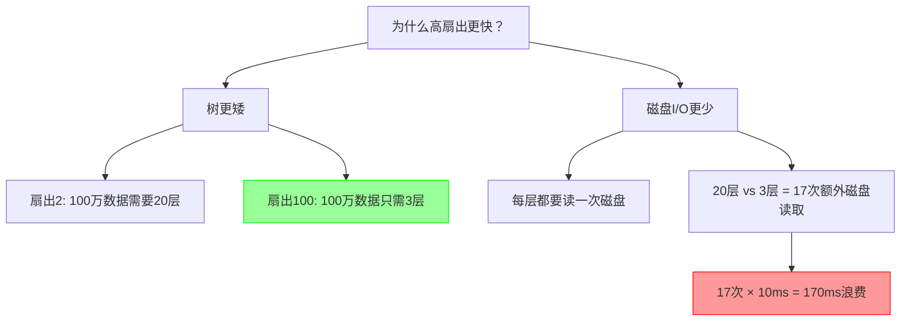
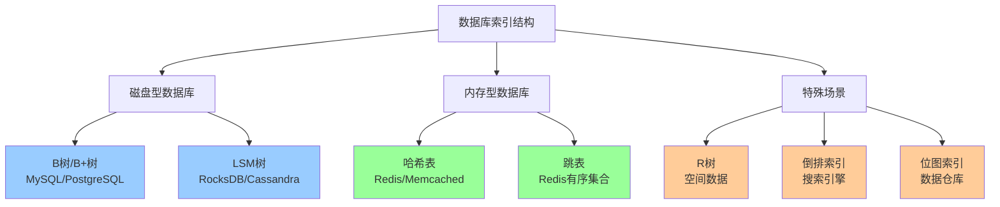
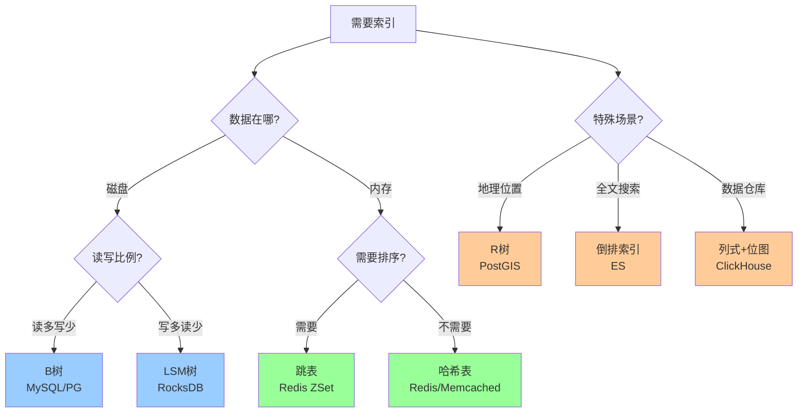

# B树深入解析：扇出与其他索引结构

> 本文是 [[技术笔记/数据库/B树：为什么每个数据库都在使用它|B树主文]] 的补充阅读材料

## 📋 目录

1. [什么是扇出？为什么低扇出会扼杀性能？](#什么是扇出为什么低扇出会扼杀性能)
2. [数据库索引结构全景图](#数据库索引结构全景图)

---

## 什么是扇出？为什么低扇出会扼杀性能？

### 扇出（Fanout）的定义

**扇出 = 一个节点能有多少个子节点**

简单来说：
- 二叉树的扇出 = **2**（每个节点最多2个子节点）
- B树的扇出 = **100-1000**（每个节点可以有上百个子节点）

### 📊 直观对比

假设我们要存储 **100万条记录**：

| 数据结构 | 扇出 | 树高度 | 磁盘读取次数 | HDD耗时 |
|---------|------|--------|------------|---------|
| **二叉树** | 2 | log₂(1,000,000) ≈ **20层** | 20次 | **200ms** ❌ |
| **B树(扇出100)** | 100 | log₁₀₀(1,000,000) ≈ **3层** | 3次 | **30ms** ✅ |
| **B树(扇出1000)** | 1000 | log₁₀₀₀(1,000,000) ≈ **2层** | 2次 | **20ms** ✅✅ |

### 🔍 为什么差距这么大？

#### 关键原因：磁盘I/O是瓶颈

```
CPU运算：纳秒级 (0.000001 ms)
内存访问：纳秒级 (0.0001 ms)
SSD读取：0.1 ms
HDD读取：10 ms  ← 这是瓶颈！
```

**每多一层树 = 多一次磁盘寻道 = 多10ms延迟**

### 📈 具体例子：查找一条记录

#### 低扇出（二叉树，扇出=2）

```
查找ID=999999的用户

第1次磁盘读取：读根节点 (500000)
  → ID > 500000，往右走

第2次磁盘读取：读右子节点 (750000)
  → ID > 750000，往右走

第3次磁盘读取：读右子节点 (875000)
  → ID > 875000，往右走

... 继续18次 ...

第20次磁盘读取：终于找到 999999

总耗时：20次 × 10ms = 200ms
```

#### 高扇出（B树，扇出=100）

```
查找ID=999999的用户

第1次磁盘读取：读根节点
  包含100个键：[10000, 20000, 30000, ..., 990000, 1000000]
  → 二分查找：999999在990000和1000000之间
  → 跟随第100个指针

第2次磁盘读取：读内部节点
  包含100个键：[991000, 992000, ..., 999000, 1000000]
  → 999999在999000和1000000之间
  → 跟随第10个指针

第3次磁盘读取：读叶节点
  包含数据：[999001, 999002, ..., 999999, 1000000]
  → 找到！返回数据

总耗时：3次 × 10ms = 30ms
```

### 🎯 核心差异



### 数学公式

#### 树高度计算

对于 **n** 条记录，扇出为 **f** 的树：

```
树高度 = ⌈log_f(n)⌉

例子：
- n=1,000,000, f=2   → 高度 = log₂(1,000,000) ≈ 20
- n=1,000,000, f=100 → 高度 = log₁₀₀(1,000,000) ≈ 3
```

#### 磁盘I/O时间

```
查询时间 = 树高度 × 单次磁盘I/O时间

例子（HDD，10ms/次）：
- 扇出2   → 20 × 10ms = 200ms
- 扇出100 → 3 × 10ms = 30ms

性能提升：200/30 = 6.7倍！
```

### 为什么磁盘读取这么慢？

#### HDD（机械硬盘）

```
1. 寻道（Seek）：磁头移动到正确磁道 → 5-10ms
2. 旋转延迟：等待数据转到磁头下 → 2-5ms
3. 数据传输：读取4KB → 0.1ms

总计：~10ms/次
```

#### SSD（固态硬盘）

```
1. 查找块地址 → 0.05ms
2. 读取4KB → 0.05ms

总计：~0.1ms/次（快100倍，但仍比内存慢1000倍）
```

### 为什么B树选择高扇出？

#### 磁盘块大小是固定的

```
磁盘块大小：通常4KB-16KB
读取1字节 = 读取整个块（4KB）

既然都要读4KB，不如在这4KB里塞满数据！
```

#### B树节点设计

```python
# 一个16KB的B树节点可以存储：

# 方案1：低扇出（像二叉树）
节点大小：16KB
键数量：1个（8字节）
指针数量：2个（16字节）
浪费空间：16KB - 24字节 ≈ 99%浪费！ ❌

# 方案2：高扇出（B树）
节点大小：16KB
键数量：500个（每个32字节 = 键8字节 + 值24字节）
指针数量：501个（每个8字节）
利用率：(500×32 + 501×8) / 16384 ≈ 95%利用！ ✅
扇出：501
```

### 实际影响

#### 数据库查询性能对比

```sql
-- 表：users，1000万条记录

-- 场景1：无索引（全表扫描）
SELECT * FROM users WHERE id = 9999999;
-- 需要扫描1000万条
-- 耗时：几秒到几分钟

-- 场景2：二叉树索引（扇出2，假设存在）
-- 树高度：log₂(10,000,000) ≈ 24层
-- 磁盘I/O：24次
-- 耗时：240ms（HDD）

-- 场景3：B树索引（扇出100，实际使用）
-- 树高度：log₁₀₀(10,000,000) ≈ 4层
-- 磁盘I/O：4次
-- 耗时：40ms（HDD）或 0.4ms（SSD）
```

#### 规模增长的影响

| 数据量 | 扇出=2 (层数) | 扇出=100 (层数) | 性能差距 |
|-------|--------------|----------------|---------|
| 1千 | 10 | 2 | **5倍** |
| 1万 | 14 | 2 | **7倍** |
| 100万 | 20 | 3 | **6.7倍** |
| 1亿 | 27 | 4 | **6.8倍** |
| 10亿 | 30 | 5 | **6倍** |

**数据越多，高扇出的优势越明显！**

### 💡 总结

#### 低扇出扼杀性能的原因

1. **树太高** → 需要更多层级
2. **磁盘I/O太多** → 每层都要读一次磁盘
3. **磁盘访问慢** → 每次10ms累加
4. **浪费磁盘块空间** → 每次读4KB却只用几字节

#### B树的解决方案

```
核心思想：用空间换时间

1. 每个节点塞满数据（高扇出）
2. 树变矮（减少层数）
3. 磁盘I/O变少（减少寻道）
4. 查询变快（从200ms降到30ms）
```

#### 形象比喻

```
低扇出（二叉树）= 单行道：
  └─ 每次只能选2条路
  └─ 要走20个红绿灯才到目的地
  └─ 每个红绿灯等10秒
  └─ 总耗时：200秒

高扇出（B树）= 高速公路：
  └─ 每次可以选100条路
  └─ 只需3个高速出口就到目的地
  └─ 每个出口10秒
  └─ 总耗时：30秒
```

**扇出越高 = 路越宽 = 到达目的地越快！** 🚀

---

## 数据库索引结构全景图

### 按使用场景分类



---

## 1️⃣ B树/B+树家族

### 使用场景
- ✅ **读多写少**的OLTP场景
- ✅ 需要**范围查询**
- ✅ 磁盘存储

### 代表数据库

| 数据库 | 索引类型 | 特点 |
|-------|---------|------|
| **MySQL InnoDB** | B+树 | 聚簇索引+二级索引 |
| **PostgreSQL** | B树 | 默认索引类型 |
| **SQLite** | B树 | 所有数据存B树 |
| **Oracle** | B+树 | 企业级优化 |
| **SQL Server** | B+树 | 聚簇/非聚簇索引 |
| **MongoDB** | B树 | WiredTiger引擎 |

### 示例代码

```sql
-- MySQL默认创建B+树索引
CREATE INDEX idx_user_email ON users(email);

-- PostgreSQL显式指定
CREATE INDEX idx_user_email ON users USING BTREE(email);
```

---

## 2️⃣ LSM树（Log-Structured Merge Tree）

### 核心思想
**写入优化**：先写内存，批量刷盘，避免随机写

```
写入流程：
1. 写入内存表（MemTable）
2. 内存满了 → 刷到磁盘（SSTable）
3. 后台合并多个SSTable → 减少文件数
```

### 使用场景
- ✅ **写多读少**的场景
- ✅ 时序数据、日志数据
- ✅ 能接受读放大

### 代表数据库

| 数据库 | 场景 | 写性能 | 读性能 |
|-------|------|--------|--------|
| **RocksDB** | 嵌入式KV存储 | ⭐⭐⭐⭐⭐ | ⭐⭐⭐ |
| **Cassandra** | 分布式NoSQL | ⭐⭐⭐⭐⭐ | ⭐⭐⭐ |
| **LevelDB** | Google开源KV | ⭐⭐⭐⭐ | ⭐⭐⭐ |
| **HBase** | 大数据NoSQL | ⭐⭐⭐⭐⭐ | ⭐⭐ |
| **InfluxDB** | 时序数据库 | ⭐⭐⭐⭐⭐ | ⭐⭐⭐ |

### B树 vs LSM树对比

```python
# 性能对比（相对值）

场景：100万次操作

             B树      LSM树
写入性能：    ⭐⭐⭐    ⭐⭐⭐⭐⭐  (快3-10倍)
读取性能：    ⭐⭐⭐⭐⭐  ⭐⭐⭐    (慢2-5倍)
范围查询：    ⭐⭐⭐⭐⭐  ⭐⭐⭐⭐
空间占用：    ⭐⭐⭐⭐   ⭐⭐⭐    (写放大)
```

### 实际例子

```python
# RocksDB (LSM树)
import rocksdb

db = rocksdb.DB("test.db", rocksdb.Options(create_if_missing=True))

# 写入非常快（批量写入内存）
for i in range(1000000):
    db.put(f"key{i}".encode(), f"value{i}".encode())

# 读取稍慢（可能需要查多个SSTable）
value = db.get(b"key999")
```

---

## 3️⃣ 哈希表（Hash Table）

### 核心思想
**O(1)精确查找**：key → hash(key) → 直接定位

```
查找流程：
ID=12345 → hash(12345) = 槽位67 → 直接读取
```

### 使用场景
- ✅ **精确匹配**查询（`WHERE id = 123`）
- ✅ 内存数据库
- ❌ **不支持范围查询**（`WHERE id > 100`）

### 代表数据库

| 数据库 | 哈希用途 | 特点 |
|-------|---------|------|
| **Redis** | 主要数据结构 | 字符串、哈希、集合 |
| **Memcached** | 全部用哈希 | 纯内存KV |
| **PostgreSQL** | Hash索引 | 精确查询优化 |
| **MySQL Memory引擎** | Hash索引 | 临时表 |

### 示例代码

```sql
-- PostgreSQL创建哈希索引
CREATE INDEX idx_user_id ON users USING HASH(id);

-- 快速查询（O(1)）
SELECT * FROM users WHERE id = 12345;  -- ✅ 超快

-- 不支持范围查询
SELECT * FROM users WHERE id > 12345;   -- ❌ 全表扫描
```

```python
# Redis (纯哈希)
import redis

r = redis.Redis()

# O(1)写入
r.set('user:12345', '{"name":"Alice"}')

# O(1)读取
user = r.get('user:12345')
```

---

## 4️⃣ 跳表（Skip List）

### 核心思想
**多层链表快速查找**：类似“高速公路+辅路”

```
层级4: 1 ----------------> 50
层级3: 1 -------> 25 -----> 50
层级2: 1 --> 10 -> 25 -> 40 -> 50
层级1: 1->5->10->15->25->30->40->45->50
```

### 使用场景
- ✅ **有序数据**
- ✅ 需要范围查询
- ✅ 并发友好（无需锁整棵树）

### 代表数据库

| 数据库 | 用途 | 复杂度 |
|-------|------|--------|
| **Redis Sorted Set** | 排行榜、延时队列 | O(log n) |
| **LevelDB** | MemTable实现 | O(log n) |
| **MemSQL** | 内存索引 | O(log n) |

### 示例代码

```python
# Redis有序集合（基于跳表）
import redis

r = redis.Redis()

# 添加分数
r.zadd('leaderboard', {'Alice': 100, 'Bob': 95, 'Charlie': 90})

# 范围查询（跳表高效）
top3 = r.zrevrange('leaderboard', 0, 2, withscores=True)
# [('Alice', 100), ('Bob', 95), ('Charlie', 90)]

# 分数范围查询
users = r.zrangebyscore('leaderboard', 90, 100)
```

---

## 5️⃣ R树（R-Tree）

### 核心思想
**空间索引**：为多维数据（地理位置、几何对象）设计

```
空间划分：
┌─────────────┬─────────────┐
│   区域A      │   区域B      │
│  (餐厅1-5)   │  (餐厅6-10)  │
├─────────────┼─────────────┤
│   区域C      │   区域D      │
│  (餐厅11-15) │  (餐厅16-20) │
└─────────────┴─────────────┘
```

### 使用场景
- ✅ **地理位置**查询（附近的餐厅）
- ✅ 几何图形碰撞检测
- ✅ 游戏地图索引

### 代表数据库

| 数据库 | R树用途 | 示例 |
|-------|---------|------|
| **PostgreSQL (PostGIS)** | 地理空间索引 | 查找附近10km的酒店 |
| **MongoDB** | 地理位置查询 | 2dsphere索引 |
| **SQLite (SpatiaLite)** | 空间扩展 | GIS应用 |
| **MySQL (Spatial)** | 空间索引 | Geometry类型 |

### 示例代码

```sql
-- PostgreSQL PostGIS
CREATE INDEX idx_location ON restaurants USING GIST(location);

-- 查找5km内的餐厅
SELECT name, ST_Distance(location, ST_MakePoint(116.4, 39.9)) as distance
FROM restaurants
WHERE ST_DWithin(location, ST_MakePoint(116.4, 39.9), 5000)
ORDER BY distance;
```

```javascript
// MongoDB 2dsphere索引
db.restaurants.createIndex({ location: "2dsphere" });

// 查找附近5km的餐厅
db.restaurants.find({
  location: {
    $near: {
      $geometry: { type: "Point", coordinates: [116.4, 39.9] },
      $maxDistance: 5000
    }
  }
});
```

---

## 6️⃣ 倒排索引（Inverted Index）

### 核心思想
**全文搜索**：单词 → 包含该单词的文档列表

```
倒排索引示例：

文档1: "I love Redis"
文档2: "I love MySQL"
文档3: "Redis is fast"

倒排索引：
"I"     → [文档1, 文档2]
"love"  → [文档1, 文档2]
"Redis" → [文档1, 文档3]
"MySQL" → [文档2]
"is"    → [文档3]
"fast"  → [文档3]
```

### 使用场景
- ✅ **全文搜索**
- ✅ 日志分析
- ✅ 文档检索

### 代表数据库/引擎

| 系统 | 场景 | 特点 |
|------|------|------|
| **Elasticsearch** | 搜索引擎 | 分布式全文搜索 |
| **Solr** | 企业搜索 | Apache Lucene |
| **PostgreSQL (GIN)** | 全文索引 | `tsvector`类型 |
| **MongoDB (Text)** | 文本搜索 | 简单全文索引 |
| **Sphinx** | 全文检索 | SQL兼容 |

### 示例代码

```python
# Elasticsearch
from elasticsearch import Elasticsearch

es = Elasticsearch()

# 索引文档
es.index(index="articles", id=1, body={
    "title": "Introduction to Redis",
    "content": "Redis is an in-memory database..."
})

# 全文搜索
results = es.search(index="articles", body={
    "query": {
        "match": {
            "content": "in-memory database"
        }
    }
})
```

```sql
-- PostgreSQL全文搜索
CREATE INDEX idx_content ON articles USING GIN(to_tsvector('english', content));

-- 搜索包含"database"的文章
SELECT title, content
FROM articles
WHERE to_tsvector('english', content) @@ to_tsquery('database');
```

---

## 7️⃣ 位图索引（Bitmap Index）

### 核心思想
**低基数列优化**：用位图表示每个值的存在

```
示例：100万用户，性别字段

传统索引：
male   → [1, 3, 5, 7, ...]  (50万个ID)
female → [2, 4, 6, 8, ...]  (50万个ID)

位图索引（用bit表示）：
male   → 10101010... (100万bit = 125KB)
female → 01010101... (100万bit = 125KB)

空间节约：传统索引~8MB，位图索引~250KB
```

### 使用场景
- ✅ **低基数列**（性别、状态、类型）
- ✅ 数据仓库（OLAP）
- ✅ 多条件组合查询

### 代表数据库

| 数据库 | 位图索引用途 | 场景 |
|-------|------------|------|
| **Oracle** | 数据仓库优化 | OLAP查询 |
| **PostgreSQL** | Bitmap Index Scan | 查询优化器 |
| **Greenplum** | 列式存储 | 大数据分析 |
| **ClickHouse** | 分析型数据库 | 实时OLAP |

### 示例代码

```sql
-- Oracle创建位图索引
CREATE BITMAP INDEX idx_gender ON users(gender);
CREATE BITMAP INDEX idx_status ON users(status);

-- 高效的多条件查询
SELECT COUNT(*)
FROM users
WHERE gender = 'male'
  AND status = 'active'
  AND age_group = '25-34';

-- 优化器使用位图AND运算，非常快
```

---

## 8️⃣ 列式存储（Columnar Storage）

### 核心思想
**按列存储**：分析查询只读需要的列

```
行式存储（传统）：
行1: [ID=1, Name=Alice, Age=25, City=Beijing]
行2: [ID=2, Name=Bob,   Age=30, City=Shanghai]
行3: [ID=3, Name=Carol, Age=28, City=Beijing]

列式存储：
ID列:   [1, 2, 3]
Name列: [Alice, Bob, Carol]
Age列:  [25, 30, 28]
City列: [Beijing, Shanghai, Beijing]
```

### 使用场景
- ✅ **OLAP分析查询**
- ✅ 只读少数几列
- ✅ 聚合计算（SUM、AVG、COUNT）

### 代表数据库

| 数据库 | 场景 | 压缩率 |
|-------|------|--------|
| **ClickHouse** | 实时OLAP | 10-100倍 |
| **Apache Parquet** | 大数据存储 | 5-20倍 |
| **Amazon Redshift** | 云数据仓库 | 10-50倍 |
| **Google BigQuery** | 云分析 | 自动优化 |
| **Apache ORC** | Hive优化 | 5-15倍 |

### 示例代码

```sql
-- ClickHouse (列式数据库)
CREATE TABLE users (
    id UInt32,
    name String,
    age UInt8,
    city String
) ENGINE = MergeTree()
ORDER BY id;

-- 只读age列（超快）
SELECT AVG(age) FROM users WHERE city = 'Beijing';
-- 只扫描age和city列，不读取name等
```

```python
# Parquet (列式文件格式)
import pandas as pd

# 写入Parquet
df = pd.DataFrame({
    'id': [1, 2, 3],
    'name': ['Alice', 'Bob', 'Carol'],
    'age': [25, 30, 28]
})
df.to_parquet('users.parquet')

# 只读age列
df_age = pd.read_parquet('users.parquet', columns=['age'])
```

---

## 🎯 完整对比表

| 数据结构 | 读性能 | 写性能 | 范围查询 | 空间占用 | 适用场景 | 代表数据库 |
|---------|-------|-------|---------|---------|---------|-----------|
| **B树** | ⭐⭐⭐⭐ | ⭐⭐⭐ | ✅ | ⭐⭐⭐⭐ | OLTP | MySQL, PostgreSQL |
| **LSM树** | ⭐⭐⭐ | ⭐⭐⭐⭐⭐ | ✅ | ⭐⭐⭐ | 写密集 | Cassandra, RocksDB |
| **哈希表** | ⭐⭐⭐⭐⭐ | ⭐⭐⭐⭐⭐ | ❌ | ⭐⭐⭐⭐⭐ | 精确查找 | Redis, Memcached |
| **跳表** | ⭐⭐⭐⭐ | ⭐⭐⭐⭐ | ✅ | ⭐⭐⭐⭐ | 有序数据 | Redis ZSet |
| **R树** | ⭐⭐⭐ | ⭐⭐ | ✅ | ⭐⭐⭐ | 空间数据 | PostGIS, MongoDB |
| **倒排索引** | ⭐⭐⭐⭐ | ⭐⭐⭐ | ⚠️ | ⭐⭐ | 全文搜索 | Elasticsearch |
| **位图索引** | ⭐⭐⭐⭐⭐ | ⭐⭐ | ✅ | ⭐⭐⭐⭐⭐ | 低基数OLAP | Oracle, ClickHouse |
| **列式存储** | ⭐⭐⭐⭐⭐ | ⭐⭐ | ✅ | ⭐⭐⭐⭐⭐ | 分析查询 | ClickHouse, Parquet |

---

## 🔍 如何选择数据结构？

### 决策树



### 实际场景推荐

| 场景 | 推荐数据结构 | 数据库选择 |
|------|------------|-----------|
| **电商网站** | B树 | MySQL, PostgreSQL |
| **社交媒体** | LSM树 | Cassandra, HBase |
| **缓存系统** | 哈希表 | Redis, Memcached |
| **排行榜** | 跳表 | Redis Sorted Set |
| **地图应用** | R树 | PostGIS, MongoDB |
| **搜索引擎** | 倒排索引 | Elasticsearch |
| **数据分析** | 列式+位图 | ClickHouse, BigQuery |
| **时序数据** | LSM树 | InfluxDB, TimescaleDB |

---

## 💡 总结

### 核心要点

1. **没有银弹**：不同场景需要不同数据结构
2. **B树最通用**：OLTP场景的首选（MySQL、PostgreSQL）
3. **LSM树擅长写**：日志、时序、大数据（Cassandra、RocksDB）
4. **哈希表最快**：精确查找，但不支持范围查询
5. **专用结构**：地理位置用R树，全文搜索用倒排索引

### 选择建议

```
问自己3个问题：
1. 数据在哪？（内存 vs 磁盘）
2. 读写比例？（读多 vs 写多）
3. 查询类型？（精确 vs 范围 vs 全文）

然后选择最合适的数据结构！
```

**记住：合适的 > 流行的**！🎯

---

## 参考资料

- [[技术笔记/数据库/B树：为什么每个数据库都在使用它|B树主文档]]
- [[技术笔记/数据库/Mysql/MySQL索引优化|MySQL索引优化]]
- [[技术笔记/数据结构/树形结构|树形数据结构]]
