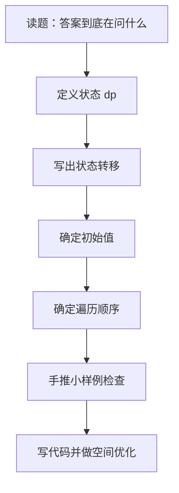
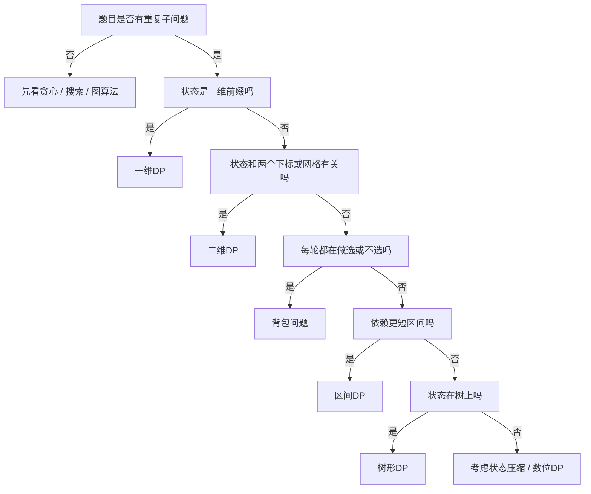

# 动态规划

> [!summary] 一句话
> 动态规划的核心不是“套公式”，而是把重复子问题定义成状态，再按正确顺序把答案一层层推出来。

## 🎯 什么问题该想到 DP

遇到下面这些信号时，优先考虑动态规划：

- 大问题可以拆成更小的问题。
- 小问题会被反复计算。
- 题目问的是：
  - 最优值
  - 方案数
  - 可行性
  - 最短 / 最小 / 最大

> [!tip] 快速判断
> 如果你写暴力搜索时，发现很多递归分支在反复求同一个子结果，这往往就是 DP 的入口。

## 🧠 先把 DP 想成人话

以爬楼梯为例：

- 到第 `i` 级台阶的方法数，不需要从头重新算。
- 因为最后一步只可能来自：
  - 第 `i-1` 级走 1 步
  - 第 `i-2` 级走 2 步

所以：

```text
dp[i] = dp[i-1] + dp[i-2]
```

这就是动态规划最常见的思路：

1. 先给每个“小问题”起名字。
2. 找它和更小问题的关系。
3. 按顺序把表填出来。

## 🔁 DP 的工作流



## 🧩 五步法

| 步骤 | 你要回答的问题 | 常见例子 |
|------|----------------|----------|
| 1. 定义状态 | `dp[i]` / `dp[i][j]` 表示什么 | `dp[i] = 到 i 的最优值` |
| 2. 状态转移 | 当前状态从哪些旧状态来 | `dp[i] = max(dp[i-1], dp[i-2] + x)` |
| 3. 初始化 | 最小问题的答案是什么 | `dp[0] = 0`、`dp[1] = 1` |
| 4. 遍历顺序 | 先算谁，后算谁 | 正序、逆序、按区间长度 |
| 5. 返回答案 | 最终答案落在哪里 | `dp[n]`、`dp[m][n]` |

## 📦 动态规划常见问题类型

### 1. 线性转移

- 前缀型、序列型。
- 只依赖前面几个状态。
- 典型题：
  - [[一维DP|一维DP]]
  - 爬楼梯
  - 打家劫舍
  - 最大子数组和

### 2. 网格 / 双序列

- 状态通常有两个维度。
- 来自上、左、左上等方向。
- 典型题：
  - [[二维DP|二维DP]]
  - LCS
  - 编辑距离
  - 不同路径

### 3. 选或不选

- 每一轮处理一个物品或一个选择。
- 特别适合“容量 / 预算 / 目标和”。
- 典型题：
  - [[背包问题]]

### 4. 区间拆分

- 答案定义在一个区间上。
- 依赖更短的区间。
- 典型题：
  - [[区间DP]]
  - 戳气球
  - 回文子串

### 5. 树上转移

- 每个节点的答案依赖子树。
- 常见写法是后序遍历 + 返回状态。
- 典型题：
  - [[树形DP]]

### 6. 状态压缩 / 数位

- 状态本身不再是简单下标。
- 适合“集合 / 位掩码 / 数位约束”。
- 典型题：
  - [[状态压缩DP]]
  - [[数位DP]]

## 🗺️ 选型图



## ⚠️ 最容易错的地方

### 状态定义不清

例如：

- `dp[i]` 是“前 i 个元素的最优解”
- 还是“以 i 结尾的最优解”

这两个定义会直接影响转移公式。

### 初始化瞎填

很多 DP 不是逻辑难，而是第一行、第一列、空状态没想清楚。

### 遍历顺序反了

这是背包问题最常见的坑：

- `0-1 背包`：逆序
- `完全背包`：正序

### 把“答案定义”和“题目答案位置”混了

有的题答案是 `dp[n]`，有的题是 `max(dp)`，有的题是 `dp[m][n]`。

## 🧪 写代码前的最小检查

> [!check] 提交前先过这 5 个问题
> - `dp` 的含义能不能用一句话说清楚？
> - 转移时引用的是不是“已经算好的状态”？
> - 初始值是否覆盖了空串、空数组、边界行列？
> - 遍历方向是否和状态依赖一致？
> - 返回的是 `dp[n]`、`dp[-1]` 还是 `max(dp)`？

## 📚 专题入口

### [[一维DP|基础DP - 一维]]

- 爬楼梯（LeetCode 70）
- 打家劫舍（LeetCode 198）
- 解码方法（LeetCode 91）
- 最大子数组和（LeetCode 53）
- 单词拆分（LeetCode 139）

### [[二维DP|基础DP - 二维]]

- 最长公共子序列 LCS（LeetCode 1143）
- 最长递增子序列 LIS（LeetCode 300）
- 编辑距离（LeetCode 72）
- 不同路径（LeetCode 62, 63）
- 最小路径和（LeetCode 64）

### [[背包问题]]

- **0-1背包**：分割等和子集（LeetCode 416）、目标和（LeetCode 494）
- **完全背包**：零钱兑换（LeetCode 322, 518）、完全平方数（LeetCode 279）
- **多重背包**：二进制优化
- **分组背包**：每组选一个物品

### [[区间DP]]

- 最长回文子串（LeetCode 5）
- 最长回文子序列（LeetCode 516）
- 戳气球（LeetCode 312）
- 合并石头的最低成本（LeetCode 1000）

### [[树形DP]]

- 树的直径（LeetCode 543）
- 打家劫舍III（LeetCode 337）
- 二叉树中的最大路径和（LeetCode 124）
- 监控二叉树（LeetCode 968）

### [[状态压缩DP]]

- 旅行商问题（TSP）
- 最小的必要团队（LeetCode 1125）
- 火柴拼正方形（LeetCode 473）

### [[数位DP]]

- 统计特殊整数（LeetCode 2376）
- 数字 1 的个数（LeetCode 233）
- 不含连续 1 的非负整数（LeetCode 600）

## 💡 常见优化

- 空间优化（滚动数组）
- 单调队列优化
- 斜率优化
- 四边形不等式优化

先别急着背这些名字。大多数面试和日常刷题，先把“一维 / 二维 / 背包 / 区间”打牢更重要。

## 相关主题

- [[../算法基础/复杂度分析|复杂度分析]]
- [[../算法笔记写作规范|算法笔记写作规范]]

---
返回：[[算法学习导航]]
