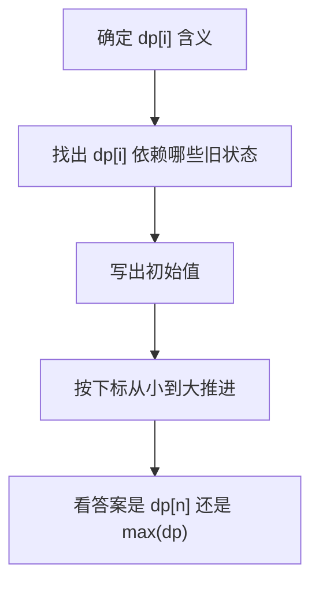
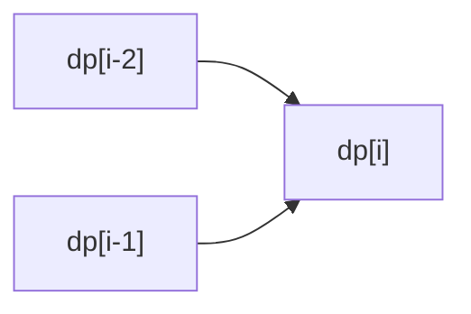
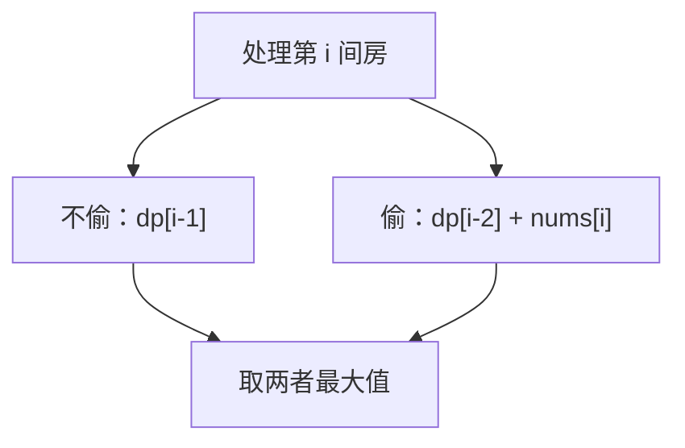

# 一维DP

> [!summary] 一句话
> 一维 DP 适合“答案沿着一个方向推进”的问题，状态通常写成 `dp[i]`，表示前 `i` 个位置或以 `i` 结尾时的答案。

## 🎯 什么时候想到一维 DP

- 数组、字符串、台阶、时间线这类线性结构。
- 当前答案只依赖前面有限个状态。
- 题目问的是：
  - 最大值 / 最小值
  - 方案数
  - 能否做到

典型信号：

- “到第 `i` 个位置”
- “前 `i` 个元素”
- “以第 `i` 个元素结尾”

## 🧠 两种最常见状态定义

### 1. 前缀型

```text
dp[i] = 前 i 个元素的最优答案
```

适合：

- 打家劫舍
- 单词拆分
- 前缀可行性判断

### 2. 结尾型

```text
dp[i] = 以第 i 个元素结尾的答案
```

适合：

- 最大子数组和
- 最长递增子序列

> [!tip] 区分方法
> 如果答案和“最后一个元素是否必须选上”有关，通常更偏向“结尾型”定义。

## 🔁 一维 DP 的通用流程



## Go 模板

```go
func oneDimensionalDP(nums []int) int {
    n := len(nums)
    dp := make([]int, n)

    // 1. 初始化
    dp[0] = initialValue

    // 2. 状态转移
    for i := 1; i < n; i++ {
        dp[i] = transition(dp, nums, i)
    }

    // 3. 返回答案
    return answer(dp)
}
```

## 📦 三种高频转移模式

| 类型 | 形式 | 常见题 |
|------|------|--------|
| 最优值 | `dp[i] = max/min(...)` | 打家劫舍、最大子数组和 |
| 方案数 | `dp[i] = dp[a] + dp[b] + ...` | 爬楼梯、解码方法 |
| 可行性 | `dp[i] = dp[a] or dp[b] or ...` | 单词拆分 |

## ✍️ 手推例子 1：爬楼梯

### 状态定义

```text
dp[i] = 到第 i 阶的方法数
```

### 为什么转移是 `dp[i-1] + dp[i-2]`

到第 `i` 阶的最后一步只有两种可能：

- 从 `i-1` 走 1 步上来
- 从 `i-2` 走 2 步上来



所以：

```text
dp[i] = dp[i-1] + dp[i-2]
```

### 状态表

以 `n = 5` 为例：

| i | 解释 | dp[i] |
|---|------|-------|
| 1 | 只有 `1` | 1 |
| 2 | `1+1`、`2` | 2 |
| 3 | 来自 `dp[2] + dp[1]` | 3 |
| 4 | 来自 `dp[3] + dp[2]` | 5 |
| 5 | 来自 `dp[4] + dp[3]` | 8 |

## Go 代码：爬楼梯

```go
func climbStairs(n int) int {
    if n <= 2 {
        return n
    }

    dp := make([]int, n+1)
    dp[1], dp[2] = 1, 2

    for i := 3; i <= n; i++ {
        dp[i] = dp[i-1] + dp[i-2]
    }

    return dp[n]
}
```

## ✍️ 手推例子 2：打家劫舍

### 状态定义

```text
dp[i] = 偷前 i 间房时的最大金额
```

### 为什么转移是二选一

处理第 `i` 间房时只有两个选择：

- 不偷它：答案就是前一间的最优值
- 偷它：那前一间不能偷，只能接到 `dp[i-2]`



### 状态表

以 `nums = [2,7,9,3,1]` 为例：

| i | 房屋金额 | 不偷 | 偷 | dp[i] |
|---|----------|------|----|-------|
| 0 | 2 | - | - | 2 |
| 1 | 7 | 2 | 7 | 7 |
| 2 | 9 | 7 | 2 + 9 = 11 | 11 |
| 3 | 3 | 11 | 7 + 3 = 10 | 11 |
| 4 | 1 | 11 | 11 + 1 = 12 | 12 |

## Go 代码：打家劫舍

```go
func rob(nums []int) int {
    if len(nums) == 0 {
        return 0
    }
    if len(nums) == 1 {
        return nums[0]
    }

    dp := make([]int, len(nums))
    dp[0] = nums[0]
    if nums[1] > nums[0] {
        dp[1] = nums[1]
    } else {
        dp[1] = nums[0]
    }

    for i := 2; i < len(nums); i++ {
        take := dp[i-2] + nums[i]
        skip := dp[i-1]
        if take > skip {
            dp[i] = take
        } else {
            dp[i] = skip
        }
    }

    return dp[len(dp)-1]
}
```

## ✍️ 手推例子 3：最大子数组和

### 状态定义

```text
dp[i] = 以 nums[i] 结尾的最大子数组和
```

这里一定要注意：不是“前 i 个元素的最大值”，而是“必须以 `i` 结尾”。

### 为什么转移是“接上去 or 重新开始”

到 `nums[i]` 时：

- 如果前面的和是正贡献，就接上
- 如果前面的和是负贡献，不如从当前元素重新开始

```text
dp[i] = max(dp[i-1] + nums[i], nums[i])
```

### 状态表

以 `nums = [-2,1,-3,4,-1,2,1,-5,4]` 为例：

| i | nums[i] | `dp[i-1] + nums[i]` | `nums[i]` | dp[i] |
|---|---------|---------------------|-----------|-------|
| 0 | -2 | - | -2 | -2 |
| 1 | 1 | -1 | 1 | 1 |
| 2 | -3 | -2 | -3 | -2 |
| 3 | 4 | 2 | 4 | 4 |
| 4 | -1 | 3 | -1 | 3 |
| 5 | 2 | 5 | 2 | 5 |
| 6 | 1 | 6 | 1 | 6 |

最终答案不是 `dp[-1]`，而是 `max(dp)`。

## Go 代码：最大子数组和

```go
func maxSubArray(nums []int) int {
    dp := make([]int, len(nums))
    dp[0] = nums[0]
    answer := dp[0]

    for i := 1; i < len(nums); i++ {
        extend := dp[i-1] + nums[i]
        restart := nums[i]
        if extend > restart {
            dp[i] = extend
        } else {
            dp[i] = restart
        }
        if dp[i] > answer {
            answer = dp[i]
        }
    }

    return answer
}
```

## 🎯 空间优化怎么想

如果 `dp[i]` 只依赖前面固定几个状态，就没必要保留整张表。

### 例子：爬楼梯

```go
func climbStairsOptimized(n int) int {
    if n <= 2 {
        return n
    }

    prev2, prev1 := 1, 2
    for i := 3; i <= n; i++ {
        curr := prev1 + prev2
        prev2 = prev1
        prev1 = curr
    }

    return prev1
}
```

## ⚠️ 一维 DP 最常见错误

- `dp[i]` 定义写得模糊，导致转移和返回值都错。
- 该返回 `max(dp)` 的题，误写成 `dp[-1]`。
- 初始值只写了一个，没处理 `n = 0 / 1 / 2`。
- 结尾型状态和前缀型状态混用。

## 🧪 写题时的检查单

> [!check] 提交前过一遍
> - `dp[i]` 是“前 i 个”还是“以 i 结尾”？
> - 转移时当前元素是“必须用”还是“可选”？
> - 答案落在 `dp[n]`、`dp[-1]` 还是 `max(dp)`？
> - 能不能把数组优化成几个变量？

## 📚 推荐练习

### 基础题

- [ ] [爬楼梯](https://leetcode.cn/problems/climbing-stairs/) - LeetCode 70
- [ ] [使用最小花费爬楼梯](https://leetcode.cn/problems/min-cost-climbing-stairs/) - LeetCode 746
- [ ] [打家劫舍](https://leetcode.cn/problems/house-robber/) - LeetCode 198
- [ ] [解码方法](https://leetcode.cn/problems/decode-ways/) - LeetCode 91

### 进阶题

- [ ] [最大子数组和](https://leetcode.cn/problems/maximum-subarray/) - LeetCode 53
- [ ] [单词拆分](https://leetcode.cn/problems/word-break/) - LeetCode 139
- [ ] [乘积最大子数组](https://leetcode.cn/problems/maximum-product-subarray/) - LeetCode 152
- [ ] [分割回文串 II](https://leetcode.cn/problems/palindrome-partitioning-ii/) - LeetCode 132

## 相关主题

- [[二维DP]]
- [[背包问题]]
- [[_index|动态规划]]

---
返回：[[_index|动态规划]] | [[../算法学习导航|算法学习导航]]
