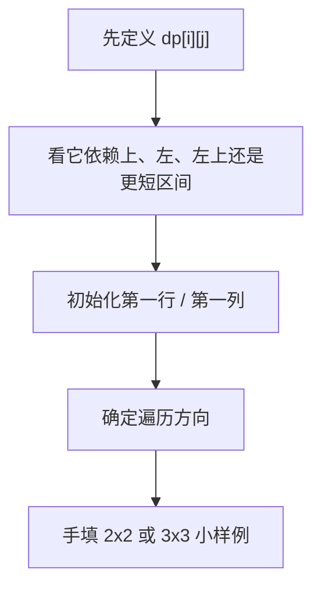
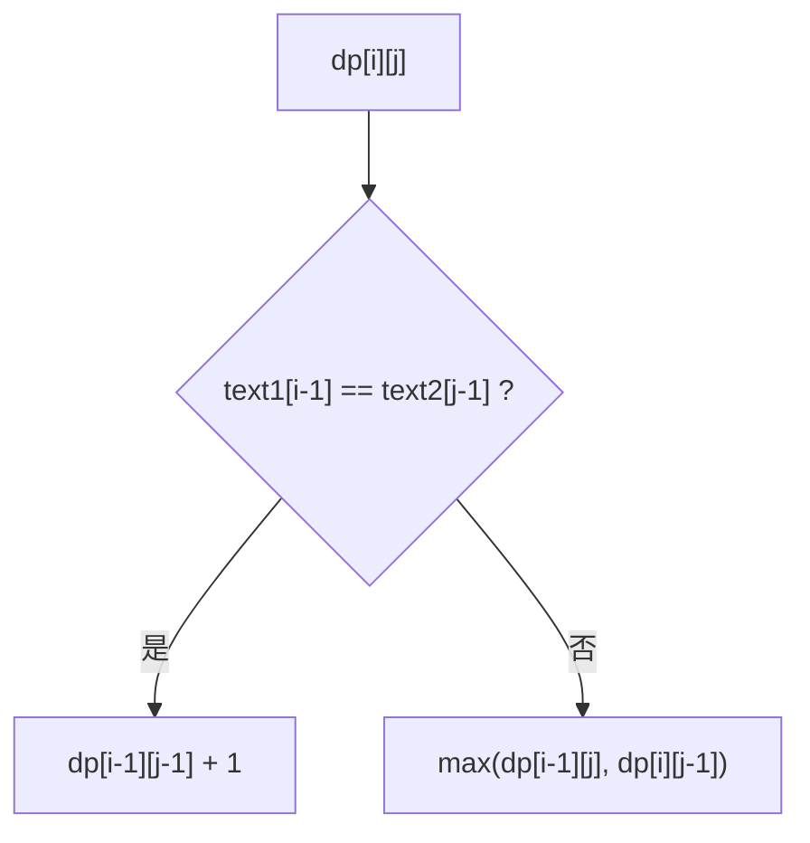
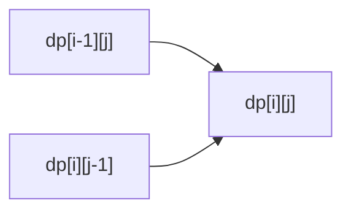
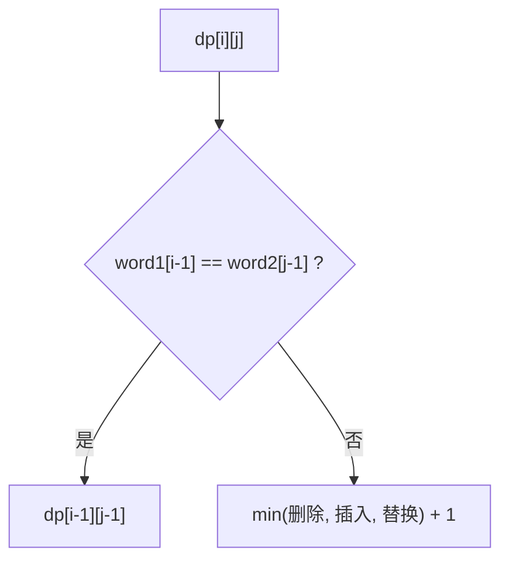

# 二维DP

> [!summary] 一句话
> 二维 DP 适合“答案同时受两个维度影响”的问题，比如两个字符串、网格坐标、两个边界或两个索引。

## 🎯 什么时候想到二维 DP

- 题目里天然有两个坐标或两个序列。
- 当前状态要同时看“左边”和“上边”，或者“前一个字符串”和“后一个字符串”。
- 典型关键词：
  - `前 i 个` 和 `前 j 个`
  - `位置 (i, j)`
  - `区间 [i, j]`

## 🧠 最常见的三类定义

| 类型 | 状态定义 | 典型问题 |
|------|----------|----------|
| 双序列型 | `dp[i][j] = s1 前 i 个与 s2 前 j 个的答案` | LCS、编辑距离 |
| 网格路径型 | `dp[i][j] = 到达 (i,j) 的答案` | 不同路径、最小路径和 |
| 区间型 | `dp[i][j] = 区间 [i,j] 的答案` | 区间DP、回文串 |

## 🔁 二维 DP 工作流



## ✍️ 手推例子 1：最长公共子序列 LCS

### 状态定义

```text
dp[i][j] = text1 前 i 个字符 和 text2 前 j 个字符 的 LCS 长度
```

### 为什么转移分两种情况

如果最后一个字符相同：

```text
text1[i-1] == text2[j-1]
```

那么它一定可以接在更短的 LCS 后面：

```text
dp[i][j] = dp[i-1][j-1] + 1
```

如果不同：

```text
dp[i][j] = max(dp[i-1][j], dp[i][j-1])
```

意思是：

- 要么丢掉 `text1[i-1]`
- 要么丢掉 `text2[j-1]`



### 小样例状态表

以 `text1 = "abcde"`、`text2 = "ace"` 为例：

| `dp[i][j]` | 空 | a | c | e |
|-----------|----|---|---|---|
| 空 | 0 | 0 | 0 | 0 |
| a | 0 | 1 | 1 | 1 |
| b | 0 | 1 | 1 | 1 |
| c | 0 | 1 | 2 | 2 |
| d | 0 | 1 | 2 | 2 |
| e | 0 | 1 | 2 | 3 |

最终答案是 `3`。

## Go 代码：LCS

```go
func longestCommonSubsequence(text1, text2 string) int {
    m, n := len(text1), len(text2)
    dp := make([][]int, m+1)
    for i := range dp {
        dp[i] = make([]int, n+1)
    }

    for i := 1; i <= m; i++ {
        for j := 1; j <= n; j++ {
            if text1[i-1] == text2[j-1] {
                dp[i][j] = dp[i-1][j-1] + 1
            } else if dp[i-1][j] > dp[i][j-1] {
                dp[i][j] = dp[i-1][j]
            } else {
                dp[i][j] = dp[i][j-1]
            }
        }
    }

    return dp[m][n]
}
```

## ✍️ 手推例子 2：不同路径

### 状态定义

```text
dp[i][j] = 从左上角走到 (i, j) 的路径数
```

### 为什么只看上和左

因为机器人只能：

- 从上边走下来
- 从左边走过来

所以：

```text
dp[i][j] = dp[i-1][j] + dp[i][j-1]
```



### 为什么第一行和第一列都初始化成 1

因为：

- 第一行只能一直向右
- 第一列只能一直向下

所以每个位置都只有 1 条路。

### 小样例状态表

以 `3 x 4` 网格为例：

| 位置 | 0 | 1 | 2 | 3 |
|------|---|---|---|---|
| 0 | 1 | 1 | 1 | 1 |
| 1 | 1 | 2 | 3 | 4 |
| 2 | 1 | 3 | 6 | 10 |

## Go 代码：不同路径

```go
func uniquePaths(m, n int) int {
    dp := make([][]int, m)
    for i := range dp {
        dp[i] = make([]int, n)
        dp[i][0] = 1
    }
    for j := 0; j < n; j++ {
        dp[0][j] = 1
    }

    for i := 1; i < m; i++ {
        for j := 1; j < n; j++ {
            dp[i][j] = dp[i-1][j] + dp[i][j-1]
        }
    }

    return dp[m-1][n-1]
}
```

## ✍️ 手推例子 3：编辑距离

### 状态定义

```text
dp[i][j] = word1 前 i 个字符 变成 word2 前 j 个字符 的最少操作数
```

### 三种操作对应什么

如果最后一个字符不同，就只可能做三件事：

- 删除：`dp[i-1][j] + 1`
- 插入：`dp[i][j-1] + 1`
- 替换：`dp[i-1][j-1] + 1`

如果最后一个字符相同：

```text
dp[i][j] = dp[i-1][j-1]
```



### 为什么初始化第一行和第一列

- `dp[i][0] = i`：删掉 `i` 个字符才能变空串
- `dp[0][j] = j`：插入 `j` 个字符才能从空串变成目标串

## Go 代码：编辑距离

```go
func minDistance(word1, word2 string) int {
    m, n := len(word1), len(word2)
    dp := make([][]int, m+1)
    for i := range dp {
        dp[i] = make([]int, n+1)
    }

    for i := 0; i <= m; i++ {
        dp[i][0] = i
    }
    for j := 0; j <= n; j++ {
        dp[0][j] = j
    }

    for i := 1; i <= m; i++ {
        for j := 1; j <= n; j++ {
            if word1[i-1] == word2[j-1] {
                dp[i][j] = dp[i-1][j-1]
                continue
            }

            best := dp[i-1][j]
            if dp[i][j-1] < best {
                best = dp[i][j-1]
            }
            if dp[i-1][j-1] < best {
                best = dp[i-1][j-1]
            }
            dp[i][j] = best + 1
        }
    }

    return dp[m][n]
}
```

## 🎯 空间优化什么时候能做

如果 `dp[i][j]` 只依赖：

- 当前行左边
- 上一行同列
- 上一行左上角

那么二维数组就能压成一维滚动数组。

### 滚动数组示意

```text
上一行: prev[j]
当前行: curr[j]

curr[j] 依赖：
- prev[j]
- curr[j-1]
- prev[j-1]
```

## ⚠️ 二维 DP 最常见错误

- `dp[i][j]` 的 `i`、`j` 到底表示长度还是下标没分清。
- 第一行第一列没有初始化，结果整张表都错。
- 双序列问题里误把字符写成 `s[i]` 而不是 `s[i-1]`。
- 网格问题里遍历顺序和依赖方向不匹配。

## 🧪 自检问题

> [!check] 写完前先问自己
> - `dp[i][j]` 是“前 i 个 / 前 j 个”，还是“坐标 `(i,j)`”？
> - 第一行、第一列分别代表什么？
> - 当前格子来自上、左、左上，还是更短区间？
> - 答案是 `dp[m][n]` 还是整张表中的最大值？

## 📚 推荐练习

### 双序列型

- [ ] [最长公共子序列](https://leetcode.cn/problems/longest-common-subsequence/) - LeetCode 1143
- [ ] [编辑距离](https://leetcode.cn/problems/edit-distance/) - LeetCode 72
- [ ] [交错字符串](https://leetcode.cn/problems/interleaving-string/) - LeetCode 97

### 网格型

- [ ] [不同路径](https://leetcode.cn/problems/unique-paths/) - LeetCode 62
- [ ] [不同路径 II](https://leetcode.cn/problems/unique-paths-ii/) - LeetCode 63
- [ ] [最小路径和](https://leetcode.cn/problems/minimum-path-sum/) - LeetCode 64

### 匹配型

- [ ] [正则表达式匹配](https://leetcode.cn/problems/regular-expression-matching/) - LeetCode 10
- [ ] [通配符匹配](https://leetcode.cn/problems/wildcard-matching/) - LeetCode 44

## 相关主题

- [[一维DP]]
- [[背包问题]]
- [[区间DP]]
- [[_index|动态规划]]

---
返回：[[_index|动态规划]] | [[../算法学习导航|算法学习导航]]
