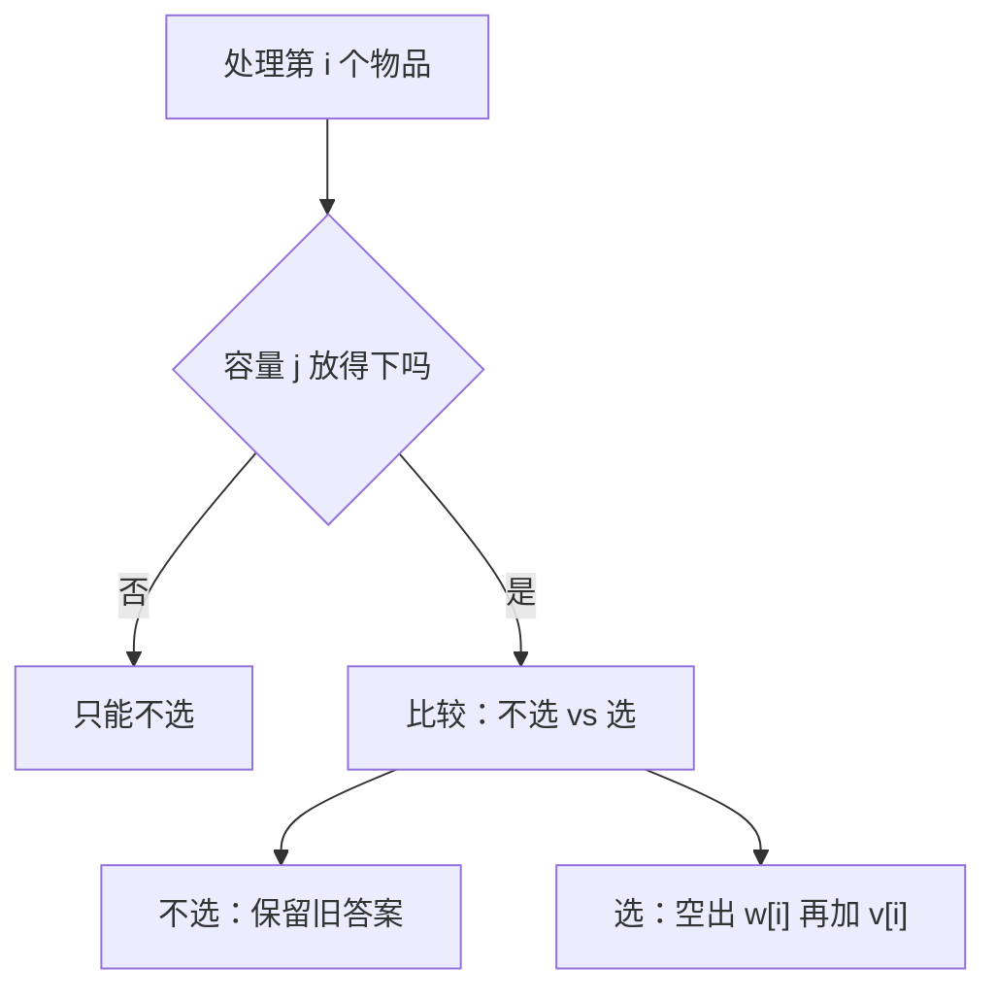
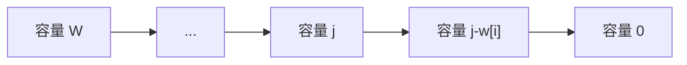
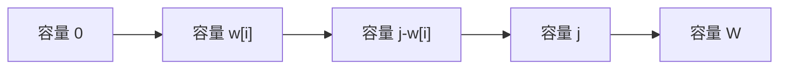

# 背包问题

> [!summary] 一句话
> 背包问题的本质是：每个物品都问一次“选还是不选”，并把容量当成状态维度。

## 🎯 什么时候想到背包

看到这些描述时，优先怀疑是背包：

- 有一堆物品 / 数字 / 硬币。
- 每个物品有“消耗”和“收益”。
- 总容量、总金额、总和有上限。
- 问：
  - 最大价值
  - 最少数量
  - 是否能凑出
  - 有多少种方案

典型题面换皮：

- 容量限制
- 预算限制
- 目标和
- 硬币拼金额
- 选若干元素使和最接近目标

## 🧠 先把背包想成买东西

- 背包容量 `W`：你的预算或空间
- 物品重量 `w[i]`：要花掉多少预算
- 物品价值 `v[i]`：带来多少收益

处理每个物品时，永远在做同一个决策：



## 🧩 背包最核心的状态定义

最经典的写法：

```text
dp[i][j] = 只看前 i 个物品、容量为 j 时的最优答案
```

如果做一维优化，则常写成：

```text
dp[j] = 当前处理到某一轮时，容量 j 的最优答案
```

## 📦 四大背包类型

| 类型 | 每个物品能选几次 | 关键区别 |
|------|------------------|----------|
| 0-1 背包 | 0 次或 1 次 | 不能重复选 |
| 完全背包 | 无限次 | 可以重复选 |
| 多重背包 | 有数量上限 | 可以二进制拆分 |
| 分组背包 | 每组最多选一个 | 组内互斥 |

## ✍️ 0-1 背包为什么要逆序

### 状态转移

```text
dp[i][j] = max(dp[i-1][j], dp[i-1][j-w[i]] + v[i])
```

一维优化后写成：

```text
dp[j] = max(dp[j], dp[j-w[i]] + v[i])
```

这里的 `dp[j-w[i]]` 必须是“上一轮”的值，不能被当前物品污染。

所以容量 `j` 要从大到小遍历。

### 逆序示意图



逆序时，`j-w[i]` 还没被当前物品更新，所以不会一轮内重复选它。

> [!warning] 结论
> `0-1 背包` 一维写法必须逆序，否则同一件物品会被重复使用。

## Go 代码：0-1 背包

```go
func knapsack01(capacity int, weights, values []int) int {
    dp := make([]int, capacity+1)

    for i := 0; i < len(weights); i++ {
        for j := capacity; j >= weights[i]; j-- {
            candidate := dp[j-weights[i]] + values[i]
            if candidate > dp[j] {
                dp[j] = candidate
            }
        }
    }

    return dp[capacity]
}
```

## ✍️ 手推一个 0-1 背包

物品如下：

| 物品 | 重量 | 价值 |
|------|------|------|
| A | 1 | 15 |
| B | 3 | 20 |
| C | 4 | 30 |

容量 `W = 4`。

### 状态表

| 容量 j | 0 | 1 | 2 | 3 | 4 |
|--------|---|---|---|---|---|
| 初始 | 0 | 0 | 0 | 0 | 0 |
| 处理 A 后 | 0 | 15 | 15 | 15 | 15 |
| 处理 B 后 | 0 | 15 | 15 | 20 | 35 |
| 处理 C 后 | 0 | 15 | 15 | 20 | 35 |

最后答案是 `35`，选的是 `A + B`。

## ✍️ 完全背包为什么要正序

完全背包允许同一种物品重复使用。

所以我们反而希望：

```text
dp[j-w[i]]
```

已经吸收过“当前物品”的贡献，这样当前物品才能继续被选。

### 状态转移

```text
dp[i][j] = max(dp[i-1][j], dp[i][j-w[i]] + v[i])
```

注意第二项是 `dp[i]`，不是 `dp[i-1]`。

这说明当前物品还能继续接着用，所以一维优化时要正序遍历。

### 正序示意图



> [!warning] 结论
> `完全背包` 一维写法必须正序，否则就失去了“重复使用当前物品”的能力。

## Go 代码：完全背包

```go
func knapsackComplete(capacity int, weights, values []int) int {
    dp := make([]int, capacity+1)

    for i := 0; i < len(weights); i++ {
        for j := weights[i]; j <= capacity; j++ {
            candidate := dp[j-weights[i]] + values[i]
            if candidate > dp[j] {
                dp[j] = candidate
            }
        }
    }

    return dp[capacity]
}
```

## 🎯 一张表看懂遍历方向

| 类型 | 一维遍历方向 | 原因 |
|------|--------------|------|
| 0-1 背包 | `j` 从大到小 | 防止同一物品在本轮重复使用 |
| 完全背包 | `j` 从小到大 | 允许同一物品在本轮继续使用 |

## 🧪 背包题的四种常见问法

### 1. 求最大值

```go
candidate := dp[j-w] + v
if candidate > dp[j] {
    dp[j] = candidate
}
```

### 2. 求最小值

例如最少硬币数：

```go
candidate := dp[j-coin] + 1
if candidate < dp[j] {
    dp[j] = candidate
}
```

### 3. 求方案数

```go
dp[j] += dp[j-w]
```

### 4. 求可行性

```go
dp[j] = dp[j] || dp[j-w]
```

## 💻 高频变形模板

### 分割等和子集

```go
func canPartition(nums []int) bool {
    total := 0
    for _, num := range nums {
        total += num
    }
    if total%2 != 0 {
        return false
    }

    target := total / 2
    dp := make([]bool, target+1)
    dp[0] = true

    for _, num := range nums {
        for j := target; j >= num; j-- {
            dp[j] = dp[j] || dp[j-num]
        }
    }

    return dp[target]
}
```

### 零钱兑换

```go
func coinChange(coins []int, amount int) int {
    const inf = int(1e9)
    dp := make([]int, amount+1)
    for i := 1; i <= amount; i++ {
        dp[i] = inf
    }

    for _, coin := range coins {
        for j := coin; j <= amount; j++ {
            candidate := dp[j-coin] + 1
            if candidate < dp[j] {
                dp[j] = candidate
            }
        }
    }

    if dp[amount] == inf {
        return -1
    }
    return dp[amount]
}
```

### 零钱兑换 II

```go
func change(amount int, coins []int) int {
    dp := make([]int, amount+1)
    dp[0] = 1

    for _, coin := range coins {
        for j := coin; j <= amount; j++ {
            dp[j] += dp[j-coin]
        }
    }

    return dp[amount]
}
```

## ⚠️ 组合和排列不要混

如果题目问“组合数”，循环顺序通常是：

```go
for _, coin := range coins {
    for j := coin; j <= amount; j++ {
        // ...
    }
}
```

如果题目问“排列数”，循环顺序通常会交换：

```go
for j := 1; j <= amount; j++ {
    for _, coin := range coins {
        // ...
    }
}
```

因为：

- 组合不关心顺序
- 排列关心顺序

## ⚠️ 背包问题最常见错误

- 把 0-1 背包写成正序遍历。
- 把完全背包写成逆序遍历。
- 题目问“方案数”，你却用 `max`。
- 题目问“最少个数”，你却把 `dp` 初始化成 0。
- 没想清楚到底是“组合”还是“排列”。

## 🧪 提交前检查单

> [!check] 做完先检查
> - 每个物品能选几次？
> - `dp[j]` 表示最大值、最小值、方案数还是可行性？
> - 容量循环应该正序还是逆序？
> - `dp[0]` 应该初始化成 0、1、`inf` 还是 `-inf`？

## 📚 推荐练习

### 0-1 背包

- [ ] [分割等和子集](https://leetcode.cn/problems/partition-equal-subset-sum/) - LeetCode 416
- [ ] [目标和](https://leetcode.cn/problems/target-sum/) - LeetCode 494
- [ ] [一和零](https://leetcode.cn/problems/ones-and-zeroes/) - LeetCode 474

### 完全背包

- [ ] [零钱兑换](https://leetcode.cn/problems/coin-change/) - LeetCode 322
- [ ] [零钱兑换 II](https://leetcode.cn/problems/coin-change-2/) - LeetCode 518
- [ ] [完全平方数](https://leetcode.cn/problems/perfect-squares/) - LeetCode 279

### 综合

- [ ] [盈利计划](https://leetcode.cn/problems/profitable-schemes/) - LeetCode 879
- [ ] [掷骰子的N种方法](https://leetcode.cn/problems/number-of-dice-rolls-with-target-sum/) - LeetCode 1155

## 相关主题

- [[一维DP]]
- [[二维DP]]
- [[_index|动态规划]]

---
返回：[[_index|动态规划]] | [[../算法学习导航|算法学习导航]]
