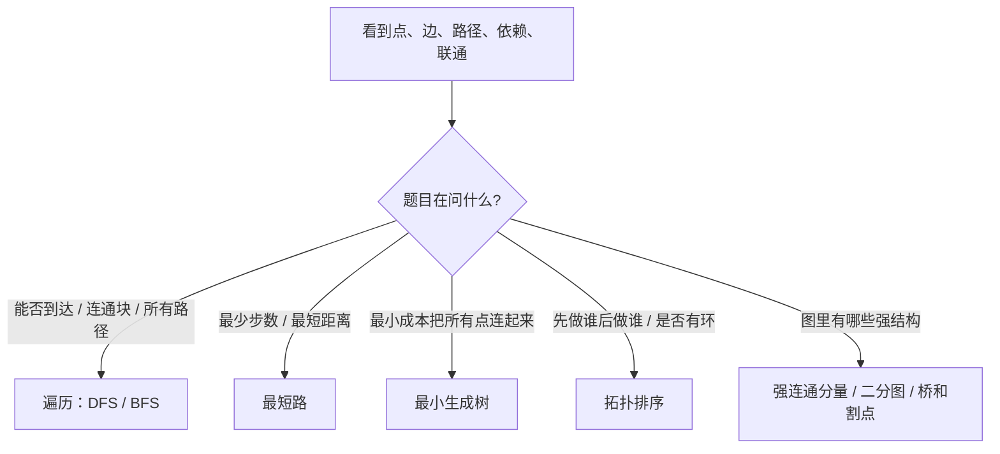
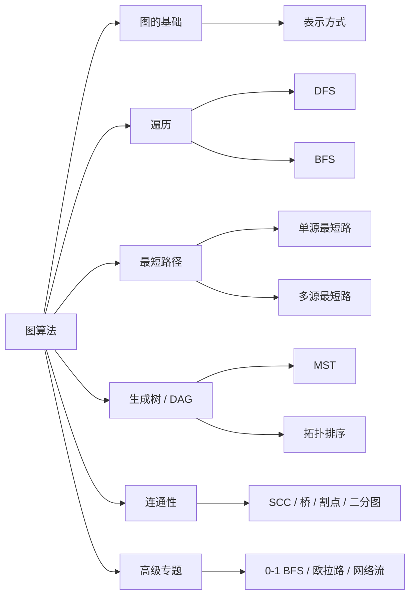

# 图算法

> [!summary] 一句话说明
> 图算法本质上是在一堆“点和关系”里回答四类问题：能不能到、最短多远、怎样最低成本连起来、依赖顺序怎么排。

## 先判断题目属于哪一类

## 最常见选择题

> [!note] 刷题时先看这张分流表

| 题目特征 | 优先算法 | 为什么 |
|---|---|---|
| 无权图、每条边代价一样、问最少步数 | [[图的遍历/DFS与BFS|BFS]] | 按层扩展，第一次到达就是最短路 |
| 边权只有 `0/1` | [[高级专题/0-1 BFS|0-1 BFS]] | 双端队列能维持距离递增 |
| 边权非负 | [[最短路径/单源最短路径|Dijkstra]] | 每次确认当前最近点，不会被未来更短路径推翻 |
| 允许负权边 | [[最短路径/单源最短路径|Bellman-Ford]] | 通过反复松弛逐步传播更优距离 |
| 要求所有点对最短路 | [[最短路径/多源最短路径|Floyd-Warshall]] | 枚举中转点做区间式扩展 |
| 问依赖顺序、课程安排、是否有环 | [[最小生成树与拓扑排序/拓扑排序|拓扑排序]] | DAG 才能排出合法线性顺序 |
| 问“用最小代价连接所有点” | [[最小生成树与拓扑排序/最小生成树|最小生成树]] | 典型是 Kruskal / Prim |
| 问无向图连通块、枚举路径、回溯搜索 | [[图的遍历/DFS与BFS|DFS]] | 递归树天然适合“走到底再回头” |

## 图算法知识地图

## 📚 目录结构

### 1. 图的基础
- [[图的基础/图的表示|图的表示]]：邻接矩阵、邻接表、边集数组怎么选

### 2. 图的遍历
- [[图的遍历/DFS与BFS|DFS与BFS]]：什么时候该“走到底”，什么时候该“按层推”

### 3. 最短路径
- [[最短路径/单源最短路径|单源最短路径]]：BFS、0-1 BFS、Dijkstra、Bellman-Ford 的选择逻辑
- [[最短路径/多源最短路径|多源最短路径]]：Floyd-Warshall 与全源最短路

### 4. 最小生成树与拓扑排序
- [[最小生成树与拓扑排序/最小生成树|最小生成树]]：Kruskal、Prim
- [[最小生成树与拓扑排序/拓扑排序|拓扑排序]]：Kahn、DFS 实现

### 5. 连通性问题
- [[连通性问题/强连通分量|强连通分量]]：Tarjan 求 SCC
- [[连通性问题/割点与桥|割点与桥]]：删除关键点边后的结构变化
- [[二分图/二分图判定与匹配|二分图判定与匹配]]：染色判定与匹配入门

### 6. 高级专题
- [[高级专题/0-1 BFS|0-1 BFS]]：权值只有 `0/1` 时的最短路
- [[高级专题/欧拉路径与回路|欧拉路径与回路]]：每条边恰好走一次
- [[高级专题/网络流与最大流|网络流与最大流]]：最大流、最小割、匹配

## 🧠 看到题目时怎么快速识别

| 题面信号词 | 大概率方向 |
|---|---|
| 最少步数、最少操作次数、最短跳跃次数 | BFS |
| 最小距离、最小花费、最早到达、网络延迟 | 最短路 |
| 课程安排、依赖、先修关系、任务调度 | 拓扑排序 |
| 最低成本连接所有城市 / 所有点 | 最小生成树 |
| 联通块数量、省份数量、岛屿数量 | DFS / BFS / 并查集 |
| 每条边都要走一次 | 欧拉路径 |
| 两种颜色分组、冲突关系 | 二分图 |

## 📊 常用算法复杂度

| 类别 | 算法 | 时间复杂度 | 空间复杂度 | 备注 |
|---|---|---|---|---|
| 遍历 | DFS / BFS | `O(V + E)` | `O(V)` | 每个点边最多进处理流程一次 |
| 单源最短路 | Dijkstra | `O((V + E)\log V)` | `O(V)` | 适合非负权图 |
| 单源最短路 | Bellman-Ford | `O(VE)` | `O(V)` | 能处理负权边 |
| 全源最短路 | Floyd-Warshall | `O(V^3)` | `O(V^2)` | 点不大时可用 |
| 生成树 | Kruskal | `O(E\log E)` | `O(V)` | 常配合并查集 |
| 生成树 | Prim | `O((V + E)\log V)` | `O(V + E)` | 稠密图也常见 |
| DAG | Kahn / DFS 拓扑 | `O(V + E)` | `O(V)` | DAG 线性排序 |
| 连通性 | Tarjan | `O(V + E)` | `O(V)` | SCC / 桥 / 割点 |

## 🎯 建议学习顺序

1. 先学 [[图的基础/图的表示|图的表示]]，理解邻接表和边集数组。
2. 再学 [[图的遍历/DFS与BFS|DFS 与 BFS]]，这是所有图题的底盘。
3. 接着学 [[最短路径/单源最短路径|单源最短路径]]，把 BFS、Dijkstra、Bellman-Ford 的边界分清。
4. 然后学 [[最小生成树与拓扑排序/最小生成树|最小生成树]] 和 [[最小生成树与拓扑排序/拓扑排序|拓扑排序]]。
5. 最后补 [[连通性问题/强连通分量|强连通分量]]、[[二分图/二分图判定与匹配|二分图]]、[[高级专题/网络流与最大流|网络流]] 等专题。

## 🎯 LeetCode 起步清单

| 类型 | 题目 | 核心算法 |
|---|---|---|
| 图遍历 | 200. 岛屿数量 | DFS / BFS |
| 图遍历 | 797. 所有可能的路径 | DFS 回溯 |
| 无权最短路 | 1091. 二进制矩阵中的最短路径 | BFS |
| 非负权最短路 | 743. 网络延迟时间 | Dijkstra |
| 负权 / 有限制松弛 | 787. K 站中转内最便宜的航班 | Bellman-Ford 变形 |
| 最小生成树 | 1584. 连接所有点的最小费用 | Kruskal / Prim |
| 拓扑排序 | 207. 课程表 | Kahn |
| 二分图 | 785. 判断二分图 | BFS / DFS 染色 |

## 相关主题

- [[../搜索算法/_index|搜索算法]]：更通用的搜索框架
- [[../动态规划/_index|动态规划]]：图上 DP、状态压缩
- [[../贪心算法/_index|贪心算法]]：Dijkstra、MST 背后都有贪心思想
- [[../数据结构/并查集|并查集]]：Kruskal、联通性判断常用

---
返回：[[../算法学习导航|算法学习导航]]
