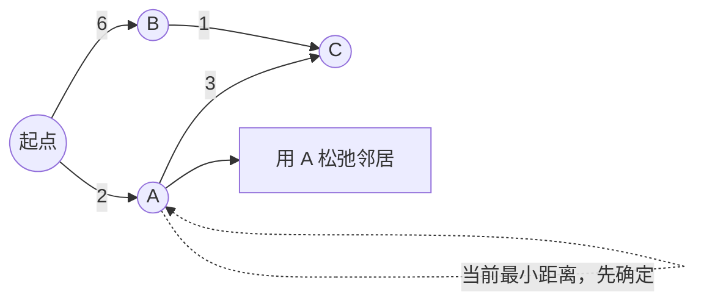

# Dijkstra算法

> [!summary] Dijkstra 的核心不在堆，而在一个贪心不变量：当前未确定节点里距离最小的那个点，一旦被取出，它的最短路就已经最终确定。

## 定义

**Dijkstra算法**是一种用于计算单源最短路径的贪心算法，适用于**非负权重**的图。

```
图示例:
    0 --2-- 1
    |     / |
    6   8   5
    | /     |
    2 --1-- 3

从节点0到其他节点的最短距离:
0→1: 2
0→2: 6
0→3: 7
```

## 🎞️ 松弛过程动画

![[附件/算法可视化/dijkstra-relax.svg]]

> [!note] 观察重点
> 被“确认”的节点一定是当前全局最近节点；接下来只需要用它去尝试更新邻居距离。

## 核心思路

- **贪心策略**：每次选择距离起点最近的未访问节点
- **松弛操作**：更新邻接节点的最短距离
- **优先队列**：使用最小堆优化节点选择
- **非负权重**：算法要求所有边权重≥0

## 为什么这样设计

Dijkstra 的关键判断是：当一个节点已经是“所有未访问节点里离起点最近的”时，它的最短距离就可以确定了。因为所有边权都是非负数，从其他更远节点绕一圈再回来，只会更远，不可能变短。



如果存在负权边，这个判断会失效：一个看起来更远的节点，可能通过负权边把距离拉低，所以 Dijkstra 不适合负权图，应该考虑 [[Bellman-Ford算法]] 或 [[SPFA算法]]。

## 实现方式

| 变量 | 含义 |
|------|------|
| `distance[node]` | 起点到 `node` 的当前最短距离 |
| `pq` | 按距离排序的最小堆，用来快速取出当前最近节点 |
| `visited` | 已经确认最短距离的节点 |
| `parent` | 用于回溯最短路径 |

使用优先队列的原因是：朴素写法每轮都要线性扫描所有未访问节点，找最近节点要 `O(V)`；最小堆可以把这一步降到 `O(log V)`，稀疏图里通常更快。

## 复杂度分析

| 实现方式 | 时间复杂度 | 空间复杂度 | 说明 |
|---------|-----------|-----------|------|
| 朴素实现 | O(V²) | O(V) | 适合稠密图 |
| 优先队列 | O((V+E)log V) | O(V) | 适合稀疏图 |
| 斐波那契堆 | O(E + V log V) | O(V) | 理论最优 |

## Go 代码

### Go 实现

```go
package main

import (
    "container/heap"
)

type Edge struct {
    To     int
    Weight int
}

type Item struct {
    Node     int
    Distance int
    Index    int
}

type PriorityQueue []*Item

func (pq PriorityQueue) Len() int { return len(pq) }
func (pq PriorityQueue) Less(i, j int) bool {
    return pq[i].Distance < pq[j].Distance
}
func (pq PriorityQueue) Swap(i, j int) {
    pq[i], pq[j] = pq[j], pq[i]
    pq[i].Index = i
    pq[j].Index = j
}
func (pq *PriorityQueue) Push(x interface{}) {
    n := len(*pq)
    item := x.(*Item)
    item.Index = n
    *pq = append(*pq, item)
}
func (pq *PriorityQueue) Pop() interface{} {
    old := *pq
    n := len(old)
    item := old[n-1]
    old[n-1] = nil
    item.Index = -1
    *pq = old[0 : n-1]
    return item
}

func Dijkstra(graph map[int][]Edge, start int) map[int]int {
    distance := make(map[int]int)
    distance[start] = 0

    pq := make(PriorityQueue, 0)
    heap.Init(&pq)
    heap.Push(&pq, &Item{Node: start, Distance: 0})

    visited := make(map[int]bool)

    for pq.Len() > 0 {
        item := heap.Pop(&pq).(*Item)
        node := item.Node
        dist := item.Distance

        if visited[node] {
            continue
        }
        visited[node] = true

        for _, edge := range graph[node] {
            newDist := dist + edge.Weight

            if _, exists := distance[edge.To]; !exists ||
               newDist < distance[edge.To] {
                distance[edge.To] = newDist
                heap.Push(&pq, &Item{
                    Node:     edge.To,
                    Distance: newDist,
                })
            }
        }
    }

    return distance
}
```

## 思路展开

### 算法步骤

1. **初始化**：
   - 起点距离设为0，其他节点距离设为∞
   - 将起点加入优先队列

2. **循环处理**：
   - 从优先队列取出距离最小的节点
   - 标记该节点为已访问
   - 对所有邻接节点进行松弛操作

3. **松弛操作**：
   - 如果通过当前节点到达邻接节点的距离更短
   - 更新邻接节点的距离
   - 将邻接节点加入优先队列

4. **终止条件**：
   - 所有节点都被访问
   - 或优先队列为空

### 执行示例

```
图:
    0 --2-- 1
    |     / |
    6   8   5
    | /     |
    2 --1-- 3

执行过程:
初始: dist={0:0}, pq=[(0,0)]

步骤1: 访问节点0
  - 松弛: 0→1 (距离2), 0→2 (距离6)
  - dist={0:0, 1:2, 2:6}
  - pq=[(2,1), (6,2)]

步骤2: 访问节点1
  - 松弛: 1→2 (距离2+8=10>6), 1→3 (距离2+5=7)
  - dist={0:0, 1:2, 2:6, 3:7}
  - pq=[(6,2), (7,3)]

步骤3: 访问节点2
  - 松弛: 2→3 (距离6+1=7=7)
  - dist={0:0, 1:2, 2:6, 3:7}
  - pq=[(7,3)]

步骤4: 访问节点3
  - 无邻接节点
  - 完成

最终结果: {0:0, 1:2, 2:6, 3:7}
```

## 易错点

> [!warning] Dijkstra 最常见的 bug，不在堆实现，而在适用条件和过期状态处理。

- 有负权边时不能用 Dijkstra。
- 优先队列里同一个点可能多次入堆，必须跳过过期状态。
- 如果图节点编号不连续，建图方式不要偷懒写死。
- 想输出路径时，除了 `dist` 还要维护 `parent`。

## 优缺点

### 优点
- ✅ 保证找到最短路径
- ✅ 优先队列实现效率高
- ✅ 适合稀疏图
- ✅ 可以提前终止（找到目标节点）

### 缺点
- ❌ 不能处理负权边
- ❌ 只能求单源最短路径
- ❌ 稠密图性能不如Floyd

## 相关主题

- [[Bellman-Ford算法|Bellman-Ford算法]] - 可处理负权边
- [[Floyd-Warshall算法|Floyd-Warshall算法]] - 多源最短路径
- [[SPFA算法|SPFA算法]] - Bellman-Ford优化版
- [[../图的遍历/广度优先搜索|BFS]] - 无权图最短路径
- [[../_index|图算法]] - 返回图算法总览

---
返回：[[../_index|图算法]] | [[../../算法学习导航|算法学习导航]]
