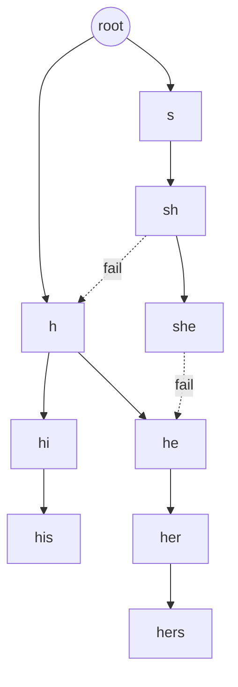

# AC 自动机（Aho-Corasick）

> [!summary] 一句话说明
> AC 自动机把多个模式串放进 Trie，并为每个节点增加失配指针，使文本只扫描一遍就能找到全部模式串。

## 三个组成部分

1. **Trie 边**：当前字符匹配时向下走。
2. **fail 指针**：失配时跳到“当前后缀中最长、同时也是某个模式前缀”的状态。
3. **输出集合**：到达当前状态时匹配到了哪些模式串。

以模式串 `he`、`she`、`his`、`hers` 为例：



虚线表示关键 fail 跳转。`she` 的后缀 `he` 也是模式串，因此到达 `she` 时要同时报告 `she` 和 `he`。

## 构建流程


```go
type ACNode struct {
    Children map[rune]int
    Fail     int
    Outputs  []string
}

type Match struct {
    Index   int
    Pattern string
}

type AhoCorasick struct {
    Nodes []ACNode
}

func NewAhoCorasick(patterns []string) *AhoCorasick {
    ac := &AhoCorasick{
        Nodes: []ACNode{{Children: make(map[rune]int)}},
    }
    for _, pattern := range patterns {
        ac.insert(pattern)
    }
    ac.buildFailLinks()
    return ac
}

func (ac *AhoCorasick) insert(pattern string) {
    state := 0
    for _, ch := range pattern {
        next, ok := ac.Nodes[state].Children[ch]
        if !ok {
            next = len(ac.Nodes)
            ac.Nodes[state].Children[ch] = next
            ac.Nodes = append(ac.Nodes, ACNode{Children: make(map[rune]int)})
        }
        state = next
    }
    ac.Nodes[state].Outputs = append(ac.Nodes[state].Outputs, pattern)
}

func (ac *AhoCorasick) buildFailLinks() {
    queue := make([]int, 0)
    for _, child := range ac.Nodes[0].Children {
        queue = append(queue, child)
    }

    for head := 0; head < len(queue); head++ {
        state := queue[head]
        for ch, child := range ac.Nodes[state].Children {
            fallback := ac.Nodes[state].Fail
            for fallback != 0 {
                if _, ok := ac.Nodes[fallback].Children[ch]; ok {
                    break
                }
                fallback = ac.Nodes[fallback].Fail
            }

            if next, ok := ac.Nodes[fallback].Children[ch]; ok {
                ac.Nodes[child].Fail = next
            }
            failState := ac.Nodes[child].Fail
            ac.Nodes[child].Outputs = append(ac.Nodes[child].Outputs, ac.Nodes[failState].Outputs...)
            queue = append(queue, child)
        }
    }
}

func (ac *AhoCorasick) Search(text string) []Match {
    matches := make([]Match, 0)
    state := 0

    for index, ch := range []rune(text) {
        for state != 0 {
            if _, ok := ac.Nodes[state].Children[ch]; ok {
                break
            }
            state = ac.Nodes[state].Fail
        }
        if next, ok := ac.Nodes[state].Children[ch]; ok {
            state = next
        }

        for _, pattern := range ac.Nodes[state].Outputs {
            matches = append(matches, Match{
                Index:   index - len([]rune(pattern)) + 1,
                Pattern: pattern,
            })
        }
    }

    return matches
}
```

## 复杂度

设所有模式串总长度为 `P`，文本长度为 `T`，匹配结果数为 `Z`：

- 建 Trie 和 fail 指针：`O(P * 字符转移代价)`，固定字符集实现通常视为 `O(P)`。
- 扫描文本：`O(T + Z)`。
- 空间：`O(P)`。

## 什么时候使用

- 敏感词、多关键词扫描。
- 日志规则批量匹配。
- DNA 序列中同时查找多个片段。
- 入侵检测中的特征模式匹配。

> [!warning] 易错点
> - fail 指针必须按 BFS 顺序构建，父节点先于子节点完成。
> - 当前节点要继承 fail 节点的输出，否则会漏掉后缀模式。
> - 动态增加模式串后，原 fail 关系通常需要重建。
> - 字符集很大时用字典省空间；字符集固定且较小时可用数组提速。

## 相关主题

- [[../数据结构/Trie树|Trie 树]]
- [[KMP算法]]
- [[Z算法]]

---
返回：[[_index|字符串算法]] | [[../算法学习导航|算法学习导航]]
