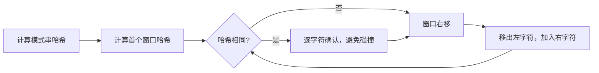

# Rabin-Karp 算法

> [!summary] 一句话说明
> Rabin-Karp 把固定长度字符串映射为哈希值，并用滚动哈希在 `O(1)` 时间更新下一个窗口的哈希。

## 从逐字符比较到比较哈希

文本 `text` 中查找长度为 `m` 的模式串 `pattern`：

```text
text:    a b r a c a d a b r a
window: [a b r a]
          [b r a c]
            [r a c a] ...
```



## 多项式滚动哈希

设基数为 `base`，模数为 `mod`。窗口右移时：

1. 减去离开窗口的字符贡献。
2. 整体乘以 `base`。
3. 加入新字符。

```go
func rabinKarp(text, pattern string) int {
    if len(pattern) == 0 {
        return 0
    }
    if len(pattern) > len(text) {
        return -1
    }

    const base int64 = 256
    const mod int64 = 1_000_000_007
    width := len(pattern)
    highest := int64(1)
    for i := 1; i < width; i++ {
        highest = (highest * base) % mod
    }

    var patternHash, windowHash int64
    for i := 0; i < width; i++ {
        patternHash = (patternHash*base + int64(pattern[i])) % mod
        windowHash = (windowHash*base + int64(text[i])) % mod
    }

    for left := 0; left+width <= len(text); left++ {
        if windowHash == patternHash && text[left:left+width] == pattern {
            return left
        }

        if left+width < len(text) {
            windowHash = (windowHash - int64(text[left])*highest) % mod
            if windowHash < 0 {
                windowHash += mod
            }
            windowHash = (windowHash*base + int64(text[left+width])) % mod
        }
    }

    return -1
}
```

## 哈希碰撞

不同字符串可能得到相同哈希值，所以：

- 单次精确匹配时，哈希相同后再逐字符确认。
- 大量子串比较时，可以使用双哈希降低碰撞概率。
- 不要把概率意义上的相等误写成绝对相等。

## 复杂度

- 平均时间：`O(n + m)`。
- 极端碰撞并反复确认时：最坏 `O(nm)`。
- 额外空间：`O(1)`，不计结果。

## 适用场景

- 多模式串具有相同长度。
- 查找重复子串。
- 大量子串相等性比较。
- 文档指纹与相似片段检测。

> [!warning] 易错点
> - 减法后要再次取模，避免负数影响后续计算。
> - `highest` 是窗口最左字符对应的最高次幂。
> - 哈希相同不等于字符串一定相同。

## 相关主题

- [[KMP算法]]
- [[Z算法]]
- [[../算法基础/双指针|双指针]]

---
返回：[[_index|字符串算法]] | [[../算法学习导航|算法学习导航]]
