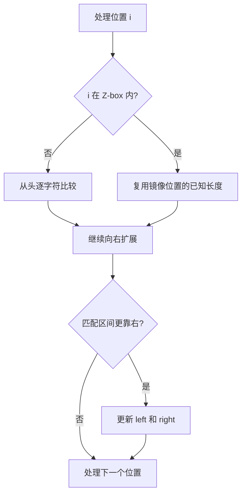

# Z 算法

> [!summary] 一句话说明
> `z[i]` 表示字符串从 `i` 开始的后缀与整个字符串前缀最长能匹配多少个字符。

## Z 数组含义

对字符串 `aabcaabxaaaz`：

```text
位置 i:  0 1 2 3 4 5 6 7 ...
字符:    a a b c a a b x ...
z[i]:    0 1 0 0 3 1 0 0 ...
```

`z[4] = 3`，因为从位置 4 开始的 `aab...` 与字符串前缀 `aab...` 匹配 3 个字符。

## Z-box

算法维护当前最靠右的匹配区间 `[left, right]`：

```text
前缀:     [0 ............ right-left]
当前位置:          [left ............ right]
```

如果 `i <= right`，可以先复用镜像位置 `i-left` 的结果，再从已知边界外继续比较。



```go
func zFunction(text string) []int {
    z := make([]int, len(text))
    left, right := 0, 0

    for i := 1; i < len(text); i++ {
        if i <= right {
            mirror := z[i-left]
            bound := right - i + 1
            if mirror < bound {
                z[i] = mirror
            } else {
                z[i] = bound
            }
        }

        for i+z[i] < len(text) && text[z[i]] == text[i+z[i]] {
            z[i]++
        }

        if i+z[i]-1 > right {
            left = i
            right = i + z[i] - 1
        }
    }

    return z
}
```

## 用于模式匹配

拼接：

```text
pattern + 分隔符 + text
```

若某个位置的 `z[i] == len(pattern)`，说明该位置匹配完整模式串。分隔符必须是不出现在两个字符串中的字符。

## 为什么是 O(n)

`right` 只会向右移动，不会回退。真正的逐字符扩展总次数受 `right` 的移动次数限制，因此总时间为 `O(n)`。

## 适用场景

- 单模式串匹配。
- 判断字符串周期。
- 统计每个后缀与前缀的最长公共前缀。
- 需要大量“前缀对后缀”比较的问题。

> [!warning] 易错点
> - 区间是闭区间 `[left, right]`，长度为 `right - i + 1`。
> - 常见定义令 `z[0] = 0`；有些资料令其为字符串长度，使用前先确认约定。
> - 更新右边界时使用 `i + z[i] - 1`。

## 相关主题

- [[KMP算法]]
- [[Rabin-Karp算法]]
- [[Manacher算法]]

---
返回：[[_index|字符串算法]] | [[../算法学习导航|算法学习导航]]
