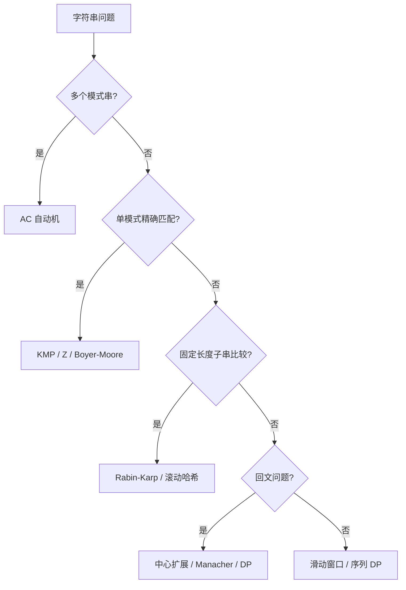

# 字符串算法

## 📌 基础操作

### 字符串基本技巧

#### [[../算法基础/双指针|双指针技巧]]
- 快慢指针、对撞指针
- 应用：回文判断、去重、分割

#### [[滑动窗口|滑动窗口]]
- 可变窗口、固定窗口
- 应用：子串问题、最小覆盖子串

#### [[../数据结构/哈希表|字符统计（哈希表）]]
- 字符频率统计
- 应用：字母异位词、有效字符串

## 📚 字符串匹配

### 暴力匹配

#### [[字符串匹配算法对比#朴素匹配|朴素算法（Brute Force）]]
- 时间复杂度：O(mn)
- 简单直接但效率低
- 适用于短文本匹配

### 高效匹配算法

#### [[KMP算法|KMP算法（Knuth-Morris-Pratt）]]
- **核心思想**：利用已匹配的信息，避免重复匹配
- **时间复杂度**：O(m+n)
- **next数组**：最长公共前后缀
- **应用**：字符串匹配、循环字符串

#### [[字符串匹配算法对比#Boyer-Moore|Boyer-Moore算法]]
- **坏字符规则**：跳过不匹配的字符
- **好后缀规则**：利用已匹配的后缀
- **时间复杂度**：最好O(n/m)，最坏O(mn)
- **应用**：文本编辑器查找

#### [[Rabin-Karp算法|Rabin-Karp算法]]
- **字符串哈希**：将字符串转为数值
- **滚动哈希**：O(1)计算下一个子串哈希
- **时间复杂度**：平均O(m+n)
- **应用**：多模式匹配、抄袭检测

#### [[字符串匹配算法对比#Sunday|Sunday算法]]
- BM算法的简化版
- 只使用坏字符规则的改进
- 实现简单，性能优秀

#### [[Z算法|Z算法]]
- 线性计算每个后缀与前缀的最长匹配
- 应用：模式匹配、周期与前缀问题

#### [[AC自动机|AC自动机]]
- Trie + 失配指针
- 应用：多模式串、敏感词和规则批量匹配

## 🔍 回文问题

### 回文判断与查找

#### [[中心扩展法|中心扩展法]]
- 时间复杂度：O(n²)
- 从每个中心向两边扩展
- 需要考虑奇数和偶数长度

#### [[../动态规划/区间DP#1. 最长回文子串（LeetCode 5）|动态规划]]
- 最长回文子串
- 回文子串计数
- dp[i][j] 表示 s[i:j] 是否为回文

#### [[Manacher算法|Manacher算法]]
- 时间复杂度：O(n)
- 最长回文子串的最优解法
- 利用回文的对称性

### 回文构造
- 最少插入次数构造回文
- 分割回文串
- 验证回文串

## 📖 字符串处理

### 字符串变换

#### [[编辑距离|编辑距离（Edit Distance）]]
- 插入、删除、替换操作
- 动态规划求解
- 应用：拼写纠错、DNA序列比对

#### 字符串压缩
- 游程编码（Run-Length Encoding）
- 应用：数据压缩

#### 字符串旋转
- 判断旋转字符串
- 翻转字符串

### 子序列问题

#### [[最长公共子序列|最长公共子序列（LCS）]]
- 动态规划经典问题
- dp[i][j] = LCS(s1[0:i], s2[0:j])
- 应用：diff工具、版本控制

#### [[最长公共子序列#LCS vs LCS（最长公共子串）|最长公共子串]]
- 与LCS的区别：必须连续
- 动态规划或后缀数组

#### [[../动态规划/二维DP#2. 最长递增子序列（LIS）- LeetCode 300|最长递增子序列（LIS）]]
- O(n²) DP 或 O(n log n) 二分
- 应用：股票问题、俄罗斯套娃

### 字符串分割
- 单词拆分（DP/回溯）
- 正则表达式匹配
- 通配符匹配

## 🌲 Trie树（前缀树）

详见 [[../数据结构/Trie树|Trie树数据结构]]

### 基本操作
- 插入单词：O(m)
- 搜索单词：O(m)
- 前缀查询：O(m)

### 应用场景
- 自动补全
- 拼写检查
- IP路由查找
- 单词搜索II

## 🔢 字符串哈希

### 哈希技巧

#### [[Rabin-Karp算法#多项式滚动哈希|滚动哈希（Rolling Hash）]]
- 快速计算子串哈希值
- O(1)时间更新哈希值
- 应用：Rabin-Karp算法

#### [[Rabin-Karp算法#多项式滚动哈希|多项式哈希（Polynomial Hash）]]
- hash = s[0] * p^0 + s[1] * p^1 + ... + s[n-1] * p^(n-1)
- 选择合适的基数p（通常31或131）
- 模运算防止溢出

### 应用
- 重复子串查找
- 字符串去重
- 最长重复子串
- 判断两个字符串是否相等（O(1)）

## 💡 常见题型

### 子串问题
- [ ] 无重复字符的最长子串
- [ ] 最小覆盖子串
- [ ] 字符串的排列

### 回文问题
- [ ] 最长回文子串
- [ ] 回文子串个数
- [ ] 验证回文串

### 匹配问题
- [ ] 实现strStr()
- [ ] 重复的子字符串
- [ ] 字符串匹配

### 变换问题
- [ ] 同构字符串
- [ ] 字母异位词
- [ ] 有效的字母异位词

## 🎯 优化技巧

1. **空间换时间**：使用哈希表存储中间结果
2. **双指针**：降低时间复杂度
3. **滚动哈希**：快速比较子串
4. **位运算**：优化字符集较小的情况

---
返回：[[../算法学习导航|算法学习导航]]
