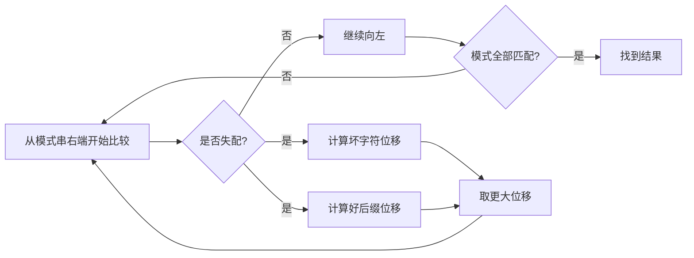

# 字符串匹配算法对比

> [!summary] 先按需求选算法
> 单模式串需要严格线性上界时用 [[KMP算法|KMP]] 或 [[Z算法|Z 算法]]；同长度窗口或子串哈希用 [[Rabin-Karp算法|Rabin-Karp]]；模式串很多时用 [[AC自动机|AC 自动机]]。

## 朴素匹配

朴素算法在文本的每个可能起点逐字符比较：

```text
text:     A B A B A C
pattern:  A B A C
          A B A C       第一次在第 4 个字符失配
            A B A C     起点右移后重新比较
```

```go
func bruteForce(text, pattern string) int {
    for start := 0; start+len(pattern) <= len(text); start++ {
        if text[start:start+len(pattern)] == pattern {
            return start
        }
    }
    return -1
}
```

最坏时间 `O(nm)`，但模式很短或数据规模很小时，它往往是最清晰的选择。

## Boyer-Moore

Boyer-Moore 从模式串右端向左比较，失配时使用两条规则跨过不可能的起点：

1. **坏字符规则**：让模式串中最靠右的同字符与失配字符对齐；模式串中不存在该字符时可整体越过。
2. **好后缀规则**：把已匹配后缀的另一次出现对齐；找不到时对齐其最长可匹配前缀。



完整实现细节较多，工程中通常直接使用语言标准库。学习重点是理解“利用失配信息一次跳过多个起点”。

## Sunday

Sunday 观察的是**当前窗口后一位字符**。如果该字符不在模式串中，整个窗口可以越过它；如果存在，就把模式串中最右侧的同字符与它对齐。

```go
func sunday(text, pattern string) int {
    if len(pattern) == 0 {
        return 0
    }

    last := make(map[byte]int)
    for i := 0; i < len(pattern); i++ {
        last[pattern[i]] = i
    }

    start, width := 0, len(pattern)
    for start+width <= len(text) {
        if text[start:start+width] == pattern {
            return start
        }
        if start+width == len(text) {
            break
        }

        nextChar := text[start+width]
        shift, ok := last[nextChar]
        if !ok {
            start += width + 1
        } else {
            start += width - shift
        }
    }

    return -1
}
```

平均表现通常不错，实现也比完整 Boyer-Moore 简单；最坏时间仍可能是 `O(nm)`。

## 算法对比

| 算法 | 预处理 | 匹配时间 | 最适合 |
|---|---:|---:|---|
| 朴素匹配 | `O(1)` | 最坏 `O(nm)` | 小规模、一次性查询 |
| KMP | `O(m)` | `O(n+m)` | 单模式串、严格线性上界 |
| Z 算法 | `O(n+m)` | `O(n+m)` | 前缀匹配、周期问题 |
| Rabin-Karp | `O(m)` | 平均 `O(n+m)` | 滚动哈希、多个同长度模式 |
| Boyer-Moore | `O(m+字符集)` | 实际跳跃大 | 长模式、自然语言文本 |
| Sunday | `O(m)` | 平均较快 | 简洁的跳跃匹配 |
| AC 自动机 | `O(模式总长)` | `O(n+结果数)` | 多模式串同时匹配 |

> [!warning] 选型误区
> 更复杂的算法不一定更快。短字符串、小输入或只查一次时，朴素算法的常数更小、代码也更可靠。

---
返回：[[_index|字符串算法]] | [[../算法学习导航|算法学习导航]]
