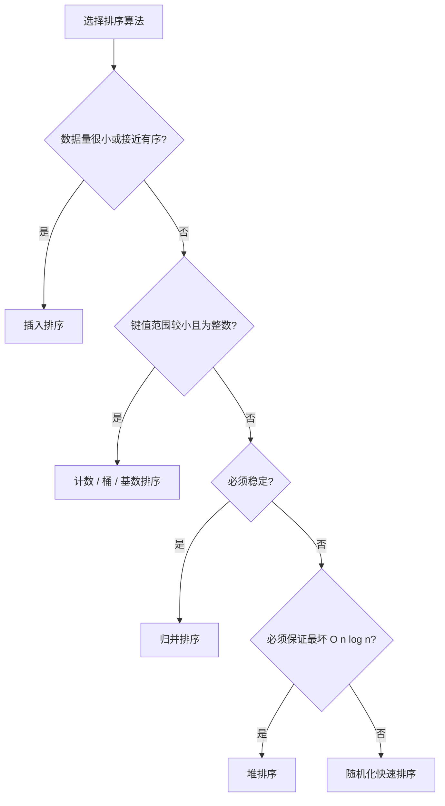

# 排序算法

> [!summary] 排序题不要背一堆名字，先判断你到底在乎什么：数据规模、稳定性、额外空间、最坏复杂度，还是数据本身接近有序。

## 怎么选排序算法

| 场景 | 优先考虑 |
|------|----------|
| 数据量很小或几乎有序 | [[插入排序]] |
| 一般数组排序，想要平均性能最好 | [[快速排序]] |
| 要稳定排序 | [[归并排序]] |
| 要最坏情况也稳在 `O(n log n)` 且额外空间小 | [[堆排序]] |
| 键值范围小、非比较排序可用 | [[计数排序]] / [[桶排序]] / [[基数排序]] |

## 核心分类

### 简单排序（O(n²)）

#### [[冒泡排序|冒泡排序（Bubble Sort）]]
- 时间复杂度：O(n²)
- 空间复杂度：O(1)
- 稳定性：稳定

#### [[选择排序|选择排序（Selection Sort）]]
- 时间复杂度：O(n²)
- 空间复杂度：O(1)
- 稳定性：不稳定

#### [[插入排序|插入排序（Insertion Sort）]]
- 时间复杂度：O(n²)
- 空间复杂度：O(1)
- 稳定性：稳定
- 特点：对“几乎有序”的数据非常友好

### 高效排序（O(nlogn)）

#### [[快速排序|快速排序（Quick Sort）]]
- 时间复杂度：O(nlogn) 平均，O(n²) 最坏
- 空间复杂度：O(logn)
- 稳定性：不稳定
- 特点：原地排序，分治思想

#### [[归并排序|归并排序（Merge Sort）]]
- 时间复杂度：O(nlogn)
- 空间复杂度：O(n)
- 稳定性：稳定
- 特点：分治思想，稳定排序

#### [[堆排序|堆排序（Heap Sort）]]
- 时间复杂度：O(nlogn)
- 空间复杂度：O(1)
- 稳定性：不稳定
- 特点：原地排序，使用堆结构

### 特殊排序

#### [[计数排序|计数排序（Counting Sort）]]
- 时间复杂度：O(n+k)
- 适用场景：整数排序，范围较小

#### [[桶排序|桶排序（Bucket Sort）]]
- 时间复杂度：O(n+k)
- 适用场景：数据分布均匀

#### [[基数排序|基数排序（Radix Sort）]]
- 时间复杂度：O(d×(n+k))
- 适用场景：整数或字符串

#### [[希尔排序|希尔排序（Shell Sort）]]
- 时间复杂度：取决于增量序列
- 插入排序的改进版

## 一张表看核心差异

| 算法 | 平均时间 | 最坏时间 | 空间 | 稳定性 |
|------|----------|----------|------|--------|
| 冒泡 | O(n²) | O(n²) | O(1) | 稳定 |
| 选择 | O(n²) | O(n²) | O(1) | 不稳定 |
| 插入 | O(n²) | O(n²) | O(1) | 稳定 |
| 快排 | O(nlogn) | O(n²) | O(logn) | 不稳定 |
| 归并 | O(nlogn) | O(nlogn) | O(n) | 稳定 |
| 堆排 | O(nlogn) | O(nlogn) | O(1) | 不稳定 |

## 学习顺序

1. 先理解 [[冒泡排序]]、[[选择排序]]、[[插入排序]] 三种 `O(n^2)` 排序的差异。
2. 再吃透 [[快速排序]] 和 [[归并排序]] 这两个面试高频。
3. 然后补 [[堆排序]] 和几种非比较排序。

## 真正要掌握的点

1. 排序过程中维护了什么不变量。
2. 为什么它稳定或不稳定。
3. 为什么最好、最坏、平均复杂度会不同。
4. 什么时候它比别的排序更值得用。

## 相关主题

- [[../分治算法/_index|分治算法]]
- [[../数据结构/堆|堆]]

---
返回：[[算法学习导航]]
