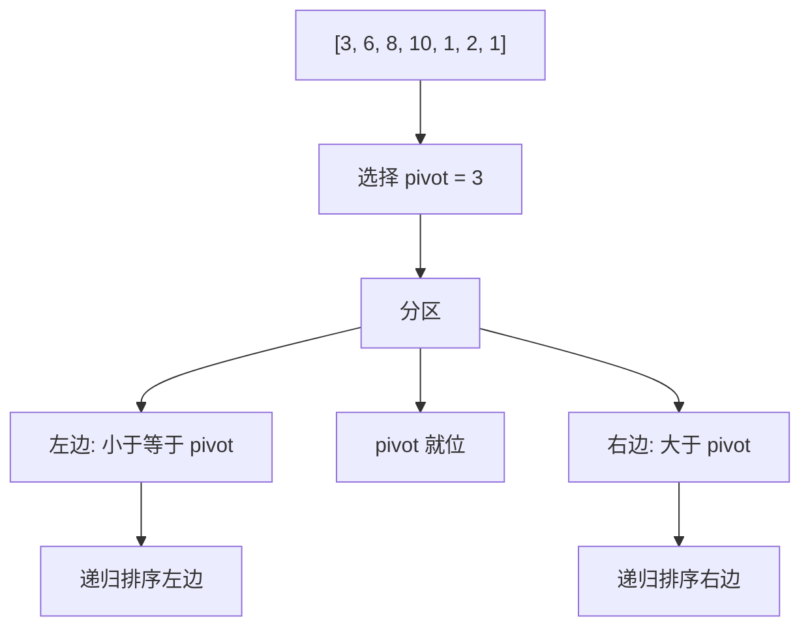

# 快速排序（Quick Sort）

> [!summary] 快速排序真正厉害的地方不在递归，而在分区：每做完一次 partition，就有一个元素被永久放到了最终位置。

## 定义

快速排序是一种高效的**分治排序算法**，通过选择一个基准元素（pivot），将数组分为两部分：小于基准的和大于基准的，然后递归地对这两部分进行排序。

## 核心思路

1. **选择基准**：从数组中选择一个元素作为pivot
2. **分区操作**：重新排列数组，使所有比pivot小的元素在其左边，大的在右边
3. **递归排序**：递归地对pivot左右两侧子数组进行快速排序

```
原数组: [3, 6, 8, 10, 1, 2, 1]
选择pivot=3

分区后: [2, 1, 1] + [3] + [6, 8, 10]
         左子数组      右子数组

递归排序左右子数组...

最终: [1, 1, 2, 3, 6, 8, 10]
```



## 🎞️ 分区动画

![[附件/算法可视化/quick-sort-partition.gif]]

> [!note] 观察重点
> 绿色区域由 `i` 维护，表示已经确认不大于 `pivot` 的元素；`j` 扫描未知区域。扫描结束后，`pivot` 与 `i + 1` 交换并到达最终位置。

## 🧠 为什么这样实现

快速排序的核心不是“交换”，而是让 `pivot` 一次性站到最终位置。分区完成后，`pivot` 左边都不大于它，右边都不小于它，所以后续排序左右两边时再也不用移动 `pivot`。

Lomuto 分区里的 `i` 表示“小于等于 pivot 区域的最后一个位置”，`j` 负责从左到右扫描未知区域：

| 区域 | 含义 |
|------|------|
| `left..i` | 已确认小于等于 `pivot` |
| `i+1..j-1` | 已确认大于 `pivot` |
| `j..right-1` | 还没扫描 |
| `right` | `pivot` |

每当 `arr[j] <= pivot`，就把它交换到 `i+1`，小元素区域扩大一格。扫描结束后，再把 `pivot` 放到 `i+1`，它的位置就确定了。

## 复杂度分析

| 指标 | 复杂度 | 说明 |
|------|--------|------|
| 最好时间 | O(n log n) | 每次平分数组 |
| 平均时间 | O(n log n) | 随机分区情况 |
| 最坏时间 | O(n²) | 已排序或逆序（每次只减少一个元素） |
| 空间复杂度 | O(log n) | 递归栈空间（平均） |
| 最坏空间 | O(n) | 递归栈（退化为链式） |
| 稳定性 | ❌ 不稳定 | 交换操作可能改变相等元素顺序 |

## Go 代码

### Go 实现

```go
package main

import "fmt"

func partition(arr []int, left, right int) int {
    pivot := arr[right]
    i := left - 1

    for j := left; j < right; j++ {
        if arr[j] <= pivot {
            i++
            arr[i], arr[j] = arr[j], arr[i]
        }
    }

    arr[i+1], arr[right] = arr[right], arr[i+1]
    return i + 1
}

func quickSort(arr []int, left, right int) {
    if left < right {
        pivotIndex := partition(arr, left, right)

        quickSort(arr, left, pivotIndex-1)
        quickSort(arr, pivotIndex+1, right)
    }
}

func main() {
    arr := []int{10, 7, 8, 9, 1, 5}

    fmt.Println("原始数组:", arr)
    quickSort(arr, 0, len(arr)-1)
    fmt.Println("排序后:", arr)
}
```

## 算法优化

### 随机化 pivot

如果每次都取固定位置做 `pivot`，在近乎有序数组上可能退化到 `O(n^2)`。更稳的工程写法通常会先随机挑一个位置，再做分区。

### 小区间切换插入排序

当区间非常小时，继续递归的收益并不高，这时切换到 [[插入排序]] 往往更快。

## 经典题目

### 基础应用
- [ ] [排序数组](https://leetcode.cn/problems/sort-an-array/) - LeetCode 912
- [ ] [数组中的第K个最大元素](https://leetcode.cn/problems/kth-largest-element-in-an-array/) - LeetCode 215（快速选择）
- [ ] [颜色分类](https://leetcode.cn/problems/sort-colors/) - LeetCode 75（三路快排）

### 快速选择算法
- [ ] [数组中的第K个最大元素](https://leetcode.cn/problems/kth-largest-element-in-an-array/) - LeetCode 215
- [ ] [最接近原点的 K 个点](https://leetcode.cn/problems/k-closest-points-to-origin/) - LeetCode 973

### 分区思想应用
- [ ] [合并区间](https://leetcode.cn/problems/merge-intervals/) - LeetCode 56
- [ ] [移动零](https://leetcode.cn/problems/move-zeroes/) - LeetCode 283

## 易错点

> [!warning] 快排最容易错的是分区不变量没守住，尤其是 `i / j` 各自代表什么。

- 先明确自己写的是 Lomuto 还是 Hoare 分区。
- 分区循环里不要同时模糊维护多个区间。
- 递归边界一定是“小区间不再排序”。
- 如果题目要求稳定排序，快排通常就不是首选。

## 优缺点

### 优点
- ✅ 平均时间复杂度 O(n log n)
- ✅ **原地排序**（只需O(log n)栈空间）
- ✅ 缓存友好（局部性好）
- ✅ 实际性能优秀
- ✅ 分治思想，易于并行化

### 缺点
- ❌ 最坏情况 O(n²)
- ❌ 不稳定
- ❌ 递归实现可能栈溢出
- ❌ 对小数组不如插入排序

## 应用场景

1. **一般排序**：大多数情况下的首选排序算法
2. **Top K问题**：使用快速选择算法
3. **分区操作**：需要按条件分组
4. **实时系统**：不能接受最坏情况可用随机化版本

## 为什么快速排序这么快？

1. **缓存友好**：连续访问内存
2. **原地操作**：减少内存分配
3. **分支预测**：现代CPU优化
4. **常数因子小**：比归并排序的常数因子小

## 快速排序 vs 归并排序

| 特性 | 快速排序 | 归并排序 |
|------|---------|---------|
| 平均时间 | O(n log n) | O(n log n) |
| 最坏时间 | O(n²) | O(n log n) |
| 空间 | O(log n) | O(n) |
| 稳定性 | 不稳定 | 稳定 |
| 实际性能 | 通常更快 | 稳定但慢 |
| 最坏保证 | 无 | 有 |

## 相关主题

- [[归并排序]] - 另一种分治排序
- [[堆排序]] - O(n log n)保证
- [[插入排序]] - 小数组优化
- [[_index|排序算法]] - 返回排序算法总览

---
返回：[[_index|排序算法]] | [[../算法学习导航|算法学习导航]]
